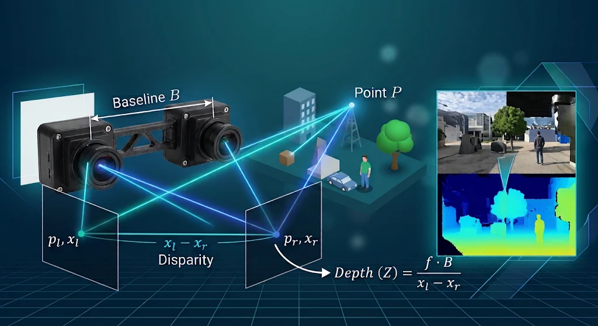
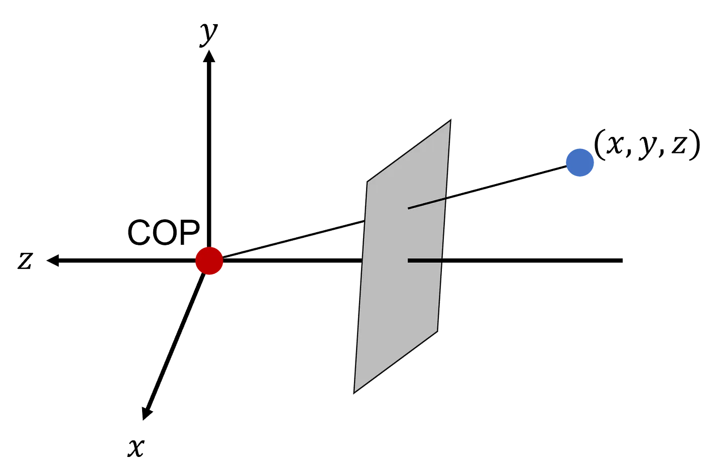
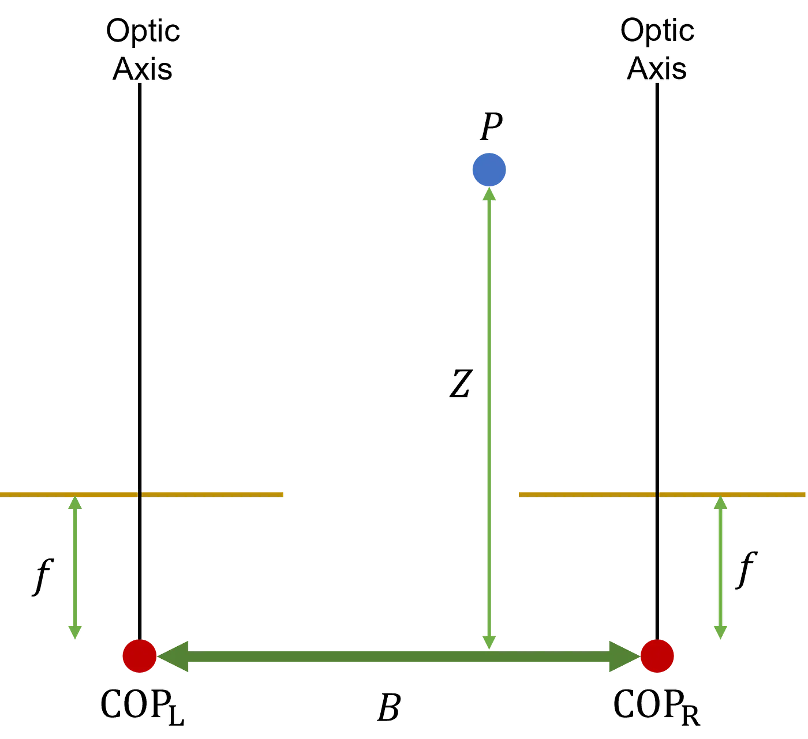
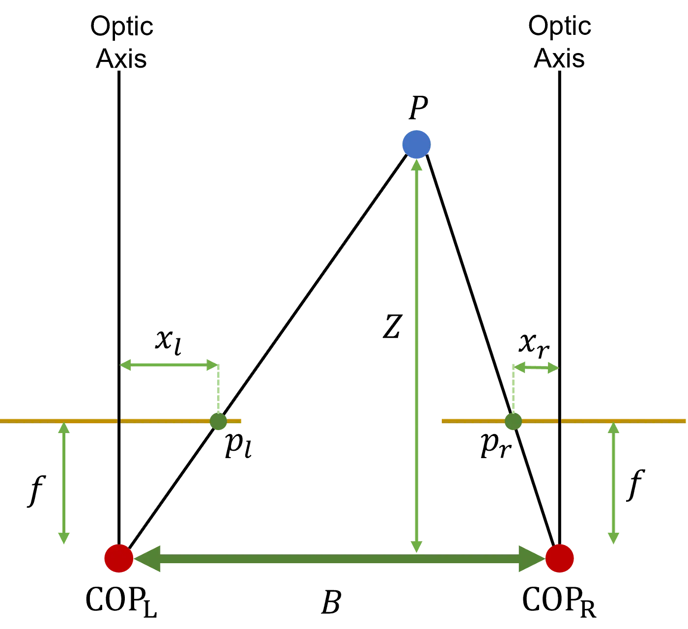
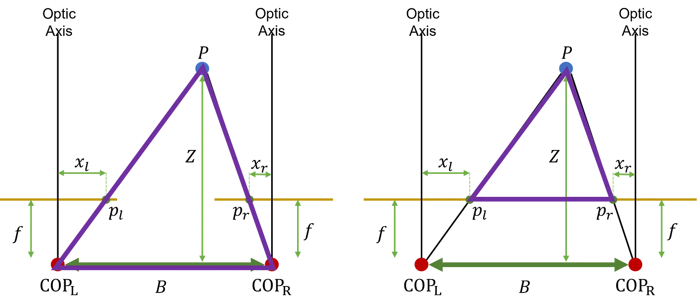

<figure>
  
</figure>

As anyone knows, an image is a 2D projection of a 3D scene. That means an image has no depth information. Sure, our brain can understand the depth in the image by the shape and size of the elements in it, but we can’t say exactly what is the distance between the camera and an object.

We can describe a camera system as a projection model using three main concepts:

1. A point in the world: that is the 3D coordinate of a point we want to capture in our image.
2. The image plane: the plane the world point is projected on. That’s the 2D plane where we get the image on.
3. The center of projection (COP): the point where each ray from a world point must go through when capturing an image.

Those concepts are described in the following image:

<figure>
  
  <figcaption>
    Modeling of projection: a ray from a point in the world (blue) goes through the image plane (gray) and ends in the center of projection (red)
  </figcaption>
</figure>

You can see that every point on the line that goes through the COP and the world point will project to the same point on the image plane, so we have no way to distinguish between far points and close points.

If we can’t get depth using one camera, let’s try two! We now consider a system of 2 cameras with parallel optical axes (that’s the z direction in the figure above) and the same focal length $f$ (that’s the distance between the COP and the image plane) with a distance $B$ (called the baseline).

<figure>
  
  <figcaption>
    Modeling of projection for a system of 2 cameras with parallel optical axes, the same focal length $f$, and a baseline of $B$, looking on a point $P$ in distance $Z$ from the COPs, as if we look down on the system
  </figcaption>
</figure>

Now we connect the point $P$ with the centers of projection of the two cameras through the image planes and mark the distances on the image planes between the optical axis and the points in the image $p_l$ and $p_r$ as $x_l$ and $x_r$.

<figure>
  
  <figcaption>
    Rays go from the point $P$ to the COPs of the two cameras
  </figcaption>
</figure>

We need to pay attention that $x_l$ is positive (it is to the right of the optical axis) while $x_r$ is negative. From the figure above, we can find two similar triangles—$(p_l, P, p_r)$ and $(\mathrm{COP}_l, P, \mathrm{COP}_r)$.

<figure>
  
  <figcaption>
    Similar triangles in purple
  </figcaption>
</figure>

Using those similar triangles, we can get the relation:

$$
\begin{align*}
&\frac{B - x_l + x_r}{Z - f} = \frac{B}{Z} \\
&\implies Z = \frac{f B}{x_l - x_r}
\end{align*}
$$

The expression $x_l - x_r$ is called disparity. The last result shows that if we know the system parameters $B$ (the baseline) and $f$ (the focal length), and we can find the corresponding points $x_l$ and $x_r$ in the two images, we can calculate the distance $Z$ of the point $P$.