Attention mechanisms are a breakthrough in the deep learning field. They help models concentrate on important parts of data, and boost understanding and performance in tasks like language processing and computer vision. This post will dive into the basics of attention in deep learning and show the main ideas behind it.

Before we talk about attention, let’s start by going over the basic ideas behind sequence models (also known as recurrent neural networks, or RNNs) in deep learning. We are not going to deep dive into this field, but understanding the concepts behind sequence models will help us to understand both the attention mechanism and the problem it solves.

The example we will use is a network for translating sentences from English to Italian. The network is composed of two parts: the encoder, which encodes the meaning of the English sentence, and the decoder which decodes the encoded information into the translation of the sentence to Italian.

We can think of the encoder in the following way:

<figure>
  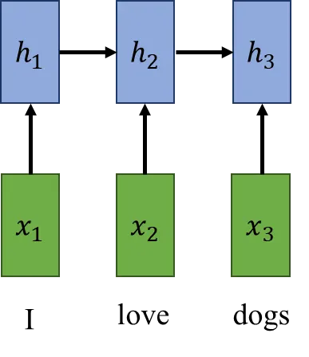
</figure>

The green rectangles are the inputs. In the case presented in the figure, the input is a sequence of English words that compose the sentence “I love dogs”. The blue rectangles are called the hidden state. The hidden state should contain some knowledge about the current input and the previous hidden state, which itself contains knowledge of its input and the previous hidden state. Formally we can write:

$$
h_t = f_w(x_t, h_{t-1})
$$

In that way, we encode the information of the sentence in the hidden states, until the end of the sentence. After going over all the inputs, the encoder summarizes (from the last hidden state) all the content of the sentence in two vectors. The first one should be the initial hidden state, $s_0$, for the decoder (the part of the network that should make the actual translation), and the second one is a context vector (usually the final hidden state of the encoder), $c$, which will be used by any step of the decoder to help it understand the sentence it works on.

<figure>
  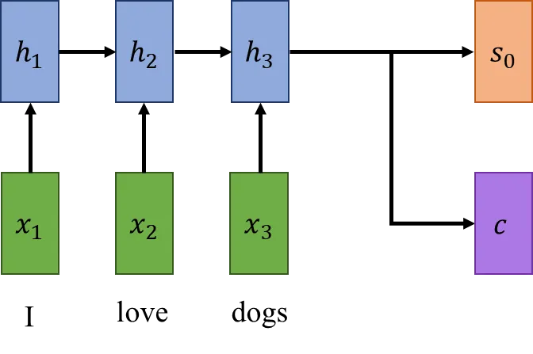
</figure>

Now that we have finished distilling the information of the sentence in the encoder part, we are ready to start decoding the information and translating the sentence to Italian using the decoder. The first input of the decoder is a start token together with the initial hidden state and the context vector, which form the first hidden state. For that hidden state, we can get the first output of the new sentence. We use that output as the input of the next step together with the previous hidden state and the context vector, to build a new hidden state and output. Formally we can write:

$$
s_t = g_w(y_{t-1}, s_{t-1}, c)
$$

This process continues until we get a stop token as an output.

<figure>
  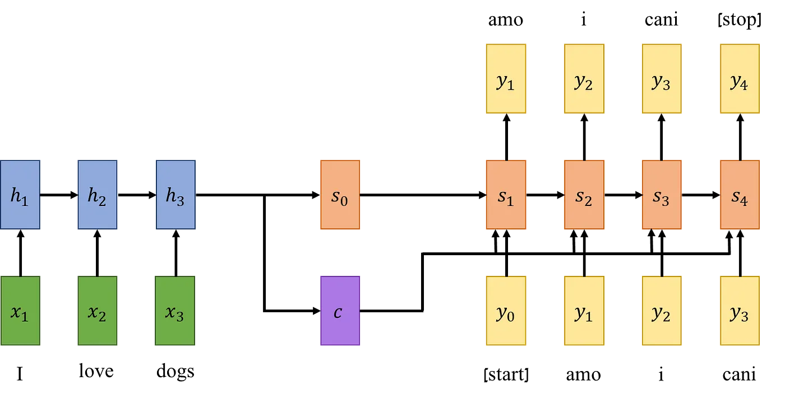
</figure>

This procedure can work well for short sentences, but when the sentences become long it may fail. The reason is that the decoder uses the context vector for all the steps, and it needs it to contain all the information about the original sentence. For a long sentence, it could be very hard to hold the whole information in a single fixed-size vector. A solution to that problem may be to construct a new context vector for each step of the decoder.

## Attention

We are going to keep the architecture of the encoder-decoder as before, but this time we add another mechanism to our network to construct a new context vector for each step of the decoder.

Our encoder still goes over the sequence of inputs and creates hidden states as before, and at the end creates the initial hidden state for the decoder. Now, instead of using the final hidden state of the encoder to make the context vector, we use the decoder's initial hidden state and all the other hidden states to construct it. For that, we will implement an alignment function which is an MLP operating on the encoder's hidden states and the decoder's hidden state. This function computes alignment scores (which are scalars) for each of the encoder's hidden states. Formally, the alignment score of step $t$, for the $i$-th hidden state is:

$$
e_{t,i} = f_{att}(s_{t-1}, h_i)
$$

These scores say how much we should attend to each hidden state of the encoder given the current hidden state of the decoder.

<figure>
  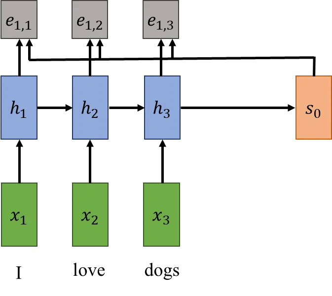
</figure>

The alignment score $e_{1,1}$, for example, says how important the first hidden state is for the prediction of the first word in the decoder. Since the alignment scores are arbitrary real numbers, we want to apply a softmax operation on them to get a probability distribution.

<figure>
  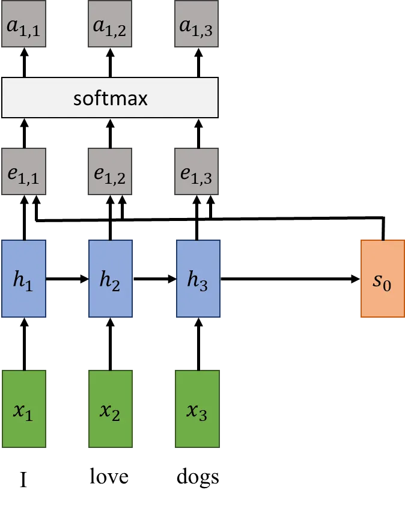
</figure>

These probabilities are the normalized alignment scores, and they will be used as the attention weights for the encoder’s hidden states. The new context vector will be the weighted sum of the encoder’s hidden states weighted by the attention weights.

<figure>
  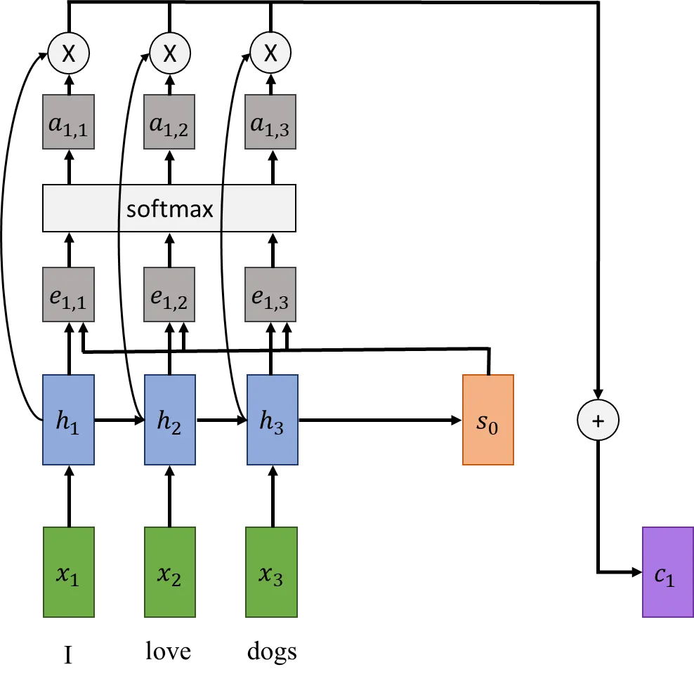
</figure>

Formally, the context vector at step $t$ is:

$$
c_t = \sum_{i} a_{t,i} h_i
$$

Now we can use the new context vector to predict the first word in the decoder.

<figure>
  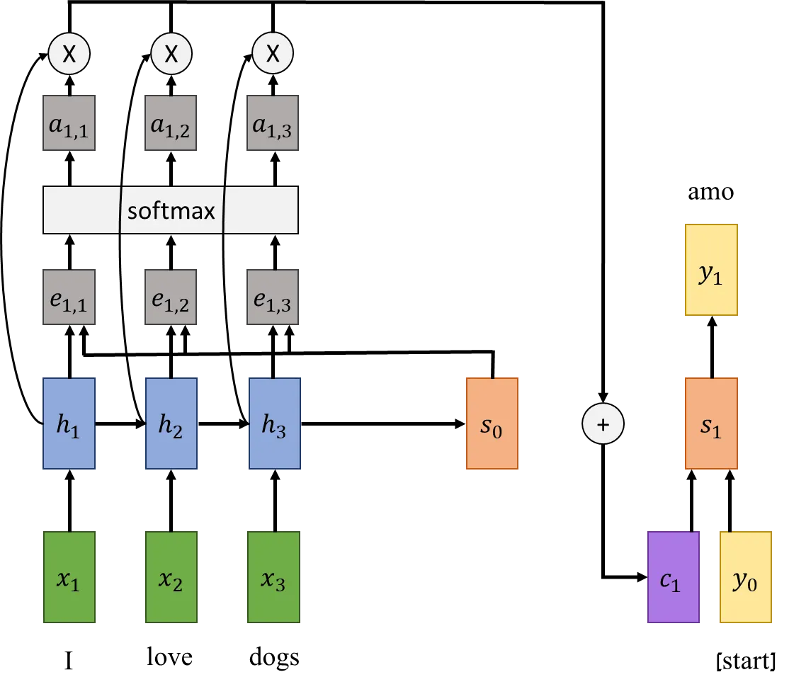
</figure>

For intuition, in our example “amo” means “I love”, so we can expect a high score for $a_{1,1}$ and $a_{1,2}$ and a low score for $a_{1,3}$.

The good part is that all the operations are differentiable, so we don’t need any supervision on the attention weights, we can learn to compute them during the regular training of the network, so the network learns by itself what parts are important for each step.

The prediction of the decoder continues in the same way for the other parts of the sentence. For the next word, we construct the $c_2$ context vector by using $s_1$ to compute the attention weights.

<figure>
  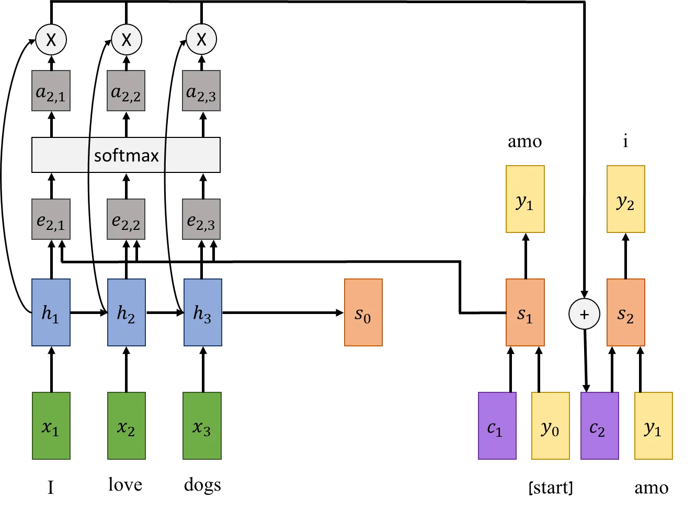
</figure>

We can see a visualization of the attention weights between words in translation between English and French in the following figure taken from [Bahdanau et al](https://arxiv.org/pdf/1409.0473.pdf).

<figure>
  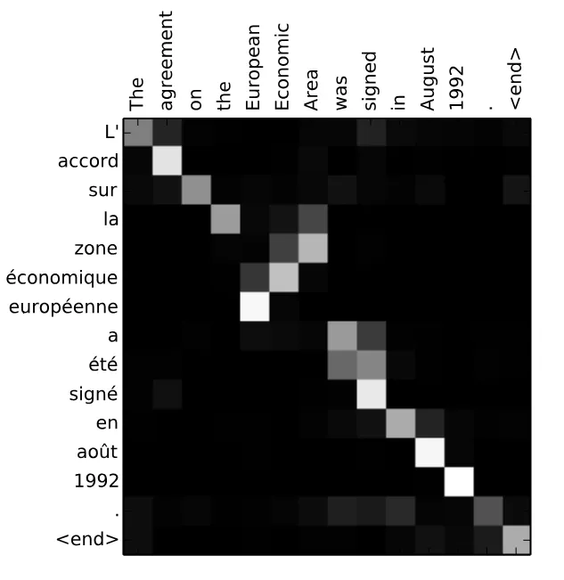
  <figcaption>
    Alignments found by RNNsearch-50. The x-axis and y-axis of each plot correspond to the words in the source sentence (English) and the generated translation (French), respectively. Each pixel shows the weight $\alpha_{ij}$ of the annotation of the $j$-th source word for the $i$-th target word, in grayscale (0: black, 1: white). Source: Figure 3 from
    <a href="https://arxiv.org/pdf/1409.0473.pdf">
      Bahdanau et al
    </a>
  </figcaption>
</figure>

You can see how related words have high weights, while words with weak relations have small weights. See for example the weight for the word “Area” and “zone”. These words are in different locations in the sentence, but the network succeeds in relating them.

## Attention for image captioning

If you look carefully at the previous example, you will see we don’t use the sequence nature of the input for the attention parts. That implies we can use attention for other tasks which are not a sequence. An example of another task using the attention mechanism is image captioning. In image captioning, we have an image, and we want our network to output a sentence that describes what we see in the image.

<figure>
  
  <figcaption>
    An image with a caption. Source:
    <a href="https://arxiv.org/pdf/1502.03044">
      Xu et al
    </a>
  </figcaption>
</figure>

In a similar way to the translation task, we can run an image through a CNN network and take the final output as a grid of feature vectors which are like the hidden states we used earlier. Then we compute the initial hidden state of the decoder and use it together with the grid feature vectors to compute alignment scores. Using a softmax we get the attention weights and then we compute a weighted sum of the feature vectors with the attention weights to construct the context vector. Finally, we use the context vector to generate the first word in the caption.

<figure>
  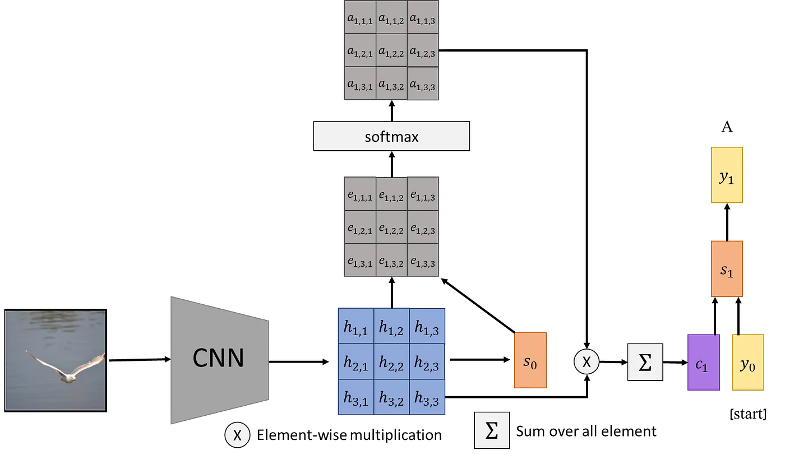
</figure>

Formally:

$$
e_{t,i,j} = f_{att}(s_{t-1}, h_{i,j})
$$

and

$$
c_t = \sum_{i,j} a_{t,i,j} h_{i,j}
$$

The attention the network gives to each part of the image can be seen in the following visualization.

<figure>
  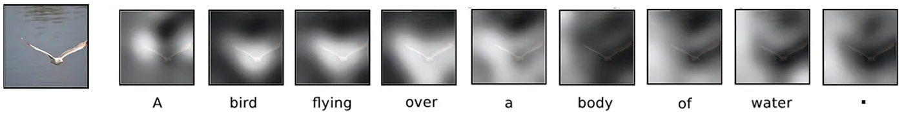
  <figcaption>
    Attention over time. As the model generates each word, its attention changes to reflect the relevant parts of the image. Source:
    <a href="https://arxiv.org/pdf/1502.03044">
      Xu et al
    </a>
  </figcaption>
</figure>

You can see, for example, how the word “bird” attends to the image part of the bird, and the word “water” attends to the water in the background.

## Conclusion

In this post, we went over the basic ideas behind the attention mechanism. We saw how it solved the problem of handling long sentences in the encoder-decoder architecture for translation by constructing a new context vector at each step by attending to the most relevant part of the encoder. We also saw how we can leverage the attention mechanism to the task of image captioning, where the attention helps to focus on the relevant part of the image for the prediction of the next word in the caption.

In a [future post](../from-attention-to-self-attention-and-transformers-a-mathematical-introduction/index.qmd), we will go over the mathematics of attention and introduce the self-attention module.