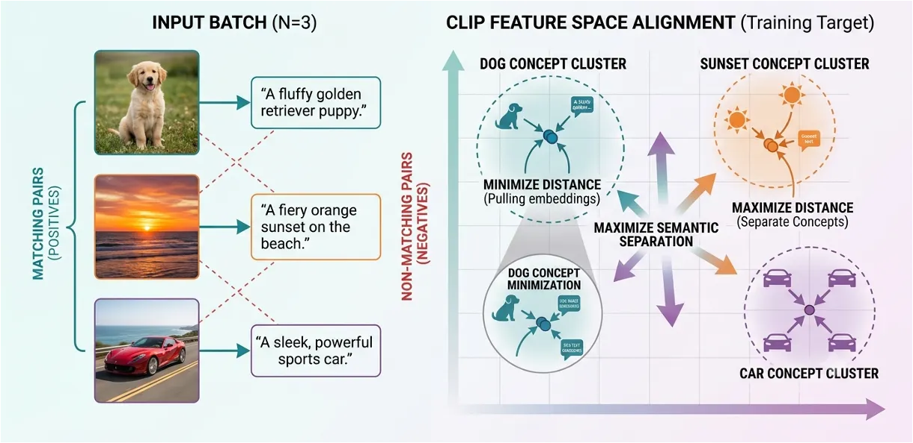
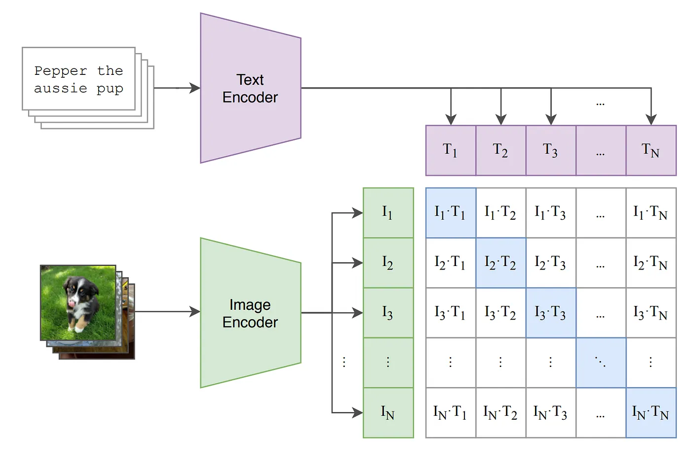
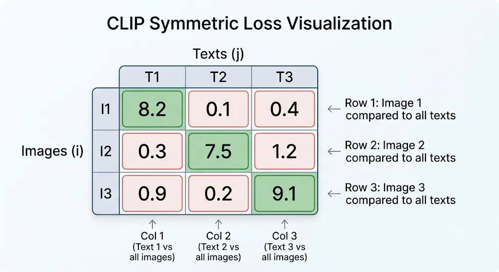
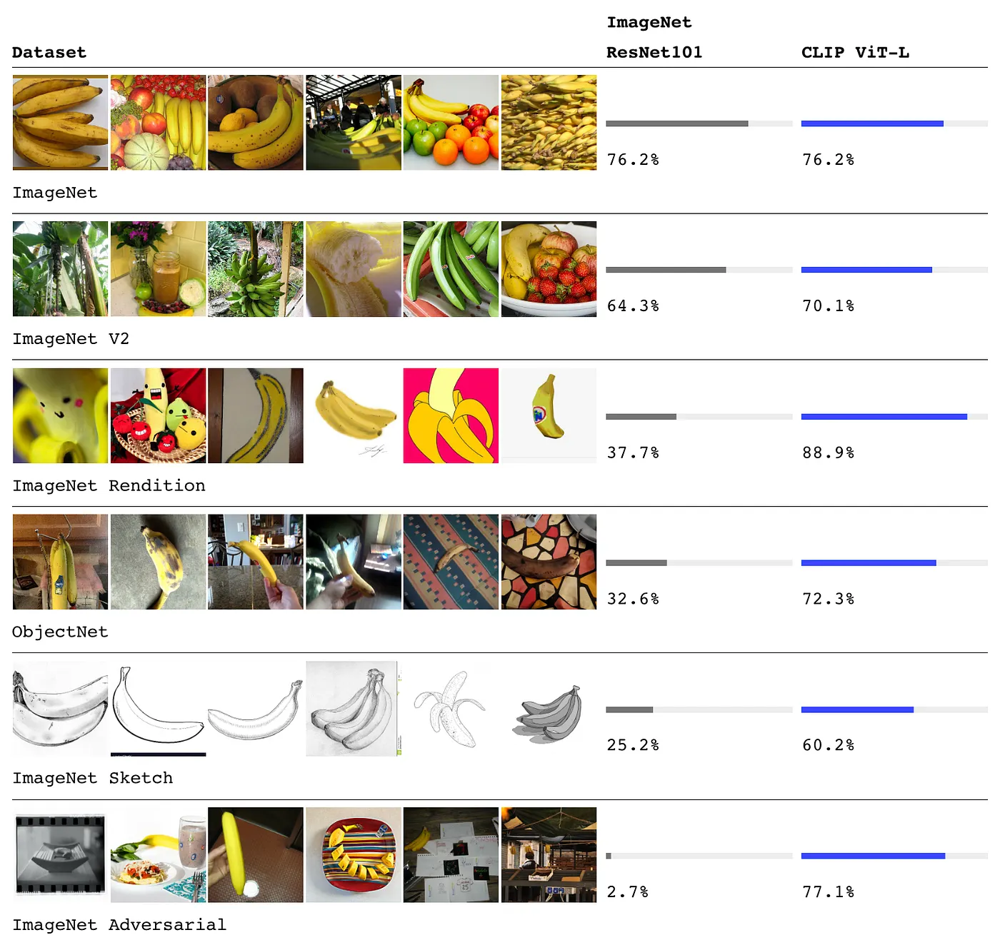

In the world of modern AI, computer vision has long been treated as a solitary field. For years, the standard approach to understanding images was to analyze them in a vacuum — either by classifying pixels into rigid, predefined categories or trying to reconstruct them using architectures like Autoencoders and VAEs. But the human experience isn’t unimodal; we don’t just look at the world, we can also describe it.

This is where **Contrastive Language-Image Pre-training (CLIP)** changes the game. By bridging the gap between vision and language, CLIP changes the traditional analysis of images and explores a powerful approach: multimodal learning. Instead of training a model to analyze images in isolation, CLIP learns to connect the dots between two entirely different worlds — images and the natural language captions that describe them. By training on massive amounts of paired data, its mission is to take any arbitrary, never-before-seen image-text pair and accurately measure how well they align. The secret to unlocking this flexible, cross-modal understanding? It all comes down to a brilliantly designed loss function.

## The Core Intuition: What is Contrastive Learning?

Contrastive learning is a technique where a model learns to distinguish between similar and dissimilar data points. The core idea is to map similar samples (positives) closer together in the feature space while pushing dissimilar samples (negatives) farther apart. There are many cases where contrastive learning and contrastive loss can be used. For example, it is used extensively across self-supervised learning, with prominent examples including methods like [SimCLR](https://python.plainenglish.io/self-supervised-learning-for-visual-representation-b242bde77241) or [BYOL](../paper-review-bootstrap-your-own-latent/index.qmd).

In CLIP, the main goal is to map an image directly to its descriptive text. For each batch of data, the model aims to produce similar representations for an image and its associated caption, while keeping that representation distant from the captions of all other images in the batch.

Through this approach, the model learns to connect visual information with textual information. By operating across two distinct modalities at once, CLIP achieved a major milestone in representation learning.

<figure>
  
  <figcaption>
    Similar images and captions should be close together, while different concepts should be kept apart
  </figcaption>
</figure>

## The Architecture: Two Encoders, One Shared Space

Images and text belong to two distinct modalities — meaning they are fundamentally different information structures. If our goal is to relate an image to a text caption, we must first bring them into a shared space where they can be directly compared and measured for similarity.

To accomplish this, CLIP uses two dedicated encoders to extract feature representations from each domain: a ResNet or Vision Transformer (ViT) for images, and a standard Transformer for text. Ultimately, these two encoders map both distinct data types into fixed-size feature vectors within the exact same embedding dimension, enabling direct mathematical comparison.

<figure>
  
  <figcaption>
    Images and text pairs are processed by two types of encoders to produce a single vector representation that can be compared. Source:
    <a href="https://arxiv.org/pdf/2103.00020">
      Learning Transferable Visual Models From Natural Language Supervision
    </a>
  </figcaption>
</figure>

## Multi-Modal Contrastive Loss

Once we have these vector representations, the next step is determining how to compare them and how to use that comparison for training. The central intuition is straightforward: for a true *(image, text)* pair, the two feature vectors should be highly similar, whereas vectors from unmatched pairs should be distinct.

A standard way to measure similarity between two vectors is **cosine similarity**, which is the normalized dot product of the vectors.

Given a batch of $N$ *(image, text)* pairs, the encoders produce $N$ image embedding vectors and $N$ text embedding vectors. Pairwise evaluation yields an $N \times N$ similarity matrix containing $N^2$ similarity scores. The $N$ diagonal entries correspond to the true matching *(image, text)* pairs and should have high similarity scores, while the remaining $N^2 - N$ off-diagonal entries represent unmatched pairs and should have low scores.

To maximize diagonal scores while minimizing off-diagonal scores, CLIP uses a symmetric cross-entropy loss. This involves computing standard cross-entropy loss on the similarity matrix in both directions and averaging the two terms:

**Image-to-Text Loss (**$\mathcal{L}_I$**):** For each image, predict which of the $N$ text captions matches it (Given Image $i$, how well can the model pick out Text $i$ from all $N$ texts?). For each row $i$, a **Softmax** function is applied across the columns to turn raw similarity scores into a probability distribution over the text captions. Categorical cross-entropy is then calculated against the ground-truth diagonal index:

$$
\mathcal{L}_I = -\frac{1}{N} \sum_{i=1}^{N} \log \frac{\exp(S_{i,i})}{\sum_{j=1}^{N} \exp(S_{i,j})}
$$

**Text-to-Image Loss (**$\mathcal{L}_T$**):** For each text caption, predict which of the $N$ images matches it. (Given Text $j$, how well can the model pick out Image $j$ from all $N$ images?). For each column $j$, a **Softmax** function is applied across the rows to form a probability distribution over the images, followed by categorical cross-entropy against the ground truth:

$$
\mathcal{L}_T = -\frac{1}{N} \sum_{j=1}^{N} \log \frac{\exp(S_{j,j})}{\sum_{i=1}^{N} \exp(S_{i,j})}
$$

The total loss is simply the average of the two directional losses:

$$
\mathcal{L}_{\text{CLIP}} = \frac{\mathcal{L}_I + \mathcal{L}_T}{2}
$$

Why use a symmetric cross-entropy loss? If the model optimized only row-wise ($\mathcal{L}_I$), it would learn to map images to text effectively, but the text encoder wouldn’t be explicitly penalized if multiple texts collapsed onto the same image region in representation space (and vice versa).

By enforcing symmetry:

* The **image encoder** is forced to produce distinct, separable features for different images.

* The **text encoder** is simultaneously forced to produce distinct, separable features for different captions.

* Neither modality is allowed to dominate the shared embedding space.

<figure>
  
  <figcaption>
    Similarity matrix. Values on the main diagonal should be maximized, while the off-diagonal ones should be minimized
  </figcaption>
</figure>

It is worth noting that the actual similarity score $S_{i,j}$ is not just the cosine similarity (computed as the dot product of L2-normalized image and text embeddings, $I_i$ and $T_j$), but it is also scaled by a learnable temperature parameter $\tau$:

$$
S_{i,j} = \frac{I_i \cdot T_j}{\tau}
$$

## Zero-Shot Classification

Classification is one of the foundational tasks in machine learning, particularly in computer vision. In standard supervised classification, given a data point and a set of predefined classes, the model outputs a probability distribution across those classes. However, those classes must be defined before training, restricting the model to categorizing data strictly within those labels.

A model capable of zero-shot classification, however, can categorize data into new classes without ever being explicitly trained on them. Because CLIP is trained to match images with descriptive text, we can construct a set of text prompts (e.g., “a photo of a dog” vs. “a photo of a cat”) and evaluate the similarity between an input image and each prompt. This turns classification into a dynamic search across arbitrary text labels. Even without dedicated training on a specific dataset or class list, CLIP can classify images flexibly on the fly.

In [OpenAI’s original blog post](https://openai.com/index/clip/), they show that CLIP can achieve performance similar to models that were trained for ImageNet, without using ImageNet for training at all. Furthermore, you can see in the figure below that CLIP keeps very high performance even when tested on other datasets, while the network trained for ImageNet shows degradation.

<figure>
  
  <figcaption>
    source:
    <a href="https://openai.com/index/clip/">
      OpenAI
    </a>
  </figcaption>
</figure>

## More Uses

Beyond zero-shot classification, CLIP serves as a powerful foundational block for several downstream applications:

* **Semantic search:** Because CLIP maps text and images into the same vector space, an image archive can be indexed by pre-computing CLIP embeddings for every photo. Users can then search the archive using natural language queries — CLIP converts the query text into an embedding vector and retrieves the closest matching photo vectors.

* **Rich Visual-Textual Embeddings:** Trained on hundreds of millions of image-caption pairs, CLIP learns rich, generalized representations. These embeddings are widely used to guide downstream tasks, such as conditioning text-to-image generative models (e.g., Stable Diffusion and DALL-E) on natural language prompts.

## Conclusion

CLIP marked a fundamental paradigm shift in representation learning. Instead of forcing models to analyze images in a vacuum or memorize rigid category labels, it proved that connecting vision directly to language makes models far more flexible and adaptable. This shift allows AI to tackle brand-new tasks on the fly without any extra training. Today, teaching models to understand text and images together isn’t just a clever alternative — it’s quickly becoming the standard way we build AI that actually understands the world around it.