In this post, we are going to build a face swap program which is a simplified version of the "[DeepFaceLab](https://github.com/iperov/DeepFaceLab)" project, using both Pytorch and OpenCV. Basically, we want to take a *source* video of the person with the face we are interested in and a *destination* video where we want to insert that face to make a new video like the destination video but with the face from the source video.

<figure>
  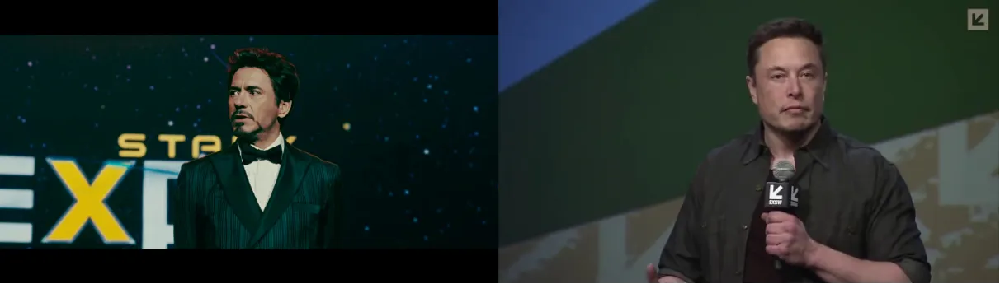
  <figcaption>
    A frame from the source video (left) and the destination video (right)
  </figcaption>
</figure>

The full code for this post is in [this GitHub repository](https://github.com/dorzv/ComputerVision/tree/master/face_swap).

The program, and the post, will be divided into three sections. The first one deals with the extraction of the faces from the two videos and the construction of standard face datasets. The second part uses the datasets together with a neural network to learn how to represent a face in some latent space and reconstruct an image of a face from this representation. The last part uses the neural network to create a face as in the source video but with the expression of the person in the destination video for each frame of the video. Then the original face is replaced by the fake one, and the new frame is saved into the new fake video.

The basic structure of the project (before the first run) looks as follows:

```bash
├── face_masking.py
├── main.py
├── face_extraction_tools.py
├── quick96.py
├── merge_frame_to_fake_video.py
├── data
│   ├── data_dst.mp4
│   ├── data_src.mp4
```

The `main.py` file is, as the name implies, the main script that runs the whole program from two videos to a fake video. We will talk about the other Python files in the following section. What’s important to notice is the *data* folder contains *data_dst.mp4* and *data_src.mp4* files that the program will look for.

## Extraction and Alignment — Building the Datasets

In the first section, we are going to cover the code in the `face_extraction_tools.py` file.

Before we can do anything, we need some data to work on. Thus, the first step is to extract the frames from the videos. For that, we are going to build a function that saves the frames as JPEG images. This function takes a path to a video and another path to an output folder where it will save the results in. We also add an optional input that lets us skip on some of the frames (if we want to save time and space, for example, in a case of a long source video). For the destination video, we want to keep all the frames because we want the network to see all the expressions of the face in that video.

```python
def extract_frames_from_video(video_path: Union[str, Path], output_folder: Union[str, Path], frames_to_skip: int=0) -> None:
    """
    Extract frame from video as a JPG images.
    Args:
        video_path (str | Path): the path to the input video from it the frame will be extracted
        output_folder (str | Path): the folder where the frames will be saved
        frames_to_skip (int): how many frames to skip after a frame which is saved. 0 will save all the frames.
            If, for example, this value is 2, the first frame will be saved, then frame 2 and 3 will be skipped,
            the 4th frame will be saved, and so on.

    Returns:

    """

    video_path = Path(video_path)
    output_folder = Path(output_folder)

    if not video_path.exists():
        raise ValueError(f'The path to the video file {video_path.absolute()} does not exist')
    if not output_folder.exists():
        output_folder.mkdir(parents=True)

    video_capture = cv2.VideoCapture(str(video_path))

    extract_frame_counter = 0
    saved_frame_counter = 0
    while True:
        ret, frame = video_capture.read()
        if not ret:
            break

        if extract_frame_counter % (frames_to_skip + 1) == 0:
            cv2.imwrite(str(output_folder / f'{saved_frame_counter:05d}.jpg'), frame, [cv2.IMWRITE_JPEG_QUALITY, 90])
            saved_frame_counter += 1

        extract_frame_counter += 1

    print(f'{saved_frame_counter} of {extract_frame_counter} frames saved')
```

The function starts by checking the video file exists and also that the output folder exists, and if it doesn’t, the function will create it. We use OpenCV *VideoCapture* class to create an object to read the video, and then we go over the video frame by frame and save it as a JPEG file in the output folder. We skip on frames according to the *frames_to_skip* argument. When the video ends, the next attempt to read a frame will fail, and the *ret* variable will get *False*, so we stop and print information about the number of frames that were saved and the total number of frames that were read. The result of this function is a folder with the frames as JPEG images.

<figure>
  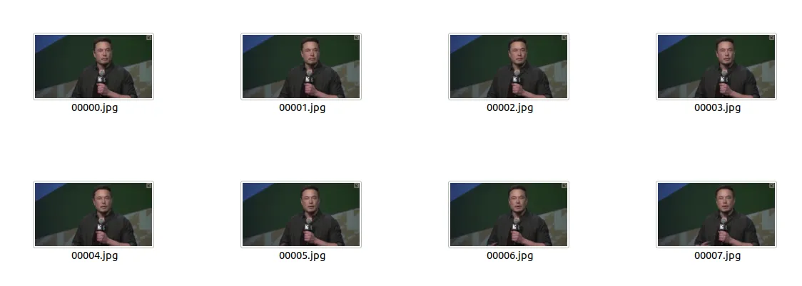
  <figcaption>
    A folder contains the frames saved as JPEG images
  </figcaption>
</figure>

But we aren't interested in the frames themselves, but in the faces inside them. The next tool we need to build is a face extractor. The tool should have the capability to detect a face in an image, extract it and align it. The last capability is necessary to build a dataset with some standardization so we can feed our network with controllable data. The best way to build such a tool is to create a *FaceExtractor* class with methods for detection, extraction, and alignment.

For the detection part, we are going to use [YuNet](https://opencv.org/blog/2022/11/15/opencv-face-detection-cascade-classifier-vs-yunet/) with OpenCV. YuNet is a fast and accurate CNN-based face detector that can be utilized by the class *FaceDetectorYN* from OpenCV. To create such a *FaceDetectorYN* object, we need an ONNX file with the weights. The file can be found in [OpenCV Zoo](https://github.com/opencv/opencv_zoo/tree/main/models/face_detection_yunet) and the current version is called “face_detection_yunet_2023mar.onnx”.

The first thing we need our tool to do, therefore, is to get the weights. We can do it in the `__init__()` method:

```python
    def __init__(self, image_size):
        """
        Create a YuNet face detector to get face from image of size 'image_size'. The YuNet model
        will be downloaded from opencv zoo, if it's not already exist.
        Args:
            image_size (tuple): a tuple of (width: int, height: int) of the image to be analyzed
        """
        detection_model_path = Path('models/face_detection_yunet_2023mar.onnx')
        if not detection_model_path.exists():
            detection_model_path.parent.mkdir(parents=True, exist_ok=True)
            url = "https://github.com/opencv/opencv_zoo/blob/main/models/face_detection_yunet/face_detection_yunet_2023mar.onnx"
            print('Downloading face detection model...')
            filename, headers = urlretrieve(url, filename=str(detection_model_path))
            print('Download finish!')

        self.detector = cv2.FaceDetectorYN.create(str(detection_model_path), "", image_size)
```

Here, the method checks if the weights file exists, and if not, it will be downloaded from the web. Then a FaceDetectorYN object is created using the weights file and the image to be analyzed size.

The *detect* method used the YuNet detect method to find faces in the image:

```python
    def detect(self, image):
        ret, faces = self.detector.detect(image)
        return ret, faces
```

The output of YuNet is a 2D array with size [num_faces, 15] with the following information:

* 0–1: x, y of the bounding box top left corner
* 2–3: width, height of the bounding box
* 4–5: x, y of the right eye (blue point in the example image)
* 6–7: x, y of the left eye (red point in the example image)
* 8–9: x, y of nose tip (green point in the example image)
* 10–11: x, y of the right corner of the mouth (pink point in the example image)
* 12–13: x, y of the left corner of the mouth (yellow point in the example image)
* 14: face score

<figure>
  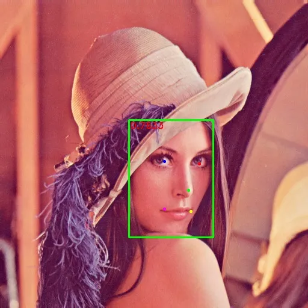
  <figcaption>
    Image from OpenCV
    <a href="https://docs.opencv.org/4.x/df/d20/classcv_1_1FaceDetectorYN.html">
      documentation
    </a>
  </figcaption>
</figure>

Now we have the face position data, and we can use it to get an aligned image of the face. For that, we will leverage the information about the position of the eyes. We want the eyes to be at the same level (the same y-coordinate) in the aligned image. Also, we want to choose the relative position of the eyes in the face image.

```python
    @staticmethod
    def align(image, face, desired_face_width=256, left_eye_desired_coordinate=np.array((0.37, 0.37))):
        """
        Align the face so the eyes will be at the same level
        Args:
            image (np.ndarray): image with face
            face (np.ndarray):  face coordinates from the detection step
            desired_face_width (int): the final width of the aligned face image
            left_eye_desired_coordinate (np.ndarray): a length 2 array of values between
             0 and 1 where the left eye should be in the aligned image

        Returns:
            (np.ndarray): aligned face image
        """
        desired_face_height = desired_face_width
        right_eye_desired_coordinate = np.array((1 - left_eye_desired_coordinate[0], left_eye_desired_coordinate[1]))

        # get coordinate of the center of the eyes in the image
        right_eye = face[4:6]
        left_eye = face[6:8]

        # compute the angle of the right eye relative to the left eye
        dist_eyes_x = right_eye[0] - left_eye[0]
        dist_eyes_y = right_eye[1] - left_eye[1]
        dist_between_eyes = np.sqrt(dist_eyes_x ** 2 + dist_eyes_y ** 2)
        angles_between_eyes = np.rad2deg(np.arctan2(dist_eyes_y, dist_eyes_x) - np.pi)
        eyes_center = (left_eye + right_eye) // 2

        desired_dist_between_eyes = desired_face_width * (
                    right_eye_desired_coordinate[0] - left_eye_desired_coordinate[0])
        scale = desired_dist_between_eyes / dist_between_eyes

        M = cv2.getRotationMatrix2D(eyes_center, angles_between_eyes, scale)

        M[0, 2] += 0.5 * desired_face_width - eyes_center[0]
        M[1, 2] += left_eye_desired_coordinate[1] * desired_face_height - eyes_center[1]

        face_aligned = cv2.warpAffine(image, M, (desired_face_width, desired_face_height), flags=cv2.INTER_CUBIC)
        return face_aligned
```

The method gets the image and the information for a single face, together with the width of the output image and the desired relative position of the left eye. The method assumes the output image is squared and that the desired position of the right eye has the same y-position and $1 - \text{left\_eye\_x}$ for the x position. The distance and the angle between the eyes are calculated, as well as the center point between them. Using the desired width and the desired positions of the eyes, a scale factor can be calculated. Using the center of the eyes, the angle between them, and the scale factor, a transformation matrix is created. Then, x and y translation components are added to the matrix to move the face so the center of the eyes will move to the right position in the final image. Finally, the transformation is applied to the original image to get the aligned face image. It’s important to notice that in this way, we don’t distort the original face in the image.

The final method is the extract method, which is similar to the align method but without the transformation, and it also returns the bounding box of the face in the image.

With our new face tools, we can write a function to take the frames we have already extracted and get a standard version of the faces from them, which will be saved in a new folder called “aligned” as our dataset for the neural network.

```python
def extract_and_align_face_from_image(input_dir: Union[str, Path], desired_face_width: int=256) -> None:
    """
    Extract the face from an image, align it and save to a directory inside in the input directory
    Args:
        input_dir (str|Path): path to the directory contains the images extracted from a video
        desired_face_width (int): the width of the aligned imaged in pixels

    Returns:

    """

    input_dir = Path(input_dir)
    output_dir = input_dir / 'aligned'
    if output_dir.exists():
        rmtree(output_dir)
    output_dir.mkdir()


    image = cv2.imread(str(input_dir / '00000.jpg'))
    image_height = image.shape[0]
    image_width = image.shape[1]

    detector = FaceExtractor((image_width, image_height))

    for image_path in tqdm(list(input_dir.glob('*.jpg'))):
        image = cv2.imread(str(image_path))

        ret, faces = detector.detect(image)
        if faces is None:
            continue

        face_aligned = detector.align(image, faces[0, :], desired_face_width)
        cv2.imwrite(str(output_dir / f'{image_path.name}'), face_aligned, [cv2.IMWRITE_JPEG_QUALITY, 90])
```

<figure>
  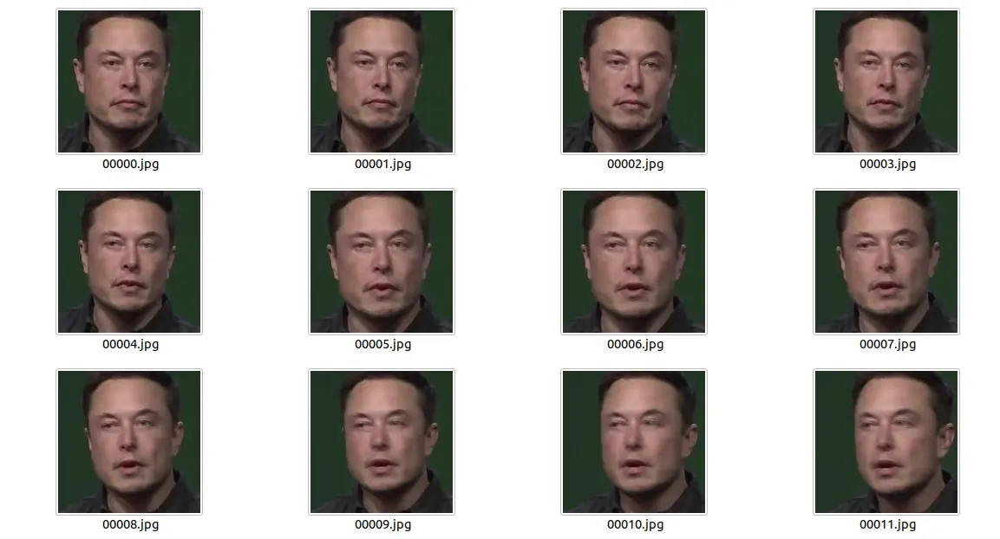
  <figcaption>
    The results of the extract_and_align_face_from_image function
  </figcaption>
</figure>

## Training the Network

For the network, we are going to use the concept of AutoEncoder. In the AutoEncoder, we have two main components — An encoder and a decoder. The encoder takes the original image and finds a latent representation of it. Then, the decoder takes the latent representation and reconstructs the original image.

For our task, we want to train an encoder to find a latent face representation and two decoders — one that can reconstruct the source face and the other that can reconstruct the destination face.

<figure>
  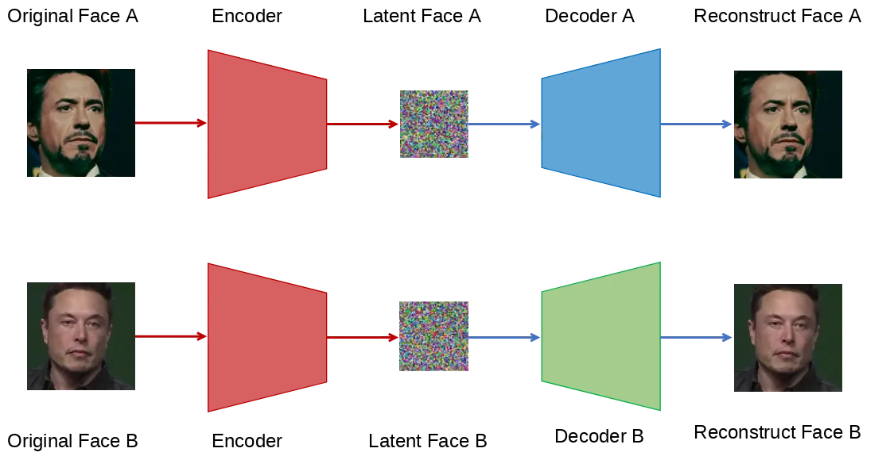
  <figcaption>
    The basic architecture of AutoEncoder
  </figcaption>
</figure>

After the three components are trained, we can go back to our original goal: to create an image of the source face but with the destination expression. For that, we can use decoder A with an image of face B.

<figure>
  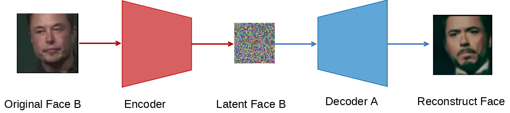
</figure>

The latent face keeps the main features of the face, such as position, orientation, and expression. The decoder takes this coded information and learns how to construct a full-face image. Since decoder A knows only how to construct a face of type A, it takes the features of image B from the encoder and constructs from them an image of type A.

In this project, we are going to use a little edited version of the Quick96 architecture from the original [DeepFaceLab](https://github.com/iperov/DeepFaceLab) project.

<figure>
  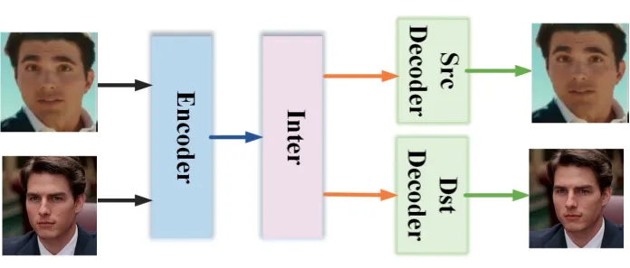
  <figcaption>
    The basic architecture from DeepFaceLab as in the paper
    <a href="https://arxiv.org/pdf/2005.05535.pdf">
      DeepFaceLab: Integrated, flexible and extensible face-swapping framework
    </a>
  </figcaption>
</figure>

The full details of the network can be seen in the code in the GitHub project inside the [quick96.py](https://github.com/dorzv/ComputerVision/blob/master/face_swap/quick96.py) file.

But before we can train the model, we first need to work on the data. To make our model robust and avoid overfitting, we want to apply two types of augmentation on the original face images. The first one is general transformations, including rotation, scaling, translation in both x and y directions, and horizontal flipping. For each transformation, we define a range for the parameters or probability (for example, the range of angles we can use to rotate) and then select a random value from the range to apply to the image.

```python
random_transform_args = {
    'rotation_range': 10,
    'zoom_range': 0.05,
    'shift_range': 0.05,
    'random_flip': 0.5,
  }

def random_transform(image, rotation_range, zoom_range, shift_range, random_flip):
    """
    Make a random transformation for an image, including rotation, zoom, shift and flip.
    Args:
        image (np.array): an image to be transformed
        rotation_range (float): the range of possible angles to rotate - [-rotation_range, rotation_range]
        zoom_range (float): range of possible scales - [1 - zoom_range, 1 + zoom_range]
        shift_range (float): the percent of translation for x  and y
        random_flip (float): the probability of horizontal flip

    Returns:
        (np.array): transformed image
    """
    h, w = image.shape[0:2]
    rotation = np.random.uniform(-rotation_range, rotation_range)
    scale = np.random.uniform(1 - zoom_range, 1 + zoom_range)
    tx = np.random.uniform(-shift_range, shift_range) * w
    ty = np.random.uniform(-shift_range, shift_range) * h
    mat = cv2.getRotationMatrix2D((w // 2, h // 2), rotation, scale)
    mat[:, 2] += (tx, ty)
    result = cv2.warpAffine(image, mat, (w, h), borderMode=cv2.BORDER_REPLICATE)
    if np.random.random() < random_flip:
        result = result[:, ::-1]
    return result
```

The second type is a distortion made by warping the image using an interpolation map with noise. The distortion will force the model to understand what are the key features of the face and make it more general.

```python
def random_warp(image):
    """
    Create a distorted face image and a target undistorted image
    Args:
        image  (np.array): image to warp

    Returns:
        (np.array): warped version of the image
        (np.array): target image to construct from the warped version
    """
    h, w = image.shape[:2]

    # build coordinate map to warp the image according to
    range_ = np.linspace(h / 2 - h * 0.4, h / 2 + h * 0.4, 5)
    mapx = np.broadcast_to(range_, (5, 5))
    mapy = mapx.T

    # add noise to get a distortion of the face while warp the image
    mapx = mapx + np.random.normal(size=(5, 5), scale=5*h/256)
    mapy = mapy + np.random.normal(size=(5, 5), scale=5*h/256)

    # get interpolation map for the center of the face with size of (96, 96)
    interp_mapx = cv2.resize(mapx, (int(w / 2 * (1 + 0.25)) , int(h / 2 * (1 + 0.25))))[int(w/2 * 0.25/2):int(w / 2 * (1 + 0.25) - w/2 * 0.25/2), int(w/2 * 0.25/2):int(w / 2 * (1 + 0.25) - w/2 * 0.25/2)].astype('float32')
    interp_mapy = cv2.resize(mapy, (int(w / 2 * (1 + 0.25)) , int(h / 2 * (1 + 0.25))))[int(w/2 * 0.25/2):int(w / 2 * (1 + 0.25) - w/2 * 0.25/2), int(w/2 * 0.25/2):int(w / 2 * (1 + 0.25) - w/2 * 0.25/2)].astype('float32')

    # remap the face image according to the interpolation map to get warp version
    warped_image = cv2.remap(image, interp_mapx, interp_mapy, cv2.INTER_LINEAR)

    # create the target (undistorted) image
    # find a transformation to go from the source coordinates to the destination coordinate
    src_points = np.stack([mapx.ravel(), mapy.ravel()], axis=-1)
    dst_points = np.mgrid[0:w//2+1:w//8, 0:h//2+1:h//8].T.reshape(-1, 2)

    # We want to find a similarity matrix (scale rotation and translation) between the
    # source and destination points. The matrix should have the structure
    # [[a, -b, c],
    #  [b,  a, d]]
    # so we can construct unknown vector [a, b, c, d] and solve for it using least
    # squares with the source and destination x and y points.
    A = np.zeros((2 * src_points.shape[0], 2))
    A[0::2, :] = src_points  # [x, y]
    A[0::2, 1] = -A[0::2, 1] # [x, -y]
    A[1::2, :] = src_points[:, ::-1]  # [y, x]
    A = np.hstack((A, np.tile(np.eye(2), (src_points.shape[0], 1))))  # [x, -y, 1, 0] for x coordinate and [y, x, 0 ,1] for y coordinate
    b = dst_points.flatten()  # arrange as [x0, y0, x1, y1, ..., xN, yN]

    similarity_mat = np.linalg.lstsq(A, b, rcond=None)[0] # get the similarity matrix elements as vector [a, b, c, d]
    # construct the similarity matrix from the result vector of the least squares
    similarity_mat = np.array([[similarity_mat[0], -similarity_mat[1], similarity_mat[2]],
                               [similarity_mat[1], similarity_mat[0], similarity_mat[3]]])
    # use the similarity matrix to construct the target image using affine transformation
    target_image = cv2.warpAffine(image, similarity_mat, (w // 2, h // 2))

    return warped_image, target_image
```

This function can be a little hard to understand, but basically, it has two parts. In the first one, we start by creating a coordinate map of the image at the area around the face itself. There is a map for the x-coordinate and a map for the y-coordinate. The values in the *mapx* and *mapy* variables are coordinates in pixels. Then, we add some noise to the maps to move the coordinate in random directions. Then we resize the maps, which makes an interpolation between the coordinates, but together with the noise we have added, we get a distorted coordinates map (pixels move a little bit in random directions). We also crop the interpolated maps to contain the center of the face with a size of $96 \times 96$ pixels. Now we can use the distorted map to remap the image accordingly and get a new distorted image.

In the second part, we want to create the undistorted image, which is the target image that the model should create from the distorted one. We use the noisy maps as the source coordinates and define a set of destination coordinates for the target image. Then we use least squares to find a similarity transformation matrix (scale rotation and translation) that maps from the source coordinates to the destination ones and apply it to the image to get the target image.

<figure>
  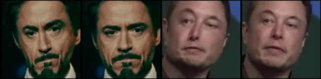
  <figcaption>
    Distorted and target images
  </figcaption>
</figure>

Now it’s time to implement a Dataset class to handle the data. Our FaceData class is pretty straightforward. It gets the path to the folder containing the *src* and *dst* folder with the data we created in the previous part and returns random source and destination images with a size of $(2 \times 96, 2 \times 96)$ normalized to 1. But what we really want our network to get is a transformed and distorted image and a target image for both the source and destination faces. To handle that, we implement a [collate_fn](https://pytorch.org/docs/stable/data.html#dataloader-collate-fn):

```python
    def collate_fn(self, batch):
        """
        Collate function to arrange the data returns from a batch. The batch returns a list
        of tuples contains pairs of source and destination images, which is the input of this
        function, and the function returns a tuple with 4 4D tensors of the warp and target
        images for the source and destination
        Args:
            batch (list): a list of tuples contains pairs of source and destination images
                as numpy array

        Returns:
            (torch.Tensor): a 4D tensor of the warp version of the source images
            (torch.Tensor): a 4D tensor of the target source images
            (torch.Tensor): a 4D tensor of the warp version of the destination images
            (torch.Tensor): a 4D tensor of the target destination images
        """
        images_src, images_dst = list(zip(*batch))  # convert list of tuples with pairs of images into tuples of source and destination images
        warp_image_src, target_image_src = get_training_data(images_src, len(images_src))
        warp_image_src = torch.tensor(warp_image_src, dtype=torch.float32).permute(0, 3, 1, 2).to(device)
        target_image_src = torch.tensor(target_image_src, dtype=torch.float32).permute(0, 3, 1, 2).to(device)
        warp_image_dst, target_image_dst = get_training_data(images_dst, len(images_dst))
        warp_image_dst = torch.tensor(warp_image_dst, dtype=torch.float32).permute(0, 3, 1, 2).to(device)
        target_image_dst = torch.tensor(target_image_dst, dtype=torch.float32).permute(0, 3, 1, 2).to(device)

        return warp_image_src, target_image_src, warp_image_dst, target_image_dst
```

When we get data from a Dataloader object, it will return a tuple with pairs of source and destination images from the FaceData object. Our `collate_fn` takes this and performs the transformation and distortion on the images, gets the target images, and returns four 4D tensors for the distorted source images, target source images, distorted destination images, and target destination images.

Now we want to define a train function. We start by creating a Dataset and DataLoader, and initializing the components of the network. We also set optimizers and define a loss function. The loss function we are going to use is a combination of the MSE (L2) loss and the DSSIM (the dissimilarity version of the SSIM), which we implement ourselves at the function *dssim*. You can learn more about the SSIM metric from this [post](https://medium.com/srm-mic/all-about-structural-similarity-index-ssim-theory-code-in-pytorch-6551b455541e).

The training goes until the user stops it. When it runs, it will show a dashboard with the loss and the results. You can refresh it by pressing “r” or finish and save the model by pressing “q”. By default, if previous model weights exist, the train function will load them and continue the training from where it stops.

<figure>
  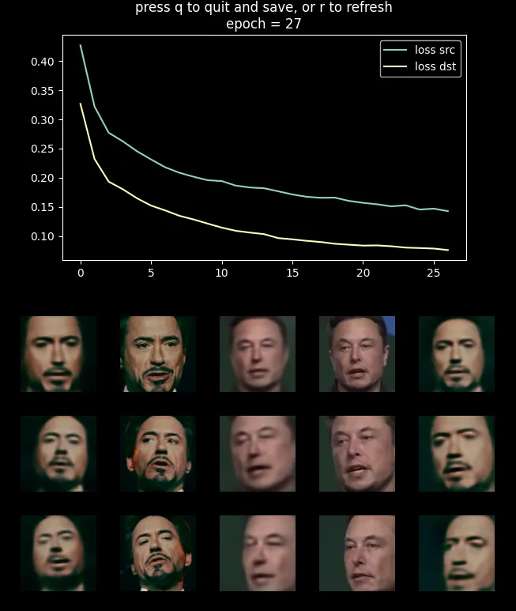
  <figcaption>
    The dashboard in the middle of the training. In the upper part, the loss as a function of the epoch is presented. At the lower part from left to right are the reconstructed image of the source, the target image of the source, the reconstructed image of the destination, the target image of the destination, and the fake image
  </figcaption>
</figure>

<figure>
  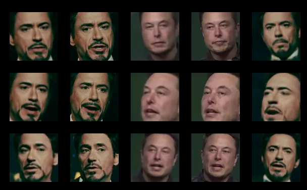
  <figcaption>
    Results after 1000 epochs
  </figcaption>
</figure>

## Generating the Fake Video

In the last step, we want to create the fake video. The function that handles this task is called `merge_frame_to_fake_video.py`. But before we create this function, we need to build another tool. Our goal is to replace just the face itself and not the head. As you can see from the network results, the output contains more than just the face (face = from the chin to a little above the eyebrows). So we need a tool to mask just the face itself. For that, we create the `FaceMasking` class. This class uses [MediaPipe face landmark detection](https://developers.google.com/mediapipe/solutions/vision/face_landmarker) tool to find the face and mask them.

When initiating a `FaceMasking` object, it searches for the face landmark model weights, and if it can’t find them, they will be downloaded from the web. Using these weights, a MediaPipe face landmark detector is initialized.

```python
class FaceMasking:
    def __init__(self):
        landmarks_model_path = Path('models/face_landmarker.task')
        if not landmarks_model_path.exists():
            landmarks_model_path.parent.mkdir(parents=True, exist_ok=True)
            url = "https://storage.googleapis.com/mediapipe-models/face_landmarker/face_landmarker/float16/latest/face_landmarker.task"
            print('Downloading face landmarks model...')
            filename, headers = urlretrieve(url, filename=str(landmarks_model_path))
            print('Download finish!')

        base_options = python_mp.BaseOptions(model_asset_path=str(landmarks_model_path))
        options = vision.FaceLandmarkerOptions(base_options=base_options,
                                               output_face_blendshapes=False,
                                               output_facial_transformation_matrixes=False,
                                               num_faces=1)
        self.detector = vision.FaceLandmarker.create_from_options(options)
```

The class also has a method to get the mask from a face image:

```python
    def get_mask(self, image):
        """
        return uint8 mask of the face in image
        Args:
            image (np.ndarray): RGB image with single face

        Returns:
            (np.ndarray): single channel uint8 mask of the face
        """
        im_mp = mp.Image(image_format=mp.ImageFormat.SRGB, data=image.astype(np.uint8).copy())
        detection_result = self.detector.detect(im_mp)

        x = np.array([landmark.x * image.shape[1] for landmark in detection_result.face_landmarks[0]], dtype=np.float32)
        y = np.array([landmark.y * image.shape[0] for landmark in detection_result.face_landmarks[0]], dtype=np.float32)

        hull = np.round(np.squeeze(cv2.convexHull(np.column_stack((x, y))))).astype(np.int32)
        mask = np.zeros(image.shape[:2], dtype=np.uint8)
        mask = cv2.fillConvexPoly(mask, hull, 255)
        kernel = np.ones((7, 7), np.uint8)
        mask = cv2.erode(mask, kernel)

        return mask
```

The function first converts the input image into a MediaPipe image structure and then uses the face landmark detector to find the landmarks. The landmarks are in relative coordinate units (between 0 to 1), so we convert them to x and y coordinates in pixels. Then we find a [convex hull](https://learnopencv.com/convex-hull-using-opencv-in-python-and-c/) of the points using OpenCV and make a binary mask by filling the area of the convex hull using OpenCV *fillConvexPoly* function. In the end, we apply an [erosion](https://docs.opencv.org/3.4/db/df6/tutorial_erosion_dilatation.html) operation to shrink the mask a little bit.

Now we have all we need to create the fake video, and we can go back to the function *merge_frame_to_fake_video*. First, we initialize all the components we will need: creating a new video object, a FaceExtractor object, a FaceMasking object, creating the neural network components, and loading their weights.

```python
def merge_frames_to_fake_video(dst_frames_path, model_name='Quick96', saved_models_dir='saved_model'):
    model_path = Path(saved_models_dir) / f'{model_name}.pth'
    dst_frames_path = Path(dst_frames_path)
    image = Image.open(next(dst_frames_path.glob('*.jpg')))
    image_size = image.size
    result_video = cv2.VideoWriter(str(dst_frames_path.parent / 'fake.mp4'), cv2.VideoWriter_fourcc(*'MJPG'), 30, image.size)

    face_extractor = FaceExtractor(image_size)
    face_masker = FaceMasking()

    encoder = Encoder().to(device)
    inter = Inter().to(device)
    decoder = Decoder().to(device)

    saved_model = torch.load(model_path)
    encoder.load_state_dict(saved_model['encoder'])
    inter.load_state_dict(saved_model['inter'])
    decoder.load_state_dict(saved_model['decoder_src'])

    model = torch.nn.Sequential(encoder, inter, decoder)
```

Then we go over all the frames in the destination video, read them, and find the face in them. If there is no face, we just write the frame into the video. If there is a face, we extract it, convert it to a proper input to the network and generate the fake face. Then we mask the original and the fake face and find the center of the original face using moments on the mask image. We use [seamless cloning](https://learnopencv.com/seamless-cloning-using-opencv-python-cpp/) to insert the fake face instead of the original face in a realistic way (for example, changing the fake face's skin color to suit the original face skin). And finally, we put the result back to the original frame as a new fake frame and write it to the video file.

```python
    frames_list = sorted(dst_frames_path.glob('*.jpg'))
    for ii, frame_path in enumerate(frames_list, 1):
        print(f'Working on {ii}/{len(frames_list)}')
        frame = cv2.imread(str(frame_path))
        retval, face = face_extractor.detect(frame)
        if face is None:
            result_video.write(frame)
            continue
        face_image, face = face_extractor.extract(frame, face[0])
        face_image = face_image[..., ::-1].copy()
        face_image_cropped = cv2.resize(face_image, (96, 96)) #face_image_resized[96//2:96+96//2, 96//2:96+96//2]
        face_image_cropped_torch = torch.tensor(face_image_cropped / 255., dtype=torch.float32).permute(2, 0, 1).unsqueeze(0).to(device)
        generated_face_torch = model(face_image_cropped_torch)
        generated_face = (generated_face_torch.squeeze().permute(1,2,0).detach().cpu().numpy() * 255).astype(np.uint8)


        mask_origin = face_masker.get_mask(face_image_cropped)
        mask_fake = face_masker.get_mask(generated_face)

        origin_moments = cv2.moments(mask_origin)
        cx = np.round(origin_moments['m10'] / origin_moments['m00']).astype(int)
        cy = np.round(origin_moments['m01'] / origin_moments['m00']).astype(int)
        try:
            output_face = cv2.seamlessClone(generated_face, face_image_cropped, mask_fake, (cx, cy), cv2.NORMAL_CLONE)
        except:
            print('Skip')
            continue

        fake_face_image = cv2.resize(output_face, (face_image.shape[1], face_image.shape[0]))
        fake_face_image = fake_face_image[..., ::-1] # change to BGR
        frame[face[1]:face[1]+face[3], face[0]:face[0]+face[2]] = fake_face_image
        result_video.write(frame)

    result_video.release()
```

Let’s look at the results:

<figure>
  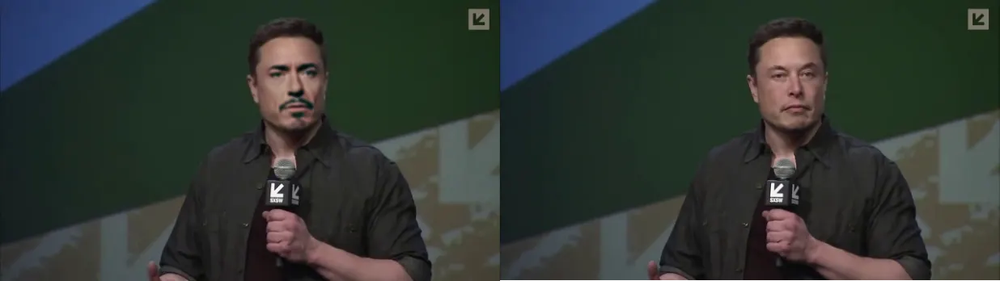
  <figcaption>
    A fake frame (left) and the original frame (right)
  </figcaption>
</figure>

Pretty good for such a simple model. Of course, the model is not perfect, and some angles of the face, especially a side view, will result in less impressive images, but overall the results are good.

## Putting It All Together

To run the entire process, we create a *main* script.

```python
from pathlib import Path
import face_extraction_tools as fet
import quick96 as q96
from merge_frame_to_fake_video import merge_frames_to_fake_video

##### user parameters #####
# True for executing the step
extract_and_align_src = True
extract_and_align_dst = True
train = True
eval = False

model_name = 'Quick96'  # use this name to save and load the model
new_model = False  # True for creating a new model even if a model with the same name already exists

##### end of user parameters #####

# the path for the videos to process
data_root = Path('./data')
src_video_path = data_root / 'data_src.mp4'
dst_video_path = data_root / 'data_dst.mp4'

# path to folders where the intermediate product will be saved
src_processing_folder = data_root / 'src'
dst_processing_folder = data_root / 'dst'

# step 1: extract the frames from the videos
if extract_and_align_src:
    fet.extract_frames_from_video(video_path=src_video_path, output_folder=src_processing_folder, frames_to_skip=0)
if extract_and_align_dst:
    fet.extract_frames_from_video(video_path=dst_video_path, output_folder=dst_processing_folder, frames_to_skip=0)

# step 2: extract and align face from frames
if extract_and_align_src:
    fet.extract_and_align_face_from_image(input_dir=src_processing_folder, desired_face_width=256)
if extract_and_align_dst:
    fet.extract_and_align_face_from_image(input_dir=dst_processing_folder, desired_face_width=256)

# step 3: train the model
if train:
    q96.train(str(data_root), model_name, new_model, saved_models_dir='saved_model')

# step 4: create the fake video
if eval:
    merge_frames_to_fake_video(dst_processing_folder, model_name, saved_models_dir='saved_model')
```

The first part is where the user can control the parameters: each of the four steps to run, the name for the model, and if to create a new model (even if a model with the same name exists). Then the paths to the data and to the output folders are created, and finally, the steps to create the fake video are called:

1. Extract the frames from the videos
2. Extract and align face from frames
3. Train the model
4. Create the fake video

## Conclusion

In this post, we saw how to build a deep fake face swap program. We start by extracting the frames from the videos, then we extract the faces from the frames and align them to create a database. We use a neural network to learn how to represent a face in some latent space and how to reconstruct the face back. We used the encoded version of the destination face with the decoder of the source to get a fake face with the same expression as the original image but with the face from the other video. Finally, we went over the frames of the destination video, found the face, made a fake face, and used masks to replace the original face with the fake one and created a fake video.