## Object Detection

The task of object detection is composed of two main elements: classification of the object into a category (for example, a dog or a cat), and localization of the object in the image. The localization part is the heart of the object detection task, which differentiates it from the regular classification task.

The outcome of object detection is usually a bounding box that marks the object with an assigned class. In the following image, you can see an example of an image with two objects, a dog and a cat, each with its bounding box. The object’s bounding box is represented with a vector containing the class and the properties of the box (for example, the $x$ and $y$ coordinates of the top left corner and the height and width of the box).

<figure>
  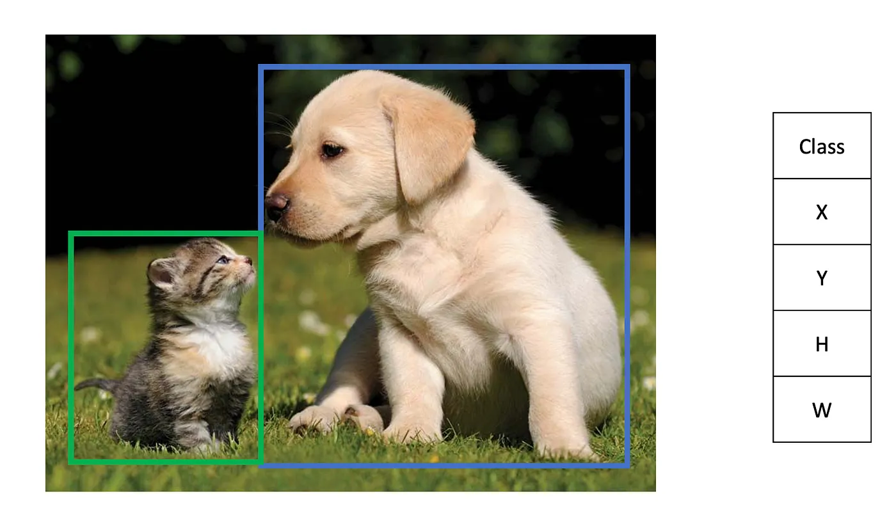
</figure>

## How to Find the Box?

There are several methods to find the bounding box.

### Sliding Windows

<figure>
  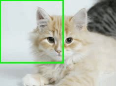
  <figcaption>
    <a href="https://medium.com/@rajshekhar_k/object-detection-series-3-0-basic-of-object-detection-196d91550671">source</a>
  </figcaption>
</figure>

In this approach, we use a window that captures a portion of the image and then perform a classification on this portion to see which (if any) object is in there. Basically, we reduce the problem to many classification tasks. However, this method has many disadvantages. First, it is very hard to pick the size and stride of the window, and the result may include a huge number of candidates. If we want to check more candidates, we will need more calculations. And even then, there is a good chance we dismiss objects or get a loose bounding box on the object.

### Region Proposals

<figure>
  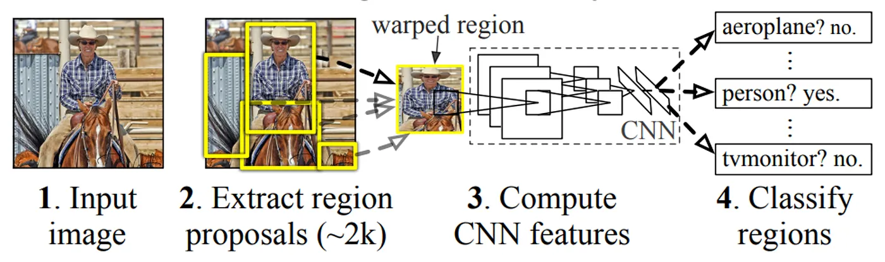
  <figcaption>
    <a href="https://arxiv.org/pdf/1311.2524">source</a>
  </figcaption>
</figure>

The region proposals method is used by R-CNN. Instead of using predefined windows that slide over the image, we first use an algorithm to extract region proposals and run a classification network only on these regions. The number of candidates in this method should be significantly lower than the number in the sliding window approach. However, it is still a slow method since we need to run the classification network many times, and it depends on the quality of the region proposals algorithm.

### Anchors

<figure>
  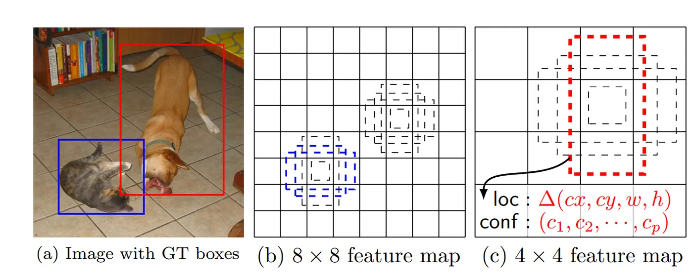
  <figcaption>
    <a href="https://arxiv.org/pdf/1512.02325">source</a>
  </figcaption>
</figure>

The anchor approach is used by some of the famous object detection architectures like Faster R-CNN, YOLO, and SSD. In this method, we pre-define boxes to capture objects. We divide the feature maps by a grid, and each grid element gets a set of boxes with different sizes and aspect ratios. If this element thinks the object is mainly inside it, it should assign it to the most suitable box and make some small corrections to the output bounding box relative to the anchor box.

The anchor boxes method lets the process be in one shot and makes the end-to-end prediction much faster. However, there are still some problems. First, the performance is dependent on the design of the anchor sets. Second, many grid elements may think the object belongs to them, and we need a post-processing step to collapse near-duplicate predictions (like non-maximum suppression). We may also need heuristics that assign target boxes to anchors.

In general, we can say that in all previous methods, the detection task is performed indirectly by defining surrogate regression and classification problems. In the next section, we will discuss DETR, and see how it can handle the problem directly and overcome the issues that arise from the previous methods.

## DEtection TRansformer (DETR)

DETR presents a CNN feature extraction + encoder-decoder transformer architecture. It predicts all objects at once and drops multiple hand-designed components that encode prior knowledge, like spatial anchors or non-maximal suppression.

### The Architecture

<figure>
  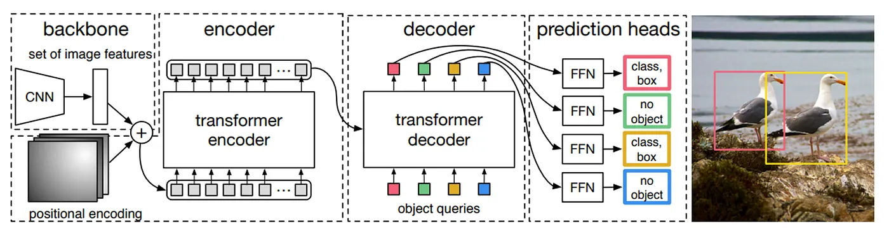
</figure>

In the first stage, the image is processed by a Convolutional Neural Network that extracts features from it. The output is a set of feature vectors. Next, we use a transformer-based encoder and decoder.

<figure>
  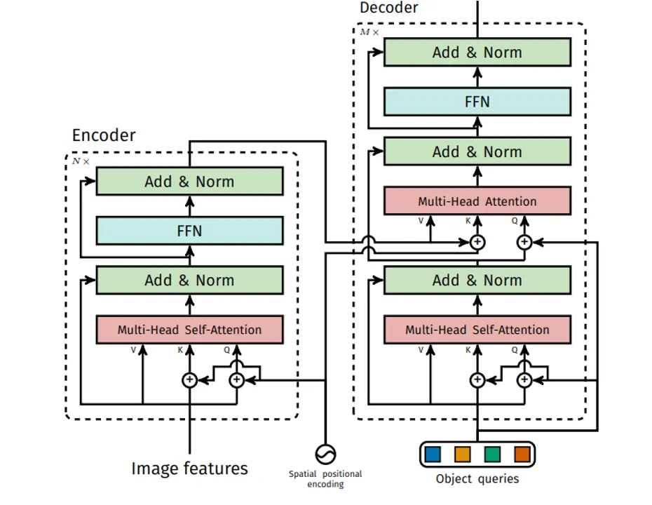
</figure>

The vectors are processed in a self-attention-based encoder, after adding positional encoding to them since self-attention is invariant to permutations and we want to preserve the location information of the different parts in the image. If you are not familiar with these terms, you can read my [post about self-attention](../from-attention-to-self-attention-and-transformers-a-mathematical-introduction/index.qmd). We stack $N$ encoder blocks together and save the result vectors for the next step.

The encoding process looks at the relations between the different feature vectors and helps to disentangle objects.

In the next image, you can see the attention maps of the last encoder layer of a trained model. It seems the encoder indeed separates instances.

<figure>
  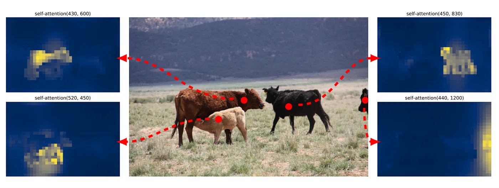
</figure>

In the next step, we take the output of the encoder and use cross-attention between them and *object queries*. The object queries are learnable vectors used as the query input for the decoder. Each object query is responsible for detecting an object in the image, and the number of object queries corresponds to the maximum number of objects the model can detect. The decoder gets all the queries together, meaning the model predicts all objects in a single shot.

In the next figure, you can see the position of objects associated with specific object queries. As you can see, the different queries focus on different areas in the image. For example, the first query mainly looks for objects in the bottom left corner of the image, while the last one mainly focuses on objects in the top left corner.

<figure>
  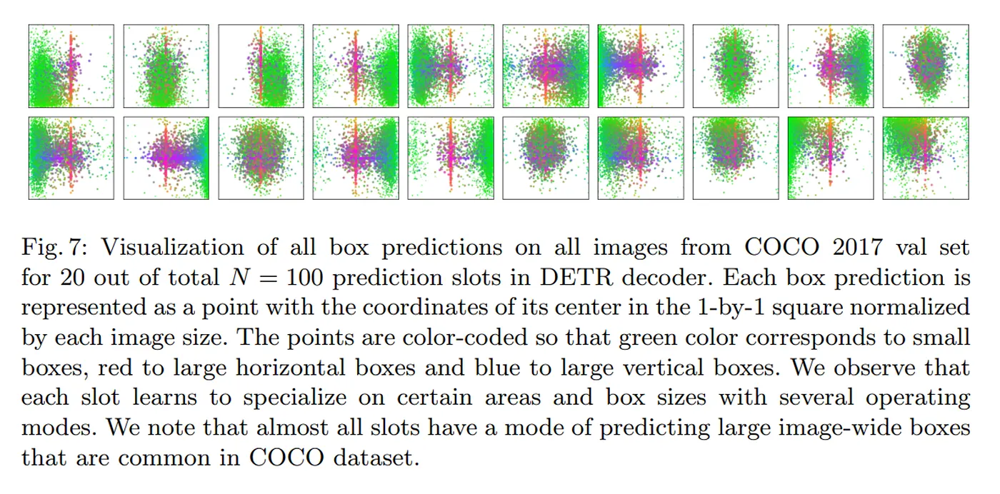
</figure>

For each object query, we get an output. Each of the outputs is then processed in a Feed Forward Network which predicts if there is an object related to this output and, if so, where it is.

### The Loss

DETR is a direct set predictions detector, meaning it predicts a set of $N$ boxes each time. Since we don’t want to dismiss objects, we set $N$ to be a much larger number than the typical number of objects in an image. Such detectors need a loss that forces unique matching between predicted and ground truth boxes. Because of that, DETR’s loss first produces an optimal bipartite matching between predicted and ground truth objects and then optimizes object-specific (bounding box) losses.

Let us denote $y$ as the ground truth set of objects and $\hat{y}$ as the set of $N$ predictions. Since $N \gg \text{GT}$ (Ground Truth), we pad $y$ with *no object* ($\emptyset$) so $y$ is also a set of size $N$. We want to find a bipartite matching between the two sets by searching for a permutation of $N$ elements, $\sigma$, with the lowest cost.

$$
\hat{\sigma} = \arg\min_{\sigma \in \mathfrak{S}_N} \sum_{i}^{N} \mathcal{L}_{\text{match}}(y_i, \hat{y}_{\sigma(i)})
$$

The permutation $\sigma$ rearranges the order of the predictions so each prediction is matched to its closest ground truth. This optimal assignment is computed efficiently with the Hungarian algorithm, which is beyond the scope of this post.

<figure>
  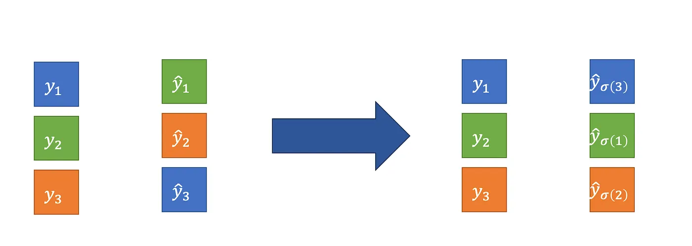
</figure>

The loss function is a pair-wise matching cost between ground truth $y_i=(c_i,b_i)$ (class and bounding box) and a prediction with index $\sigma(i)$.

$$
\mathcal{L}_{match}(y_i, \hat{y}_{\sigma(i)}) = -\mathbb{1}_{\{c_i \neq \emptyset\}} \hat{p}_{\sigma(i)}(c_i) + \mathbb{1}_{\{c_i \neq \emptyset\}} \mathcal{L}_{box}(b_i, \hat{b}_{\sigma(i)})
$$

where $\hat{p}_{\sigma(i)}(c_i)$ is the probability of the prediction belonging to class $c_i$, and the other term is a loss between the bounding boxes.

After finding the optimal matching between the two sets, we can calculate the loss itself.

$$
\mathcal{L}_{\text{Hungarian}}(y, \hat{y}) = \sum_{i=1}^{N} \left[ -\log \hat{p}_{\hat{\sigma}(i)}(c_i) + \mathbb{1}_{\{c_i \neq \emptyset\}} \mathcal{L}_{\text{box}}(b_i, \hat{b}_{\hat{\sigma}}(i)) \right]
$$

where $\hat{\sigma}$ is the optimal assignment we found in the previous step. Next, let's look at the box loss. The box prediction is not made with respect to initial guesses, but directly predicted, so we calculate the loss relative to the ground truth box. The loss itself is composed of generalized IoU (intersection over union) loss and $L_1$ loss.

$$
\mathcal{L}_{box}(b_i, \hat{b}_{\sigma(i)}) = \lambda_{iou} \mathcal{L}_{iou}(b_i, \hat{b}_{\sigma(i)}) + \lambda_{L_1} \|b_i - \hat{b}_{\sigma(i)}\|_1
$$

where the generalized IoU is given by

$$
\mathcal{L}_{iou}(b_i, \hat{b}_{\sigma(i)}) = 1 - \left( \frac{|b_i \cap \hat{b}_{\sigma(i)}|}{|b_i \cup \hat{b}_{\sigma(i)}|} - \frac{|B(b_i, \hat{b}_{\sigma(i)}) \setminus (b_i \cup \hat{b}_{\sigma(i)})|}{|B(b_i, \hat{b}_{\sigma(i)})|} \right)
$$

where $B(b_i, \hat{b}_{\sigma(i)})$ is the smallest enclosing box containing $b_i$ and $\hat{b}_{\sigma(i)}$. As opposed to regular IoU, generalized IoU also considers how far the true box and the predicted box are from each other.

<figure>
  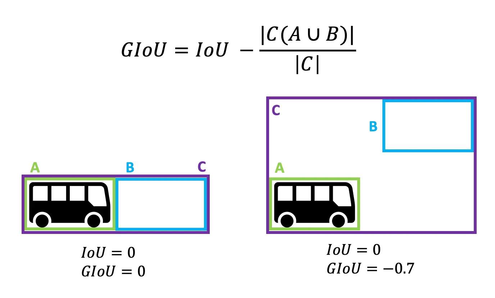
</figure>

## Bonus: DETR for Panoptic Segmentation

DETR was created for object detection tasks, but the authors of the paper showed that they can add a segmentation head after the original architecture to get a panoptic segmentation model. Panoptic means it can assign a class to each pixel in the image (as in a semantic segmentation task), while also separating different objects of the same class (as in an instance segmentation task).

<figure>
  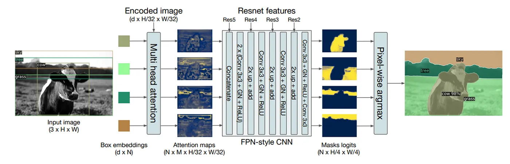
  <figcaption>
    The additional head for panoptic segmentation
  </figcaption>
</figure>

Here are some results of panoptic segmentation with DETR.

<figure>
  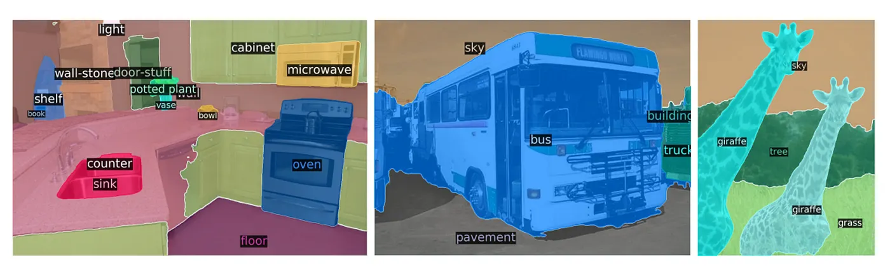
</figure>

## Conclusion

DETR brings a new approach to object detection by leveraging a transformer-based architecture that enables end-to-end training, eliminating the need for pre-designed anchors and traditional post-processing steps like Non-Maximum Suppression (NMS). Its ability to perform parallel decoding allows for more efficient and simultaneous predictions, streamlining the detection process. Additionally, its flexibility makes it a powerful model that can be extended to other tasks, such as panoptic segmentation, showcasing its versatility. With these innovations, DETR paves the way for more streamlined, scalable, and efficient approaches in computer vision.