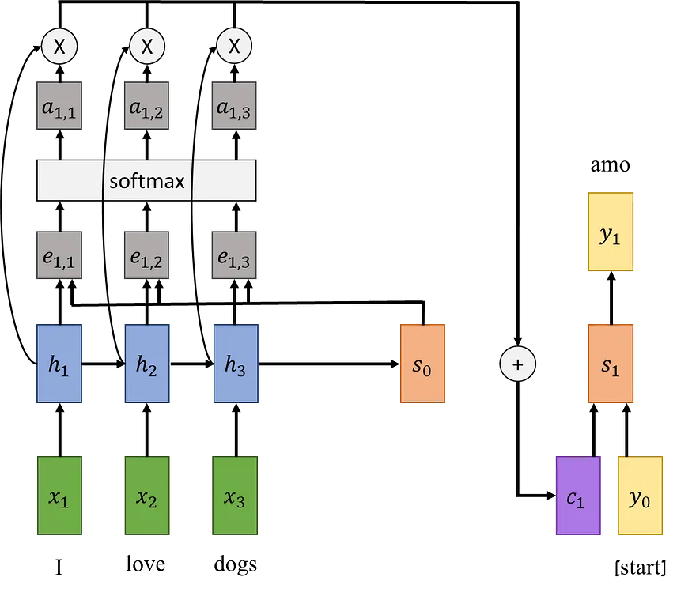
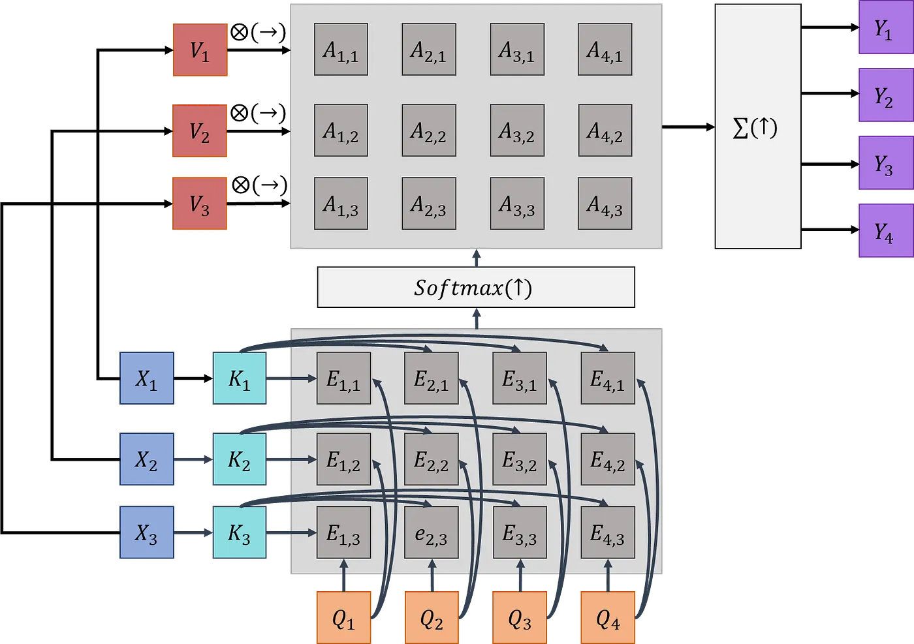
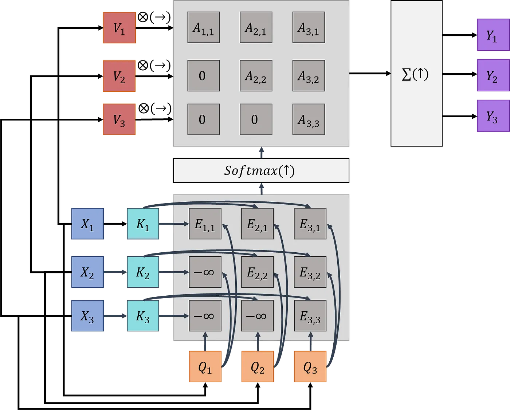
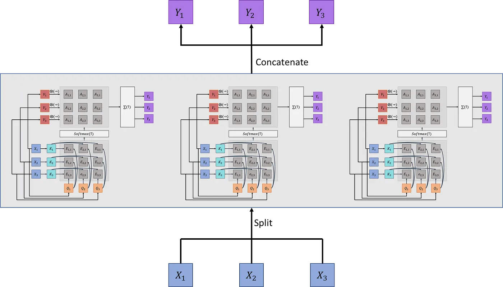
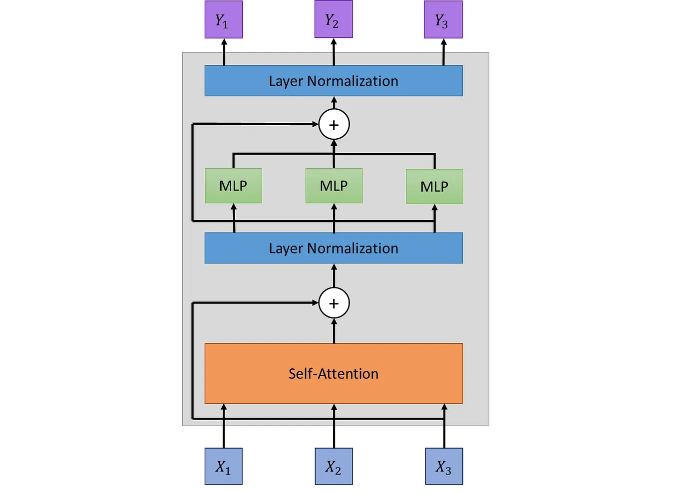

In the [previous post](../attention-what-is-it-and-how-it-works/index.qmd), we discussed the attention mechanism and outlined the challenges it addresses. In this post, we delve into a more mathematical exploration of the attention mechanism, including the introduction of self-attention. Additionally, we look at the Transformer architecture, which is built upon the foundation of self-attention.

From the previous post, we already know that in attention we have a vector (called a query) that we compare using some similarity function to several other vectors (called keys), and we get alignment scores that after applying softmax become the attention weights that apply to the keys and together form a new vector which is a weighted sum of the keys.

<figure>
  
  <figcaption>
    From the previous post. $h$'s are the keys, $s_0$ is the query, the $e$'s are the alignment scores, the $a$'s are the attention weights and $c_1$ is the weighted sum of the keys according to the attention scores.
  </figcaption>
</figure>

Mathematically, we can say we have the following inputs:

$$
\begin{aligned}
&\text{Query vector: } q \ [1 \times D_q] \\
&\text{Key vectors: } X \ [N \times D_X]
\end{aligned}
$$

where inside the `[]` are the dimensions of the vectors (we can look at the key vectors as a matrix composed of $N$ vectors). By using a similarity function we get the alignment scores:

$$
\text{Alignment score: } e_i = f_{att}(q, X_i) \ [i = 1, \dots, N]
$$

where $X_i$ is the $i$-th row of the matrix $X$ (which is a single key). Now we can apply softmax to all the alignment scores.

$$
\text{Attention weights: } a = \text{softmax}(e) \ [1 \times N]
$$

and finally, the output is the weighted sum of the keys.

$$
\text{Output vector: } y = \sum_i a_i X_i \ [1 \times D_X]
$$

Usually, people use a dot product to calculate the similarity between the query and the keys. For using the dot product we need the same dimension for the query and the keys.

$$
\begin{aligned}
&\text{Query vector: } q \ [1 \times D_q] \\
&\text{Key vectors: } X \ [N \times D_q] \\
&\text{Alignment score: } e_i = q \cdot X_i \ [i = 1, \dots, N]
\end{aligned}
$$

In practice, there is a problem with simply using the dot product. If we have vectors with a very high dimension, the dot product result can be very large (since it sums over the product of the elements in the vectors, and there are a lot of elements). This can make the softmax saturate which leads to giving all the weight to a single key, and it will harm the propagation of the gradient, and so the learning of the model.

To address this issue, in the paper [Attention Is All You Need](https://arxiv.org/pdf/1706.03762) the authors suggest scaling the dot product by $\sqrt{D_q}$ (the square root of the query and keys dimension). To understand this choice, let us assume two vectors $q$ and $k$ which are independent random variables with zero mean and variance of one. Now let’s look at the expectation and variance of the dot product.

$$
\begin{aligned}
E[q \cdot k] &= E\left[\sum_i q_i k_i\right] = \sum_i E[q_i k_i] = \sum_i E[q_i] E[k_i] = 0 \\
Var[q \cdot k] &= Var\left[\sum_i q_i k_i\right] = \sum_i Var[q_i k_i] = \sum_i Var[q_i] Var[k_i] = D_q
\end{aligned}
$$

Since

$$
Var[\alpha X] = \alpha^2 Var[X]
$$

if we divide the dot product by $\sqrt{D_q}$ we get

$$
\begin{aligned}
E\left[\frac{q \cdot k}{\sqrt{D_q}}\right] &= \frac{1}{\sqrt{D_q}} E[q \cdot k] = 0 \\
Var\left[\frac{q \cdot k}{\sqrt{D_q}}\right] &= \frac{1}{D_q} Var[q \cdot k] = 1
\end{aligned}
$$

Hence, by dividing by $\sqrt{D_q}$ we keep the result with a mean of zero and variance of 1. Keep in mind that for this logic to work, one needs to maintain the network to normalize the values so they will be about zero mean and variance of one.

Instead of using one query at each time, we can use multiple queries at once by arranging the queries in a matrix.

$$
\begin{aligned}
&\text{Query vectors: } Q \ [N_Q \times D_Q] \\
&\text{Key vectors: } X \ [N_X \times D_Q] \\
&\text{Alignment score: } E = \frac{QX^T}{\sqrt{D_Q}} \ [N_Q \times N_X]
\end{aligned}
$$

Where each entry of the matrix $E$ is given by a scaled dot product between a query and a key.

$$
E_{i,j} = \frac{Q_i \cdot X_j}{\sqrt{D_q}}
$$

The indexes $i$ and $j$ for $Q$ and $X$ are the $i$-th and $j$-th rows in the queries matrix and keys matrix, respectively.

To get the attention weights we take a softmax along the rows of $E$ because each row contains the alignment scores for a query.

$$
\text{Attention weights: } A = \text{Softmax}(E, dim=1) \ [N_Q \times N_X]
$$

Finally, we get the output matrix by calculating

$$
\text{Output matrix: } Y = AX \ [N_Q \times D_Q]
$$

Each row is a weighted sum of the keys according to the attention weights, and the number of rows is the same as the number of queries. You can also think about it as the $i$-th row of $Y$ is given by

$$
Y_i = \sum_j A_{i,j} X_j
$$

## Queries, Keys, and Values

Up until now, we have used the keys both as actual keys to calculate similarity with the queries, but we also have used them again to calculate the output. In this way, $X$ fulfills two different purposes. So, instead, we can transform $X$ into two new matrices: one will be used as a keys matrix and the other one will be used to calculate the output, and it will be called a values matrix. The transformation will be made by using two learnable matrices

$$
\begin{aligned}
&W_K \ [D_X \times D_Q] \\
&W_V \ [D_X \times D_V]
\end{aligned}
$$

Pay attention that now the matrix $X$ can have a dimension $D_X$ instead of $D_Q$ since $W_K$ will convert it to be the same as the queries. Now we can get the key vectors and value vectors as

$$
\begin{aligned}
&\text{Query vectors: } Q \ [N_Q \times D_Q] \\
&\text{Input vectors: } X \ [N_X \times D_X] \\
&\text{Key vectors: } K = XW_K \ [N_X \times D_Q] \\
&\text{Value vectors: } V = XW_V \ [N_X \times D_V]
\end{aligned}
$$

For the similarity we use $K$ instead of $X$, and for the output, $V$ instead of $X$.

$$
\begin{aligned}
&\text{Alignment score: } E = \frac{QK^T}{\sqrt{D_Q}} \ [N_Q \times N_X] \\
&\text{Attention weights: } A = \text{Softmax}(E, dim=1) \ [N_Q \times N_X] \\
&\text{Output matrix: } Y = AV \ [N_Q \times D_V]
\end{aligned}
$$

We can illustrate this in the following diagram.

<figure>
  
  <figcaption>
    The arrows show the direction of the operator. The $\otimes$ is for elementwise multiplication.
  </figcaption>
</figure>

## Self Attention

In all previous examples, we had some input and a query. In the self-attention case, we don’t have separate query vectors. Instead, we use the input to compute query vectors in a similar way to the one we used in the previous section to compute the keys and the values. We introduce a new learnable matrix $W_Q$ and compute $Q$ from the input $X$.

$$
\begin{aligned}
&W_Q \ [D_X \times D_Q] \\
&\text{Input vectors: } X \ [N_X \times D_X] \\
&\text{Query vectors: } Q = XW_Q \ [N_X \times D_Q]
\end{aligned}
$$

All the other components remain exactly as in the previous section.

<figure>
  
  <figcaption>
    The arrows show the direction of the operator. The $\otimes$ is for elementwise multiplication.
  </figcaption>
</figure>

## Attention and Order

Look at the previous figure and assume we switch between $X_1$ and $X_3$. What will happen in that case? If you think about it a little you will see that all the calculations remain the same, but the order is changed according to the change in the input. So, in the output, we will get the same vectors but permuted according to the input permutation.

Therefore, attention (and specifically self-attention) is permutation equivariant, meaning the permutation doesn’t change the result up to a permutation of the output. That implies that self-attention doesn’t care about the order of the input, and there is no meaning of order for it.

However, sometimes we care about the order (for example in a sequence). To solve this problem, we can add some positional information to the input. This information is called positional encoding, and there are many ways to create such an encoding. In the paper “[Attention Is All You Need](https://arxiv.org/pdf/1706.03762)”, the authors use sine and cosine functions of different frequencies.

## Masked Self-Attention

In some tasks, not only is the order important, we also don’t want the network to look at the future. For example, if we want our network to predict the next word in a sentence we may not want a word to “see” the words that follow it, only the words previous to it.

To prevent a vector from “looking ahead” to the next vectors, we can mask the alignment scores, so that the score for the similarity between a vector and the vectors ahead of it will be minus infinity, which becomes zero after the softmax. In this way, at the output, the “future” vectors don’t influence it.

<figure>
  
</figure>

## Multihead Self-Attention

Another way to use the self-attention mechanism is by multihead self-attention. In this architecture, we take the input vectors $X$ and split each of them into $h$ sub-vectors, so if the original dimension of an input vector is $D$, the new sub-vectors have a dimension of $D/h$. Each of the sub-vectors inputs to a different self-attention block, and the results of all the blocks are concatenated to the final outputs.

<figure>
  
</figure>

The multiheading approach has several advantages such as improved performance, leveraging parallelization, and even acting as regularization. But one of the most powerful features it presents is capturing different dependencies. By using multiple attention heads, the model can simultaneously attend to different positions in the input sequence. Each attention head can learn different relationships between vectors, allowing the model to capture various kinds of dependencies and relationships within the data.

## The Transformer

In this section, we will go over the basic ideas behind the transformer architecture. What is special about the transformer is that it only uses the self-attention mechanism to make interactions between the vectors. All the other components work independently on each vector.

We won’t go into much detail, but we will present the main idea of the transformer block. You can read more [here](https://arxiv.org/pdf/1706.03762).

<figure>
  
  <figcaption>
    Illustration of the transformer block
  </figcaption>
</figure>

As you can see in the above figure, we have a set of input vectors that go into a self-attention block. This is the only place where the vectors interact with each other. Then we use a skip connection between the input and the output of the self-attention block, and we apply layer normalization. The layer normalization block normalizes each vector independently. Then the vectors go into separate MLP blocks (again, these blocks operate on each vector independently), and the output is added to the input using a skip connection. Finally, the vectors go into another layer normalization block, and we get the output of the transformer block. The transformer itself is composed of a stack of transformer blocks.

## Conclusion

In this post, we saw a mathematical approach to the attention mechanism. We introduced the ideas of keys, queries, and values, and saw how we can use scaled dot product to compare the keys and queries and get weights to compute the outputs for the values. We also saw that we can use the input to generate the keys, queries, and values in the self-attention mechanism. We presented what to do when the order of the input matters, how to prevent the attention from looking into the future in a sequence, and the concept of multihead attention. Finally, we briefly introduced the transformer architecture which is built upon the self-attention mechanism.