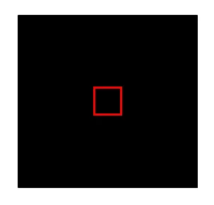
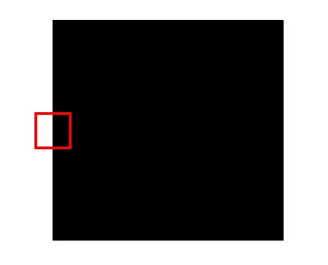
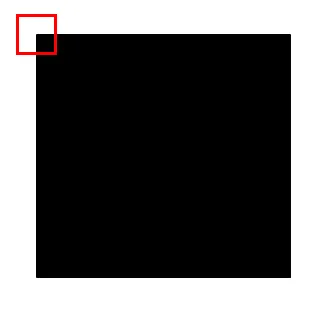
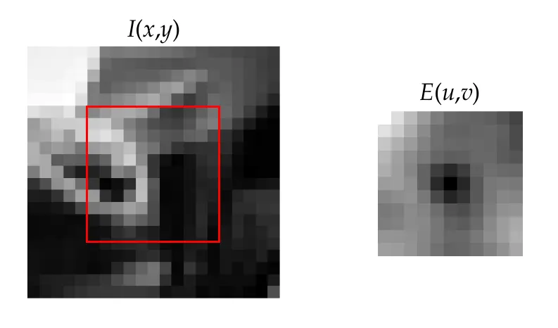
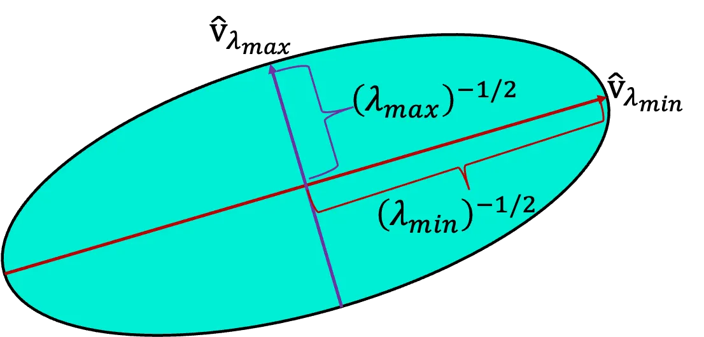
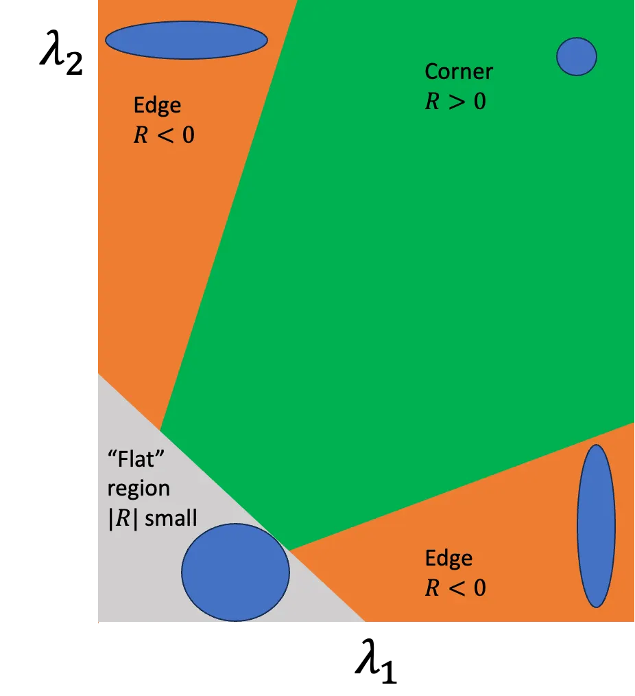
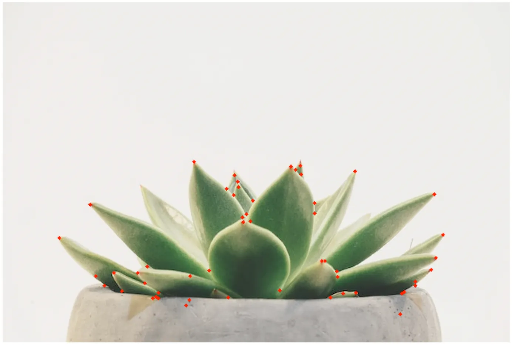

In many computer vision tasks, we need to find some *interest points* — points in the image we can detect and describe and then use for a task, such as image-stitching and detection.

The first question one should ask is what is a good interest point (also called a *feature*). We want such a point to be well-defined so we can detect it precisely and repetitively. To get a feeling of what is a good feature point, let's look at some scenarios in an image. First, we look at a point with similar values around it, like a middle of a black square.

<figure>
  
</figure>

This is not a good feature since we can't detect it precisely. We can move the red square a little in any direction, and we don't even know we have moved.

Now, let's look at an edge:

<figure>
  
</figure>

If the red square moves a little to the right or to the left, we can see something has changed, but if it moves a little up or down, we can't tell if something has changed. So this is also not a good feature to detect precisely.

What about the corner?

<figure>
  
</figure>

Here any movement of the red square results in some changes inside it. We can say exactly where this point is! Think about it, if I ask you to point to the center of the square, you can only guess where it is and pick some point in the area of the center. But, if I ask you to point to the top left corner, you know exactly where it is. Thus, the corner is a good feature.

What characterizes the corner is that it has gradients (changes) in more than one direction, so it is easy to say if something changes when we move a little.

## The Mathematics

We want now to formulate the idea of changes when moving a little bit from a pixel in the image. For that, we introduce the following error function:

$$
E(u, v) = \sum_{x,y} w(x,y) \left[ I(x+u, y+v) - I(x,y) \right]^2
$$

where $x$ and $y$ are the pixel's coordinates, $u$ and $v$ are a shift amount, $I$ is the intensity of the image at some point (the value of a pixel), and $w$ is a window function. This formula calculates the error we will get if we move the image by $u$ and $v$ (inside some window).

<figure>
  
  <figcaption>
    An image <em>I with a window (left) and the error as a function of the shift (right)</em>
  </figcaption>
</figure>

In the figure above, you can see that at $E(0, 0)$ (the center), the value is 0 (perfect black) since there are no changes with a shift of zero, and so the error function got zero. When the shift becomes bigger, the error function gets bigger too.

A corner region should change even for a small shift, so we want to see what happens to the error function for a small shift. For that, we can use the Taylor series. We are going to develop a second-order expansion of the error function, but first, let's recall how a second-order Taylor series around $x_0$ looks like

$$
f(x - x_0) \approx f(x_0) + f'(x_0)(x - x_0) + \frac{1}{2} f''(x_0)(x - x_0)^2
$$

for the error function expansion, we set $x_0 = 0$, so

$$
f(x) \approx f(0) + f'(0)x + \frac{1}{2} f''(0)x^2
$$

but the error function is a two-variable function, so the Taylor series is a little more complicated and can be written in a matrix notation as

$$
E(u, v) \approx E(0,0) + \begin{bmatrix} u & v \end{bmatrix} \begin{bmatrix} E_u(0,0) \\ E_v(0,0) \end{bmatrix} + \frac{1}{2} \begin{bmatrix} u & v \end{bmatrix} \begin{bmatrix} E_{uu}(0,0) & E_{uv}(0,0) \\ E_{uv}(0,0) & E_{vv}(0,0) \end{bmatrix} \begin{bmatrix} u \\ v \end{bmatrix}
$$

where the $u$ and $v$ subscript mean derivative according to $u$ and $v$, respectively (and $uu$ is the second derivative according to $u$ and so on). You can expand the expression above and see this is a regular 2-dimensional Taylor series.

Let's calculate the first derivatives:

$$
\begin{aligned}
E_u(u,v) &= \sum_{x,y} 2w(x,y) \left[ I(x+u,y+v) - I(x,y) \right] I_x(x+u,y+v) \\
E_v(u,v) &= \sum_{x,y} 2w(x,y) \left[ I(x+u,y+v) - I(x,y) \right] I_y(x+u,y+v)
\end{aligned}
$$

Notice that the direction of $u$ is the same as $x$, and the direction of $v$ is the same as $y$. For the second derivatives:

$$
\begin{aligned}
E_{uu}(u,v) &= \sum_{x,y} 2w(x,y) I_x(x+u,y+v) I_x(x+u,y+v) \\
&\quad + \sum_{x,y} 2w(x,y) \left[ I(x+u,y+v) - I(x,y) \right] I_{xx}(x+u,y+v)
\end{aligned}
$$

and similarly for $v$

$$
\begin{aligned}
E_{vv}(u,v) &= \sum_{x,y} 2w(x,y) I_y(x+u,y+v) I_y(x+u,y+v) \\
&\quad + \sum_{x,y} 2w(x,y) \left[ I(x+u,y+v) - I(x,y) \right] I_{yy}(x+u,y+v)
\end{aligned}
$$

and the cross derivative

$$
\begin{aligned}
E_{uv}(u,v) &= \sum_{x,y} 2w(x,y) I_y(x+u,y+v) I_x(x+u,y+v) \\
&\quad + \sum_{x,y} 2w(x,y) \left[ I(x+u,y+v) - I(x,y) \right] I_{xy}(x+u,y+v)
\end{aligned}
$$

Recall now that we evaluate the derivative at $(u, v) = (0, 0)$, so a lot of things are going to vanish.

$$
\begin{aligned}
E(0,0) &= 0 \\
E_u(0,0) &= 0 \\
E_v(0,0) &= 0 \\
E_{uu}(0,0) &= \sum_{x,y} 2w(x,y) I_x(x,y) I_x(x,y) \\
E_{vv}(0,0) &= \sum_{x,y} 2w(x,y) I_y(x,y) I_y(x,y) \\
E_{uv}(0,0) &= \sum_{x,y} 2w(x,y) I_y(x,y) I_x(x,y)
\end{aligned}
$$

Notice there are no more second or cross derivatives of $I$. Now we can rewrite the equation for the error function as

$$
E(u, v) \approx \begin{bmatrix} u & v \end{bmatrix} \begin{bmatrix} \sum_{x,y} w(x,y) I_x^2(x,y) & \sum_{x,y} w(x,y) I_x(x,y) I_y(x,y) \\ \sum_{x,y} w(x,y) I_x(x,y) I_y(x,y) & \sum_{x,y} w(x,y) I_y^2(x,y) \end{bmatrix} \begin{bmatrix} u \\ v \end{bmatrix}
$$

The matrix in the equation above can be written as

$$
M = \sum_{x,y} w(x,y) \begin{bmatrix} I_x^2 & I_x I_y \\ I_x I_y & I_y^2 \end{bmatrix}
$$

Now, let's suppose we can write the matrix $M$ using the eigen decomposition so

$$
M = P \begin{bmatrix} \lambda_1 & 0 \\ 0 & \lambda_2 \end{bmatrix} P^{-1}
$$

where $\lambda_1$ and $\lambda_2$ are the eigenvalues of $M$ and $P$ is a matrix with eigenvectors as columns

$$
P = \begin{bmatrix} \mathbf{v}_1 & \mathbf{v}_2 \end{bmatrix}
$$

We can write the vector $\mathbf{u} = [u, v]$ using a linear combination of the eigenvectors as

$$
\mathbf{u} = a \mathbf{v}_1 + b \mathbf{v}_2
$$

and recall that if $\mathbf{v}_1$ is an eigenvector of the matrix $M$ with eigenvalue $\lambda_1$, then

$$
M \mathbf{v}_1 = \lambda_1 \mathbf{v}_1
$$

Let's use all of that in the function of the error.

$$
\begin{aligned}
E(u,v) &= \mathbf{u}^T M \mathbf{u} = (a \mathbf{v}_1 + b \mathbf{v}_2)^T M (a \mathbf{v}_1 + b \mathbf{v}_2) \\
&= (a \mathbf{v}_1^T + b \mathbf{v}_2^T)(a \lambda_1 \mathbf{v}_1 + b \lambda_2 \mathbf{v}_2) \\
&= \lambda_1 a^2 + \lambda_2 b^2 \\
&= \frac{a^2}{\left(\lambda_1^{-1/2}\right)^2} + \frac{b^2}{\left(\lambda_2^{-1/2}\right)^2}
\end{aligned}
$$

We assume the eigenvectors are normalized, and also they are orthogonal (so their dot product is 0). Notice that the last expression is an expression of an ellipse for some **constant** error. The ellipse axes are according to the direction of the eigenvectors, and their length is according to the eigenvalues. The values of $a$ and $b$ are the length in the direction of $\mathbf{v}_1$ and $\mathbf{v}_2$ that are needed to reconstruct the vector $\mathbf{u}$.

<figure>
  
</figure>

The question that arises now is what is the meaning of the result above. Let's start by assuming both $\lambda_1$ and $\lambda_2$ are small numbers. In this case, the axes of the ellipse will be very large. That means we need a big step in any of the eigenvector directions to get a high error, which means that the image is relatively flat (slow changes).

If, on the other hand, $\lambda_1 \gg \lambda_2$, the axis in $\mathbf{v}_1$ direction will be much smaller than the one of $\mathbf{v}_2$. If so, for some error, a little step in $\mathbf{v}_1$ direction will be sufficient to satisfy the equation, but if we choose to go with the other direction, we need a much bigger step. This is a case of an edge in the image, where one direction causes a little change and so a little error, while the other direction can make a big change with a small shift.

Finally, if $\lambda_1$ and $\lambda_2$ are both large and similar in size, the ellipse will be small and with a shape more similar to a circle which implies a significant change in all directions. This is a case of a corner.

<figure>
  
</figure>

The calculation of the eigenvalues can be expensive, but since we are interested in the relation between the eigenvalues, we don't actually need to compute them. Instead, recall that the *determinant* of a matrix is the multiplication of the eigenvalues, and the *trace* (sum of the elements on the diagonal) is the sum of the eigenvalues. So, instead of getting the eigenvalues themselves, we can calculate another number — $R.$

$$
R = \text{det}(M) - \alpha \text{trace}(M)^2 = \lambda_1 \lambda_2 - \alpha (\lambda_1 + \lambda_2)^2
$$

where $\alpha$ is a constant between 0.04 and 0.06 found empirically. If both eigenvalues are large, the value of $R$ will be large, and it's a corner. If just one of the eigenvalues is large, the result of $R$ will be a large negative value. And, if the magnitude of $R$ is small, this is the case of a “flat” region where the eigenvalues are small numbers.

<figure>
  
</figure>

## Harris Corners Detector Algorithm

The algorithm for detecting corners is as follows:

1. Convert the image into a gray-scale image
2. Apply Gaussian blurring to reduce noise
3. Take derivatives in both $x$ and $y$ directions for each pixel
4. Compute the $M$ matrix using a window around each pixel
5. Compute $R$
6. Threshold $R$
7. For accurate localization, one can add non-maximum suppression

## Coding It

Let's write a simple code to find corners and mark them with red circles. First, we import the necessary modules

```python
import numpy as np
from numpy.linalg import det
import matplotlib.pyplot as plt
import cv2  # OpenCV
```

We define a function for non-maximum suppression

```python
def non_maximum_suppression(matrix, kernel_size=5):
    kernel = cv2.getStructuringElement(cv2.MORPH_RECT, (kernel_size, kernel_size))  # rectangular kernel
    maxed_matrix  = cv2.dilate(matrix, kernel)  # get maximum value in the window for each pixel
    non_maximum_suppression_matrix = matrix.copy()
    non_maximum_suppression_matrix[matrix != maxed_matrix] = 0  # set to 0 pixel originally are not local maxima
    return non_maximum_suppression_matrix
```

And implement a function for the Harris detector algorithm

```python
def corner_detector(image, window_size, k, threshold):
    image_copy = image.copy()  # get copy of the image so the original one won't be changed
    height = image.shape[0]
    width = image.shape[1]
    # step 1: convert to gray-scale
    gray_image = cv2.cvtColor(image, cv2.COLOR_BGR2GRAY)
    # step 2: reduce noise using Gaussian blurring
    image_blurred = cv2.GaussianBlur(gray_image, (3, 3), 0)
    
    # step 3: get the derivatives using Sobel operator
    Ix = cv2.Sobel(image_blurred, cv2.CV_64F, 1, 0, ksize=3)
    Iy = cv2.Sobel(image_blurred, cv2.CV_64F, 0, 1, ksize=3)
    # compute the basic components of the M matrix
    IxIx = Ix ** 2
    IyIy = Iy ** 2
    IxIy = Ix * Iy

    offset = window_size // 2  # offset from the edge of the image so the all window will be inside the image
    image_R_matrix = np.zeros((height, width))
    # go over each pixel
    for y in range(offset, height - offset):
        for x in range(offset, width - offset):
            #  step 4: compute the element of the M matrix
            M_00 = np.sum(IxIx[y-offset:y+offset+1, x-offset:x+offset+1])
            M_11 = np.sum(IyIy[y-offset:y+offset+1, x-offset:x+offset+1])
            M_01 = np.sum(IxIy[y-offset:y+offset+1, x-offset:x+offset+1])
            M = np.array([[M_00, M_01], [M_01, M_11]])
            #  step 5: compute R
            R = det(M) - k * (np.trace(M) ** 2)
            image_R_matrix[y, x] = R

    # normalize the values of Rs to be between 0 and 1
    cv2.normalize(image_R_matrix, image_R_matrix, alpha=0, beta=1, norm_type=cv2.NORM_MINMAX)
    #  step 6: thresholding R
    is_corner = image_R_matrix > threshold
    image_R_matrix[~is_corner] = 0
    #  step 7: apply non-maximum suppression
    image_R_matrix = non_maximum_suppression(image_R_matrix)
    
    #  draw circle around the corners
    for y in range(offset, height - offset):
        for x in range(offset, width - offset):
            if image_R_matrix[y, x] != 0:
                cv2.circle(image_copy, (x, y), 1, (0, 0, 255), -1)

    return image_copy
```

And we can use the code with

```python
image = cv2.imread('./im.jpg')
corner_image = corner_detector(image, 5, 0.04, 0.24)
plt.imshow(corner_image[:, :, ::-1])
plt.show()
```

and the final result:

<figure>
  
</figure>
