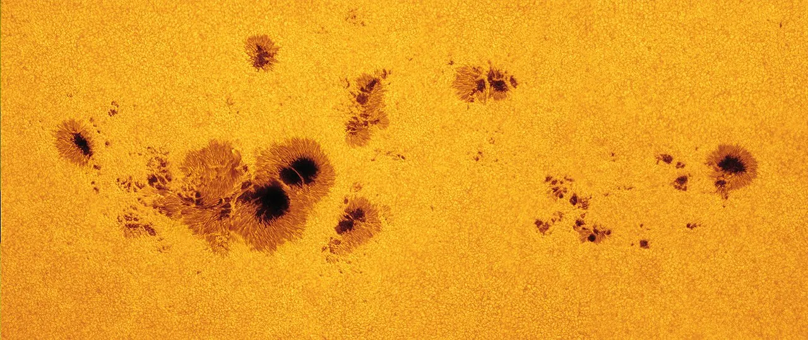
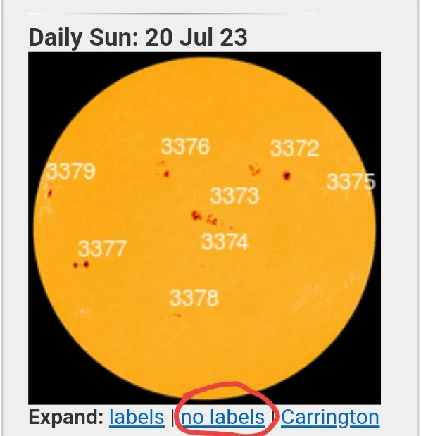
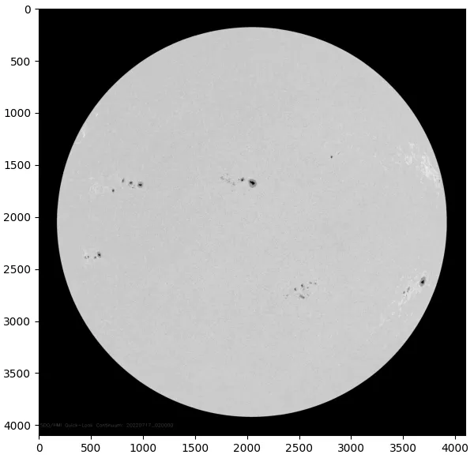
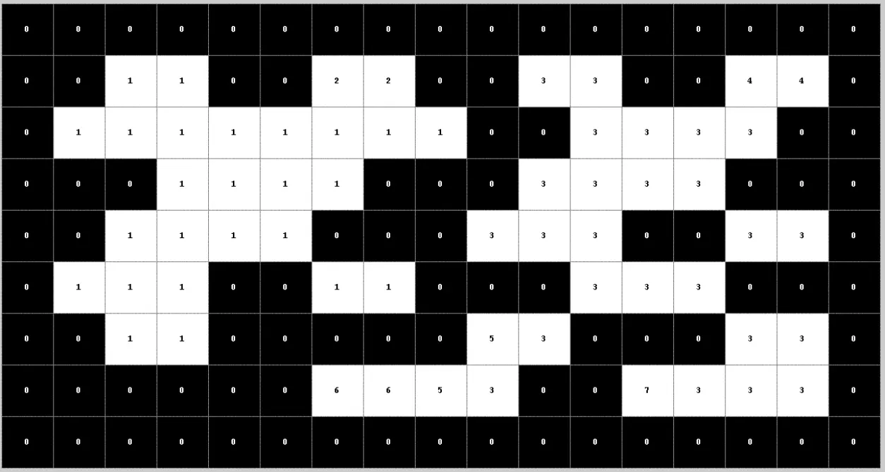
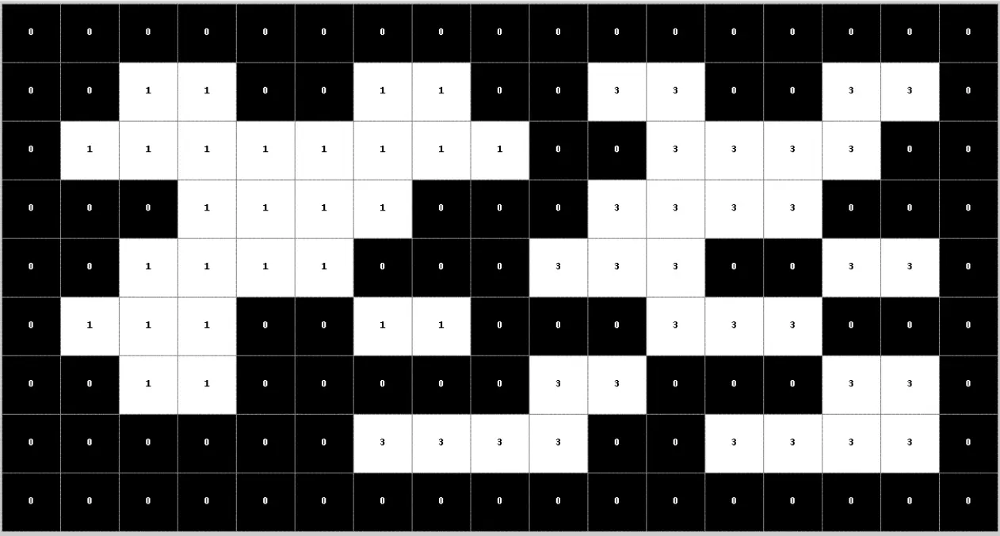
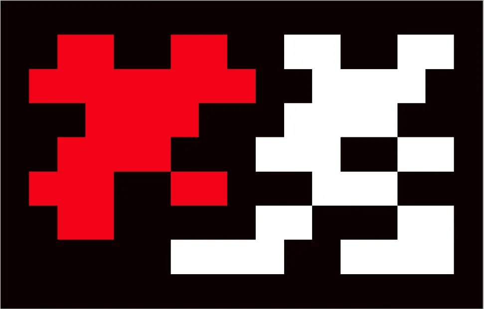
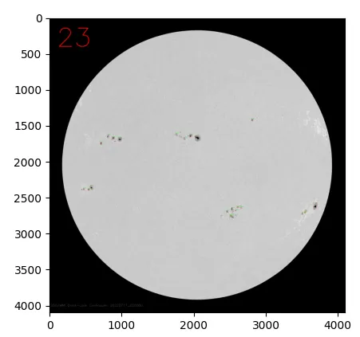
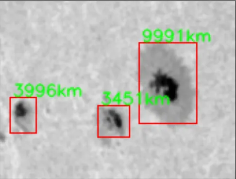

Sunspots are phenomena on the sun's surface that appear as temporary dark spots. In the region of the spots, the temperature is lower than the surface around, which makes the spot region look darker.

<figure>
  
  <figcaption>
    Image by NASA
  </figcaption>
</figure>

Although the spots can look small, they are actually huge and can be bigger than Earth.

In this article, we are going to use photos of the sun from [SpaceWeather](https://spaceweather.com/), search for sunspots and determine their size.

## Getting the Data

The first step is to get an image of the sun from SpaceWeather. We can manually download an image from the website as in the figure below:

<figure>
  
  <figcaption>
    Go to the sun photo on the left side and click "no label"
  </figcaption>
</figure>

But it will be much nicer if Python gets the photos for us. The simplest way (although it may not work for old photos) is to look at the URL of the photo.

For instance, let’s look at the URL of a photo from the 20th of July 2023: `spaceweather.com/images2023/20jul23/hmi4096_blank.jpg`. We can see a pattern in the URL we can handle simply.

```python
from datetime import datetime

date = datetime(2022, 7, 17)
url = f'https://spaceweather.com/images{date.year}/{date.strftime("%d%b%y").lower()}/hmi4096_blank.jpg'
```

In the above code block, we import the `datetime` class to handle dates. We create a `datetime` object with the date we want a photo of (in this case, the 17th of July 2022) and then compose the URL for the image using the date.

Now that we have the URL for the date we want, we can read the image data

```python
from urllib.request import urlopen
import numpy as np
import cv2  # OpenCV

resp = urlopen(url)
image = np.asarray(bytearray(resp.read()), dtype="uint8")
image = cv2.imdecode(image, cv2.IMREAD_COLOR)
image = cv2.cvtColor(image, cv2.COLOR_BGR2GRAY)
```

We use the `urlopen` function to connect to the image on the web, and then read the data of the image as a byte array and convert it to a numpy array. We decode that array into an image using `imdecode` from OpenCV and finally convert it into a grayscale image.

<figure>
  
  <figcaption>
    A grayscale image of the sun with sunspots
  </figcaption>
</figure>

We succeeded in getting the image of the sun and loading it into our environment. Now we want to find the sunspots.

## Finding Spots

To find the spots, we use two main techniques. The first one is adaptive thresholding, and the second is connected components.

In regular thresholding, we pick a threshold value (in an uint8 image, an integer between 0 and 255), and if the value of a pixel is above it, we set its new value to 255, otherwise to 0. A more sophisticated method is to use an adaptive threshold—a different threshold for each pixel that depends on the neighborhood of that pixel. For example, the threshold can be the mean of some window or a weighted sum using a Gaussian window. We can also move this value with a scalar to pick a value bigger or smaller than the mean. Again, if the value of the pixel is greater than the threshold, we set it to 255, otherwise to 0. In our case, it can be more convenient to set the sunspots to white (255) and keep the background black. For that, we can use inverse thresholding, which sets to 255 pixels with values smaller than the threshold. The reason to use such thresholding is that the sunspot should be darker than its neighbor regions.

The connected components is a technique to group pixels into blobs in a black and white image. The basic idea behind this algorithm is simple and can be described as follows: start from the top left pixel (we assume it is black) and mark it as belonging to component 0 (all black pixels are considered as background, and we set them to group 0). Continue to the next pixel on the right until finding a white pixel, and set it to 1. If the next pixel is also white, we set it to 1 since it touches another white pixel with the label 1. Continue so up to the end of the row, and then go to the next row. For any white pixel that touches another white pixel with a label, we set it to the same component as the pixel it touches. If the new white pixel does not touch any other white pixel which has already been set to some group, we set it to a new group.

<figure>
  
  <figcaption>
    First scan result. We can see pixels with different labels in the same blob. Image from
    <a href="https://en.wikipedia.org/wiki/Connected-component_labeling">
      Wikipedia
    </a>
  </figcaption>
</figure>

After the first run, we may see pixels in the same blob but with different labels, as in the figure above. To solve it, we search for a relation between the different labels. If we find a white pixel that has a white pixel neighbor but with a different label, we mark those labels as equivalent. For example, in the figure above, labels 1 and 2 are equivalent, and so are labels 3, 4, 5, 6, and 7. We replace the equivalent labels with one label and get the components.

<figure>
  
  <figcaption>
    After removing redundant labels. Image from
    <a href="https://en.wikipedia.org/wiki/Connected-component_labeling">
      Wikipedia
    </a>
  </figcaption>
</figure>

In the figure above, we see that we found two blobs.

You can watch the following video to understand better the process:



Let’s code now!

```python
def find_spots_adaptive(image):
    image_blur = cv2.GaussianBlur(image, (13, 13), 0)
    binary_img = cv2.adaptiveThreshold(image_blur, 255, cv2.ADAPTIVE_THRESH_GAUSSIAN_C, cv2.THRESH_BINARY_INV, 301, 30)
    binary_img = cv2.dilate(binary_img, None, iterations=1)
    binary_img = cv2.erode(binary_img, None, iterations=1)
```

We create a function to find the sunspots using adaptive thresholding and connected components. We start by blurring the image a little to remove noise and then binarize it using inverse adaptive thresholding with a Gaussian window so that the darker spots will be white and the other pixels will be black. We apply dilation followed by erosion to close small holes which may be present.

```python
    _, _, boxes, centroid = cv2.connectedComponentsWithStats(binary_img)
```

On the binary image, we use the function `connectedComponentsWithStats`. This function returns all the connected components in the image. As already explained, connected component is a blob built from white pixels that touch each other.

<figure>
  
  <figcaption>
    Image with three connected components (black background, red, and white). Each pixel in a component touches another pixel in the component. Image from
    <a href="https://en.wikipedia.org/wiki/Connected-component_labeling">
      Wikipedia
    </a>
  </figcaption>
</figure>

Pay attention that the background itself is considered a connected component. In the `boxes` variable, we have the top left (x, y) and the width and height of the bounding rectangle of the components (where the first one is the background), and also the total area (in pixels) for each component. The `centroid` variable stores the (x, y) coordinate of the center of the component.

```python
    boxes = boxes[1:]
    filtered_boxes = []
    filtered_centroid = []
    for (x, y, w, h, pixels), cent in zip(boxes, centroid):
        if pixels < 10000 and h > 10 and w > 10:
            filtered_boxes.append((x, y, w, h))
            filtered_centroid.append(cent)
```

We continue our function by throwing the first component since it is the background. Then, we want to filter the components and keep only blobs that can be a sunspot. We go over the components and keep blobs with a size greater than 10 pixels and an area of less than 10,000 pixels.

```python
    pixel_size_km = 363.313
    im_rgb = cv2.cvtColor(image, cv2.COLOR_GRAY2RGB)
    oversize = 2
    for x, y, w, h in filtered_boxes:
        cv2.rectangle(im_rgb, (x - oversize, y - oversize), (x + w + oversize, y + h + oversize), (255, 0, 0), 1)
    for (x, y, w, h), (x_cent, y_cent) in zip(filtered_boxes, filtered_centroid):
        r = max(w / 2, h / 2)
        cv2.putText(im_rgb, f'{int(pixel_size_km * r)}km', (x, y - 3), cv2.FONT_HERSHEY_SIMPLEX, 0.4, (0, 255, 0), 1,
                    cv2.LINE_AA)
    cv2.putText(im_rgb, f'{len(filtered_boxes)}', (100, 400), cv2.FONT_HERSHEY_SIMPLEX, 12, (255, 0, 0), 10, cv2.LINE_AA)
    return im_rgb
```

Finally, we want to mark the spots in the image and estimate the size. To determine the size of the spots, we can find the diameter of the sun in pixels (manually measure it from the image), while we know that the real diameter of the sun is about 1.4 million kilometers. From that, we can convert pixels to kilometers.

We convert our image back to a color image and then draw a red rectangle over the detected spots, and also add text with the radius of the spot, estimated as the maximum between half the width and half the height of the bounding rectangle. At the corner of the image, we also add the number of spots detected.

<figure>
  
  <figcaption>
    The final result with the sunspots marked.
  </figcaption>
</figure>

<figure>
  
  <figcaption>
    A zoom-in to the spots.
  </figcaption>
</figure>

## Conclusion

In this article, we saw how we could get an image of the sun and detect sunspots with their size using Python and OpenCV and techniques such as adaptive thresholding and connected components.

The full code:

```python
from datetime import datetime
from urllib.request import urlopen
import numpy as np
import cv2  # OpenCV

def find_spots_adaptive(image):
    image_blur = cv2.GaussianBlur(image, (13, 13), 0)
    binary_img = cv2.adaptiveThreshold(image_blur, 255, cv2.ADAPTIVE_THRESH_GAUSSIAN_C,
                                       cv2.THRESH_BINARY_INV, 301, 30)
    binary_img = cv2.dilate(binary_img, None, iterations=1)
    binary_img = cv2.erode(binary_img, None, iterations=1)
    
    _, _, boxes, centroid = cv2.connectedComponentsWithStats(binary_img)
    
    boxes = boxes[1:]
    filtered_boxes = []
    filtered_centroid = []
    for (x, y, w, h, pixels), cent in zip(boxes, centroid):
        if pixels < 10000 and h > 10 and w > 10:
            filtered_boxes.append((x, y, w, h))
            filtered_centroid.append(cent)
    
    pixel_size_km = 363.313
    im_rgb = cv2.cvtColor(image, cv2.COLOR_GRAY2RGB)
    oversize = 2
    for x, y, w, h in filtered_boxes:
        cv2.rectangle(im_rgb, (x - oversize, y - oversize), (x + w + oversize, y + h + oversize), (255, 0, 0), 1)
    
    for (x, y, w, h), (x_cent, y_cent) in zip(filtered_boxes, filtered_centroid):
        r = max(w / 2, h / 2)
        cv2.putText(im_rgb, f'{int(pixel_size_km * r)}km', (x, y - 3), cv2.FONT_HERSHEY_SIMPLEX, 0.4, (0, 255, 0), 1,
                    cv2.LINE_AA)
    cv2.putText(im_rgb, f'{len(filtered_boxes)}', (100, 400), cv2.FONT_HERSHEY_SIMPLEX, 12, (255, 0, 0), 10, cv2.LINE_AA)
    return im_rgb

date = datetime(2022, 7, 17)
url = f'https://spaceweather.com/images{date.year}/{date.strftime("%d%b%y").lower()}/hmi4096_blank.jpg'
resp = urlopen(url)
image = np.asarray(bytearray(resp.read()), dtype="uint8")
image = cv2.imdecode(image, cv2.IMREAD_COLOR)
image = cv2.cvtColor(image, cv2.COLOR_BGR2GRAY)

spots_im = find_spots_adaptive(image)
```