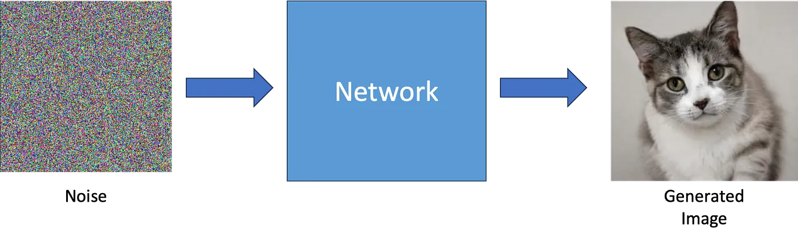
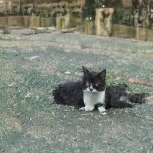
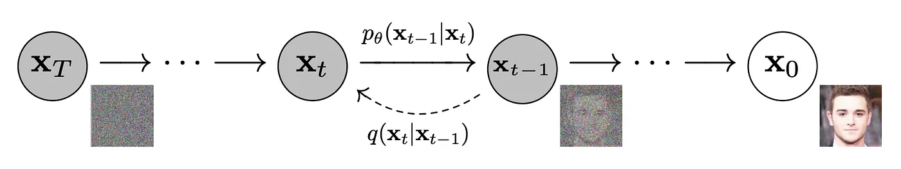
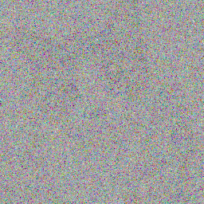

This post is part of a series of posts about diffusion models:

- [Intro to Diffusion Model — Part 1](../intro-to-diffusion-model-part-1/index.qmd) (this post)
- [Intro to Diffusion Model — Part 2](../intro-to-diffusion-model-part-2/index.qmd)
- [Intro to Diffusion Model — Part 3](../intro-to-diffusion-model-part-3/index.qmd)
- [Intro to Diffusion Model — Part 4](../intro-to-diffusion-model-part-4/index.qmd)
- [Intro to Diffusion Model — Part 5](../intro-to-diffusion-model-part-5/index.qmd)
- [Intro to Diffusion Model — Part 6](../intro-to-diffusion-model-part-6/index.qmd)
- [Intro to Diffusion Model — Part 7](../intro-to-diffusion-model-part-7/index.qmd)
- [Full implementation](https://github.com/dorzv/ComputerVision/blob/master/Diffusion/Diffusion.ipynb)

The field of image generative models is highly developed. A lot of great models have been introduced in recent years, such as AutoEncoders, Variational AutoEncoder, and, of course, the Generative Adversarial Network. In most of the models, we train a network to take some noise and output a new image. In some of the models, we can even add to the noise some conditions of our own to direct the model to the results we want.

<figure>
  
  <figcaption>
    Illustration of a generative model based on noise input
  </figcaption>
</figure>

Usually, those networks go from noise to image in one step (or, to be more exact, in one forward pass). That means the network has hard work to understand how to convert the noise to a fine image, which can lead to blurred results and some artifacts. If the network makes an error, it can not be fixed, and we see it in the final image.

<figure>
  
  <figcaption>
    An example of artifacts in an image generated by GAN. You can see the artifacts in the cat’s body and the distortion of the background at the top of the image.
  </figcaption>
</figure>

Although the models improve all the time, and nowadays we can get very high quality images using the types of models mentioned above, it could be very beneficial if we wouldn’t need to generate the image in one forward pass but iteratively improve it step by step. In this way, even if the model makes some mistakes, it has the opportunity to find and correct these mistakes in the later steps.

On the basis of this idea, enters the diffusion models. Diffusion models are relatively new, but their origins appeared already in 2015 in the paper [“Deep Unsupervised Learning using Nonequilibrium Thermodynamics”](https://arxiv.org/pdf/1503.03585.pdf). Diffusion-based models achieve phenomenal results, and you probably saw some images produced by models like [DALL-E 2](https://openai.com/dall-e-2) by OpenAI and [Imagen](https://imagen.research.google/) by Google.

Diffusion models use many steps to generate the final image. In each step, the model makes a refinement of the result of the previous step. In this way, the model can gradually improve the result, get a better image after each step, and also fix errors that are made along the way.

## Diffusion Models Key Idea

The key idea of the diffusion models is to remove the noise from the image gradually. We start with a completely noisy image, and we want to denoise it. We can think of that noise image as the target image that is corrupted by adding a little Gaussian noise (for example) over many steps. The network goal is to understand how this noise was added so that it can remove it. In each step, the network removes some noise to find a less noisy version of the target image and then uses this image as the input, and it tries to remove a little bit more noise, and so on, until we get a fine image.

<figure>
  
  <figcaption>
    Graphical description of the diffusion model. In each step, a little bit of noise is removed. Image from the paper “<a href="https://arxiv.org/pdf/2006.11239.pdf">Denoising Diffusion Probabilistic Models</a>”
  </figcaption>
</figure>

The following gif illustrates the process of the diffusion model:

<figure>
  
  <figcaption>
    Illustration of the reverse process of a diffusion model. The model starts from a complete noise image, and then, step by step, it removes the noise until it gets a clean image.
  </figcaption>
</figure>

The training of a diffusion model consists of two main parts:

1. **Forward process** — the process of adding noise to the image until it becomes a pure noise image. We can control the process by choosing the number of steps, how much noise is added in each step, what type of noise we add, and what is the distribution parameters of the noise (for example, we can select Gaussian noise with some mean and variance that can also be changed between steps).
2. **Reverse process** — the process where the model learns how to denoise the image gradually. This process starts with a complete noise image and should finish with a good looking image.

In the next part, we will go over the processes in more detail and formulate them mathematically. We understand how to sample the noise in the different steps and how the model can be trained to predict the noise it should remove from the image.