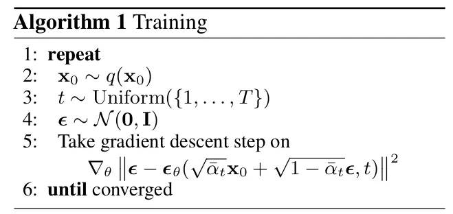

This post is part of a series of posts about diffusion models:

* [Intro to Diffusion Model — Part 1](../intro-to-diffusion-model-part-1/index.qmd)
* [Intro to Diffusion Model — Part 2](../intro-to-diffusion-model-part-2/index.qmd)  
* [Intro to Diffusion Model — Part 3](../intro-to-diffusion-model-part-3/index.qmd) (this post)  
* [Intro to Diffusion Model — Part 4](../intro-to-diffusion-model-part-4/index.qmd)  
* [Intro to Diffusion Model — Part 5](../intro-to-diffusion-model-part-5/index.qmd)  
* [Intro to Diffusion Model — Part 6](../intro-to-diffusion-model-part-6/index.qmd)  
* [Intro to Diffusion Model — Part 7](../intro-to-diffusion-model-part-7/index.qmd)  
* [Full implementation](https://github.com/dorzv/ComputerVision/blob/master/Diffusion/Diffusion.ipynb)

In the previous part, we defined mathematically the forward and the reverse processes. We also introduced the model we want to estimate for going from a noisier image to an image with less noise.

$$
p_\theta (\mathbf{x}_{t-1} \mid \mathbf{x}_t) = \mathcal{N}(\mathbf{x}_{t-1}; \boldsymbol{\mu}_\theta(\mathbf{x}_t, t), \boldsymbol{\Sigma}_\theta(\mathbf{x}_t, t))
$$

&nbsp;

We also said that we would simplify the problem by fixing the variance and only estimating the mean, as in the [DDPM paper](https://arxiv.org/pdf/2006.11239.pdf).

In this post, we want to build a loss function that will help us to find the parameters for the model. Basically, we can use the negative log-likelihood as a loss function $-\log(p_\theta(\mathbf{x}_0))$. The problem with this approach is that to estimate the distribution of $\mathbf{x}_0$ in the reverse process, we need to keep track of all the $T$ steps before.

So, instead of using the negative log-likelihood directly, we can use it as a lower bound for another function that we can optimize. Let’s look at the following inequality:

$$
\begin{aligned}
-\log p_\theta (\mathbf{x}_0) &\le -\log p_\theta (\mathbf{x}_0) + D_{\mathrm{KL}} (q (\mathbf{x}_{1:T} \mid \mathbf{x}_0) \parallel p_\theta (\mathbf{x}_{1:T} \mid \mathbf{x}_0)) \\
&= -\log p_\theta (\mathbf{x}_0) + \mathbb{E}_{\mathbf{x}_{1:T} \sim q(\mathbf{x}_{1:T} \mid \mathbf{x}_0)} \left[ \log \frac{q(\mathbf{x}_{1:T} \mid \mathbf{x}_0)}{p_\theta (\mathbf{x}_{1:T} \mid \mathbf{x}_0)} \right]
\end{aligned}
$$

&nbsp;

We add to the negative log-likelihood a non-negative value — KL divergence — so the expression on the right-hand side is always bigger or equal to the left-hand side. By minimizing the right-hand side, we can also minimize the negative log-likelihood. You must ask yourself now how this helps us if, on the right-hand side, we again have the original negative log-likelihood. You are right, of course. To solve that, let’s play a little with the log component in the KL divergence on the right-hand side. First, we can apply Bayes' rule to the numerator of the log argument:

$$
p_\theta (\mathbf{x}_{1:T} \mid \mathbf{x}_0) = \frac{p_\theta (\mathbf{x}_0 \mid \mathbf{x}_{1:T}) p_\theta (\mathbf{x}_{1:T})}{p_\theta (\mathbf{x}_0)} = \frac{p_\theta (\mathbf{x}_0, \mathbf{x}_{1:T})}{p_\theta (\mathbf{x}_0)} = \frac{p_\theta (\mathbf{x}_{0:T})}{p_\theta (\mathbf{x}_0)}
$$

&nbsp;

Taking this result back to the log, we get

$$
\log \left( \frac{q(\mathbf{x}_{1:T} \mid \mathbf{x}_0)}{p_\theta (\mathbf{x}_{1:T} \mid \mathbf{x}_0)} \right) = \log \left( \frac{q(\mathbf{x}_{1:T} \mid \mathbf{x}_0)}{\frac{p_\theta (\mathbf{x}_{0:T})}{p_\theta (\mathbf{x}_0)}} \right) = \log \left( \frac{q(\mathbf{x}_{1:T} \mid \mathbf{x}_0)}{p_\theta (\mathbf{x}_{0:T})} \right) + \log(p_\theta(\mathbf{x}_0))
$$

&nbsp;

By substituting the last result back into the inequality, we can get rid of the log-likelihood term and get

$$
E_q [-\log(p_\theta(\mathbf{x}_0))] \le E_q \left[ \log \left( \frac{q(\mathbf{x}_{1:T} \mid \mathbf{x}_0)}{p_\theta (\mathbf{x}_{0:T})} \right) \right]
$$

&nbsp;

On the right-hand side, the denominator is the forwarding process starting from $\mathbf{x}_0$, and the numerator is the reverse process, as defined in the previous post. Let's use this explicitly in the logarithm term and develop it more.

$$
\log \frac{q(\mathbf{x}_{1:T} \mid \mathbf{x}_0)}{p_\theta (\mathbf{x}_{0:T})} = \log \frac{\prod_{t=1}^T q(\mathbf{x}_t \mid \mathbf{x}_{t-1})}{p_\theta (\mathbf{x}_T) \prod_{t=1}^T p_\theta (\mathbf{x}_{t-1} \mid \mathbf{x}_t)} = -\log p_\theta (\mathbf{x}_T) + \sum_{t=1}^T \log \frac{q(\mathbf{x}_t \mid \mathbf{x}_{t-1})}{p_\theta (\mathbf{x}_{t-1} \mid \mathbf{x}_t)}
$$

&nbsp;

where we converted the multiplications inside the log to a summation of logs. Now, let’s move the first element under the summation outside:

$$
-\log p_\theta (\mathbf{x}_T) + \sum_{t=1}^T \log \frac{q(\mathbf{x}_t \mid \mathbf{x}_{t-1})}{p_\theta (\mathbf{x}_{t-1} \mid \mathbf{x}_t)} = -\log p_\theta (\mathbf{x}_T) + \sum_{t=2}^T \log \frac{q(\mathbf{x}_t \mid \mathbf{x}_{t-1})}{p_\theta (\mathbf{x}_{t-1} \mid \mathbf{x}_t)} + \log \frac{q(\mathbf{x}_1 \mid \mathbf{x}_0)}{p_\theta (\mathbf{x}_0 \mid \mathbf{x}_1)}
$$

&nbsp;

For the numerator in the summation, we can use Bayes’ rule:

$$
q(\mathbf{x}_t \mid \mathbf{x}_{t-1}) = \frac{q(\mathbf{x}_{t-1} \mid \mathbf{x}_t) q(\mathbf{x}_t)}{q(\mathbf{x}_{t-1})}
$$

&nbsp;

The problem with calculating $q(\mathbf{x}_{t-1} \mid \mathbf{x}_t)$ directly is that it is **intractable** — we cannot reverse a step of noise without knowing the underlying data distribution. However, if we condition on the initial clean image $\mathbf{x}_0$, the expression $q(\mathbf{x}_{t-1} \mid \mathbf{x}_t, \mathbf{x}_0)$ becomes a simple closed-form Gaussian (as can be seen by applying Bayes’ rule; see below). So we want to add conditioning on the initial state $\mathbf{x}_0$ such that:

$$
\frac{q(\mathbf{x}_{t-1} \mid \mathbf{x}_t) q(\mathbf{x}_t)}{q(\mathbf{x}_{t-1})} \Rightarrow \frac{q(\mathbf{x}_{t-1} \mid \mathbf{x}_t, \mathbf{x}_0) q(\mathbf{x}_t \mid \mathbf{x}_0)}{q(\mathbf{x}_{t-1} \mid \mathbf{x}_0)}
$$

&nbsp;

To actually do it, we will use the Markov property of the forward process. Each step of the forward process $\mathbf{x}_t$ depends only on $\mathbf{x}_{t-1}$. That means we only have to know $\mathbf{x}_{t-1}$ to go to $\mathbf{x}_t$, and the previous history doesn’t matter. This property means we can write:

$$
q(\mathbf{x}_t \mid \mathbf{x}_{t-1}) = q(\mathbf{x}_t \mid \mathbf{x}_{t-1}, \mathbf{x}_0) = \frac{q(\mathbf{x}_{t-1} \mid \mathbf{x}_t, \mathbf{x}_0) q(\mathbf{x}_t \mid \mathbf{x}_0)}{q(\mathbf{x}_{t-1} \mid \mathbf{x}_0)}
$$

&nbsp;

Putting it back to the original equation, we get

$$
\begin{aligned}
-\log p_\theta (\mathbf{x}_T) &+ \sum_{t=2}^T \log \frac{q(\mathbf{x}_t \mid \mathbf{x}_{t-1})}{p_\theta (\mathbf{x}_{t-1} \mid \mathbf{x}_t)} + \log \frac{q(\mathbf{x}_1 \mid \mathbf{x}_0)}{p_\theta (\mathbf{x}_0 \mid \mathbf{x}_1)} \\
&= -\log p_\theta (\mathbf{x}_T) + \sum_{t=2}^T \log \left( \frac{q(\mathbf{x}_{t-1} \mid \mathbf{x}_t, \mathbf{x}_0) q(\mathbf{x}_t \mid \mathbf{x}_0)}{p_\theta (\mathbf{x}_{t-1} \mid \mathbf{x}_t) q(\mathbf{x}_{t-1} \mid \mathbf{x}_0)} \right) + \log \frac{q(\mathbf{x}_1 \mid \mathbf{x}_0)}{p_\theta (\mathbf{x}_0 \mid \mathbf{x}_1)}
\end{aligned}
$$

&nbsp;

Now, let’s focus on the summation and split it as follows:

$$
\sum_{t=2}^T \log \left( \frac{q(\mathbf{x}_{t-1} \mid \mathbf{x}_t, \mathbf{x}_0) q(\mathbf{x}_t \mid \mathbf{x}_0)}{p_\theta (\mathbf{x}_{t-1} \mid \mathbf{x}_t) q(\mathbf{x}_{t-1} \mid \mathbf{x}_0)} \right) = \sum_{t=2}^T \log \left( \frac{q(\mathbf{x}_{t-1} \mid \mathbf{x}_t, \mathbf{x}_0)}{p_\theta (\mathbf{x}_{t-1} \mid \mathbf{x}_t)} \right) + \sum_{t=2}^T \log \left( \frac{q(\mathbf{x}_t \mid \mathbf{x}_0)}{q(\mathbf{x}_{t-1} \mid \mathbf{x}_0)} \right)
$$

&nbsp;

Look carefully at the second summation on the right-hand side. The numerator is one step after the denominator. That means if we change the summation of the logs into a multiplication of the arguments in the log, the numerator of the current $t$ will cancel the denominator of $t+1$. So, only the first term in the denominator and the last term in the numerator will survive.

$$
\frac{\cancel{q(\mathbf{x}_2 \mid \mathbf{x}_0)} \cancel{q(\mathbf{x}_3 \mid \mathbf{x}_0)} \dots \cancel{q(\mathbf{x}_{T-1} \mid \mathbf{x}_0)} q(\mathbf{x}_T \mid \mathbf{x}_0)}{q(\mathbf{x}_1 \mid \mathbf{x}_0) \cancel{q(\mathbf{x}_2 \mid \mathbf{x}_0)} \dots \cancel{q(\mathbf{x}_{T-2} \mid \mathbf{x}_0)} \cancel{q(\mathbf{x}_{T-1} \mid \mathbf{x}_0)} } = \frac{q(\mathbf{x}_T \mid \mathbf{x}_0)}{q(\mathbf{x}_1 \mid \mathbf{x}_0)}
$$

&nbsp;

The previous equation can now be written as

$$
\sum_{t=2}^T \log \left( \frac{q(\mathbf{x}_{t-1} \mid \mathbf{x}_t, \mathbf{x}_0) q(\mathbf{x}_t \mid \mathbf{x}_0)}{p_\theta (\mathbf{x}_{t-1} \mid \mathbf{x}_t) q(\mathbf{x}_{t-1} \mid \mathbf{x}_0)} \right) = \sum_{t=2}^T \log \left( \frac{q(\mathbf{x}_{t-1} \mid \mathbf{x}_t, \mathbf{x}_0)}{p_\theta (\mathbf{x}_{t-1} \mid \mathbf{x}_t)} \right) + \log \left( \frac{q(\mathbf{x}_T \mid \mathbf{x}_0)}{q(\mathbf{x}_1 \mid \mathbf{x}_0)} \right)
$$

&nbsp;

Let’s substitute this result back to the original equation and play with the logarithms:

$$
\begin{aligned} 
-\log p_\theta (\mathbf{x}_T) &+ \sum_{t=2}^T \log \left( \frac{q(\mathbf{x}_{t-1} \mid \mathbf{x}_t, \mathbf{x}_0) q(\mathbf{x}_t \mid \mathbf{x}_0)}{p_\theta (\mathbf{x}_{t-1} \mid \mathbf{x}_t) q(\mathbf{x}_{t-1} \mid \mathbf{x}_0)} \right) + \log \frac{q(\mathbf{x}_1 \mid \mathbf{x}_0)}{p_\theta (\mathbf{x}_0 \mid \mathbf{x}_1)} \\ 
&= -\log p_\theta (\mathbf{x}_T) + \sum_{t=2}^T \log \left( \frac{q(\mathbf{x}_{t-1} \mid \mathbf{x}_t, \mathbf{x}_0)}{p_\theta (\mathbf{x}_{t-1} \mid \mathbf{x}_t)} \right) + \log \frac{q(\mathbf{x}_T \mid \mathbf{x}_0)}{q(\mathbf{x}_1 \mid \mathbf{x}_0)} + \log \frac{q(\mathbf{x}_1 \mid \mathbf{x}_0)}{p_\theta (\mathbf{x}_0 \mid \mathbf{x}_1)} \\ 
&= -\log p_\theta (\mathbf{x}_T) + \sum_{t=2}^T \log \left( \frac{q(\mathbf{x}_{t-1} \mid \mathbf{x}_t, \mathbf{x}_0)}{p_\theta (\mathbf{x}_{t-1} \mid \mathbf{x}_t)} \right) + \log \frac{q(\mathbf{x}_T \mid \mathbf{x}_0) q(\mathbf{x}_1 \mid \mathbf{x}_0)}{q(\mathbf{x}_1 \mid \mathbf{x}_0) p_\theta (\mathbf{x}_0 \mid \mathbf{x}_1)} \\ 
&= \log q(\mathbf{x}_T \mid \mathbf{x}_0) - \log p_\theta (\mathbf{x}_T) + \sum_{t=2}^T \log \left( \frac{q(\mathbf{x}_{t-1} \mid \mathbf{x}_t, \mathbf{x}_0)}{p_\theta (\mathbf{x}_{t-1} \mid \mathbf{x}_t)} \right) - \log p_\theta (\mathbf{x}_0 \mid \mathbf{x}_1) \\ 
&= \log \frac{q(\mathbf{x}_T \mid \mathbf{x}_0)}{p_\theta (\mathbf{x}_T)} + \sum_{t=2}^T \log \left( \frac{q(\mathbf{x}_{t-1} \mid \mathbf{x}_t, \mathbf{x}_0)}{p_\theta (\mathbf{x}_{t-1} \mid \mathbf{x}_t)} \right) - \log p_\theta (\mathbf{x}_0 \mid \mathbf{x}_1) 
\end{aligned}
$$

&nbsp;

And finally, we can represent the last result of the full loss using KL divergence notation so

$$
\log \frac{q(\mathbf{x}_{1:T} \mid \mathbf{x}_0)}{p_\theta (\mathbf{x}_{0:T})} = \underbrace{D_{\mathrm{KL}} (q(\mathbf{x}_T \mid \mathbf{x}_0) \parallel p_\theta (\mathbf{x}_T))}_{L_T} + \sum_{t=2}^T \underbrace{D_{\mathrm{KL}} (q(\mathbf{x}_{t-1} \mid \mathbf{x}_t, \mathbf{x}_0) \parallel p_\theta (\mathbf{x}_{t-1} \mid \mathbf{x}_t))}_{L_{t-1}} \underbrace{-\log p_\theta (\mathbf{x}_0 \mid \mathbf{x}_1)}_{L_0}
$$

&nbsp;

The first component on the right-hand side, ${L}_{T}$, can be ignored while training since *q* has no learnable parameters, and $\mathbf{x}_T$ is just a Gaussian noise. Let’s look closer now to the second component, ${L}_{t}$. This component calculates the KL divergence between *q* and *p*. For *p*, we already explained in the previous post that it can be described by:

$$
p_\theta (\mathbf{x}_{t-1} \mid \mathbf{x}_t) = \mathcal{N}(\mathbf{x}_{t-1}; \boldsymbol{\mu}_\theta(\mathbf{x}_t, t), \boldsymbol{\Sigma}_\theta(\mathbf{x}_t, t))
$$

&nbsp;

but we are going to use a simplified version where the variance is not learnable but is known:

$$
p_\theta (\mathbf{x}_{t-1} \mid \mathbf{x}_t) = \mathcal{N}(\mathbf{x}_{t-1}; \boldsymbol{\mu}_\theta(\mathbf{x}_t, t), \sigma_t \mathbf{I})
$$

&nbsp;

Now, let’s look at *q*. This distribution is also a Gaussian, so we can write

$$
q(\mathbf{x}_{t-1} \mid \mathbf{x}_t, \mathbf{x}_0) = \mathcal{N}\left(\mathbf{x}_{t-1}; \tilde{\boldsymbol{\mu}}_\theta(\mathbf{x}_t, \mathbf{x}_0), \tilde{\beta}_t \mathbf{I}\right)
$$

&nbsp;

Let’s recall the structure of a Gaussian distribution:

$$
\mathcal{N}(x) \propto \exp \left( -\frac{1}{2} \frac{(x - \mu)^2}{\sigma^2} \right) = \exp \left( -\frac{1}{2} \frac{x^2 - 2\mu x + \mu^2}{\sigma^2} \right) = \exp \left( -\frac{1}{2} \left[ \frac{1}{\sigma^2} x^2 - 2 \frac{\mu}{\sigma^2} x + \frac{\mu^2}{\sigma^2} \right] \right)
$$

&nbsp;

Now, we can use Bayes’ rule to write

$$
q(\mathbf{x}_{t-1} \mid \mathbf{x}_t, \mathbf{x}_0) = q(\mathbf{x}_t \mid \mathbf{x}_{t-1}, \mathbf{x}_0) \frac{q(\mathbf{x}_{t-1} \mid \mathbf{x}_0)}{q(\mathbf{x}_t \mid \mathbf{x}_0)}
$$

&nbsp;

Since all the distributions above are Gaussian, we can write, according to the development from the previous post:

$$
q(\mathbf{x}_{t-1} \mid \mathbf{x}_t, \mathbf{x}_0) \propto \exp \left( -\frac{1}{2} \left[ \frac{(\mathbf{x}_t - \sqrt{\alpha_t}\mathbf{x}_{t-1})^2}{\beta_t} + \frac{(\mathbf{x}_{t-1} - \sqrt{\bar{\alpha}_{t-1}}\mathbf{x}_0)^2}{1 - \bar{\alpha}_{t-1}} - \frac{(\mathbf{x}_t - \sqrt{\bar{\alpha}_t}\mathbf{x}_0)^2}{1 - \bar{\alpha}_t} \right] \right)
$$

&nbsp;

The distribution of the left-hand side is Gaussian, as we wrote earlier, so we want to rearrange the right-hand side to a Gaussian structure, and then we can find the mean and the variance.

$$
q(\mathbf{x}_{t-1} \mid \mathbf{x}_t, \mathbf{x}_0) \propto \exp \left( -\frac{1}{2} \left[ \underbrace{\left( \frac{\alpha_t}{\beta_t} + \frac{1}{1 - \bar{\alpha}_{t-1}} \right)}_{1/\sigma^2} \mathbf{x}_{t-1}^2 - \underbrace{\left( \frac{2\sqrt{\alpha_t}}{\beta_t}\mathbf{x}_t + \frac{2\sqrt{\bar{\alpha}_{t-1}}}{1 - \bar{\alpha}_{t-1}}\mathbf{x}_0 \right)}_{2\mu/\sigma^2} \mathbf{x}_{t-1} + \underbrace{f(\mathbf{x}_t, \mathbf{x}_0)}_{\mu^2/\sigma^2} \right] \right)
$$

&nbsp;

where *f* is some function of $\mathbf{x}_t$ and $\mathbf{x}_0$ that we don’t really need for getting the mean and the variance. From the last relation, we conclude that:

$${\sigma }^{2}={\tilde{\beta }}_{t}=\frac{1}{\left({\frac{{\alpha }_{t}}{{\beta }_{t}}+\frac{1}{1-{\bar{\alpha }}_{t-1}}}\right)}=\frac{1}{\left({\frac{{\alpha }_{t}-{\bar{\alpha }}_{t}+{\beta }_{t}}{{\beta }_{t}(1-{\bar{\alpha }}_{t-1})}}\right)}=\frac{1-{\bar{\alpha }}_{t-1}}{1-{\bar{\alpha }}_{t}}\cdot {\beta }_{t}$$

&nbsp;

$$
\begin{aligned} \tilde{\boldsymbol{\mu}}_t(\mathbf{x}_t, \mathbf{x}_0) &= \left( \frac{\sqrt{\alpha_t}}{\beta_t}\mathbf{x}_t + \frac{\sqrt{\bar{\alpha}_{t-1}}}{1 - \bar{\alpha}_{t-1}}\mathbf{x}_0 \right) \frac{1}{\left( \frac{\alpha_t}{\beta_t} + \frac{1}{1 - \bar{\alpha}_{t-1}} \right)} \\ &= \left( \frac{\sqrt{\alpha_t}}{\beta_t}\mathbf{x}_t + \frac{\sqrt{\bar{\alpha}_{t-1}}}{1 - \bar{\alpha}_{t-1}}\mathbf{x}_0 \right) \frac{1 - \bar{\alpha}_{t-1}}{1 - \bar{\alpha}_t} \cdot \beta_t \\ &= \frac{\sqrt{\alpha_t}(1 - \bar{\alpha}_{t-1})}{1 - \bar{\alpha}_t} \mathbf{x}_t + \frac{\sqrt{\bar{\alpha}_{t-1}}\beta_t}{1 - \bar{\alpha}_t} \mathbf{x}_0 \end{aligned}
$$

&nbsp;

In the previous post, we saw that we can write

$$
\begin{aligned}
&\mathbf{x}_t = \sqrt{\bar{\alpha}_t}\mathbf{x}_0 + \sqrt{1 - \bar{\alpha}_t}\boldsymbol{\varepsilon}\\ 
&\Rightarrow \mathbf{x}_0 = \frac{1}{\sqrt{\bar{\alpha}_t}}\left(\mathbf{x}_t - \sqrt{1 - \bar{\alpha}_t}\boldsymbol{\varepsilon}\right)
\end{aligned}
$$

&nbsp;

We substitute this to the previous equation and get

$$
\tilde{\boldsymbol{\mu}}_t(\mathbf{x}_t, \mathbf{x}_0) = \frac{1}{\sqrt{\alpha_t}} \left( \mathbf{x}_t - \frac{1 - \alpha_t}{\sqrt{1 - \bar{\alpha}_t}}\boldsymbol{\varepsilon} \right)
$$

&nbsp;

If we go back to the (second) loss expression we have developed, we can conclude that we want our network to train $\boldsymbol{\mu}_\theta$ to predict $\tilde{\boldsymbol{\mu}}_t$. In addition, since we know $\mathbf{x}_t$ in the reverse process, we actually need to predict the noise at step *t*, $\boldsymbol{\varepsilon}_t$.

$$
\boldsymbol{\mu}_\theta(\mathbf{x}_t, t) = \frac{1}{\sqrt{\alpha_t}} \left( \mathbf{x}_t - \frac{1 - \alpha_t}{\sqrt{1 - \bar{\alpha}_t}}\boldsymbol{\varepsilon}_\theta(\mathbf{x}_t, t) \right)
$$

&nbsp;

Since we deal with Gaussians and the only parameter is the mean, using the KL divergence leads to the following loss:

$$
\begin{aligned} L_t &= \frac{1}{2\sigma_t^2} \Vert{}\tilde{\boldsymbol{\mu}}_t(\mathbf{x}_t, \mathbf{x}_0) - \boldsymbol{\mu}_\theta(\mathbf{x}_t, t)\Vert{}^2 \\ &= \frac{1}{2\sigma_t^2} \left\Vert{} \frac{1}{\sqrt{\alpha_t}} \left( \mathbf{x}_t - \frac{1 - \alpha_t}{\sqrt{1 - \bar{\alpha}_t}}\boldsymbol{\varepsilon}_t \right) - \frac{1}{\sqrt{\alpha_t}} \left( \mathbf{x}_t - \frac{1 - \alpha_t}{\sqrt{1 - \bar{\alpha}_t}}\boldsymbol{\varepsilon}_\theta(\mathbf{x}_t, t) \right) \right\Vert{}^2 \\ &= \frac{(1 - \alpha_t)^2}{2\alpha_t(1 - \bar{\alpha}_t)\sigma_t^2} \Vert{}\boldsymbol{\varepsilon}_t - \boldsymbol{\varepsilon}_\theta(\mathbf{x}_t, t)\Vert{}^2 \end{aligned}
$$

&nbsp;

In the [DDPM](https://arxiv.org/abs/2006.11239) paper, it is found empirically that the training works better if the scaling factor is omitted, i.e., we can simplify the loss to

$$
L_t = \Vert{}\boldsymbol{\varepsilon}_t - \boldsymbol{\varepsilon}_\theta(\mathbf{x}_t, t)\Vert{}^2
$$

&nbsp;

That’s the objective we got from the middle term (in the summation) of the full loss expression. Now, we need to handle the last term of the loss ${L}_{0}$. For this term, the DDPM paper suggests using an independent discrete decoder derived from the Gaussian

$$
\mathcal{N}(\mathbf{x}_0; \boldsymbol{\mu}_\theta(\mathbf{x}_1, 1), \sigma^2 \mathbf{I})
$$

&nbsp;

The paper also assumes that the image is originally constructed from discrete pixels with values {0, 1, 2, …, 255} that scaled to the range \[-1, 1\]. The distribution is then represented as:

$$
p_\theta(\mathbf{x}_0 \mid \mathbf{x}_1) = \prod_{i=1}^D \int_{\delta_-(x_0^i)}^{\delta_+(x_0^i)} \mathcal{N}(x, \mu_\theta^i(\mathbf{x}_1, 1), \sigma_1^2) dx
$$

&nbsp;

where

$$
\delta_+(x) = \begin{cases} \infty & \text{if } x = 1 \\ x + \frac{1}{255} & \text{if } x < 1 \end{cases} \quad \delta_-(x) = \begin{cases} -\infty & \text{if } x = -1 \\ x - \frac{1}{255} & \text{if } x > -1 \end{cases}
$$

&nbsp;

and D is the data dimensionality (the number of pixels in the image). Intuitively, our network predicts the mean of a pixel, and then we use this prediction to draw a Gaussian distribution. We integrate over this distribution according to the real pixel value as in the original image $\mathbf{x}_0$, from the real value minus 1/255 to the real value plus 1/255. If the predicted mean is close to the original value of the pixel, the result of the integral will be high.

However, the paper simplifies this loss also. Instead of calculating the integral, it is approximated by the Gaussian probability density function times the bin width:

$$
p_\theta(\mathbf{x}_0 \mid \mathbf{x}_1) \approx \frac{1}{\sqrt{2\pi}\sigma_1} \exp \left( -\frac{1}{2} \frac{\Vert{}\mathbf{x}_0 - \boldsymbol{\mu}_\theta(\mathbf{x}_1, 1)\Vert{}^2}{\sigma_1^2} \right) \cdot \frac{2}{255}
$$

&nbsp;

and the log will be

$$
L_0 = -\log(p_\theta(\mathbf{x}_0 \mid \mathbf{x}_1)) \approx \frac{1}{2\sigma_1^2} \Vert{}\mathbf{x}_0 - \boldsymbol{\mu}_\theta(\mathbf{x}_1, 1)\Vert{}^2 + C
$$

&nbsp;

where *C* is a constant so that we can ignore it. We are also going to ignore the scaling factor and recall the relations:

$$
\mathbf{x}_0 = \frac{1}{\sqrt{\bar{\alpha}_1}}(\mathbf{x}_1 - \sqrt{1 - \bar{\alpha}_1}\boldsymbol{\varepsilon}) = \frac{1}{\sqrt{\alpha_1}}(\mathbf{x}_1 - \sqrt{1 - \alpha_1}\boldsymbol{\varepsilon})
$$

&nbsp;

$$
\boldsymbol{\mu}_\theta(\mathbf{x}_1, 1) = \frac{1}{\sqrt{\alpha_1}}\left(\mathbf{x}_1 - \frac{1 - \alpha_1}{\sqrt{1 - \bar{\alpha}_1}}\boldsymbol{\varepsilon}_\theta(\mathbf{x}_1, 1)\right) = \frac{1}{\sqrt{\alpha_1}}\left(\mathbf{x}_1 - \frac{1 - \alpha_1}{\sqrt{1 - \alpha_1}}\boldsymbol{\varepsilon}_\theta(\mathbf{x}_1, 1)\right)
$$

&nbsp;

substitute these and again ignoring the scaling factor, we get

$$
L_0 \approx \Vert{}\boldsymbol{\varepsilon}_1 - \boldsymbol{\varepsilon}_\theta(\mathbf{x}_1, 1)\Vert{}^2
$$

&nbsp;

## Simplified Training Objective

From all the above development, the DDPM paper suggests using this loss function for training:

$$
\begin{aligned} L_{\text{simple}} &:= \mathbb{E}_{t \sim U[1, T], \mathbf{x}_0, \boldsymbol{\varepsilon}} \left[ \Vert{}\boldsymbol{\varepsilon} - \boldsymbol{\varepsilon}_\theta(\mathbf{x}_t, t)\Vert{}^2 \right] \\ &= \mathbb{E}_{t \sim U[1, T], \mathbf{x}_0, \boldsymbol{\varepsilon}} \left[ \Vert{}\boldsymbol{\varepsilon} - \boldsymbol{\varepsilon}_\theta \left( \sqrt{\bar{\alpha}_t}\mathbf{x}_0 + \sqrt{1 - \bar{\alpha}_t}\boldsymbol{\varepsilon}, t \right) \Vert{}^2 \right] \end{aligned}
$$

&nbsp;

In the expression above, $\mathbf{x}_0$ is the real image without any noise that we start with, *t* is the sample time step in the process, $\boldsymbol{\varepsilon}$ is Gaussian noise sampled from $\mathcal{N}(\mathbf{0}, \mathbf{I})$, and $\boldsymbol{\varepsilon}_\theta$ is the neural network prediction of the noise. Our training objective is to have the network predict the added noise vector by minimizing the mean squared error, which allows the model to learn how to reverse the diffusion process.

Based on this loss function, the DDPM paper suggests the following algorithm for training:

<figure>
  
  <figcaption>
    Training Algorithm from DDPM paper
  </figcaption>
</figure>

&nbsp;

The algorithm samples a random real image $\mathbf{x}_0$ from the distribution $q(\mathbf{x}_0)$, then sample time step uniformly between 1 to *T,* which determines the noise level and generates a random sample of noise from a Gaussian distribution. Using that noise, the image is corrupted to $\mathbf{x}_t$ on the basis of $\mathbf{x}_0$ and a known ${\beta }_{t}$, and the neural network uses that in its training to predict the noise.