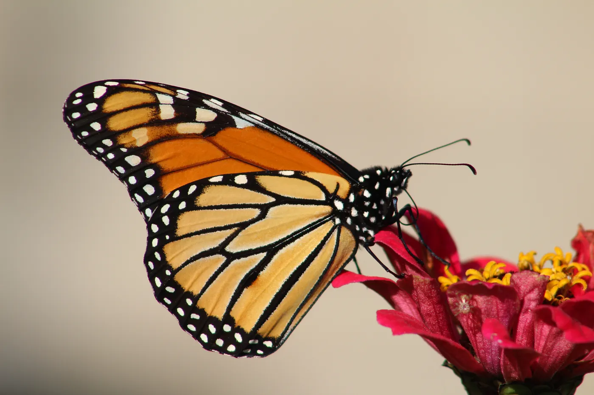
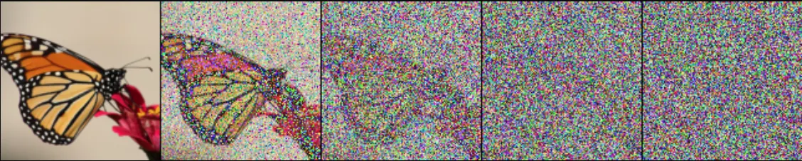

This post is part of a series of posts about diffusion models:

* [Intro to Diffusion Model — Part 1](../intro-to-diffusion-model-part-1/index.qmd)
* [Intro to Diffusion Model — Part 2](../intro-to-diffusion-model-part-2/index.qmd)
* [Intro to Diffusion Model — Part 3](../intro-to-diffusion-model-part-3/index.qmd)
* [Intro to Diffusion Model — Part 4](../intro-to-diffusion-model-part-4/index.qmd) (this post)
* [Intro to Diffusion Model — Part 5](../intro-to-diffusion-model-part-5/index.qmd)
* [Intro to Diffusion Model — Part 6](../intro-to-diffusion-model-part-6/index.qmd)
* [Intro to Diffusion Model — Part 7](../intro-to-diffusion-model-part-7/index.qmd)
* [Full implementation](https://github.com/dorzv/ComputerVision/blob/master/Diffusion/Diffusion.ipynb)

In part 2, we defined the forward process. Recall that in this process, we gradually add noise to the original image in a series of time steps. At each time step $t$, the variance of the noise added to the previous step is predetermined by the variance schedule, and it’s marked as $\beta_t$, where $0 < \beta_1 < \dots < \beta_T < 1$.

The variance schedule can be of different types, such as linear, cosine, quadratic, etc. In the paper [Denoising Diffusion Probabilistic Models](https://arxiv.org/abs/2006.11239), they used a linear time schedule, meaning $\beta$ grows linearly from some initial value to some final value (in the paper, they used $\beta_1 = 10^{-4}$ and $\beta_T = 0.02$).

In a later paper, [Improved Denoising Diffusion Probabilistic Models](https://arxiv.org/abs/2102.09672), it was shown that using a cosine schedule provides better results than the linear one.

Let’s implement these two schedules.

```python
def linear_schedule(num_timesteps):
  beta_start = 1e-4
  beta_end = 0.02
  betas = torch.linspace(beta_start, beta_end, num_timesteps)
  return betas

def cosine_schedule(num_timesteps, s=0.008):
  def f(t):
    return torch.cos((t / num_timesteps + s) / (1 + s) * 0.5 * torch.pi) ** 2
  x = torch.linspace(0, num_timesteps, num_timesteps + 1)
  alphas_cumprod = f(x) / f(torch.tensor([0]))
  betas = 1 - alphas_cumprod[1:] / alphas_cumprod[:-1]
  betas = torch.clip(betas, 0.0001, 0.999)
  return betas
```

Now, we want to define a function for sampling from the forward process. First, let’s define a helper function to sample a tensor sorted by time, according to timesteps.

```python
def sample_by_t(tensor_to_sample, timesteps, x_shape):
  batch_size = timesteps.shape[0]
  sampled_tensor = tensor_to_sample.gather(-1, timesteps.cpu())
  sampled_tensor = torch.reshape(sampled_tensor, (batch_size,) + (1,) * (len(x_shape) - 1))
  return sampled_tensor.to(timesteps.device)
```

and define $\alpha_t$, $\bar{\alpha}_t$, $\beta_t$ and some operation on them as we need according to the developments in part 2 and part 3.

```python
num_timesteps = 300
betas_t = linear_schedule(num_timesteps)

alphas_t = 1. - betas_t
alphas_bar_t = torch.cumprod(alphas_t, dim=0)
alphas_bar_t_minus_1 = torch.cat((torch.tensor([0]), alphas_bar_t[:-1]))
one_over_sqrt_alphas_t = 1. / torch.sqrt(alphas_t)
sqrt_alphas_bar_t = torch.sqrt(alphas_bar_t)
sqrt_1_minus_alphas_bar_t = torch.sqrt(1. - alphas_bar_t)
# the variance of q(xₜ₋₁ | xₜ, x₀) as in part 3
posterior_variance = (1. - alphas_bar_t_minus_1) / (1. - alphas_bar_t) * betas_t
```

The forward process sampling function is

```python
def sample_q(x0, t, noise=None):
  if noise is None:
    noise = torch.randn_like(x0)

  sqrt_alphas_bar_t_sampled = sample_by_t(sqrt_alphas_bar_t, t, x0.shape)
  sqrt_1_minus_alphas_bar_t_sampled = sample_by_t(sqrt_1_minus_alphas_bar_t, t, x0.shape)

  x_t = sqrt_alphas_bar_t_sampled * x0 + sqrt_1_minus_alphas_bar_t_sampled * noise
  return x_t
```

where we use the relation from part 2

$$\mathbf{x}_t = \sqrt{\bar{\alpha}_t}\mathbf{x}_0 + \sqrt{1 - \bar{\alpha}_t}\epsilon$$

Now, it’s time to see how an image will look when adding a different amount of noise during the forward process. For that, let’s start by loading an image to work with. We are going to use `PIL` and the `requests` modules to get an image from the [web](https://images.pexels.com/photos/1557208/pexels-photo-1557208.jpeg?auto=compress&cs=tinysrgb&w=1260&h=750&dpr=2).

```python
import requests
from PIL import Image

url = 'https://images.pexels.com/photos/1557208/pexels-photo-1557208.jpeg?auto=compress&cs=tinysrgb&w=1260&h=750&dpr=2'
image_raw_data = requests.get(url, stream=True).raw
image = Image.open(image_raw_data)
```

<figure>
  
  <figcaption>
    Photo by Tinthia Clemant from
    <a href="https://www.pexels.com/photo/monarch-butterfly-perching-on-red-flower-1557208/">
      Pexels
    </a>
  </figcaption>
</figure>

To work with the image, we need to convert it into a Pytorch tensor. We also want to transform it according to some standardization:

* A square shape
* Predefined size
* Values in the range [-1, 1]

We can achieve this with the help of the `transforms` module from `torchvision`.

```python
from torchvision.transforms import Compose, ToTensor, CenterCrop, Resize, Normalize

image_size = 128
transform = Compose([
  Resize(image_size),  # resize smaller edge to image_size
  CenterCrop(image_size),  # make a square image with size image_size
  ToTensor(),  # convert to tensor with shape CHW and values in the range [0, 1]
  Normalize(mean=(0.5, 0.5, 0.5), std=(0.5, 0.5, 0.5)) # set the values to the range [-1, 1]
])
```

We also want a reverse transformation to return the image into a PIL object and one for getting a tensor with values in the range [0, 1].

```python
from torchvision.transforms import ToPILImage

reverse_transform_pil = Compose([
  Normalize(mean=(-1, -1, -1), std=(2, 2, 2)),
  ToPILImage()
])

reverse_transform_tensor = Compose([
  Normalize(mean=(-1, -1, -1), std=(2, 2, 2)),
])
```

Pay attention that the image is still a square shape and size `image_size` after the reverse transformation.

We can define a function that, given an image as a tensor and a timestep $t$, returns a noisy image sampled from the $q$ distribution.

```python
def get_noisy_image(x0, t, transform=reverse_transform_pil):
  x_noisy = sample_q(x0, t)
  noise_image = transform(x_noisy.squeeze())
  return noise_image
```

and a function to display noisy images as a grid where the rows are different images, and the columns are the noisy images in different timesteps.

```python
import matplotlib.pyplot as plt
def show_noisy_images(noisy_images):
  """
  Show and return a grid of noisy images where
  the rows are different images, and the columns
  are the noisy images in different timesteps.

  Args:
    noisy_images (list[list[PIL]]): a list of lists of images
      with noise from different timesteps.
  """
  num_of_image_sets = len(noisy_images)
  num_of_images_in_set = len(noisy_images[0])
  image_size = noisy_images[0][0].size[0]

  full_image = Image.new('RGB', (image_size * num_of_images_in_set + (num_of_images_in_set - 1), image_size * num_of_image_sets + (num_of_image_sets - 1)))
  for set_index, image_set in enumerate(noisy_images):
    for image_index, image in enumerate(image_set):
      full_image.paste(image, (image_index * image_size + image_index, set_index * image_size + set_index))
  
  plt.imshow(full_image)
  plt.axis('off')
  return full_image
```

Let’s see an example.

```python
show_noisy_images([[get_noisy_image(x0, torch.tensor([t])) for t in [0, 50, 100, 150, 200]]])
```

<figure>
  
</figure>