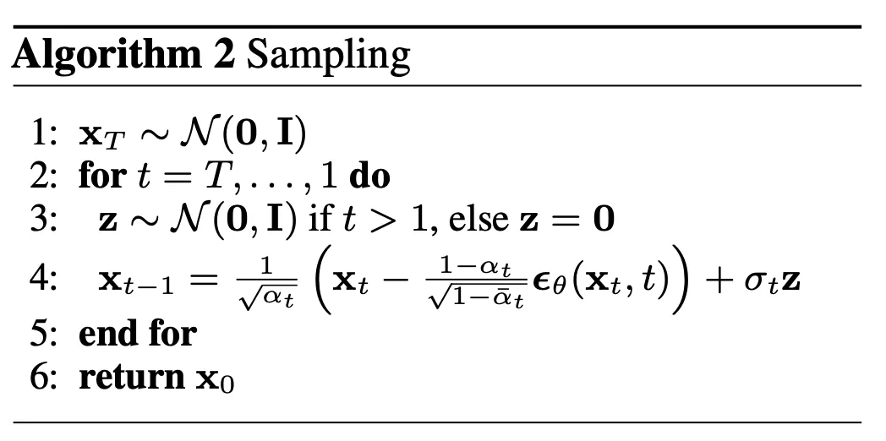

In this post, we are going to focus on sampling from the reverse process.

This post is part of a series of posts about diffusion models:

- [Intro to Diffusion Model — Part 1](../intro-to-diffusion-model-part-1/index.qmd)
- [Intro to Diffusion Model — Part 2](../intro-to-diffusion-model-part-2/index.qmd)
- [Intro to Diffusion Model — Part 3](../intro-to-diffusion-model-part-3/index.qmd)
- [Intro to Diffusion Model — Part 4](../intro-to-diffusion-model-part-4/index.qmd)
- [Intro to Diffusion Model — Part 5](../intro-to-diffusion-model-part-5/index.qmd)
- [Intro to Diffusion Model — Part 6](../intro-to-diffusion-model-part-6/index.qmd) (this post)
- [Intro to Diffusion Model — Part 7](../intro-to-diffusion-model-part-7/index.qmd)
- [Full implementation](https://github.com/dorzv/ComputerVision/blob/master/Diffusion/Diffusion.ipynb)

When our model will be fully trained (and even during the training), we will want to reconstruct images using the reverse process. For that, we are going to implement Algorithm 2 from the [DDPM paper](https://arxiv.org/pdf/2006.11239.pdf) for sampling from the reverse process and get a new image, which hopefully looks like it comes from the real distribution.

<figure>
  
  <figcaption>
    Algorithm 2 from the
    <a href="https://arxiv.org/pdf/2006.11239.pdf">
      DDPM paper
    </a>
  </figcaption>
</figure>

This algorithm describes the reverse process we discussed in parts 2 and 3. We start with a pure standard Gaussian noise, and we gradually denoise it using the prediction of our model. In the end, we get $\mathbf{x}_0$, which should be a clean image from the real distribution. At each step, we try to predict $\mathbf{x}_{t-1}$ based on the expressions we derivate in parts 2 and 3, such as

$$p_\theta(\mathbf{x}_{t-1} | \mathbf{x}_t) = \mathcal{N}(\mathbf{x}_{t-1}; \boldsymbol{\mu}_\theta(\mathbf{x}_t, t), \boldsymbol{\Sigma}_\theta(\mathbf{x}_t, t))$$

$$\boldsymbol{\mu}_\theta(\mathbf{x}_t, t) = \frac{1}{\sqrt{\alpha_t}} \left( \mathbf{x}_t - \frac{1 - \alpha_t}{\sqrt{1 - \bar{\alpha}_t}} \boldsymbol{\epsilon}_\theta(\mathbf{x}_t, t) \right)$$

$$\mathbf{x}_0 = \frac{1}{\sqrt{\bar{\alpha}_1}} (\mathbf{x}_1 - \sqrt{1 - \bar{\alpha}_1} \boldsymbol{\epsilon}) = \frac{1}{\sqrt{\alpha_1}} (\mathbf{x}_1 - \sqrt{1 - \alpha_1} \boldsymbol{\epsilon})$$

$$\boldsymbol{\mu}_\theta(\mathbf{x}_1, 1) = \frac{1}{\sqrt{\alpha_1}} \left( \mathbf{x}_1 - \frac{1 - \alpha_1}{\sqrt{1 - \bar{\alpha}_1}} \boldsymbol{\epsilon}_\theta(\mathbf{x}_1, 1) \right) = \frac{1}{\sqrt{\alpha_1}} \left( \mathbf{x}_1 - \frac{1 - \alpha_1}{\sqrt{1 - \alpha_1}} \boldsymbol{\epsilon}_\theta(\mathbf{x}_1, 1) \right)$$

Note that the variance we use in the process is known; we don’t need to predict it.

We start by implementing a basic sampling from $p$

```python
@torch.no_grad()
def sample_p(model, x_t, t, clipping=True):
  """
  Sample from p_θ(xₜ₋₁|xₜ) to get xₜ₋₁ according to Algorithm 2
  """
  betas_t_sampled = sample_by_t(betas_t, t, x_t.shape)
  sqrt_1_minus_alphas_bar_t_sampled = sample_by_t(sqrt_1_minus_alphas_bar_t, t, x_t.shape)
  one_over_sqrt_alphas_t_sampled = sample_by_t(one_over_sqrt_alphas_t, t, x_t.shape)

  if clipping:
    sqrt_alphas_bar_t_sampled = sample_by_t(sqrt_alphas_bar_t, t, x_t.shape)
    sqrt_alphas_bar_t_minus_1_sampled = sample_by_t(sqrt_alphas_bar_t_minus_1, t, x_t.shape)
    alphas_bar_t_sampled = sample_by_t(alphas_bar_t, t, x_t.shape)
    sqrt_alphas_t_sampled = sample_by_t(sqrt_alphas_t, t, x_t.shape)
    alphas_bar_t_minus_1_sampled = sample_by_t(alphas_bar_t_minus_1, t, x_t.shape)

    x0_reconstruct = 1 / sqrt_alphas_bar_t_sampled * (x_t - sqrt_1_minus_alphas_bar_t_sampled * model(x_t, t))
    x0_reconstruct = torch.clip(x0_reconstruct, -1., 1.)
    predicted_mean = (sqrt_alphas_bar_t_minus_1_sampled * betas_t_sampled) / (1 - alphas_bar_t_sampled) * x0_reconstruct + (sqrt_alphas_t_sampled * (1 - alphas_bar_t_minus_1_sampled)) /  (1 - alphas_bar_t_sampled) * x_t

  else:
    predicted_mean = one_over_sqrt_alphas_t_sampled * (x_t - betas_t_sampled / sqrt_1_minus_alphas_bar_t_sampled * model(x_t, t))

  if t[0].item() == 1:
    return predicted_mean
  else:
    posterior_variance_sampled = sample_by_t(posterior_variance, t, x_t.shape)
    noise = torch.randn_like(x_t)
    return predicted_mean + torch.sqrt(posterior_variance_sampled) * noise
```

The function above is not part of the training, so we wrap it with the `torch.no_grad()` decorator. Pay attention that there are two modes of implementation here: with and without clipping. The version without the clipping is exactly as in Algorithm 2. However, when we reconstruct $\mathbf{x}_0$, it should be in the range $[-1, 1]$, and that is the reason for the clipping. While the training could perform well without the clipping for simple training datasets, it is better to use the clipping. The expression for the mean in the clipping mode we use is the one we got in part 3:

$$\mu_t(\mathbf{x}_t, \mathbf{x}_0) = \frac{\sqrt{\bar{\alpha}_{t-1}}\beta_t}{1 - \bar{\alpha}_t}\mathbf{x}_0 + \frac{\sqrt{\alpha_t}(1 - \bar{\alpha}_{t-1})}{1 - \bar{\alpha}_t}\mathbf{x}_t$$

and the reconstruction of $\mathbf{x}_0$ is followed by the expression from part 3:

$$\mathbf{x}_0 = \frac{1}{\sqrt{\bar{\alpha}_t}} (\mathbf{x}_t - \sqrt{1 - \bar{\alpha}_t} \boldsymbol{\epsilon})$$

Now, we can implement the full Algorithm 2 with a function that lets us sample images from the reverse process.

```python
from tqdm import tqdm
@torch.no_grad()
def sampling(model, shape, image_noise_steps_to_keep=1):
  """
  Implementing Algorithm 2 - sampling.
  Args:
    model (torch.Module): the model that predict the noise
    shape (tuple): shape of the data (batch, channels, image_size, image_size)
  Returns:
    (list): list containing the images in the different steps of the reverse process
  """

  batch = shape[0]
  images = torch.randn(shape, device=device)  # pure noise
  images_list = []

  for timestep in tqdm(range(num_timesteps, 0, -1), desc='sampling timestep'):
    images = sample_p(model, images, torch.full((batch,), timestep, device=device, dtype=torch.long))
    if timestep <= image_noise_steps_to_keep:
      images_list.append(images.cpu())
  return images_list
```