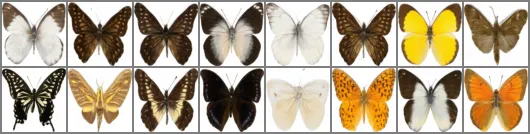

This post is part of a series of posts about diffusion models:

- [Intro to Diffusion Model — Part 1](../intro-to-diffusion-model-part-1/index.qmd)
- [Intro to Diffusion Model — Part 2](../intro-to-diffusion-model-part-2/index.qmd)
- [Intro to Diffusion Model — Part 3](../intro-to-diffusion-model-part-3/index.qmd)
- [Intro to Diffusion Model — Part 4](../intro-to-diffusion-model-part-4/index.qmd)
- [Intro to Diffusion Model — Part 5](../intro-to-diffusion-model-part-5/index.qmd)
- [Intro to Diffusion Model — Part 6](../intro-to-diffusion-model-part-6/index.qmd)
- [Intro to Diffusion Model — Part 7](../intro-to-diffusion-model-part-7/index.qmd) (this post)
- [Full implementation](https://github.com/dorzv/ComputerVision/blob/master/Diffusion/Diffusion.ipynb)

Before we train, we need a dataset. I chose to work here with the Smithsonian butterflies dataset from Hugging Face. First, we need to install the Hugging Face dataset module.

```bash
pip install datasets[vision] -q
```

Then, we can load the Smithsonian butterflies dataset.

```python
from datasets import load_dataset
dataset = load_dataset("huggan/smithsonian_butterflies_subset", split='train')
```

Now, we want to create a data loader with this dataset and apply transformation in a similar way to what we did in part 4.

```python
from torchvision.transforms import RandomHorizontalFlip, Compose, ToTensor, Resize, Normalize
from torch.utils.data import DataLoader

image_size = 64
transform = Compose([
  Resize((image_size, image_size)),
  RandomHorizontalFlip(),
  ToTensor(),
  Normalize(mean=(0.5, 0.5, 0.5), std=(0.5, 0.5, 0.5))
])

def transforms(data):
  images = [transform(im) for im in data['image']]
  return {'images': images}

dataset.set_transform(transforms)

batch_size=32
train_dataloader = DataLoader(dataset, batch_size=batch_size, shuffle=True)
```

We can look at an example from the dataset with

```python
batch = next(iter(train_dataloader))
reverse_transform_pil(batch['images'][20])
```

<figure>
  
  <figcaption>
    An example of a butterfly image from the Smithsonian butterflies dataset after applying transformations
  </figcaption>
</figure>

We need to define a loss for the training. Here, we are going to use L1.

```python
import torch.nn.functional as F

def compute_loss(model, x0, t, noise=None):
  if noise is None:
    noise = torch.randn_like(x0)

  x_t = sample_q(x0, t, noise)
  predicted_noise = model(x_t, t)
  loss = F.l1_loss(noise, predicted_noise)
  return loss
```

Now, we can initialize the model and set an optimizer.

```python
from torch.optim import Adam

device = "cuda" if torch.cuda.is_available() else "cpu"
model = DiffusionUnet(dim=image_size, channels=3, dim_mults=(1, 2, 4, 8)).to(device)
optimizer = Adam(model.parameters(), lr=1e-4)
```

We will want to save results along the training, so we create a results folder.

```python
from pathlib import Path
results_folder = Path("./results")
results_folder.mkdir(exist_ok = True)
```

For the training, I’m going to use Google Colab, so I want to save the model to my Google Drive and continue the training later in case of a timeout. For that, we need to connect to Google Drive first.

```python
from google.colab import drive
drive.mount('/content/gdrive')
```

Now, we check if we already have a model saved in our drive. If there is, we load it; otherwise, we create an empty dictionary.

```python
model_saved_file_path = Path('/content/gdrive/MyDrive/diffusion_checkpoints/saved_model.pth')
if model_saved_file_path.exists():
  saved_model = torch.load(str(model_saved_file_path))
else:
  model_saved_file_path.parent.mkdir(parents=True, exist_ok=True)
  saved_model = {}
  start_epoch = 0

if saved_model:
    print('loading model')
    model.load_state_dict(saved_model['model'])
    optimizer.load_state_dict(saved_model['optimizer'])
    current_epoch = saved_model['epoch']
```

And finally, we implement the training loop.

```python
import numpy as np
from torchvision.utils import save_image
epochs = 1000
loss_steps = 50
sample_every = 1000
loss_for_mean = np.zeros(loss_steps)
prev_time = time.time()

for epoch in range(start_epoch, epochs):
  for batch_index, batch in enumerate(train_dataloader):
    images = batch['images'].to(device)
    # sample t according to Algorithm 1
    t = torch.randint(1, num_timesteps, (images.shape[0],), device=device).long()
    loss = compute_loss(model, images, t)
    current_step = batch_index + epoch * len(train_dataloader)
    if current_step % loss_steps == 0:

      # Determine approximate time left
      batches_done = epoch * len(train_dataloader) + batch_index
      batches_left = epochs * len(train_dataloader) - current_step
      time_left = datetime.timedelta(seconds=batches_left * (time.time() - prev_time) / loss_steps)
      prev_time = time.time()

      print(f'Loss at epoch {epoch}, batch {batch_index}: {loss_for_mean.mean()} | time remaining: {time_left}')
      loss_for_mean[:] = 0
    loss_for_mean[current_step%loss_steps] = loss.item()

    optimizer.zero_grad()
    loss.backward()
    optimizer.step()

    if current_step % sample_every == 0:
      batch_to_sample = 5
      sample_images_list = sampling(model, (batch_to_sample, 3, image_size, image_size))
      sample_images = torch.cat(sample_images_list, dim=0)
      sample_images = reverse_transform_tensor(sample_images)
      save_image(sample_images, str(results_folder / f'sample_{current_step}.png'), nrow=batch_to_sample)

  saved_model['epoch'] = epoch + 1
  saved_model['model'] = model.state_dict()
  saved_model['optimizer']= optimizer.state_dict()
  torch.save(saved_model, '/content/gdrive/MyDrive/diffusion_checkpoints/saved_model.pth')
```

We train according to Algorithm 1 from part 3. We get a batch of clean images and sample the timestamp uniformly, and then we try to predict the noise we have added to the images and compute the loss. We save the loss values for `loss_steps` steps (a step is one batch from the data loader), and after that, we print the mean of the loss over the last `loss_steps` steps. Pay attention that the loss printed the first time is meaningless since the `loss_for_mean` buffer is not full yet. We also estimate the time remaining and print it with the loss. We update the weights of the model, and once every `sample_every` steps we sample from the reverse process and save the result. Finally, at the end of each epoch, we save the states of the model and the optimizer together with the current epoch index.

After finishing the training, we can sample new butterfly images with the following code:

```python
from torchvision.utils import make_grid
reverse_transform_pil(make_grid(sampling(model, (16, 3, 64, 64))[-1], nrow=8))
```

<figure>
  
  <figcaption>
    Samples of butterflies after 1000 epochs
  </figcaption>
</figure>

We can also see the reverse process using

```python
from torchvision.utils import make_grid
image_steps_list = sampling(model, (4, 3, 64, 64), 300)
image_steps = torch.cat(image_steps_list, dim=0)
reverse_transform_pil(make_grid(image_steps, nrow=4))
```

The code above will show the last 300 steps of sampling 4 butterflies.

<div style="text-align: center;">
  
</div>