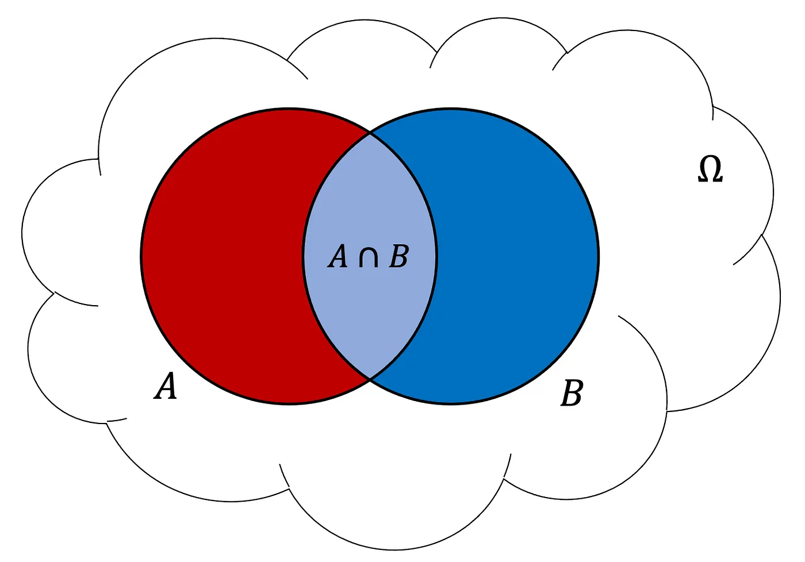
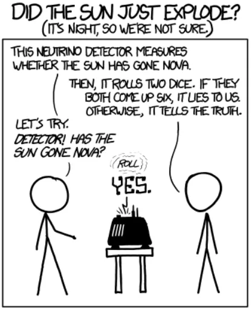

# Introduction to Conditional Probability

Usually, in many probability problems, we want to know what is the probability that a particular event will happen. But sometimes, we have several events that can influence each other.

The probability of event $A$ can be changed if we know that event $B$ has already happened. For example, suppose we roll a die, and we look at the probability of two events; event $A$ is getting 2, and event $B$ is getting an even number. The probability of event $A$ is $1/6$, while the probability of event $B$ is $3/6$. However, if I say to you that event $A$ has happened, you know that we got the number 2, so knowing that, what is the probability of $B$, i.e., getting an even number? It’s 100% because we know we got 2, and 2 is an even number. And if we know $B$ has happened, that means we got one of $\{2, 4, 6\}$, so the probability of getting 2, knowing that we got 2, 4 or 6, is $1/3$.

As we saw in the last examples, events that are related to each other can add information to the problem and change the probability of the events. If the events are not related, there will be no influence. For example, if we roll two dice, knowing the result of one of them has no influence on the result of the second one.

Understanding such relations between events can help us to get a more precise probability of events. And that’s what conditional probability is about.

# Conditional Probability

Assuming we have two events, $A$ and $B$, with probabilities $P(A)$ and $P(B) \neq 0$. The conditional probability of event $A$ given event $B$ is marked $P(A|B)$ and defined as:

$$P(A|B) = \frac{P(A \cap B)}{P(B)}$$

That’s the ratio between the probability of the intersection of the two events (the part of the two events which is common to the two of them) and the probability of event $B$. We know that event $B$ has already happened, so we deduce that the only part of event $A$ that can happen is the part that is common to event $B$ --- $A \cap B$. Since $B$ has happened, the sample space has narrowed to the region of event $B$, so we need to divide by $P(B)$.

We can visualize it with the following diagram:

<figure>
  
  <figcaption>
    The left circle is event A, the right circle is event B. The two events are inside the sample space Ω.
  </figcaption>
</figure>

The light blue is the intersection between events $A$ and $B$. Since we know that $B$ happened, our result is somewhere in the circle of $B$ (the blue and light blue region), so the possibilities of $A$ now lay only inside the region $A \cap B$ while the whole probability space is $B$ (an event in the red region is not possible since we know $B$ has happened, and that’s why the sample space narrows from $\Omega$ into $B$ only). We can think of it as measuring the size of $A$ inside $B$.

# Independence

What if there is no relation between $A$ and $B$? If the knowledge that event $B$ has happened doesn’t add any information on the probability that $A$ happened too, we say that the events are statistically independent. We define it mathematically as:

$$P(A \cap B) = P(A)P(B)$$

This definition is consistent with the conditional probability definition. If $A$ and $B$ are independent:

$$P(A|B) = \frac{P(A \cap B)}{P(B)} = \frac{P(A)P(B)}{P(B)} = P(A)$$

The above equation shows that if the knowledge that $B$ has happened does not add information about $A$, the conditional probability becomes the regular probability, as we expect.

From the last equation, we get an equivalent definition of independence as:

$$P(A|B) = P(A) \quad \text{or} \quad P(B|A) = P(B)$$

It’s important to note that independent and disjoint are two different things. Independent means $P(A \cap B) = P(A)P(B)$, while disjoint means $A \cap B = \emptyset$. If we know two events are disjoint, it means that $P(A \cap B) = 0$, but unless $P(A) = 0$ or $P(B) = 0$, it does not mean we can write $P(A \cap B) = P(A)P(B)$. On the other hand, if the two events are independent, it means that $P(A \cap B) = P(A)P(B)$, but we can’t infer that $P(A \cap B) = 0$ (unless $P(A) = 0$ or $P(B) = 0$).

Let’s see an example of that. Suppose we throw two dice and define the events $A = \{\text{first die is } 1\}$ and $B = \{\text{sum of dice is } 7\}$. $P(A \cap B) = P(\{1, 6\}) = 1/36$, and $A \cap B \neq \emptyset$, but since $P(A) = 1/6$ and $P(B) = 1/6$, $P(A \cap B) = P(A)P(B)$ so the events are independent, but are not disjoint.

# Bayes’ Theorem

Bayes’ theorem can help us move from $P(A|B)$ to $P(B|A)$:

$$P(A|B) = \frac{P(B|A)P(A)}{P(B)}$$

**Proof:**

Using the conditional probability definition, we can write:

$$P(A|B) = \frac{P(A \cap B)}{P(B)} \quad \text{and} \quad P(B|A) = \frac{P(A \cap B)}{P(A)}$$

Using $P(A \cap B)$ as a common part, we can get:

$$P(A|B)P(B) = P(B|A)P(A)$$

## An Example to Illustrate Bayes’ Theorem
Let’s see Bayes’ theorem in action:

<figure>
  
  <figcaption>
    Image from <a href="https://xkcd.com/1132/">xkcd</a>
  </figcaption>
</figure>

It’s nighttime, and we have a device that can say if the sun has exploded. Before the device says “yes” or “no”, it rolls two dice, and if they both come 6, the device lies to us. We try the device, and it says “yes”. Now we want to know what is the probability that the sun has actually exploded.

We have two events to consider: $A$ --- the sun has exploded, and $B$ --- the device says yes. We want to find $P(A|B)$, which means what is the probability that the sun has exploded given that the device said yes.

First, we can find $P(B|A)$, which is the probability that the device said yes, given that the sun exploded. We know that the device tells the truth if the dice don’t get $\{6, 6\}$ so if the sun actually exploded, there is a $35/36$ probability that the device tells the truth --- $P(B|A) = 35/36$.

For event $A$, we don’t know the precise probability, but we can estimate it as a very small number since we know that so far, our sun hasn’t exploded. Let’s estimate it as $P(A) = 1/10,000$ (which is still a very high probability for the sun to explode).

There are two cases where the device says “yes”. If the sun hasn’t exploded and it lies, or when the sun has exploded, and it tells the truth. We can use the *law of total probability* to write that as:

$$P(B) = P(B|A)P(A) + P(B|C)P(C)$$

where $C$ is the complementary event of $A$, which means the sun hasn’t exploded. In the equation above, we say that the probability that the device says “yes” is the probability of it saying “yes” given that the sun has exploded, multiplied by the probability that the sun exploded and the probability of it saying “yes” given that the sun hasn’t exploded, multiplied by the probability that the sun hasn’t exploded. $C$ is the complementary event of $A$ so $P(C) = 1 - P(A) = 9,999/10,000$. For $P(B|C)$ --- the device says “yes” even though the sun hasn’t exploded, we know it is the case where the device lies, and that happens if the dice got $\{6, 6\}$, and so $P(B|C) = 1/36$. And so:

$$P(B) = \frac{35}{36} \cdot \frac{1}{10000} + \frac{1}{36} \cdot \frac{9999}{10000} = 0.0278$$

And now substitute $P(B|A)$, $P(A)$ and $P(B)$ into Bayes’ theorem we get:

$$P(A|B) = \frac{P(B|A)P(A)}{P(B)} = \frac{35/36 \cdot 1/10000}{0.0278} = 0.0035$$