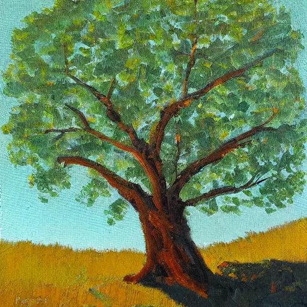
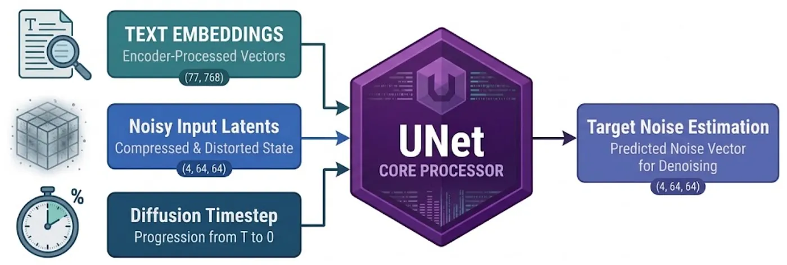
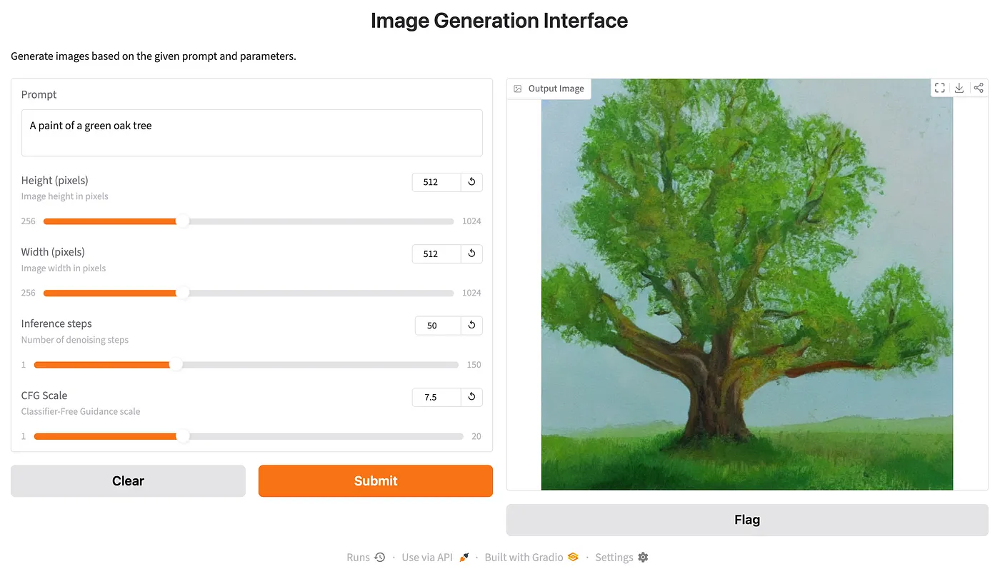

## Introduction to Stable Diffusion with Hugging Face

In a previous [series of posts](../intro-to-diffusion-model-part-1/index.qmd), we introduced the basic diffusion model and the ideas behind it, such as iterative refinement. The model we wrote let us generate beautiful images of butterflies, but we had no control over the final image (we got a random butterfly), and it was time-consuming. In this post, we will leverage the ideas behind a model called Stable Diffusion to condition the generated image using text descriptions and also improve the generation process. We are also going to use the Hugging Face library since it already implements the necessary components of Stable Diffusion.

## Latent Diffusion Models

Before we talk about conditioning image generation, let’s start with another problem we have. One of the main challenges in image generation is to generate a high-quality, high-resolution image. The problem is that as the image size increases, so does the computational power required to generate the image. If our model uses [self-attention](../from-attention-to-self-attention-and-transformers-a-mathematical-introduction/index.qmd), the computational power grows quadratically! For example, suppose we want to increase the image resolution from a $64\times 64$ image to a $128\times 128$ image. The new image has four times as many pixels as the first one, which means it requires 16 times the memory and computational cost in a self-attention layer. This is a high price to pay for just double the image size.

Here comes Latent Diffusion. The idea is to stop working directly in the image's pixel space and instead move to a lower-dimensional representation in what we call a latent space. We can achieve this by using a [Variational AutoEncoder](../variational-autoencoder/index.qmd) (VAE) before the actual diffusion model. The main reason to use it is that the VAE can compress images to a smaller spatial dimension while it removes a lot of redundant information the image may contain. A good VAE reconstructs an image from the latent space back into a high-fidelity image in pixel space.

In Stable Diffusion, they use a VAE that takes as input an image of 3 channels and produces a four-channel latent representation with a spatial reduction factor of 8 for each dimension. That means that if we use a $512\times 512$ input image, the VAE compresses it to a $4\times 64\times 64$ latent, i.e., from $3\times 512\times 512 = 786,432$ values to $16,384$ values, a reduction factor of 48.

There are many benefits to using smaller latent representations in the diffusion process, such as lower memory usage, fewer layers needed in the network, and faster generation. And the important thing is that we can still enjoy high-resolution generated images.

Now that we understand the core idea behind latent diffusion models, let’s break Stable Diffusion down into its components and explain each one of them. We will use the Hugging Face *diffusers* module to also see how to implement each component in code.

We are going to handle the code by creating a class that centralizes all the components.

```python
from PIL import Image
import numpy as np
import torch
from diffusers import StableDiffusionPipeline
from tqdm import tqdm


class LDM:
    def __init__(self, device, seed=42):
        torch.manual_seed(seed)
        self.device = device
        self.pipe = self.create_pipe(device)

    def create_pipe(self, device):
        return StableDiffusionPipeline.from_pretrained(
            "stable-diffusion-v1-5/stable-diffusion-v1-5",
            torch_dtype=torch.float16,
            variant="fp16",
        ).to(device)
```

The main component Hugging Face gives us to handle a diffusion model, and specifically Stable Diffusion in our case, is the *StableDiffusionPipeline*. This object contains all the necessary components and information (such as scaling factor, normalization, etc.). In fact, we don’t need anything else to generate images. We can use the following:

```python
pipe = StableDiffusionPipeline.from_pretrained(
            "stable-diffusion-v1-5/stable-diffusion-v1-5",
            torch_dtype=torch.float16,
            variant="fp16",
        ).to(device)
pipe("A painting of a green oak tree").images[0]
```

<figure>
  
</figure>

### Text Encoder

To control the generated image, we must add additional information to the diffusion process. In the [post](../intro-to-diffusion-model-part-1/index.qmd) about classic diffusion, the process takes random noise and generates an image from the distribution it was trained on. To make Stable Diffusion generate an image according to a description, we add a text caption as additional information to the process. Instead of relying on the noisy image alone, the model conditions its prediction on the text caption, making the noise estimation significantly more accurate.

Since we can’t just use raw text in the network, the original Stable Diffusion uses [CLIP](../clip-contrastive-language-image-pre-training/index.qmd) to get a text embedding of the caption by encoding the tokens that represent the caption text. The UNet gets all embedding vectors, not just the final combined representation vector, so it can use each token's information separately rather than only the text's overall meaning.

<figure>
  
  <figcaption>Overview of the inputs that condition the UNet’s prediction</figcaption>
</figure>

The first method, therefore, would be to create tokens from text.

```python
    def make_tokens(self, prompt: str):
        # Tokenize the input
        inputs = self.pipe.tokenizer(
            prompt, padding="max_length", truncation=True, return_tensors="pt"
        )

        # Tokenize an empty string as the unconditional input
        unconditional_inputs = self.pipe.tokenizer(
            "", padding="max_length", truncation=True, return_tensors="pt"
        )

        return inputs, unconditional_inputs
```

The method takes a text prompt and converts it into tokens. You can see that we also get tokens for an empty prompt in *unconditional_inputs*, which will be explained later.

After we have the token representation, the next step is to create the embedding.

```python
    def make_embedding(self, inputs, unconditional_inputs):
        with torch.inference_mode():
            conditional_output = self.pipe.text_encoder(
                input_ids=inputs.input_ids.to(self.device),
                return_dict=True,
            )

            conditional_embeddings = conditional_output.last_hidden_state

            unconditional_output = self.pipe.text_encoder(
                input_ids=unconditional_inputs.input_ids.to(self.device),
                return_dict=True,
            )

            unconditional_embeddings = unconditional_output.last_hidden_state

        text_embedding = torch.cat(
            [unconditional_embeddings, conditional_embeddings], dim=0
        )

        return text_embedding
```

We use the text encoder (CLIP in this case) to get the embedding. Since the text embedding is the internal representation of the CLIP model, it’s referred to as the encoder hidden state, or, as in the code, the *last_hidden_state*.

### The Latent Space

As explained earlier, in a latent diffusion model, we don’t work in pixel space, but in a latent space we get from a VAE. When we train the model, we use the VAE to convert the image from a pixel representation with shape $(3, 512, 512)$ into a latent representation with shape $(4, 64, 64)$. When we want to generate a new image, we start from Gaussian noise with shape $(4, 64, 64)$, and after the denoising process finishes, we use the VAE to decode the clean latent representation back into an image in the pixel space.

So, to start the process, we have to get some random noise in the latent space.

```python
    def make_latents(self, height, width):
        latents = torch.randn(
            (1, self.pipe.unet.config.in_channels, height // 8, width // 8),
            dtype=torch.float16,
        ).to(self.device)

        latents = latents * self.pipe.scheduler.init_noise_sigma

        return latents
```

The *init_noise_sigma* scales standard Gaussian noise to match the initial noise level required by the active scheduler (in the classic schedulers, it’s just $1$).

### The Denoising Process

Now that we have the latent noise, we can use the denoising process to get a real image latent representation.

```python
    def predict(self, latents, text_embedding, guidance_scale):
        for t in tqdm(
            self.pipe.scheduler.timesteps, desc="Generating image", unit="steps"
        ):
            latent_input = torch.cat([latents] * 2, dim=0)
            latent_input = self.pipe.scheduler.scale_model_input(latent_input, t)

            with torch.inference_mode():
                noise_prediction = self.pipe.unet(
                    latent_input, t, encoder_hidden_states=text_embedding
                ).sample

            noise_prediction_unconditional, noise_prediction_text = (
                noise_prediction.chunk(2, dim=0)
            )

            # Perform guidance
            noise_prediction = noise_prediction_unconditional + guidance_scale * (
                noise_prediction_text - noise_prediction_unconditional
            )

            latents = self.pipe.scheduler.step(noise_prediction, t, latents).prev_sample

        return latents
```

We loop over the timesteps of the scheduler, where in each iteration we

1. Take the latent representation and duplicate it on the first dimension

2. Scale the model input. `scale_model_input` adjusts the latents at every timestep to match the exact input scale the UNet expects to see, and it depends on the scheduler (in classic schedulers, it does nothing).

3. Run the latent input (with the current time step and the text embedding) through the UNet to predict the noise.

4. Recall that the text embedding contains two representations: one is the prompt that describes the image, and one is an empty prompt we call the *unconditional_embeddings*. We also duplicated our latent. That means our network made two predictions, one for the unconditional embedding and the other for the prompt embedding on the same latent representation. So we split the result into *noise_prediction_unconditional* and *noise_prediction_text*.

5. The next step is performing Classifier-Free Guidance, which we will explain immediately.

6. Finally, we use the predicted noise to get a little bit clearer latent representation of the final image.

7. And we continue with the new latent representation to the next iteration until we go through all the time steps and get the clean latent representation of a real image.

### Classifier-Free Guidance

Recall that one of the main goals with this model is to condition the result on a prompt. However, it appears that the model tends to rely mostly on the noisy image rather than the prompt for making its predictions. One reason we can think of why that may happen is that, during training, the image contains much more information than a very general caption that describes it.

This can be a problem, since we want the result to follow the prompt. To direct the process better, we can use *guidance*. Guidance is a method to get more control of the process. For example, we can use CLIP on the result image to get its embedding, compare it to the original prompt we used, and measure similarity.

A better method is *classifier-free guidance* (CFG). The main idea is to combine the prompt-conditioned process with an unconditioned process (empty prompt). During training, we sometimes use an empty prompt to force the network to also learn to generate images without additional information. At inference time, as you already saw in the code above, we make two predictions: one uses the prompt we gave the network, and another one uses an empty prompt.

You can think about the noise prediction with a prompt as a combination of the noise prediction according to the prompt only and the noise prediction according to the image only, without any prompt. Since we also have the noise prediction according to the image only, we can, by subtracting, get the noise prediction according to the prompt: `noise_prediction_text - noise_prediction_unconditional`. Now we can add it back to the noise prediction of the image only, but with some scaling to emphasize the part of the text:

```python
noise_prediction = noise_prediction_unconditional + guidance_scale * (
                noise_prediction_text - noise_prediction_unconditional
            )
```

The stronger the scale, the stronger the impact of the prompt on the result, and the final image follows the prompt better. However, applying a guidance scale that is too high pushes the latents outside the model’s learned distribution, resulting in color clipping, blown-out contrast, and unnatural visual artifacts.

### Decoding with VAE

At the end of the diffusion process, we get the clean image. But in a latent diffusion, it’s not really an image, but some representation of it in the latent space of the VAE. So to get the actual image, we have to use the VAE to decode the result.

```python
    def decode(self, prediction):
        # Use VAE to decode the latents into an image
        prediction_scaled = 1 / self.pipe.vae.config.scaling_factor * prediction

        with torch.inference_mode():
            image = self.pipe.vae.decode(prediction_scaled).sample

        return image
```

We first scale the prediction with a scaling factor used in the training process to get it back to the correct latent representation of the VAE. The reason is that when a standard VAE encodes an image into a latent space, the resulting latent vectors do not naturally have a variance of $1$. For example, in Stable Diffusion v1.5, the raw latents produced by the VAE encoder have a standard deviation around $1 / 0.18215 = 5.49$.

Most diffusion models operate under the strict assumption that their input starts as standard Gaussian noise with a mean of $0$ and a variance of $1$. That’s why we use the scaling factor to bring the VAE encoding to variance $1$ in the training process, and use it at inference to move the result back to the original statistics.

After the scaling, we decode the result with the VAE to get the image.

### Helper Function for Visualization

The image we get from the VAE is in the range $[-1, 1]$. For visualization, we want to move it to the range of $[0, 1]$:

```python
def normalize_image(self, image):
      return (image / 2 + 0.5).clamp(0, 1)
```

and we also want to convert PyTorch tensor to numpy and numpy to PIL

```python
@staticmethod
def convert_numpy_to_pil(image: np.ndarray) -> Image:
    return Image.fromarray((image * 255).astype("uint8"))

@staticmethod
def convert_tensor_to_numpy(tensor: torch.Tensor) -> np.ndarray:
    tensor = torch.squeeze(tensor)
    image = tensor.detach().cpu().float().numpy()
    image = image.transpose(1, 2, 0)
    return image
```

## Gradio

It is much nicer to generate images and control the parameters with a web interface rather than in code. Gradio is a library that can help us to build a convenient UI with minimal code.

<figure>
  
  <figcaption>Gradio interface example</figcaption>
</figure>

The code for the Gradio app is very simple.

```python
import gradio as gr

prompt_input = gr.Textbox(label="Prompt", lines=2)

height_input = gr.Slider(
    minimum=256,
    maximum=1024,
    step=64,
    value=512,
    label="Height (pixels)",
    info="Image height in pixels",
)

width_input = gr.Slider(
    minimum=256,
    maximum=1024,
    step=64,
    value=512,
    label="Width (pixels)",
    info="Image width in pixels",
)

cfg_input = gr.Slider(
    minimum=1.0,
    maximum=20.0,
    step=0.5,
    value=7.5,
    label="CFG Scale",
    info="Classifier-Free Guidance scale",
)

steps_input = gr.Slider(
    minimum=1,
    maximum=150,
    step=1,
    value=50,
    label="Inference steps",
    info="Number of denoising steps",
)

output_image = gr.Image(label="Output Image", type="pil", format="png")


def make_gradio_interface(function: callable):
    return gr.Interface(
        fn=function,
        inputs=[prompt_input, height_input, width_input, steps_input, cfg_input],
        outputs=[output_image],
        title="Image Generation Interface",
        description="Generate images based on the given prompt and parameters.",
    )
```

We chose the components we want to use, like Textbox, Slider, and Image, set some properties for each of them, and used the *Interface* function to generate the interface. The *Interface* function takes as input a function that uses the inputs and returns something that the output element expects to get (a PIL image in our case). See how simple it is!

## Run the App

We have all the components we need and we can make our main script to put it all together.

```python
import torch

from app import make_gradio_interface
from models import LDM

device = torch.device(
    "mps"
    if torch.backends.mps.is_available()
    else ("cuda" if torch.cuda.is_available() else "cpu")
)

ldm = LDM(device)


def make_image(prompt, height, width, num_inference_steps, guidance_scale):
    tensor_image = ldm(prompt, height, width, num_inference_steps, guidance_scale)
    numpy_image = LDM.convert_tensor_to_numpy(tensor_image)
    pil_image = LDM.convert_numpy_to_pil(numpy_image)
    return pil_image


app = make_gradio_interface(make_image)

if __name__ == "__main__":
    print(f"Using device: {device}")
    app.launch()
```

We start by selecting the device we are going to use (MPS for Apple Silicon, CUDA for Nvidia GPU, or CPU if we don’t have an accelerator). We create the LDM object and define a function for the Gradio interface that runs the latent diffusion process and returns a tensor that is converted to a PIL image. This PIL image will show as the result in the interface. `app.launch()` will start the Gradio app, usually at the address <http://127.0.0.1:7860>.

## Summary

In this post, we take the principles of diffusion models a step further by diving into Stable Diffusion and Latent Diffusion Models (LDMs). We examine how shifting the denoising process from high-dimensional pixel space into a lower-dimensional latent space using a VAE drastically reduces computational cost while preserving high-resolution outputs. We then break down each essential component — including CLIP text embeddings, UNet noise estimation, Classifier-Free Guidance (CFG), and VAE decoding — implementing them step-by-step using Hugging Face `diffusers` before wrapping everything into an interactive Gradio web app.

## Code Example

The full code example can be found at this [link](https://github.com/dorzv/ComputerVision/tree/master/latent_diffusion).