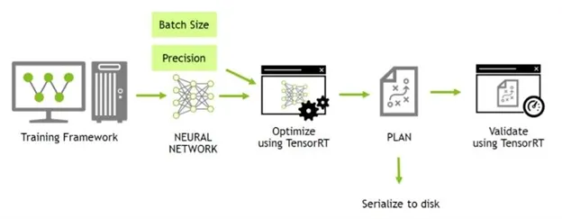

Deep Learning is a great tool that is incredibly successful in many tasks including vision and natural language tasks. While the model’s training could be very long, the inference is relatively quick. However, we sometimes need to speed up the inference, usually for real-time tasks (for example, for autonomous vehicles).

To address this issue, several methods were developed, such as layer fusion, model quantization, pruning, etc. Although there are many ways to use such methods, in this post we will focus on TensorRT by Nvidia.

TensorRT is an optimized deep-learning inference library developed by Nvidia for accelerating the performance of models **on Nvidia GPUs**. It includes features that enable developers to maximize model performance, reduce memory usage, and lower latency. To name some of them:

- Layer and Kernel Fusion — TensorRT fuses compatible layers to reduce the number of operations, enabling faster computation by decreasing the number of kernel calls and memory accesses.
- Quantization — TensorRT supports various precisions, and by reducing precision (like using FP16 or INT8) it can speed up inference.
- Optimized Kernels — TensorRT includes highly optimized kernels for different operations (like convolutions, pooling, etc.).
- Graph Optimization — TensorRT provides graph-level optimizations, such as eliminating redundant operations, which reduce computation and improve runtime performance.
- Tensor Memory Management — TensorRT optimizes memory usage by efficiently managing tensor storage.

and more.

It’s important to note that TensorRT is an optimization library specifically designed for Nvidia hardware. This means that TensorRT only works with Nvidia GPUs, and the optimizations it applies are tailored to the specific Nvidia GPU architecture it will run on. As a result, models optimized with TensorRT are highly efficient on the specific hardware it runs on, but they may not run or would require different optimization, on non-NVIDIA hardware or even other Nvidia hardware.

The following image illustrates the typical deep learning development cycle using TensorRT.

<figure>
  
  <figcaption>
    Source: Nvidia
  </figcaption>
</figure>

There are several options to convert a model into an optimized version by using TensorRT: using an ONNX file, using PyTorch with TensorRT, or using the TensorRT API in Python or C++. We can also deploy the optimized model in several ways, including using PyTorch, TensorRT API in Python or C++, or by using Nvidia Triton Inference.

In my opinion, it is easiest to go with [Torch TensorRT](https://github.com/pytorch/TensorRT) with PyTorch, so let’s focus on it in this post.

## Torch-TensorRT

We start by installing Torch TensorRT.

```bash
! pip install torch-tensorrt -q
```

First, let’s import all the necessary modules.

```python
import time

import torch
import torch.nn.functional as F
import torch_tensorrt
import torchvision.models as models
import torchvision.transforms.v2 as transforms

from PIL import Image
import requests
from io import BytesIO
import numpy as np
```

For our example, we will use ResNet50 as our model to be optimized. We can use TorchVision to download the network with its weights pre-trained on ImageNet.

```python
model = models.resnet50(weights='DEFAULT').eval().to("cuda")
```

We set the state of the model to *eval* since we don’t train it, and move it to the GPU.

Before we optimize the network, let’s make sure it works as expected. We will get an image from the internet and ask the network to predict what’s in the image.

We can download the image and load it to our code, but it will be nicer to get it from the web directly.

```python
url = "https://images.pexels.com/photos/1108099/pexels-photo-1108099.jpeg?cs=srgb&dl=pexels-chevanon-1108099.jpg&fm=jpg&w=640&h=480"
response = requests.get(url)
image = Image.open(BytesIO(response.content)).convert("RGB")
```

<figure>
  
  <figcaption>
    <a href="https://www.pexels.com/photo/two-yellow-labrador-retriever-puppies-1108099/">
      Photo by Chevanon Photography
    </a>
  </figcaption>
</figure>

Before we can feed the image to the network, we need to apply some transformations to make the image an appropriate input to the network.

```python
transform = transforms.Compose([
    transforms.Resize(256),
    transforms.CenterCrop(224),
    transforms.ToTensor(),
    transforms.Normalize(mean=[0.485, 0.456, 0.406], std=[0.229, 0.224, 0.225]),
])
```

We apply the transformations to the image and move it to the GPU.

```python
input_image = transform(image).unsqueeze(0).to("cuda")
```

The network will output logits, but it will be more convenient if we get as output the name of the predicted class together with the probability. For the class names, we first need to get all the names. There are a lot of GitHubs where we can find the list of classes for ImageNet. I just picked one and read the data from it.

```python
url = 'https://raw.githubusercontent.com/pytorch/hub/master/imagenet_classes.txt'
response = requests.get(url)
labels = {index: label for index, label in enumerate(response.text.split('\n'))}
```

Now we have a dictionary with all the classes, and we can make a function to predict the class of an image.

```python
def predict(model, image):
    with torch.no_grad():
        output = model(image)
        probabilities = F.softmax(output, dim=1)
    probability , class_index = torch.max(probabilities, dim=1)
    return labels[class_index.item()], probability.item()

predict(model, input_image)
# ('golden retriever', 0.44795194268226624)
```

The network predicted the right class!

Now, we want to measure the time it takes for the network to predict a batch. For that, we will write a function to measure the average prediction time.

```python
def benchmark(model, input_shape=(32, 3, 224, 224), warmup_iterations=50, run_iterations=100):
    input_data = torch.randn(input_shape)
    input_data = input_data.to("cuda")
        
    print("Warm up ...")
    with torch.no_grad():
        for _ in range(warmup_iterations):
            outputs = model(input_data)
    
    torch.cuda.synchronize()
    print("Start timing ...")
    timings = []
    with torch.no_grad():
        for i in range(run_iterations):
            start_time = time.time()
            outputs = model(input_data)
            torch.cuda.synchronize()
            end_time = time.time()
            timings.append(end_time - start_time)

    print(f'Average batch time: {np.mean(timings)*1000:.2f} ms')
```

The function gets a model, input shape, and the number of warmups and benchmark iterations.

At first, the function creates a random tensor with *input_shape* (batch size, channels, height, width) and moves it to the GPU. Then the model processes the input *warmup_iterations* times without measuring the time. The purpose of this stage is to warm up the GPU for more stable performance measurements. During this phase, any initialization that PyTorch might perform internally on the GPU occurs before the actual timed runs.

Now we move to the actual benchmarking. We use `torch.cuda.synchronize()` to ensure that all GPU operations are complete before timing starts. This is important to get accurate measurements because CUDA operations are asynchronous. We define a list for keeping track of the batch processing time, and then process the input in a loop for *run_iterations* times. Inside the loop, we record the start time before we process the input, process it in the network, and then call again to `torch.cuda.synchronize()` to ensure that all GPU operations related to model inference are complete before recording the end time. Only then, we can record the end time and append the process time to the list. At the end, we will print the average batch time it took to the network to infer the batch.

```python
benchmark(model)
# Warm up ...
# Start timing ...
# Average batch time: 89.47 ms
```

Now it’s time to optimize the model with TensorRT. Basic optimization using Torch TensorRT is very straightforward. We choose the input size to optimize for and then compile the model.

```python
inputs = [torch.randn((1, 3, 224, 224)).cuda()]
optimized_model = torch_tensorrt.compile(model,'default', inputs)
```

That’s it. We have three main arguments in the compile function: the model we want to optimize, the strategy to compile (default means let Torch TensorRT decide), and the inputs we want to optimize for (in this case we optimize the model for input with shape (1, 3, 224, 224)).

Let’s see if we still get the same result as before.

```python
predict(optimized_model, input_image)
# ('golden retriever', 0.4479517638683319)
```

Indeed, we get pretty much the same results.

Before benchmarking the optimized model, let’s optimize it again with a batch size of 32.

```python
inputs = [torch.randn((32, 3, 224, 224)).cuda()]
optimized_model = torch_tensorrt.compile(model,'default', inputs)
```

and run the benchmark.

```python
benchmark(optimized_model)
# Warm up ...
# Start timing ...
# Average batch time: 66.77 ms
```

We get a nice improvement with very minimal work. We can use more settings to optimize even more. For example, let’s use half-precision (float 16) for the optimization.

```python
inputs = [torch.randn((32, 3, 224, 224)).cuda()]
optimized_model = torch_tensorrt.compile(model,'default', inputs, enabled_precisions={torch.float16})
```

and run the benchmark again.

```python
benchmark(optimized_model)
# Warm up ...
# Start timing ...
# Average batch time: 15.26 ms
```

This is a very big improvement! But is it still accurate?

```python
inputs = [torch.randn((1, 3, 224, 224)).cuda()]
optimized_model = torch_tensorrt.compile(model,'default', inputs, enabled_precisions={torch.float16})

predict(optimized_model, input_image)
# ('golden retriever', 0.44798213243484497)
```

Yes, we still get the right result. You have probably noticed we had to compile the model again because we have a batch of size one in the prediction. It would be more convenient if we could use more input shapes in our optimized model.

```python
inputs = torch_tensorrt.Input(
    min_shape=(1, 3, 224, 224),
    opt_shape=(32, 3, 224, 224),
    max_shape=(64, 3, 224, 224),
    dtype=torch.float32)
optimized_model = torch_tensorrt.compile(model,'default', inputs, enabled_precisions={torch.float16})
```

In the previous code, we tell TensorRT that the minimum shape of inputs is for a batch of size one, and the maximum is a batch size of 64. We also tell it that we want the main optimization to be for a size of 32, and the format of the input will be float32.

We optimize the model again and check the benchmark and prediction.

```python
benchmark(optimized_model)
# Warm up ...
# Start timing ...
# Average batch time: 15.73 ms

predict(optimized_model, input_image)
# ('golden retriever', 0.4470345973968506)
```

We got similar results as in the previous experiment, but we didn’t need to create different optimized models to test the benchmark and the prediction.

## Conclusion

TensorRT is a very powerful optimization tool for neural networks that run on Nvidia hardware. It lets us gain significant speed up for the model inference, with a little work from our side, using a wide variety of optimization techniques. In this post, we saw some basic examples of how we can use Torch-TensorRT to leverage the power of TensorRT directly into our PyTorch models with very minimal effort, but there is a lot more to do with it, and if you like, you can read more about it in [here](https://docs.nvidia.com/deeplearning/tensorrt/developer-guide/index.html).