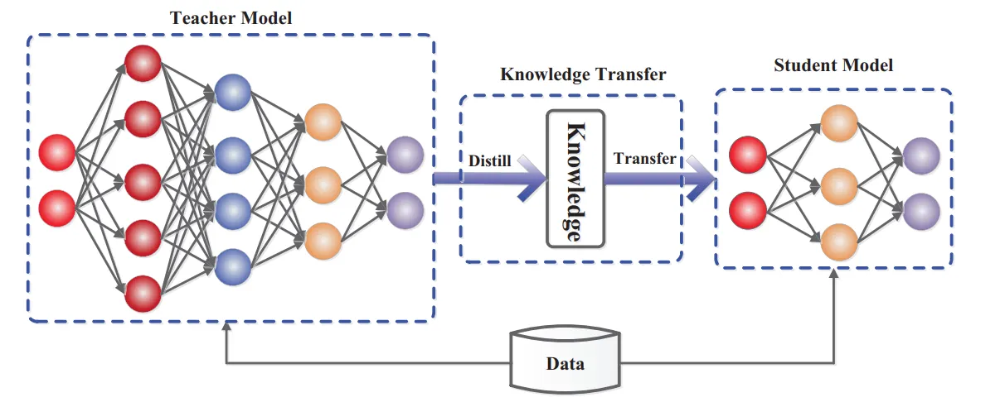
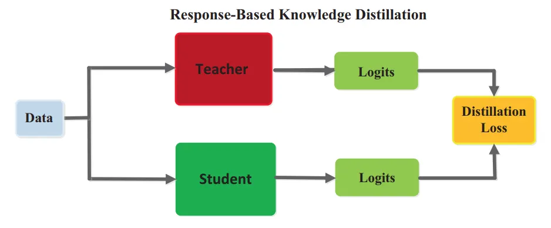
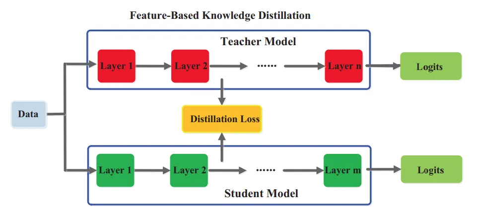
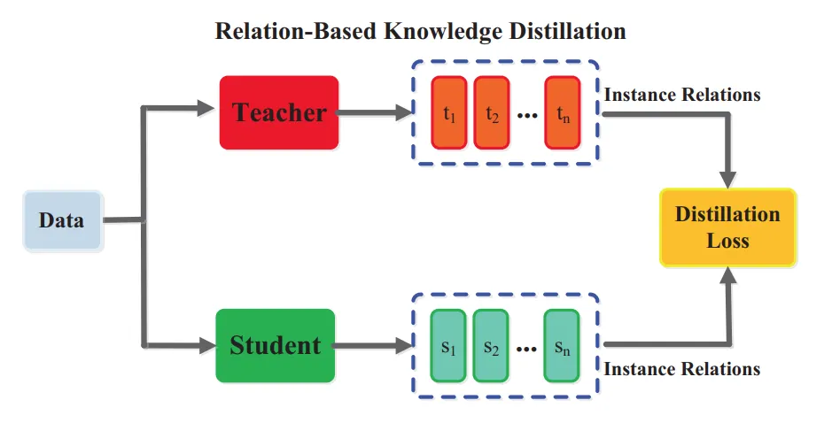
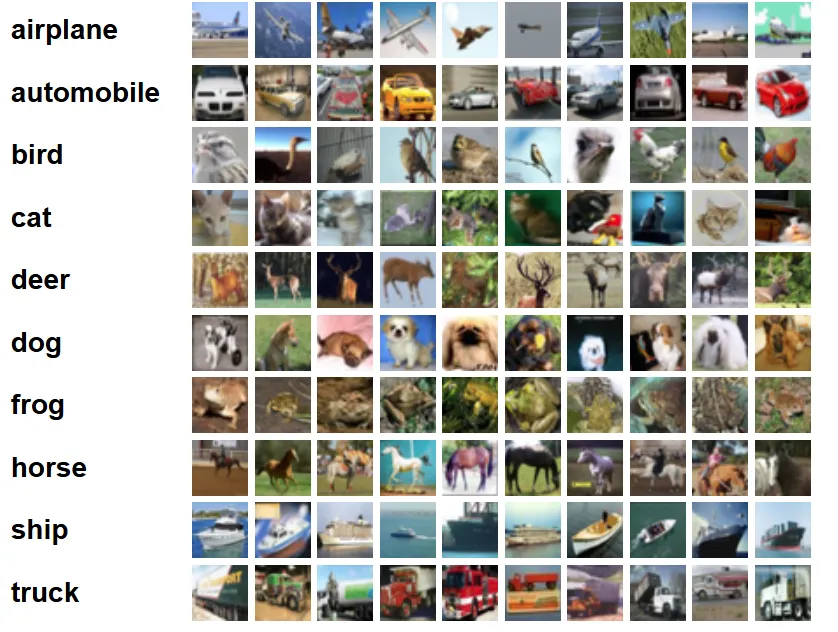

<figure>
  
  <figcaption>
    <a href="https://arxiv.org/pdf/2006.05525">Source</a>
  </figcaption>
</figure>

In the rapidly advancing field of deep learning, deploying high-performance models in real-world applications often comes with a key challenge: the balance between accuracy and computational efficiency. Many state-of-the-art models are large and resource-intensive, making them impractical for deployment on devices with limited memory or processing power, such as mobile phones, embedded systems, or autonomous vehicles. This is where knowledge distillation becomes a powerful technique.

The core idea of knowledge distillation is to transfer knowledge from a large, complex model to a smaller, more efficient one without significant loss of accuracy.

This post will explore the principles behind knowledge distillation, its various techniques, and how it can be applied to deep learning models in computer vision. Let’s dive into how it works and what makes it so effective.

## Knowledge Distillation

Knowledge distillation is a technique for transferring insights from a large, complex model or group of models to a single, more compact model that is feasible for deployment in real-world scenarios with practical limitations. In essence, it serves as a method of model compression.

This technique is predominantly applied to neural network models that feature complex architectures with multiple layers and numerous parameters. While deep learning models become more successful and bigger than ever, the deployment of extensive deep neural networks poses significant challenges, particularly for edge devices that have restricted memory and computational resources. This is why knowledge distillation methods have become increasingly important for real-world implementations.

In knowledge distillation, we take advantage of the complex network and use it as a “teacher”, to help a smaller and resource-friendly “student” model to learn from it, aiming to replicate the teacher's performance. The following section will explore the structure and mechanisms of the knowledge distillation technique in greater detail.

## How to Transfer the Knowledge

As mentioned previously, our goal is to use an intricate network with high performance (the “teacher”), to teach a small and simpler network the knowledge it needs to perform well.

When we refer to knowledge in this context, we mainly talk about the weights and biases the network learns during training. These weights and biases are responsible for the results of the networks. However, since the student network has significantly fewer parameters than the teacher, we can’t just copy the values of the teacher parameters to the student. We need a way to transfer the knowledge to the student.

There are three techniques to transfer the knowledge.

### Response-based

This is the most straightforward and commonly used method in knowledge distillation. It focuses on training the student model to replicate the final output predictions of the teacher model. This approach uses the prediction (or “response”) of the teacher as the primary source of knowledge to transfer to the student.

<figure>
  
  <figcaption>
    The generic response-based knowledge distillation. <a href="https://arxiv.org/pdf/2006.05525">Source.</a>
  </figcaption>
</figure>

### Feature-based

This type of knowledge distillation extends the knowledge transfer process beyond just the final outputs of the teacher model to include the internal feature representations learned by the teacher. This approach aims to make the student model learn the intermediate representations (the feature maps) that the teacher extracts from the input data, providing a deeper level of guidance.

<figure>
  
  <figcaption>
    The generic feature-based knowledge distillation. <a href="https://arxiv.org/pdf/2006.05525">Source.</a>
  </figcaption>
</figure>

### Relation-based

This type of distillation method focuses on transferring knowledge about the relations among data samples, layers, or feature representations from the teacher model to the student model. Instead of directly mimicking the teacher’s outputs or internal features, relation-based distillation trains the student to capture the relationships between multiple feature representations or data points learned by the teacher, such as correlations, similarities, embedding, or probabilistic distributions.

<figure>
  
  <figcaption>
    Generic relation-based knowledge distillation. <a href="https://arxiv.org/pdf/2006.05525">Source.</a>
  </figcaption>
</figure>

## Distillation Schemes

There are several techniques to train the teacher and student models to perform knowledge distillation. The three main categories of knowledge distillation are **offline distillation, online distillation,** and **self-distillation**.

Offline distillation is the most popular. We first train the large teacher model, and after that, we use the pre-trained teacher to train the small student model. In the online distillation case, we train the teacher and the student simultaneously, so it is not a two-step process like the offline one, but an end-to-end training. Self-distillation is a special case of online distillation where the same network is used for both the teacher and student. An example of such a technique is where knowledge from deeper sections of the network is distilled into shallow sections of it.

There is a lot more to say about knowledge distillation techniques, and you can learn more from this [paper](https://arxiv.org/pdf/2006.05525).

## Offline Response-based Knowledge Distillation

From now on we will focus on the most popular and straightforward technique of knowledge distillation, which is an offline learning of a response-based scheme.

The core idea behind it is to train a student model to approximate the results of a pre-trained teacher model. This involves several key steps:

1. **Soft Targets**: Instead of simply training the student to match the hard labels (e.g., a class label like “cat” or “dog”), like in the regular training scheme, knowledge distillation leverages the “soft targets” produced by the teacher. These soft targets are probability distributions over all possible classes (usually achieved by soft-max), and they contain information about the teacher’s confidence in its predictions.

2. **Temperature Scaling**: During distillation, the teacher’s output is often scaled by a temperature parameter. The teacher’s predictions become softer by setting a higher temperature, which helps the student learn from subtle relationships between classes. For example, if an image has a high probability of both “dog” and “wolf,” this hint from the teacher helps the student understand that these classes are visually similar, thus improving its generalization.

3. **Loss Function**: Knowledge distillation involves a special loss function that combines two terms: one that aligns the student’s predictions with the hard ground truth labels (the one true label of the image, like “dog”) as in regular training, and another that aligns the student’s predictions with the teacher’s soft targets (which give each class a probability). By optimizing this combined loss, the student learns from the ground truth and the teacher’s nuanced output, allowing it to approximate the teacher’s performance more closely.

## Let’s Code It

In this part, we will implement a simple knowledge-distillation scheme using offline response-based learning. We will use a large network as the teacher, and a smaller version as a student.

The full notebook can be found [here](https://github.com/dorzv/ComputerVision/blob/master/knowledge_distillation/knowledge_distillation.ipynb).

We start by importing all the necessary modules and setting a device to use.

```python
from copy import deepcopy
import torch
import torch.nn as nn
import torch.optim as optim
from torch.utils.data import DataLoader
import torchvision.transforms.v2 as transforms
import torchvision.datasets as datasets

device = "cuda" if torch.cuda.is_available() else "cpu"
torch.manual_seed(42)
```

We will use the CIFAR-10 dataset, which contains RGB images of size 32x32 for ten classes.

<figure>
  
  <figcaption>
    A sample of images from the CIFAR-10 dataset. Source: <a href="https://www.cs.toronto.edu/~kriz/cifar.html">https://www.cs.toronto.edu/~kriz/cifar.html</a>
  </figcaption>
</figure>

We will use torchvision to download and use the dataset and to define a transformation that converts the images to PyTorch tensors.

```python
transform = transforms.Compose([
    transforms.ToTensor()
])

train_dataset = datasets.CIFAR10(root='data', train=True, download=True, transform=transform)
test_dataset = datasets.CIFAR10(root='data', train=False, download=True, transform=transform)
```

We use the datasets to create DataLoader objects.

```python
train_loader = DataLoader(train_dataset, batch_size=128, shuffle=True, num_workers=2)
test_loader = DataLoader(test_dataset, batch_size=128, shuffle=False, num_workers=2)
```

After having the data, we can define the models. Let’s start with the teacher model, which will be a CNN model with a classifier.

```python
class TeacherModel(nn.Module):
    def __init__(self, num_classes=10):
        super().__init__()
        self.features_extractor = nn.Sequential(
            nn.Conv2d(3, 128, kernel_size=3, padding=1),
            nn.BatchNorm2d(128),
            nn.ReLU(),
            nn.Conv2d(128, 64, kernel_size=3, padding=1),
            nn.BatchNorm2d(64),
            nn.ReLU(),
            nn.MaxPool2d(kernel_size=2, stride=2),
            nn.Conv2d(64, 64, kernel_size=3, padding=1),
            nn.BatchNorm2d(64),
            nn.ReLU(),
            nn.Conv2d(64, 32, kernel_size=3, padding=1),
            nn.BatchNorm2d(32),
            nn.ReLU(),
            nn.MaxPool2d(kernel_size=2, stride=2),
        )

        self.classifier = nn.Sequential(
            nn.Linear(2048, 512),
            nn.ReLU(),
            nn.Dropout(0.1),
            nn.Linear(512, num_classes)
        )

    def forward(self, x):
        x = self.features_extractor(x)
        x = torch.flatten(x, 1)
        x = self.classifier(x)
        return x
```

And the student model.

```python
class StudentModel(nn.Module):
    def __init__(self, num_classes=10):
        super().__init__()
        self.features_extractor = nn.Sequential(
            nn.Conv2d(3, 16, kernel_size=3, padding=1),
            nn.BatchNorm2d(16),
            nn.ReLU(),
            nn.MaxPool2d(kernel_size=2, stride=2),
            nn.Conv2d(16, 16, kernel_size=3, padding=1),
            nn.BatchNorm2d(16),
            nn.ReLU(),
            nn.MaxPool2d(kernel_size=2, stride=2),
        )

        self.classifier = nn.Sequential(
            nn.Linear(1024, 256),
            nn.ReLU(),
            nn.Dropout(0.1),
            nn.Linear(256, num_classes)
        )

    def forward(self, x):
        x = self.features_extractor(x)
        x = torch.flatten(x, 1)
        x = self.classifier(x)
        return x
```

As you can see, the student model is shallower and narrower than the teacher model but has a similar architecture.

We want a training function and also a test function to measure accuracy.

```python
def train(model, dataloader, epochs, learning_rate, device):
    criterion = nn.CrossEntropyLoss()
    optimizer = optim.Adam(model.parameters(), lr=learning_rate)

    model.to(device)
    model.train()

    for epoch in range(epochs):
        running_loss = 0.0
        for images, labels in dataloader:
            images = images.to(device)
            labels = labels.to(device)

            optimizer.zero_grad()
            outputs = model(images)

            loss = criterion(outputs, labels)
            loss.backward()
            optimizer.step()

            running_loss += loss.item()

        print(f"Epoch {epoch+1}/{epochs}, Mean Loss: {running_loss / len(dataloader)}")
```

```python
def test(model, data_loader, device):
    model.to(device)
    model.eval()

    correct = 0
    total = 0

    with torch.no_grad():
        for images, labels in data_loader:
            images = images.to(device)
            labels = labels.to(device)

            outputs = model(images)
            predicted_class = torch.argmax(outputs, dim=1)

            total += labels.size(0)
            correct += (predicted_class == labels).sum().item()

    accuracy = 100 * correct / total
    print(f"Test Accuracy: {accuracy:.2f}%")
    return accuracy
```

Now we create instances of the teacher models, and of the student model, and train them regularly. We also clone the student model to use later with knowledge distillation.

```python
print('Teacher')
teacher = TeacherModel(num_classes=10)
train(teacher, train_loader, epochs=30, learning_rate=0.001, device=device)
test_accuracy_teacher = test(teacher, test_loader, device)

print('\nStudent')
student1 = StudentModel(num_classes=10)
student2 = deepcopy(student1)
train(student1, train_loader, epochs=30, learning_rate=0.001, device=device)
test_accuracy_student1 = test(student1, test_loader, device)
```

```text
Teacher
Epoch 1/30, Mean Loss: 1.227013551975455
Epoch 2/30, Mean Loss: 0.8006297277520075
.
.
.
Epoch 30/30, Mean Loss: 0.042777400205383447
Test Accuracy: 80.35%

Student
Epoch 1/30, Mean Loss: 1.3870741598441472
Epoch 2/30, Mean Loss: 1.0735777561621898
.
.
.
Epoch 30/30, Mean Loss: 0.19093702329546594
Test Accuracy: 68.70%
```

As we can see, the teacher model performs better than the student model. Now, we want to use knowledge distillation to see if it improves the student’s performance. First, we define a new training function that uses the teacher's result for the training of the student.

```python
def train_knowledge_distillation(teacher, student, data_loader, epochs, learning_rate, temperature, alpha, device):
    criterion = nn.CrossEntropyLoss()
    criterion_distill = nn.KLDivLoss(reduction='batchmean')
    optimizer = optim.Adam(student.parameters(), lr=learning_rate)
    teacher.to(device)
    student.to(device)
    teacher.eval()
    student.train()

    for epoch in range(epochs):
        running_loss = 0.0
        for images, labels in data_loader:
            images = images.to(device)
            labels = labels.to(device)

            optimizer.zero_grad()

            # Forward pass with the teacher model
            with torch.no_grad():
                teacher_logits = teacher(images)

            # Forward pass with the student model
            student_logits = student(images)

            # Calculate the soft label loss
            soft_targets = torch.softmax(teacher_logits / temperature, dim=1)
            soft_probs = torch.log_softmax(student_logits / temperature, dim=1)

            distillation_loss = criterion_distill(soft_probs, soft_targets)

            # Calculate the true label loss
            label_loss = criterion(student_logits, labels)

            # Weighted sum of the two losses
            loss = alpha * label_loss + (1.0 - alpha) * temperature**2 * distillation_loss
            loss.backward()
            optimizer.step()

            running_loss += loss.item()

        print(f"Epoch {epoch+1}/{epochs}, Loss: {running_loss / len(data_loader)}")
```

Most of the function is identical to the previous function, but we add a distillation loss term that uses soft labels based on the teacher results. This loss uses KL divergence (Kullback–Leibler divergence), which measures how much a model distribution is different from a true distribution. In our case, we assume the probability for each class that the teacher produces is the target probability, and we want to measure the differences between the probabilities the student gives and the teacher's result. Pay attention that PyTorch `KLDivLoss` assumes the input is in a log scale (but the target doesn’t have to), so we use `log_softmax` on the student’s logits. You can also see that we use a *temperature* term to smooth the probabilities that the softmax produces.

$$
p(z_i, T) = \frac{\exp(z_i / T)}{\sum_j \exp(z_j / T)}
$$

In addition, we also calculate the regular cross-entropy loss with the true labels. The total loss can be written as:

$$
\mathcal{L} = \alpha \mathcal{L}_{\text{hard}} + (1 - \alpha) T^2 \mathcal{L}_{\text{soft}}
$$

where the hard loss is a cross-entropy with the real labels, the soft loss is the KL divergence on the smoothed probabilities, $T$ is the temperature we have used for the smoothed probabilities, and $\alpha$ is a weight parameter.

Now we can train the clone of the student with the new procedure. It’s important to notice that the clone is identical to the original student model before the training.

```python
train_knowledge_distillation(teacher, student2, train_loader, epochs=30, learning_rate=0.001, temperature=2, alpha=0.8, device=device)
test_accuracy_student_with_distillation = test(student2, test_loader, device)
```

```text
Epoch 1/30, Loss: 2.1964448251382773
Epoch 2/30, Loss: 1.6716872932356033
.
.
.
Epoch 30/30, Loss: 0.3442998861946413
Test Accuracy: 71.08%
```

You can see we achieve a nice improvement by only adding information from the teacher model.

## Conclusion

Knowledge distillation offers a practical and effective way to bridge the gap between state-of-the-art performance and real-world constraints. By transferring the knowledge from a large, complex model to a smaller, more efficient one, developers can deploy their systems on resource-limited devices without sacrificing accuracy. We saw various methods to use the knowledge distillation idea, and in the example we explored, we demonstrated how a teacher-student framework can be implemented, showcasing the simplicity and effectiveness of applying this method in computer vision tasks. As AI continues to evolve, techniques like knowledge distillation will remain essential for enabling advanced models to perform efficiently in resource-constrained environments.