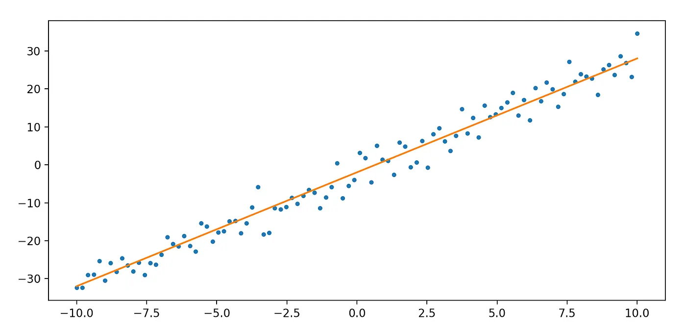
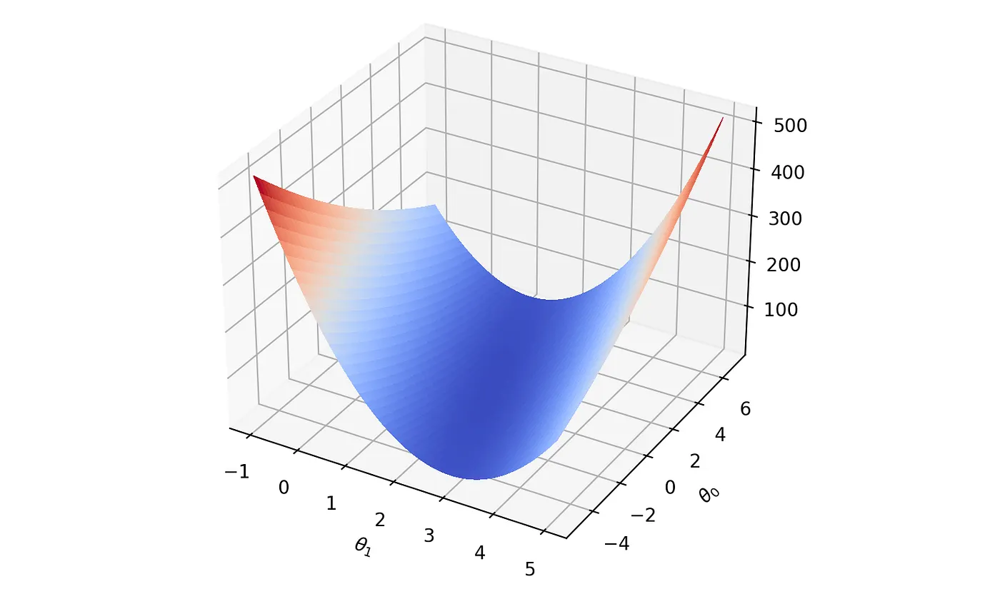
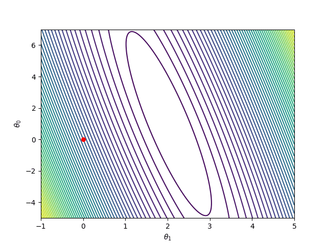
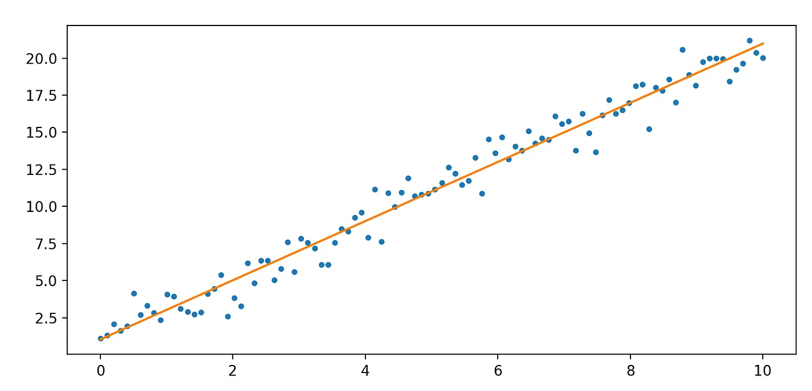

Linear regression is a sort of supervised learning model that lets us find a linear relation between the data (features) and the results (labels).

<figure>
  
  <figcaption>
    Linear model for the blue point
  </figcaption>
</figure>

Our goal while fitting a linear regression is to find the line (or hyper-plane in the general multi-dimensions case) that produces the least error between the known data and the prediction of the model.

Let’s start with the case where we have $m$ data points, and each point has $n$ features. For example, if we try to predict house prices, we may have data for 10 houses (this is $m$), and for each house, we have 3 features: size, age, and number of bedrooms (this is $n$). We want to find a linear model of the form:

$$
y = \theta_0 + \theta_1 x_1 + \theta_2 x_2 + \dots + \theta_n x_n
$$

where $y$ is the label, for example, house price, $x_i$ are the features, and the $\theta$s are the model parameters. We call $\theta_0$ the *bias* term, and the other $\theta$s are the *weights* of the model. You can see this equation is a linear equation. We want to find the parameters that make the minimum error between the real $y$ value and the predicted one $\hat{y}$.

Suppose the error (or loss function) we use is the mean square error (MSE). The objective we want to minimize is

$$
\theta = \arg \min_{\theta} \frac{1}{2m} \sum_{i=1}^{m} (y_i - \hat{y}_i)^2
$$

where $e = y_i - \hat{y}_i$ is the error for the i-th data point. To find the parameters that make this expression minimal, we can derive it according to each $\theta$ and find when it equals zero.

$$
\begin{aligned}
0 &= \frac{\partial}{\partial \theta_j} \left( \frac{1}{2m} \sum_{i=1}^{m} (y_i - \hat{y}_i)^2 \right) \\
&= \frac{1}{2m} \frac{\partial}{\partial \theta_j} \left( \sum_{i=1}^{m} (y_i - \theta_0 - \theta_1 x_{i1} - \dots - \theta_n x_{in})^2 \right) \\
&= -\frac{1}{m} \sum_{i=1}^{m} (y_i - \theta_0 - \theta_1 x_{i1} - \dots - \theta_n x_{in}) x_{ij}
\end{aligned}
$$

The above equation is one equation of a set of linear equations for the *θ*s we can solve. But, it will be more convenient to write it in a matrix notation.

$$
\begin{aligned}
0 &= \frac{1}{2m} \nabla_{\mathbf{\theta}} \|\mathbf{e}\|^2 \\
&= \frac{1}{2m} \nabla_{\mathbf{\theta}} \|\mathbf{y}_i - \mathbf{\hat{y}}_i\|^2 \\
&= \frac{1}{2m} \nabla_{\mathbf{\theta}} \|\mathbf{y}_i - \mathbf{X}\boldsymbol{\theta}\|^2 \\
&= \frac{1}{2m} \nabla_{\mathbf{\theta}} ((\mathbf{y}_i - \mathbf{X}\boldsymbol{\theta})^T (\mathbf{y}_i - \mathbf{X}\boldsymbol{\theta})) \\
&= \frac{1}{2m} \nabla_{\mathbf{\theta}} ((\mathbf{y}_i^T - \boldsymbol{\theta}^T \mathbf{X}^T) (\mathbf{y}_i - \mathbf{X}\boldsymbol{\theta})) \\
&= \frac{1}{2m} \nabla_{\mathbf{\theta}} (\mathbf{y}^T \mathbf{y} - \mathbf{y}^T \mathbf{X}\boldsymbol{\theta} - \boldsymbol{\theta}^T \mathbf{X}^T \mathbf{y} + \boldsymbol{\theta}^T \mathbf{X}^T \mathbf{X}\boldsymbol{\theta}) \\
&= \frac{1}{2m} \nabla_{\mathbf{\theta}} (-2\boldsymbol{\theta}^T \mathbf{X}^T \mathbf{y} + \boldsymbol{\theta}^T \mathbf{X}^T \mathbf{X}\boldsymbol{\theta}) \\
&= \frac{1}{2m} (-2\mathbf{X}^T \mathbf{y} + 2\mathbf{X}^T \mathbf{X}\boldsymbol{\theta}) \\
&= \frac{1}{m} (-\mathbf{X}^T \mathbf{y} + \mathbf{X}^T \mathbf{X}\boldsymbol{\theta}) \\
\Rightarrow \boldsymbol{\theta} &= (\mathbf{X}^T \mathbf{X})^{-1} \mathbf{X}^T \mathbf{y}
\end{aligned}
$$

We found the solution for the best $\theta$s that minimize our error function. Notice that the matrix $\mathbf{X}$ should contain a column of ones as its first column for the bias term in the $\boldsymbol{\theta}$ vector. So why do we need a gradient descent algorithm if we can find the solution directly? There are several reasons. First, the matrix $\mathbf{X}$ can be very large, so the multiplication and the inversion can be very expensive to compute and require a lot of memory. Second, the equation above is only true for the MSE loss function and does not apply to a general loss function.

Instead of using the direct approach, we can use the gradient descent algorithm, which is an iterative algorithm. The main idea behind the gradient descent is to look at the direction of the steepest descent at our current position on the error function and make a small step in this direction. Recall we look at the loss function in the parameters space and look for the minimum of it. If we move in the direction of the descent, we hope to find, eventually, the parameters that minimize it.

<figure>
  
  <figcaption>
    The loss surface in the parameters space for a straight line. We want to find the global minimum of the surface.
  </figcaption>
</figure>

At each iteration, we compute the gradient of the loss function and update the parameters by moving a little step in the negative direction of the gradient of the loss (this is the steepest descent).

$$
\boldsymbol{\theta} := \boldsymbol{\theta} - \alpha \nabla_{\mathbf{\theta}} \mathcal{L}(\boldsymbol{\theta})
$$

The hyper-parameter α is calling the *learning rate,* and it determines the step size we take in the descent direction. We keep updating the parameters until convergence of the loss function (or for some predefined number of iterations). Pay attention that if the loss function is not convex, we may end in a local minimum instead of the optimal global minimum.

<figure>
  
  <figcaption>
    Parameters update during gradient descent
  </figcaption>
</figure>

## Time to Code

Let’s write a class that performs a linear regression. We start by writing the whole code, and then we will explain each step.

```python
import numpy as np

class LinearRegression:
    def __init__(self, learning_rate=0.01, max_num_iteration=10000, eps=1e-6):
        self.learning_rate = learning_rate
        self.max_num_iteration = max_num_iteration
        self.eps = eps
        self.bias = 0
        self.weights = None

    def fit(self, X, y):
        num_sample, num_features = X.shape
        self.weights = np.zeros(num_features)
        weights_and_bias = np.zeros(num_features + 1)
        X_with_bias = np.hstack((np.ones((num_sample, 1)), X))

        for _ in range(self.max_num_iteration):
            y_predicted = self.predict(X)

            d_loss = 1 / num_sample * X_with_bias.T @ (y_predicted - y)

            weights_and_bias -= self.learning_rate * d_loss
            self.bias = weights_and_bias[0]
            self.weights =  weights_and_bias[1:].copy()

            if np.max(np.abs(y_predicted - self.predict(X))) < self.eps:
                break

    def predict(self, X):
        return X @ self.weights + self.bias
```

First, we define a LinearRegression class and initialize it with the learning rate, the maximum number of iterations, and some epsilon value to determine convergence. We also initialize the bias term to 0 and set the weights to None since we don’t know yet how many features we have.

In the fit method, we try to find the bias and the weights using gradient descent. As we saw earlier, the gradient of the loss is:

$$
\begin{aligned}
\nabla_{\mathbf{\theta}}\mathcal{L} &= \frac{1}{m}(\mathbf{X}^T\mathbf{X}\boldsymbol{\theta} - \mathbf{X}^T\mathbf{y}) \\
&= \frac{1}{m}\mathbf{X}^T(\mathbf{\hat{y}} - \mathbf{y})
\end{aligned}
$$

So, we first construct the $\mathbf{X}$ matrix to include an additional column with ones for the bias term, and we create a vector of zeros for the bias term and the weights. Then, in each iteration, we find the prediction $\hat{y}$, compute the derivate of the loss, and update the bias and the weights. Finally, we check if the new prediction changed enough relative to the old prediction to determine if we converge.

The predict method uses the bias and weights we found for the model to predict the result from the data.

Let’s try it.

```python
theta_1 = 2
theta_0 = 1
X = np.linspace(0, 10, 100)[:, None]
y = np.squeeze(theta_1 * X + theta_0) + np.random.normal(scale=1, size=X.shape[0])
lin = LinearRegression()
lin.fit(X, y)
```

We create a synthetic dataset of a simple line of the form $y = \theta_0 + \theta_1 x$, and we also add some noise to $y$. Then, we try to find the line from the data with our class. The results are as follows.

<figure>
  
  <figcaption>
    Linear regression model fit result plot
  </figcaption>
</figure>

The blue dots are the data we fitted for, and the orange line is the model found. The bias term is 1.03, and the weight is 1.99, which shows a very good fitting.