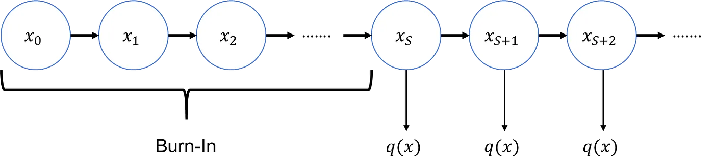
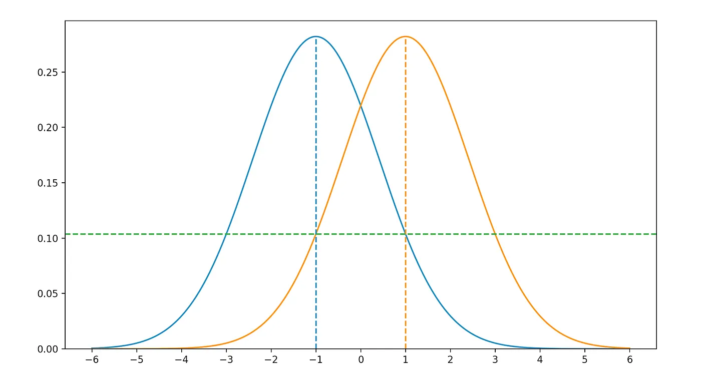
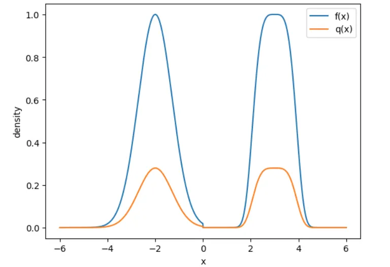
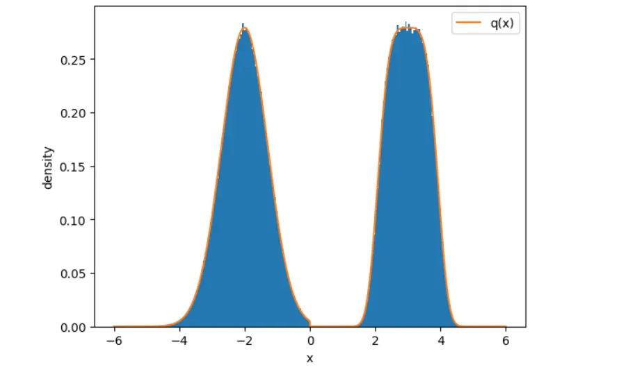
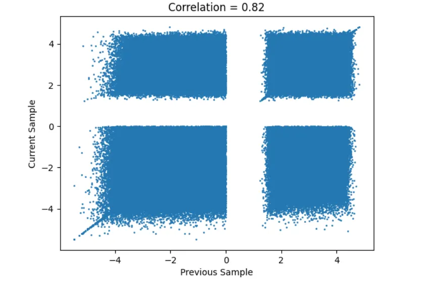
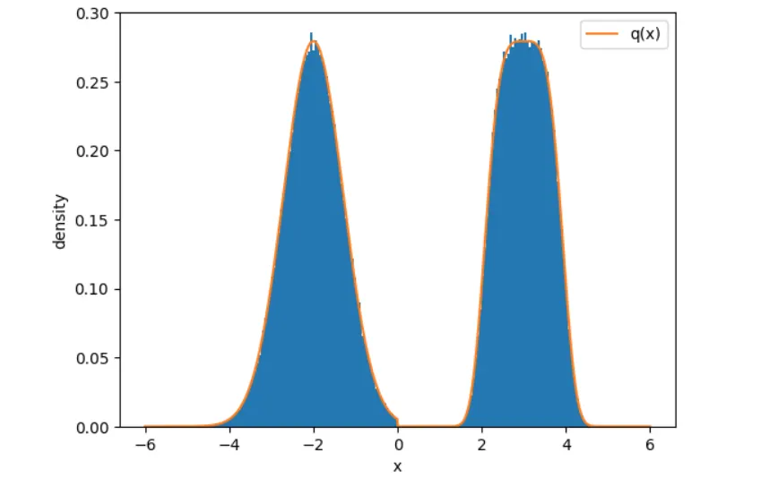
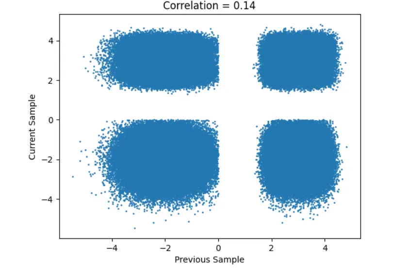

In the field of probability and statistics, it is not uncommon to encounter situations where the probability distribution function cannot be calculated directly. One example of such a situation is the Bayesian inference.

A popular example of Bayesian inference is the estimation of model parameters. The parameters are the elements that define the model structure. For example, for a normal distribution, the parameters are the mean and the variance. For an exponential distribution, the parameter is $\lambda$.

In this case, we usually have some samples $x$ that come from a distribution with unknown parameters $\theta$, but we assume we have some prior knowledge about $\theta$ we can express using a probability function $p(\theta)$. Using Bayes theorem, we can find the probability for $\theta$ according to observed data $x$.

$$
p(\theta\vert{}x) = \frac{p(x\vert{}\theta)p(\theta)}{p(x)}
$$

In most cases, the calculation of the numerator is not too difficult. However, the normalization factor can be a challenge. To find $p(x)$, we usually need to calculate the integral

$$
p(x) = \int_{\theta} p(x\vert{}\theta)p(\theta)d\theta
$$

In some simple cases (especially in low dimensions), we can compute that integral, but in higher dimensions, it may become intractable. So, instead of computing $p(\theta\vert{}x)$ directly, we need to use some approximation.

There are two main approaches to tackling this problem. The first one is the Markov Chain Monte Carlo (MCMC), which is based on sampling from the unknown distribution, and we are going to deal with in this post. The second one is the Variational Inference, which is an approximation-based approach.

Before we continue, if you want to recall what Markov Chain and Monte Carlo are, you can read about them in my previous posts [here](../markov-chain/index.qmd) and [here](../markov-chain-monte-carlo-or-how-to-estimate-unknown-probability-function/index.qmd).

## Markov Chain Monte Carlo

As described earlier, we have some unknown probability density function ($p(\theta\vert{}x)$) we know up to a normalization factor ($p(x)$). That means we have some unknown distribution function $q(x)$ and some known distribution $f(x)$ such that $q(x) \propto f(x)$. We want to sample from the unknown distribution so we can estimate it. In the MCMC approach, we want to sample a new data point in a way that depends on the previous sample. The concept of a new state based only on the previous step is the main idea of the Markov Chain. The Monte Carlo part comes from the simulated sampling from the unknown distribution.

Our final goal is to construct a Markov Chain that eventually describes the unknown distribution. But how can we do that? We need a Markov Chain whose stationary state is $q(x)$. In such a case, sampling using the Markov Chain (from the point it gets to the stationary state) is exactly like sampling from $q(x)$ for all the next steps of the chain.

To show we get to a stationary state, we want to check the detailed balance equation:

$$
q(x)T(y\vert{}x) = q(y)T(x\vert{}y) \qquad \forall x, y
$$

The equation says that the probability of transition to go from the state $x$ to the state $y$ multiplied by the probability of being in the state $x$ is equal to the probability of transition to go from the state $y$ to the state $x$ multiplied by the probability of being in the state $y$, for all $x$ and $y$ (where $T$ can be thought of as a transition matrix). If that equation is true for all $x$ and $y$, we can sum it over all the states so

$$
\sum_i q(x_i)T(y\vert{}x_i) = \sum_i q(y)T(x_i\vert{}y) = q(y) \sum_i T(x_i\vert{}y) = q(y)
$$

The last equation is true because the sum of all the transition probabilities from a state in a Markov chain is equal to $1$. Remember also that the equation is true for every $y$. The equation above describes the stationary condition of a Markov chain:

$$
\pi T = \pi
$$

When we multiply a state vector $\pi$ (which is a row vector) with the transition matrix $T$ of the Markov chain in the stationary state, we get the same state vector. Look at the first element of $\pi$ on the right-hand side, $\pi_1$, for example. According to the equation above, it equals to

$$
\pi_1 = \sum_i \pi_i T_{i,1}
$$

where $T_{i,1}$ is the transition probability to move from state $i$ to state $1$, $T(1\vert{}i)$. This is exactly like the equation we saw before, so it truly describes a stationary state condition.

If we can prove the detailed balance condition, we can show we are in a stationary state that describes the probability function we want to find.

But there is another thing we need to take care of. If our Markov chain has a stationary state, it won’t get to it immediately. We need to take many steps before we move to the stationary state. So, when we start to take steps in our chain, we want to “burn” the first steps before we actually take samples. This first stage is called “burn-in”.

<figure>
  
  <figcaption></figcaption>
</figure>

All we have discussed up until now is the general idea of the MCMC method — construct a Markov chain with a stationary state that describes the unknown probability and sample from it. Now, we are going to see an implementation of this general idea as a specific algorithm called the Metropolis—Hastings algorithm.

## Metropolis — Hastings Algorithm

The first thing we need to define is an easier distribution we can sample new data from, where each new sample data depends on the previous data point (that’s the Markovian property). For example, we can choose to work with a normal distribution with a mean equal to the previous sample.

$$
g(x_{t+1}\vert{}x_t) = \mathcal{N}(x_t, \sigma^2)
$$

Using this distribution $g$, we generate a new candidate point we can accept as a new sample from the unknown distribution or reject. For accepting or rejecting, we want to define an acceptance probability $A$ to move from the point $x_t$ to the new candidate $x_{t+1}$. For defining $A$, we want to use the detailed balance condition:

$$
q(x)T(y\vert{}x) = q(y)T(x\vert{}y) \qquad \forall x, y
$$

and remember that $q(x) = f(x) / C$ where $C$ is some normalization constant. Let’s focus on the transition probability $T$. To move from state $x$ to state $y$, we need our $g$ distribution to generate $y$ (where the previous state was $x$) and also to accept this transition. We can write the detailed balance condition as:

$$
\frac{f(x)}{C} g(y\vert{}x) A(x \rightarrow y) = \frac{f(y)}{C} g(x\vert{}y) A(y \rightarrow x)
$$

We can simplify the above equation as

$$
\frac{A(x \rightarrow y)}{A(y \rightarrow x)} = \underbrace{\frac{f(y)}{f(x)}}_{r_f} \underbrace{\frac{g(x\vert{}y)}{g(y\vert{}x)}}_{r_g}
$$

The algorithm defines the acceptance probability as follows

$$
A(x \rightarrow y) = \begin{cases} r_f r_g, & \text{if } r_f r_g < 1 \\ 1, & \text{if } r_f r_g \geq 1 \end{cases}
$$

$$
A(y \rightarrow x) = \begin{cases} 1, & \text{if } r_f r_g < 1 \\ \frac{1}{r_f r_g}, & \text{if } r_f r_g \geq 1 \end{cases}
$$

Or simply

$$
A(x \rightarrow y) = \min(1, r_f r_g)
$$

If we accept the candidate, the next state of the Markov chain is the new candidate, but if we do not accept it, the next state will simply be the previous state.

To better understand this, let’s assume $g$ is indeed a normal distribution with mean as the previous state and variance $\sigma^2$, as we suggested earlier. In this case, $g(x\vert{}y)$ is the same as $g(y\vert{}x)$ since the normal distribution is symmetric.

<figure>
  
  <figcaption>
    In blue, a normal distribution with a mean of -1 and variance of 2, and in orange, a normal distribution with a mean of 1 and variance of 2. The probability density of 1 for the blue distribution is the same as that of -1 for the orange one because of the symmetry of the normal distribution.
  </figcaption>
</figure>

In such a case, the value of $r_g$ is $1$, and so the acceptance probability is

$$
A(x \rightarrow y) = \min(1, r_f) = \min\left(1, \frac{f(y)}{f(x)}\right) = \min\left(1, \frac{q(y)}{q(x)}\right)
$$

So if the probability of getting $y$, $q(y)$, is greater than that of getting $x$, we want to move to $y$ and $A$ is $1$. We move to the area of high probability to get more samples from that area. But if the probability of $x$, the current state, is greater than $y$ there is some probability of moving to that state, which is in the area of a lower probability. As the new state $y$ is smaller relative to $x$, the probability of moving to it gets lower. This behavior ensures we get more samples for the high probability area and better describe the real unknown probability function.

## Let’s Code It

After understanding the Metropolis—Hastings algorithm, let’s see a code example to understand it better.

We are going to use the following density function $f(x)$

$$
f(x) = \begin{cases} e^{-(x+2)^2}, & \text{if } x < 0 \\ e^{-(x-3)^4}, & \text{if } x \geq 0 \end{cases}
$$

To make it a probability density function $q(x)$, we need to find its normalization factor. For that, we can use [WolframAlpha](http://www.wolframalpha.com) and find the normalization factor to be $3.58111$. In the same way, we can find the expectation value of $q(x)$ and get $0.5284$. Moreover, we are going to use a normal distribution function for the function $g(x)$.

```python
import numpy as np
import matplotlib.pyplot as plt

def f(x):
  if isinstance(x,float):
    x = np.array([x])
  results = np.zeros_like(x, dtype=float)
  less_than_zero = x < 0
  results[less_than_zero] = np.exp(-(x[less_than_zero] + 2) ** 2)
  results[~less_than_zero] = np.exp(-(x[~less_than_zero] - 3) ** 4)
  return results

# normal PDF
def g(x, mu, sigma_2):
    return 1 / np.sqrt(2 * np.pi * sigma_2) * np.exp(-0.5 * (x-mu) ** 2 / sigma_2)

C = 3.58111
EXPECTATION = 1.8926 / C # = 0.5284
```

Let’s look at how the distributions $f(x)$ and $q(x)$ look like.

```python
x_points = np.linspace(-6 , 6 , 1000)
f_distribution = f(x_points)
q_distribution = f_distribution / C

plt.plot(x_points, f_distribution, label='f(x)')
plt.plot(x_points, q_distribution, label='q(x)')
plt.xlabel('x')
plt.ylabel('density')
plt.legend()
```

<figure>
  
  <figcaption></figcaption>
</figure>

Now, we run the algorithm itself

```python
num_of_samples = int(5e6)
num_of_accepted = 0
samples = np.zeros(num_of_samples)
var = 4

for ii in range(num_of_samples-1):
  candidate = np.random.normal(samples[ii], var)
  A_prob = min(1, f(candidate) / f(samples[ii]))

  if np.random.random() < A_prob:
    samples[ii+1] = candidate
    num_of_accepted += 1
  else:
    samples[ii+1] = samples[ii]
```

We make 5 million samples. At each iteration, we get a candidate according to the previous step using $g(x)$ with the mean as the previous sample and a variance of $4$. Then, we calculate the acceptance probability $A$, and according to it, we decide if we take the candidate as the next state or use the previous step.

Next, we want to remove the burn-in part from the sampling data.

```python
burn_in = 1000
samples_to_use = samples[burn_in:]
```

We can check the percentage of the sample we accepted.

```python
print(f"Acceptances: {num_of_accepted / num_of_samples * 100:.2f}%")
# Acceptances: 29.72%
```

Let’s compare the sampling distribution to the real one $q(x)$.

```python
plt.hist(samples_to_use, bins=200, density=True)
plt.plot(x_points, q_distribution, label='q(x)')
plt.xlabel('x')
plt.ylabel('density')
plt.legend()
```

<figure>
  
  <figcaption></figcaption>
</figure>

We see a good match between the sampling distribution and the real distribution $q(x)$. We can also compute the mean.

```bash
samples_to_use.mean()
#  0.532
```

This result is close to the real one.

One problem this algorithm has is a high correlation between the samples since the next sample is strongly related to the previous one. Let’s check the correlation of the samples.

```python
from scipy.stats import pearsonr
plt.scatter(samples_to_use[:-1], samples_to_use[1:], s=1)
plt.xlabel('Previous Sample')
plt.ylabel('Current Sample')
corr = np.round(pearsonr(samples_to_use[:-1], samples_to_use[1:])[0], 2)
plt.title(f'Correlation = {corr}')
```

<figure>
  
  <figcaption></figcaption>
</figure>

A correlation of $0.82$ is pretty high. We can reduce this correlation if we take each 10th sample, for example.

```python
samples_to_use_no_correlation = samples_to_use[::10]
plt.hist(samples_to_use_no_correlation, bins=200, density=True)
plt.plot(x_points, q_distribution, label='q(x)')
plt.xlabel('x')
plt.ylabel('density')
plt.legend()
```

<figure>
  
  <figcaption></figcaption>
</figure>

```bash
samples_to_use_no_correlation.mean()
#  0.536
```

```python
plt.scatter(samples_to_use_no_correlation[:-1], samples_to_use_no_correlation[1:], s=1)
plt.xlabel('Previous Sample')
plt.ylabel('Current Sample')
corr = np.round(pearsonr(samples_to_use_no_correlation[:-1], samples_to_use_no_correlation[1:])[0], 2)
plt.title(f'Correlation = {corr}')
```

<figure>
  
  <figcaption></figcaption>
</figure>

We see we succeeded in reducing the correlation and still keep a good distribution.