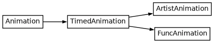
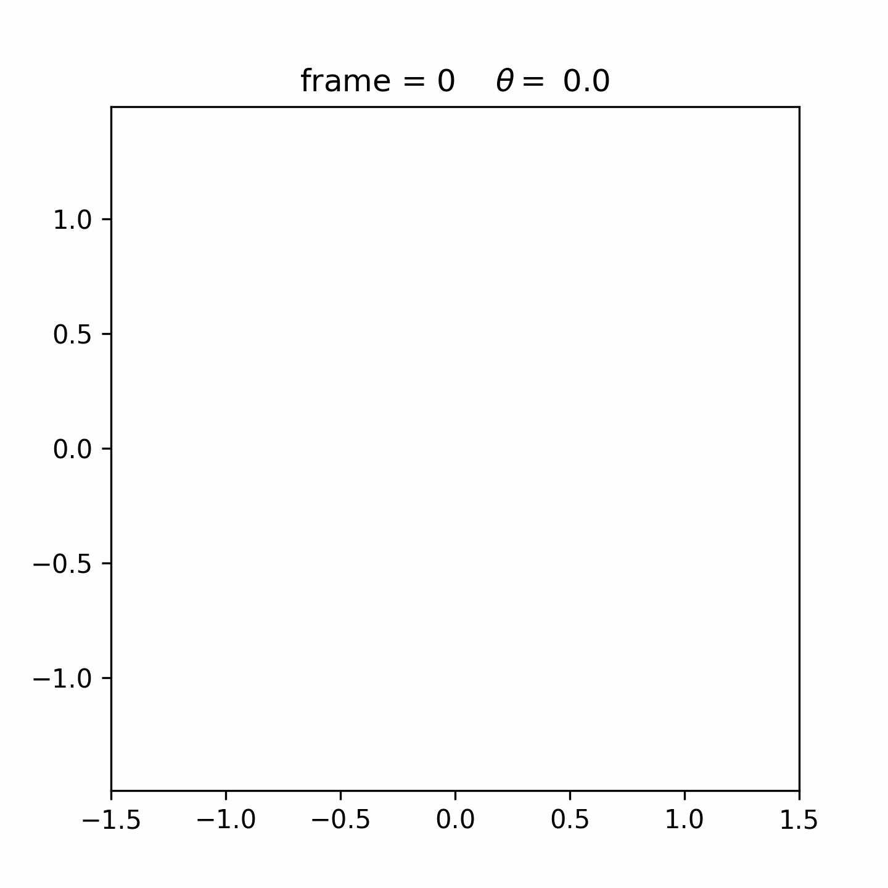
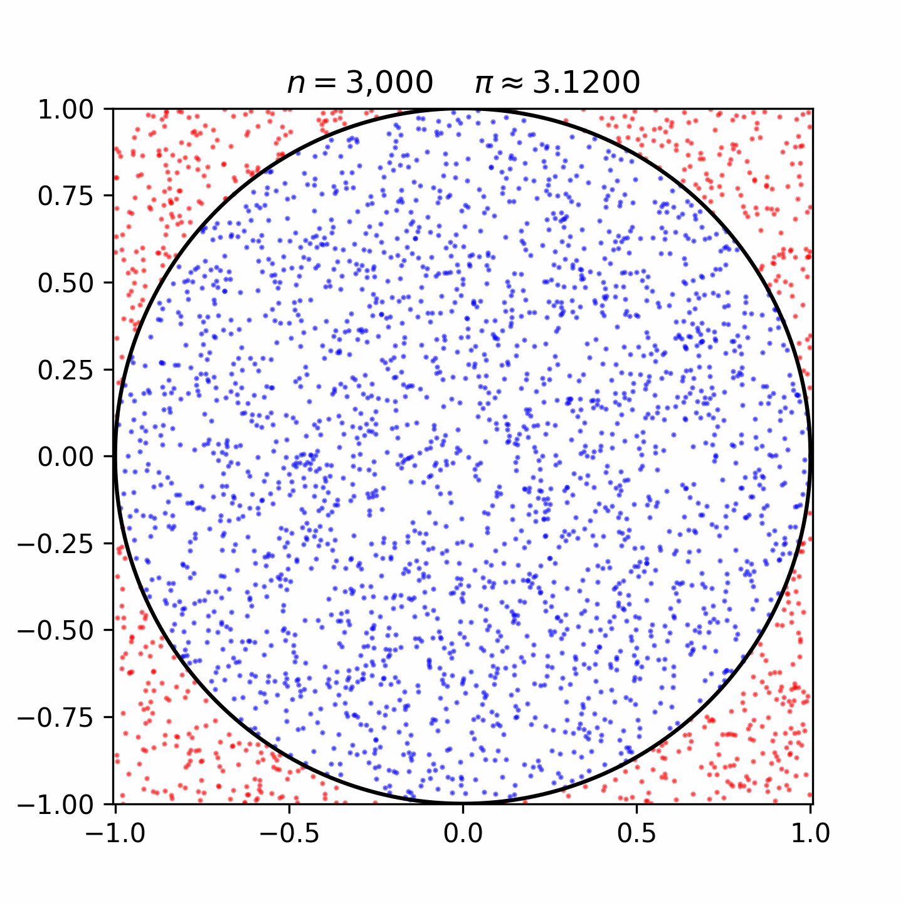

For some mathematical problems, an exact solution can be very difficult to obtain. Instead of solving the problem directly, we can use random numbers to get an approximation of the solution.

Monte Carlo algorithms are computational algorithms that draw many random numbers and perform calculations on the drawn numbers. The name Monte Carlo comes from the casino in Monte Carlo due to the random nature of the method.

The Monte Carlo algorithms have the following structure:

1. Define the input space (the numbers that are possible as input for the algorithm)
2. Use a probability function to sample a number from the input space
3. Making a deterministic calculation on the selected input (that means a calculation that we know how to perform exactly)
4. Collecting the results to make statistics

## Animation Using Matplotlib

Matplotlib is a popular visualization library for Python. It can help us to plot data with a wide range of graphs. When the data or the results change with time, it can be helpful to visualize it using animation that shows the change over time.

Matplotlib has two main subclasses to handle animation that change over time: `FuncAnimation` and `ArtistAnimation`, both are a subclass of `TimedAnimation` and `Animation`.

<figure>
  
  <figcaption>
    Image by matplotlib
  </figcaption>
</figure>

The `FuncAnimation` makes its animation by repeatedly calling for some function while `ArtistAnimation` using a fixed set of [`Artist`](https://matplotlib.org/stable/api/artist_api.html#matplotlib.artist.Artist).

We focus on the `FuncAnimation` class, and let's start with a simple example of drawing a circle:

```python
import numpy as np
import matplotlib.pyplot as plt
from matplotlib.animation import FuncAnimation, PillowWriter

num_of_frames = 100

radius = 1.0
theta = np.linspace(0, 2 * np.pi, num_of_frames)
x_circle = radius * np.cos(theta)
y_circle = radius * np.sin(theta)

fig, ax = plt.subplots(figsize=(4.8, 4.8))

def animate(i):
    print(i)
    ax.clear()
    x = x_circle[:i+1]
    y = y_circle[:i+1]
    ax.plot(x, y, 'k')
    ax.axis('equal')
    ax.set_xlim(-1.5, 1.5)
    ax.set_ylim(-1.5, 1.5)
    ax.set_title(fr'frame = {i}    $\theta = $ {np.rad2deg(theta[i]):.1f}')
    return

# create FuncAnimation object and save the animation into gif
ani = FuncAnimation(fig, animate, interval=50, repeat=True, frames=num_of_frames)
ani.save("circle.gif", dpi=300, writer=PillowWriter(fps=24))
```

In the example above, we start by importing the necessary packages. Specifically, we import the `FuncAnimation` to make the animation and `PillowWriter` which will help us to save the animation as a gif file.

We define the parameter of the circle — radius of $1$ and angles go from $0$ to $2\pi$, and create an array of the $x$ and $y$ coordinates of the point along the circle.

We create a matplotlib figure and axis objects and then define the function we send to the `FuncAnimation` object to create the animation. The animation function gets the current frame index (an integer between 0 to the total number of frame-1); that's i. We take the points on the circle until the i-th index (remember Python doesn't include the last number in the indexing) and plot them to our axis object, together with a title with the frame index and the current angle on the circle.

Finally, we create the `FuncAnimation` object with the following arguments: the figure we use, the function to call repeatedly, interval which is the time in milliseconds between the frames in the animation, repeat which is true for repeating the animation after it ends, and the total number of frames the animation should contain. Then we save our animation using the save method, and the `PillowWriter` object gets the frame rate we want for the gif file.

<figure>
  
</figure>

## Estimating $\pi$ with Monte Carlo

Now that we are familiar with the Monte Carlo simulation concept and also with the animation in matplotlib, we can use them to make a simulation to estimate $\pi$ (It's not the best way to estimate $\pi$, but a good example for Monte Carlo).

The main idea is as follows: let's look at a circle with a radius of $1$ that is bound inside a square. The ratio of the areas of the circle and the square is

$$\frac{\pi r^2}{(2r)^2} = \frac{\pi}{4}$$

so we can scatter points randomly inside the square and see what is the ratio between the number of points inside the circle to the total number of points inside the square. This ratio should be $\pi$/4. Let's use the 4 steps of the Monte Carlo algorithm:

1. The domain of possible inputs is $x$ and $y$ coordinates between $-1$ to $1$
2. We use a uniform distribution to generate $x$ and $y$ coordinates
3. Find the points inside the circle
4. Calculate the ratio between the number of points inside the circle and the total number of points

We also want to make an animation to see the result of the Monte Carlo simulation for different numbers of points.

We can do all of that with the following script:

```python
import numpy as np
from numpy.random import uniform
import matplotlib.pyplot as plt
from matplotlib.animation import FuncAnimation, PillowWriter

num_of_frames = 50
num_of_samples = 150_000

x = uniform(low=-1.0, high=1.0, size=num_of_samples)
y = uniform(low=-1.0, high=1.0, size=num_of_samples)

radius = 1.0
theta = np.linspace(0, 2 * np.pi, 1000)
x_circle = radius * np.cos(theta)
y_circle = radius * np.sin(theta)

fig, ax = plt.subplots(figsize=(4.8, 4.8))

def animate(i):
    print(i)
    ax.clear()
    x_samples = x[:int(num_of_samples*(i+1)/num_of_frames)]
    y_samples = y[:int(num_of_samples * (i+1) / num_of_frames)]
    inside_circle = np.sqrt(x_samples ** 2 + y_samples ** 2) <= 1
    x_inside = x_samples[inside_circle]
    x_outside = x_samples[~inside_circle]
    y_inside = y_samples[inside_circle]
    y_outside = y_samples[~inside_circle]
    ax.scatter(x_inside, y_inside, 1, c='b', alpha=0.5)
    ax.scatter(x_outside, y_outside, 1, c='r', alpha=0.5)
    ax.plot(x_circle, y_circle, 'k')
    ax.axis('equal')
    ax.set_xlim(-1, 1)
    ax.set_ylim(-1, 1)
    ax.set_title(fr'$n = ${len(x_samples):,}    $\pi \approx {4*len(x_inside)/len(x_samples):.4f}$')
    return


ani = FuncAnimation(fig, animate, interval=200, repeat=True, frames=num_of_frames)
ani.save("TLI.gif", dpi=300, writer=PillowWriter(fps=5))
```

In the script we generate $x$ and $y$ coordinates from a uniform distribution between $-1$ to $1$ using NumPy `uniform` function, then inside the `animate` function, we take part of the $x$ and $y$ coordinate (according to the index of the current frame), find which of the points are inside the circle, and draw them as blue dots, while the outside points are red. We also add the circle outline in black and set the axes to be with an equal ratio and between $-1$ to $1$. Finally, we set a title with the total number of points in the current frame and the approximation for $\pi$.

After defining the `animate` function, we pass it to the `FuncAnimation` object, and save the animation into a gif file.

<figure>
  
</figure>

## Conclusion

Monte Carlo is a powerful algorithm to solve complex problems that can be hard to solve exactly. It can help us get a good estimation of the result with not too many computational resources. We also saw how we could use matplotlib `FuncAnimation` object to visualize changes over time with animation and save that animation as a gif file.