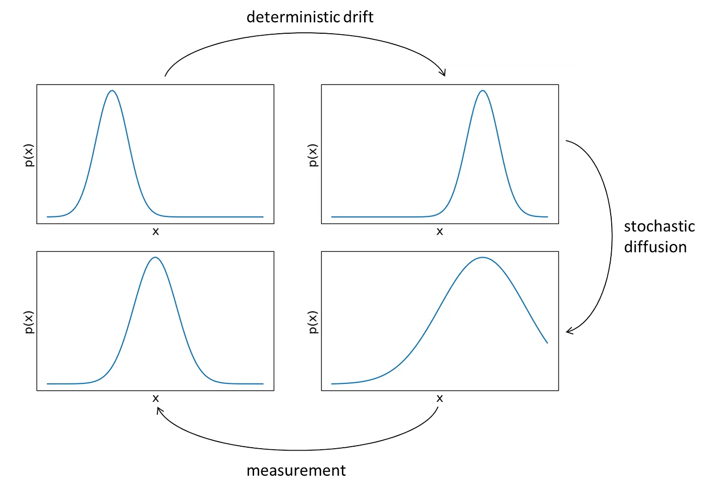
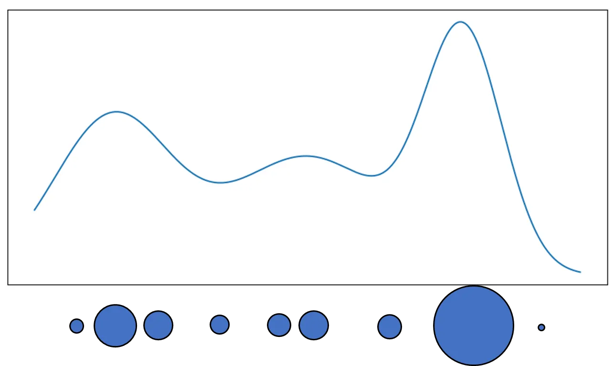
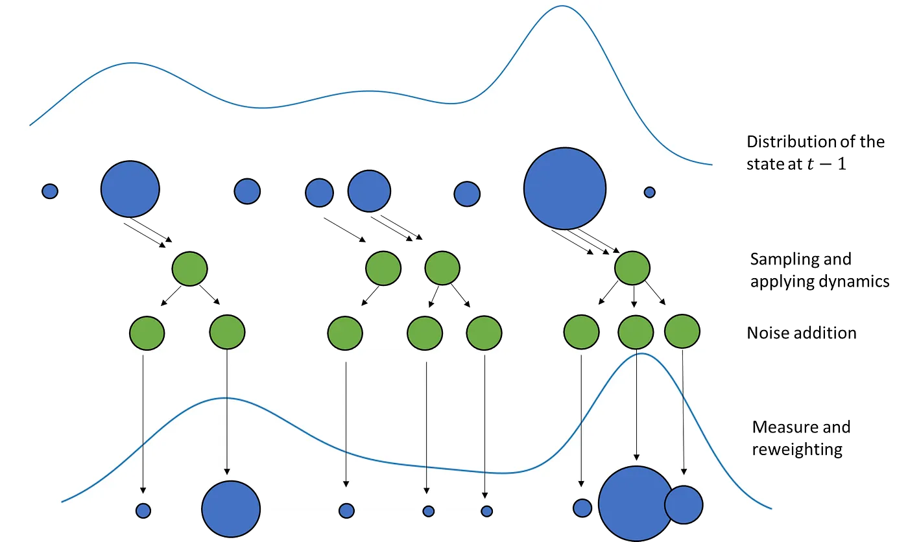

In this post, we are going to talk about object tracking in videos. In the tracking task, we want to predict the location of an object in the next frame. In the case of particle filter, as well as many other classical tracking algorithms, we make the prediction based on estimated dynamics (which will be explained later) and then update the prediction using some measurements.

Consider the example of the following video of one of the Simpsons [couch gags](https://en.wikipedia.org/wiki/The_Simpsons_opening_sequence#Couch_gag).



We would like to track the position of the gardener at each frame.

Let’s start by explaining the general mathematical idea behind the algorithm. At each time step (or frame in the case of a video), we have some *belief* (also called *prior knowledge*) about the position of the object. This belief is based on the information we have from the previous steps. To improve our estimation of the position of the object, we add additional information to our initial belief (or prediction) by measuring the state at the current time step. Using the measurement, we can update, or correct, the state of the object (which is its position). This new corrected estimation is also called *posterior*.

More formally, we can say our object has some hidden state (position in our case) which will be marked as $X$. We don’t know this state for sure (that’s why it’s hidden), and we can make an estimation of it. We can also make some measurement $Y$ of the state, but the measurement is always noisy, which means it is not perfect and gives us some distribution of where the object is, rather than a precise location (if the measurement were perfect, we wouldn't need any estimation—we would know exactly where the object is).

At each time step the state of the object changes, and we want to use the information from the past and the current measurement to estimate the current state by finding the most probable state. Mathematically, we first want to make a prediction based on the past to form our belief of the current state (which is a probability distribution)

$$
P(X_t \vert{} X_0, \dots, X_{t-1}, Y_0, \dots, Y_{t-1})
$$

Then, we want to make a correction to the prediction by using the measurement from the current time step.

$$
P(X_t \vert{} X_0, \dots, X_{t-1}, Y_0, \dots, Y_{t-1}, Y_t)
$$

In practice, we are going to simplify this by assuming the process is [Markovian](../markov-chain/index.qmd), which means it only depends on the previous time step. So, the belief about the current state only depends on the previous step's state.

$$
P(X_t \vert{} X_{t-1})
$$

and the correction adds knowledge of the current measurement.

$$
P(X_t \vert{} X_{t-1}, Y_t)
$$

We can express the last equation using [Bayes’ rule](../introduction-to-conditional-probability/index.qmd#bayes’-theorem) as follows.

$$
P(X_t \vert{} X_{t-1}, Y_t) = \frac{P(Y_t \vert{} X_{t-1}, X_t)P(X_t \vert{} X_{t-1})}{P(Y_t \vert{} X_{t-1})}
$$

From this equation, we can see that the current state depends on the probability of getting the current measurement $Y_t$ given we are in the state $X_t$ (the likelihood of seeing the measurement if we are indeed in state $X_t$) multiplied by the probability of being at state $X_t$ given we were in the state $X_{t-1}$ (which is our belief or prior). This is normalized by the probability of getting the measurement $Y_t$ given we were in state $X_{t-1}$.

## Linear Dynamics Model

For making our initial prediction (or belief) we use a dynamics model. This model assumes some relation between the state at step $t-1$ and step $t$. We are going to use a linear dynamics model, which means the relation between the steps is linear. As we want to predict the position of a moving object, we can, for example, construct its state as a vector of position $p_x$ and $p_y$, and velocity $v_x$ and $v_y$, so $x_t=[p_{x,t}, p_{y,t}, v_{x,t}, v_{y,t}]$. One model that can relate the state $x_{t-1}$ and $x_t$ is

$$
\begin{aligned} p_{x,t} &= p_{x,t-1} + v_{x,t-1}\Delta t \\ p_{y,t} &= p_{y,t-1} + v_{y,t-1}\Delta t \\ v_{x,t} &= v_{x,t-1} \\ v_{y,t} &= v_{y,t-1} \end{aligned}
$$

where in our case $\Delta t=1$. We can also write it in a matrix form:

$$
x_t = Mx_{t-1} + \epsilon
$$

where

$$
M = \begin{bmatrix} 1 & 0 & 1 & 0 \\ 0 & 1 & 0 & 1 \\ 0 & 0 & 1 & 0 \\ 0 & 0 & 0 & 1 \end{bmatrix}
$$

The first two rows represent the equation for the new position and the last two rows mean the velocity in both the x and y directions is conserved. We also add some noise because of the uncertainty we have.

## Visualization of the Process

The process we described so far to go from the state at $t-1$ to the state at time $t$ can be visualized in the following figure which describes a 1D case.

<figure>
  
</figure>

In the top left plot, we see the distribution of the position $x$ (since we are in 1D, the state contains only the position along the x-axis) at step $t-1$. After applying our dynamics, the distribution moves to a new position without changing its shape. This step is deterministic since we know our dynamics. Because we are not sure about the dynamics, we add noise, or uncertainty, to the distribution which makes it wider, as in the bottom right figure. Finally, we add additional information by making a measurement, which corrects the position and decreases the uncertainty.

## Particle Filter

We can look at a distribution as a representation of particles with different weights. Big particles are located where the probability is high and small ones where it is low.

<figure>
  
</figure>

The process is similar to the one described before. We start with $N$ particles with different weights that describe the distribution of the state at step $t-1$. From those particles, we sample a new collection of $N$ particles where a bigger particle has a higher probability of being chosen, and we can sample the same particle more than once. For the new collection of particles, we apply the dynamics and make the deterministic drift. Then, we add some noise to the particles to extend the distribution. Finally, by using measurements, we assign weights to the particles according to the likelihood of getting this measurement if the state is really as represented by the particle.

<figure>
  
</figure>

As usual, it will be clearer if we code an example, so let’s code it.

## Let’s code it

In this section, we are going to implement a particle filter in Python to track the gardener in the video from the beginning.

The full code can be seen [here](https://github.com/dorzv/ComputerVision/blob/master/particles_filter_tracking/particle_filter_tracking.py).

First, we need to import the packages we will use

```python
import matplotlib.pyplot as plt
import numpy as np
import cv2  # openCV
```

Next, we initialize a video capture object to read the frames from the video and read the first frame.

```python
# create video reader object and read the first frame
cap = cv2.VideoCapture('simpson.avi')
ret, image = cap.read()
```

We start the particle filter by choosing the number of particles we will use (the more particles, the more accurate the distribution will be, though at a higher computational cost), and set an initial state. We choose the state to be [x coordinate of the center of the gardener's bounding box, its y coordinate, the velocity in the x direction of the bounding box, the velocity in the y direction]. We are also going to assume the size of the bounding box is constant (though generally speaking, it can be part of the state).

```python
num_of_particles = 250
s_init = np.array([81, 169, 0, 0])  # initial state [x_center, y_center, x_velocity, y_velocity]

# bounding box's (half) height and width.
# We assume those are constant
half_height = 118
half_width = 33
```

The initial state and the size of the bounding box are picked manually.

Before the actual calculation, we create a video writer object to save the resulting video with the tracking.

```python
# get parameters of the video
frame_width = int(cap.get(3))
frame_height = int(cap.get(4))
fps = 20 #cap.get(5)  # frames per second

# create a video writer object
size = (frame_width, frame_height)
result = cv2.VideoWriter('simpson_tracked.avi',
                         cv2.VideoWriter_fourcc(*'MJPG'),
                         fps, size)
```

For the measurement, we will compare the (normalized) color histogram in the region of interest (ROI) between the original bounding box from the initial state and the new candidate bounding boxes in later frames. For that, we define a function to compute the normalized histogram.

```python
def compute_norm_hist(image, state):
    """
    Compute histogram based on the RGB values of the image in the ROI defined by the state
    Args:
        image (np.ndarray): matrix representing image with the object to track in it
        state (np.ndarray): vector of the state of the tracked object

    Returns:
        vector of the normalized histogram of the colors in the ROI of the image based on the state
    """
    # get the top-left and bottom-right corner of the object bounding box
    # if the bounding box is outside the frame, we clamp it
    x_min = max(np.round(state[0] - half_width).astype(int), 0)
    x_max = min(np.round(state[0] + half_width).astype(int), image.shape[1])
    y_min = max(np.round(state[1] - half_height).astype(int), 0)
    y_max = min(np.round(state[1] + half_height).astype(int), image.shape[0])

    roi = image[y_min:y_max+1, x_min:x_max+1]
    roi_reduced = roi // 16  # change range of pixel values from 0-255 to 0-15
    # build vector to represent the combinations of RGB as single value
    roi_indexing = (roi_reduced[..., 0] + roi_reduced[..., 1] * 16 + roi_reduced[..., 2] * 16 ** 2).flatten()
    hist, _ = np.histogram(roi_indexing, bins=4096, range=(0,4096))
    norm_hist = hist / np.sum(hist)  # normalize the histogram
    return norm_hist
```

First, we get the coordinates of the top-left and bottom-right corners of the bounding box according to the state. Next, we extract only the ROI from the image. To make the calculation easier, we reduce the range of color values from 256 values to 16 values. The `//` operator is called floor division. It divides the two numbers and rounds the result down to the nearest whole number. For example, $245 // 16 = 15$, and also $255 // 16 = 15$. For each combination of RGB (in the range 0–15) we want to assign a unique number, so we build a base-16 number. Think of a regular decimal number like 163. This number is in base 10, which means we can write it as $163 = 3 \times 10^0 + 6 \times 10^1 + 1 \times 10^2$. The same principle is used here where the first color channel represents $16^0$, the second is $16^1$, and the last is $16^2$. The range of the new numbers is 0–4095, meaning 4096 unique numbers. We construct a histogram from all the values in the ROI and normalize it by the sum of the histogram so the comparison will be consistent.

Using the previous function, we can create the normalized histogram of the initial state.

```python
# get the normalized histogram of the initial state
# This histogram is the histogram we compare to later
q = compute_norm_hist(image, s_init)
```

Since we currently have only one state, we duplicate it by the number of particles and set the same weight for all of them.

```python
# for the first frame all the particles are the same as the initial state
# and have the same weight since we don't have uncertainty in the state
s_new = np.tile(s_init, (num_of_particles, 1)).T
weights = np.ones(num_of_particles)
```

Inside a while loop, we will perform all the steps of the algorithm: sample, predict (and add noise), measure, and reweight.

```python
# go over the frames in the video
while True:
    # sample new particles according to the weights
    s_sampled = sample_particle(s_new, weights)
    # predict new particles (states) according to the previous states
    s_new = predict_particles(s_sampled)
    # go over the new predicted states, and compute the histogram for the state and
    # the weight with the original histogram
    for jj, s in enumerate(s_new.T):
        p = compute_norm_hist(image, s)
        weights[jj] = compute_weight(p, q)
```

Let’s go over the steps. First, we sample based on the particles and their distributions.

```python
def sample_particle(particles_states, weights):
    """
    Sample the particles (states) according to their weights.
    First, random numbers from uniform distribution U~[0,1] are generated.
    The random numbers are subtracted from the cumulative sum of the weights,
    and the sampling is made by selecting the state whose cumulative weight
    sum is the minimal one greater than the random number. If c[i] is the
    cumulative sum of the weights for the i-th state and r is a random number, the
    state which will be sampled is the j-th state such that c[j] >= r and c[j] is
    the smallest one that holds this inequality.
    Args:
        particles_states (np.ndarray): matrix whose columns are the states
        weights (np.ndarray): weights of each state

    Returns:
        (np.ndarray): matrix of sampled states according to their weights
    """
    normalized_weights = weights / np.sum(weights)
    sampling_weights = np.cumsum(normalized_weights)
    rand_numbers = np.random.random(sampling_weights.size)  # get random numbers from U~[0,1]
    cross_diff = sampling_weights[None, :] - rand_numbers[:, None]  # subtract from each weight any of the random numbers
    cross_diff[cross_diff < 0] = np.inf  # remove negative results
    sampling = np.argmin(cross_diff, axis=1)
    sampled_particles = particles_states[:, sampling]  # sample the particles
    return sampled_particles
```

The main idea behind the algorithm is as follows: we normalize the weights of the particles and calculate their cumulative sum. We pick a random number between 0 and 1, and subtract this number from the cumulative weight vector we calculated previously. We search for the element with the minimum value that is also above 0. In other words, we pick the first element whose cumulative sum weight is greater than the random number. States with high weights are more likely to be selected (we can select a state more than once).

The next step is making a prediction using the sample we just created.

```python
def predict_particles(particles_states):
    """
    Predict new particles (states) based on the previous states
    Args:
        particles_states (np.ndarray): matrix of states. The rows are the properties of the state and the columns are the particles

    Returns:
        (np.ndarray): new predicted particles
    """
    # the dynamics we use assume that:
    # x_new = x + v_x (x - center position)
    # y_new = y + v_y (y - center position)
    # v_x_new = v_x (velocity at x)
    # v_y_new = v_y (velocity at y)
    dynamics = np.array(
        [[1 ,0, 1, 0],
         [0, 1, 0, 1],
         [0, 0, 1, 0],
         [0, 0, 0, 1]]
    )
    # multiplying the state by the dynamics and add some noise
    predicted_states = dynamics @ particles_states + np.random.normal(loc=0, scale=1, size=particles_states.shape)
    return predicted_states
```

We use dynamics like the ones we described earlier to predict the new states. For each new state, we also add Gaussian noise to create the predicted states.

For the new particles, we want to measure their similarity to the original ROI. For the measurement, we are going to use the Bhattacharyya coefficient, which measures the similarity between two normalized histograms.

```python
def compute_weight(p, q):
    """
    Compute the weight based on Bhattacharyya coefficient between 2 normalized histograms
    Args:
        p (np.ndarray): normalized histogram
        q (np.ndarray): normalized histogram

    Returns:
        (float): weight based on Bhattacharyya coefficient between p and q
    """
    # make sure the histogram is normalized
    if not np.isclose(np.sum(p), 1):
        raise ValueError('p histogram is not normalized')
    if not np.isclose(np.sum(q), 1):
        raise ValueError('q histogram is not normalized')
    bc = np.sum(np.sqrt(p * q))  # Bhattacharyya coefficient
    return np.exp(20 * bc)  
```

For each of the particles, we measure the similarity between its histogram and the original one to assign a weight.

Finally, we draw the bounding box on the frame and save it to the video.

```python
    # draw bounding box over the tracked object
    image_with_boxes = draw_bounding_box(image, s_new, weights, with_max=True)
    result.write(image_with_boxes)
```

To draw the bounding box, we calculate the weighted average over the new states to get the mean state and draw it. We also add the bounding box of the most probable state (the one with the highest weight).

```python
def draw_bounding_box(image, states, weights, with_max=True):
    """
    Draw rectangle according to the weighted average state and (optionally) a rectangle of the state with
    the maximum score.
    Args:
        image (np.ndarray): the image to draw rectangle on
        states (np.ndarray): the sampling states
        weights (np.ndarray): the weight of each state
        with_max (bool): True to draw a rectangle according to the state with the highest weight

    Returns:
        (np.ndarray): image with rectangle drawn on for the tracked object
    """
    mean_box = np.average(states, axis=1, weights=weights)
    x_c_mean, y_c_mean = np.round(mean_box[:2]).astype(int)
    image_with_boxes = image.copy()
    cv2.rectangle(image_with_boxes, (x_c_mean - half_width, y_c_mean - half_height),
                                     (x_c_mean + half_width, y_c_mean + half_height), (0, 255, 0), 1)
    if with_max:
        max_box = states[:, np.argmax(weights)]
        x_c_max, y_c_max = np.round(max_box[:2]).astype(int)
        cv2.rectangle(image_with_boxes, (x_c_max - half_width, y_c_max - half_height),
                                         (x_c_max + half_width, y_c_max + half_height), (0, 0, 255), 1)
    return image_with_boxes
```

At the end of the iteration, we read the next frame of the video. If there are no frames left, we finish the loop.

```python
    # read next frame
    ret, image = cap.read()
    if not ret:  # if there is no next frame to read, stop
        break
```

This process continues in the loop, where we use the new states and weights to restart the algorithm and find the bounding box for the next frame.

After going over all the frames, we close the video objects.

```python
# release video objects
cap.release()
result.release()
```

Time to see the final video with the bounding boxes. The green one is for the weighted average state and the red is for the most probable state.



Note that there is a stochastic element in the algorithm, so the tracking may not work every time. It can be improved by adjusting the number of particles and the added noise.

## Conclusion

In this post, we went over the particle filter algorithm for tracking objects in a video. We saw just one implementation, but there are other techniques to use it (for example, other measurement methods). Moreover, the algorithm can be applied to more fields than just tracking, since it helps build a general distribution.