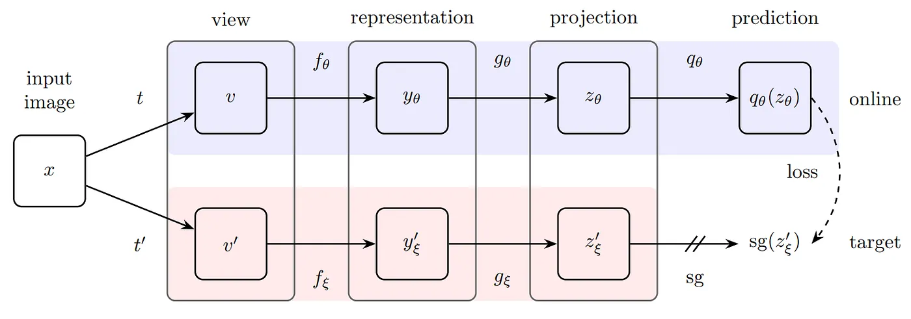

In a [previous post](https://python.plainenglish.io/self-supervised-learning-for-visual-representation-b242bde77241), we talked about the importance of self-supervised learning and why we would like to use it. Let’s repeat the main points. As we know, deep learning models need an extensive labeled dataset to learn from. While in a lot of cases, collecting the data itself is not a too hard task, the labeling step could be very time and money consuming, but this step is crucial for the classic supervised learning methods.

Self-supervised techniques can solve this problem by letting models learn from unlabeled data. It does so by learning meaningful representations directly from the data, without any need for labels.

In the [previous post](https://python.plainenglish.io/self-supervised-learning-for-visual-representation-b242bde77241), we focused on the [SimCLR](https://arxiv.org/pdf/2002.05709) architecture based on the contrastive learning method, which uses positive and negative sample pairs to teach models distinguishing features, by mapping similar samples (positives) closer together in the feature space while pushing dissimilar samples (negatives) farther apart. However, this method comes with significant computational costs and practical challenges. “Bootstrap Your Own Latent” (BYOL) brings a new approach to the field by proposing a way to learn without the need for negative pairs, making it both efficient and highly scalable.

In this post, we’ll explore how BYOL works, the problem it solves, its architectural design, and why it’s considered a breakthrough in self-supervised learning.

## The Problem: Dependency on Negative Samples

As mentioned above, contrastive learning tries to find representations that keep pairs of positive examples (which are two augmented views of the same image) close, while negative samples (views from different images) representations are pushed farther apart. In this way, the model can learn distinct representations.

However, this method has limitations:

* **Risk of representation collapse**: Without enough negative examples, contrastive learning methods can sometimes yield trivial representations that fail to capture useful features.
* **High computational costs**: Contrastive learning often requires large batch sizes to provide diverse negative samples, leading to increased memory and computational requirements.
* **Batch size dependency**: The method’s success often hinges on having a substantial number of negative samples, which becomes a problem when the batch size is small.

As the last two points are a result of the first one, let’s expand a bit on the first point. Because we ask our model to find representations such that two views of the same image have similar representations, the model may come up with a constant representation for all images. Such a representation fulfills this goal, but it is not much of a help. By adding negative samples (i.e., other images), we add to the original task another task of discrimination between the representations of different images. This addition is the key to preventing collapsed representations.

It is found empirically that the number of negative samples and their quality have a strong influence on the result of this technique. This is the reason why it needs a large batch size and has high computational costs.

BYOL proposes a novel approach that eliminates the need for negative samples. Instead, it leverages two networks — a target network and an online network — that interact with different augmented views of the same image to refine each other’s representations iteratively. BYOL avoids collapse and complex negative sampling strategies and presents an efficient and stable learning solution that we will talk about next.

## BYOL’s Core Idea

A simple solution to prevent collapse is to use a fixed randomly initialized network to produce the target representation of the predictions our main network produces. The authors found empirically that although it does avoid collapse, the result representations are not very good, but still much better than the initial fixed representation.

This experimental finding is the main idea behind BYOL. We start with a target representation, and we train a new and potentially enhanced representation, referred to as online, by predicting the target representation. Later we can use the updated online representation as the new target and iteratively repeat the procedure. In practice, the authors suggest using a slowly moving exponential average of the online network as the target network, instead of fixed checkpoints.

## BYOL’s Architecture: How It Works

BYOL’s approach is to create two augmented views of an image — two different transformations of the same input — and pass them through separate networks, “online” and “target”, where the online network tries to predict the target output.

<figure>
  
  <figcaption>
    BYOL’s architecture. BYOL minimizes a similarity loss between $q_\theta(z_\theta)$ and $\text{sg}(z'_\xi)$, where $\theta$ are the trained weights, $\xi$ are an exponential moving average of $\theta$ and $\text{sg}$ means stop-gradient. At the end of training, everything but $f_\theta$ is discarded, and $y_\theta$ is used as the image representation. Source:
    <a href="https://arxiv.org/pdf/2006.07733">
      Bootstrap Your Own Latent A New Approach to Self-Supervised Learning
    </a>
  </figcaption>
</figure>

Let’s break down the architecture:

### Online Network

The online network processes one view of the image and consists of three key stages:

* **Encoder** $f_\theta$: This is the primary network, often a convolutional neural network (CNN) like ResNet, that processes the image and extracts features. The encoder produces high-dimensional embeddings that capture the main features.
* **Projector** $g_\theta$: Following the encoder there is a multi-layer perceptron (MLP) projector. This projector transforms the high-dimensional representation into a lower-dimensional latent space.
* **Predictor** $q_\theta$: Exclusive to the online network, the predictor maps the projected feature representation to align with the target network’s output. This component helps the online network to closely match the target’s output.

### Target Network

The target network mirrors the online network’s structure, containing an encoder and a projector. However, it lacks a predictor. The target network serves as a stable reference point for the online network to align with, and its weights are updated gradually using an exponential moving average (EMA) of the online network’s weights. This EMA process is crucial for maintaining stability, preventing the model from collapsing to trivial solutions.

### The Loss Function

BYOL employs a simple mean squared error between the normalized prediction and target projections, which can be shown to be a sort of cosine similarity loss.

$$
\begin{aligned}
\mathcal{L}_{\theta,\xi} &= \|\overline{q_\theta}(z_\theta) - \overline{z}'_\xi\|_2^2 \\
&= \left\| \frac{q_\theta(z_\theta)}{\|q_\theta(z_\theta)\|_2} - \frac{z'_\xi}{\|z'_\xi\|_2} \right\|_2^2 \\
&= \sum_i \left( \frac{q_{\theta_i}(z_\theta)}{\|q_\theta(z_\theta)\|_2} - \frac{z'_{\xi_i}}{\|z'_\xi\|_2} \right)^2 \\
&= \sum_i \left( \frac{q_{\theta_i}^2(z_\theta)}{\|q_\theta(z_\theta)\|_2^2} + \frac{z'^2_{\xi_i}}{\|z'_\xi\|_2^2} - 2\frac{q_{\theta_i}(z_\theta) \cdot z'_{\xi_i}}{\|q_\theta(z_\theta)\|_2 \cdot \|z'_\xi\|_2} \right) \\
&= \sum_i \frac{q_{\theta_i}^2(z_\theta)}{\|q_\theta(z_\theta)\|_2^2} + \sum_i \frac{z'^2_{\xi_i}}{\|z'_\xi\|_2^2} - 2\sum_i \frac{q_{\theta_i}(z_\theta) \cdot z'_{\xi_i}}{\|q_\theta(z_\theta)\|_2 \cdot \|z'_\xi\|_2} \\
&= 1 + 1 - 2\frac{\langle q_\theta(z_\theta), z'_\xi \rangle}{\|q_\theta(z_\theta)\|_2 \cdot \|z'_\xi\|_2} \\
&= 2 - 2\frac{\langle q_\theta(z_\theta), z'_\xi \rangle}{\|q_\theta(z_\theta)\|_2 \cdot \|z'_\xi\|_2}
\end{aligned}
$$

The goal is to minimize the difference between these two representations, encouraging the online network to match the target’s stable reference. Unlike contrastive methods that require both positive and negative samples, BYOL’s loss is based solely on positive alignment, eliminating the need for direct contrast.

At each step, this loss is computed twice, wherein the second time we switch between the two augmented views so each of them will be passed to the other network. The final loss is the addition of the two losses.

### Exponential Moving Average (EMA) Update

A pivotal part of BYOL is the slow, smoothing update of the target network’s weights using EMA. In each training step, the target network’s weights become a mix of its current weights and those of the online network. This creates a progressively refined target, which helps prevent representation collapse and allows the network to focus on meaningful features over time.

More formally, at each step, we compute the two losses, add them, make the optimization step to update the online network weights, and finally update the target weights as follows.

$$
\begin{aligned}
\mathcal{L}_{\theta,\xi}^{\text{BYOL}} &= \mathcal{L}_{\theta,\xi} + \tilde{\mathcal{L}}_{\theta,\xi} \\
\theta &\leftarrow \text{optimizer}(\theta, \nabla_\theta \mathcal{L}_{\theta,\xi}^{\text{BYOL}}, \eta) \\
\xi &\leftarrow \tau\xi + (1 - \tau)\theta
\end{aligned}
$$

where $\tau$ is the decay rate of the EMA and $\eta$ is the learning rate.

## Main Code Implementation

In this section, we will write the main components of BYOL architecture. Although this is not a full implementation, it still should give you an understanding of how to implement it.

Let’s import some necessary modules.

```python
from copy import deepcopy

import torch
from torch import nn
import torch.nn.functional as F
from torchvision import models
```

We start with the components of the online network. For the encoder, we can use ResNet50, for example. ResNet50 can be downloaded directly from `torchvision`.

```python
backbone = models.resnet50(weights=None)
backbone_without_classifier = nn.Sequential(*list(backbone.children())[:-1])
online_encoder = backbone_without_classifier
```

In the code, we got the ResNet50 architecture with random initialization. The original ResNet is built to predict ImageNet classes, so we remove the classifier component from it since we only want the features extracted from it.

We continue to the online projection which is a simple MLP.

```python
online_projection = nn.Sequential(
            nn.Flatten(),
            nn.Linear(backbone.fc.in_features, 4096),
            nn.BatchNorm1d(4096),
            nn.ReLU(inplace=True),
            nn.Linear(4096, 256)
        )
```

And the predictor is the same.

```python
online_prediction = nn.Sequential(
            nn.Linear(256, 4096),
            nn.BatchNorm1d(4096),
            nn.ReLU(inplace=True),
            nn.Linear(4096, 256)
        )
```

For the target network, we clone the online network’s encoder and projector.

```python
target_encoder = deepcopy(online_encoder)
target_projection = deepcopy(online_projection)
```

and since we don’t need gradients for the target network, we can set all its parameters to not track gradients.

```python
for param in target_encoder.parameters():
    param.requires_grad = False

for param in target_projection.parameters():
    param.requires_grad = False
```

We define the loss as a module (you can also define it as a regular function)

```python
class BYOLLoss(nn.Module):
    """
    Loss function for self supervised learning based on
    the paper "Bootstrap Your Own Latent A New Approach
    to Self-Supervised Learning" equation (2).
    """
    @staticmethod
    def forward(prediction, projection):
        """

        Args:
            prediction (torch.Tensor): the instance representation prediction
                of the online network.
            projection (torch.Tensor): the instance representation of the
                target network.

        Returns:

        """
        loss = 2 - 2 * F.cosine_similarity(prediction, projection)
        return loss.mean()
```

and finally, a function to update the target network’s weights with an exponential moving average.

```python
def update_target_models(online, target, moving_average_decay):
    """
    Update the weights of the target models (encoder and projection)
    using exponential moving average with the online models. For more 
    information about the technique, refer to the paper "Bootstrap Your 
    Own Latent A New Approach to Self-Supervised Learning"

    Args:
      online (nn.Module): a component of the online network
      target (nn.Module): a component of the target network, 
        the same as the online one
      moving_average_decay (float): the decay rate of the exponential 
        moving average. Number between 0 and 1.
    """
    for online_params, target_params in zip(online.parameters(), target.parameters()):
        target_params.data = (target_params.data * moving_average_decay
                              + (1 - moving_average_decay) * online_params.data)
```

These are the main components we need to implement BYOL. For the training itself, you need to create a dataset that returns two augmented views of the image (you can read about the specific augmentations in the paper). Then, first pass the first view to the online network, and the second to the target network and compute the loss. After that, pass the second view to the online network and the first one to the target network, and compute the loss. Use the combined loss to update the online network’s weights, and then update the target network’s weights using the exponential moving average.

### Conclusion

BYOL brings several significant benefits to self-supervised learning, thanks to its architecture and loss design. BYOL’s approach gives us several advantages:

1. **Avoidance of Negative Samples**

   By eliminating the need for negative pairs, BYOL bypasses the high resource demands of contrastive learning. It’s a considerable advantage in applications with limited computational resources, as it reduces the dependence on large batch sizes and complicated negative sample strategies. BYOL’s innovative design shows that useful features can be learned solely through positive reinforcement, making it a more efficient solution.

2. **Reduced Risk of Representation Collapse**

   Representation collapse — where a network produces the same outputs regardless of the input — can be a common problem in self-supervised models. BYOL’s use of a predictor in the online network, combined with EMA-updated target weights, allows it to avoid collapse, making it more stable and robust.

3. **Simplicity and Scalability**

   BYOL’s architecture is simple and highly scalable, requiring fewer hyperparameters than contrastive methods. This simplicity enables it to be easily adapted to various architectures.

BYOL has a great impact on the field of self-supervised learning by showing that meaningful representations can be learned without negative samples. The success of BYOL shows the potential of innovative self-supervised learning methods and lays the foundations for future advancements in resource-efficient models.

By demonstrating that robust features can be learned without complex contrastive methods, BYOL is used as a base for new research directions. If you work on a task with a big dataset, but limited labels, BYOL offers you a highly effective solution to increase your system performance.