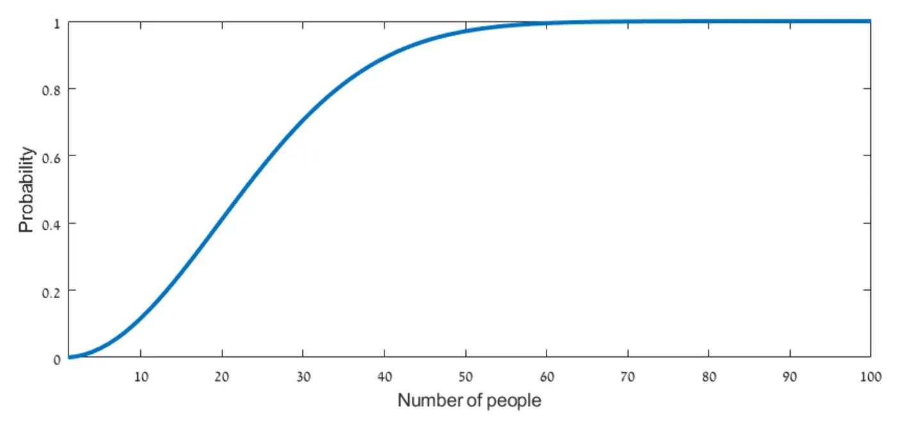

<figure>
  
  <figcaption>
    Photo by
    <a href="https://www.pexels.com/photo/birthday-cake-with-strawberries-on-tray-15472008/">
      ALINA MATVEYCHEVA
    </a>
    on Pexels
  </figcaption>
</figure>

Ok, it’s not really a paradox, but the “birthday paradox” asks how many random people we should collect, so we have at least two of them with the same birthday. Given that a year has 365 days, we can conclude that if we collect 366, we ensure by 100% that we have at least two people with the same birthday. But do we actually need so many people?

Let’s assume we have two people and ask what is the probability that they have different birthdays. So, the first man can have any of the 365 possibilities of a birthday. After we get his birthday, the second man’s birthday can only be one of the 364 possibilities left (out of the 365 days in a year). The number of possibilities for that is $365 \times 364$ out of $365 \times 365$ possibilities in total. If so, the probability that the two men have different birthdays is

$$P
(\text{two persons with different birthdays}) = \frac{365 \times 364}{365 \times 365} = 0.997
$$

But we want the probability that at least two people in the group have the same birthday, which is exactly the complement of the probability we have found (i.e., no one in the group has the same birthday). In this case, the probability of that is $1 - 0.997 = 0.003$ which is a very low probability. What about a group of 50 people?

$$
P(\{\text{50 persons with different birthdays}\}) = \frac{365 \times 364 \times \dots \times 316}{365^{50}} = \frac{365!}{(365 - 50)! \times 365^{50}} = 0.0296
$$

which means that the probability that at least two people have the same birthday is $1 - 0.0296 = 0.9704$. We see that even though we need 366 people to ensure that we have at least two people with the same birthday, by collecting only 50 people, we already get a 97% chance of finding two people with the same birthday.

The following graph shows the probability as a function of the number of people:

<figure>
  
  <figcaption>
  </figcaption>
</figure>