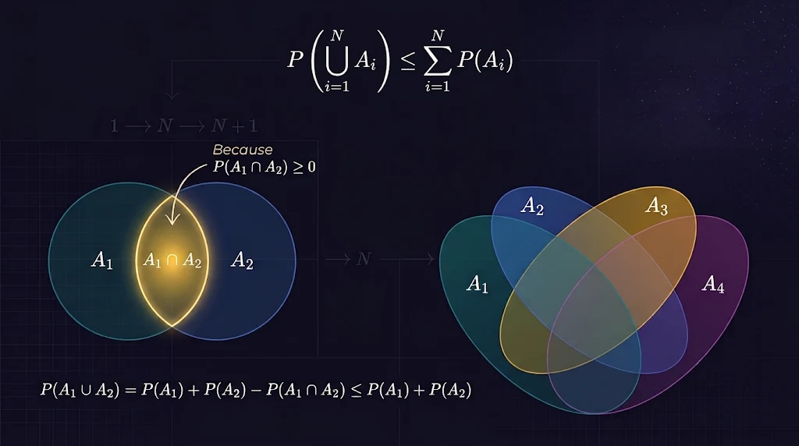

<figure>
  
</figure>

In this quick probability post, we are going to prove the union bound. In probability, it can be very helpful to set some bounds since it can be hard to find the exact probability.

The union bound states that if we have a collection of sets $A_1, A_2, \dots A_N$, then:

$$
P\left(\bigcup_{i=1}^N A_i\right) \le \sum_{i=1}^N P(A_i)
$$

### Proof

We prove this by induction. We start with the base of $N=2$:

$$
P(A_1 \cup A_2) = P(A_1) + P(A_2) - P(A_1 \cap A_2) \le P(A_1) + P(A_2)
$$

The inequality is true because probability is a non-negative number. After proving for the base case, we assume that the argument is true for some $N$, and we want to prove for $N+1$.

$$
\begin{aligned}
P\left(\bigcup_{i=1}^{N+1} A_i\right) &= P\left(\bigcup_{i=1}^N A_i \cup A_{N+1}\right) \\
&= P\left(\bigcup_{i=1}^N A_i\right) + P(A_{N+1}) - P\left(\left(\bigcup_{i=1}^N A_i\right) \cap A_{N+1}\right) \\
&\le P\left(\bigcup_{i=1}^N A_i\right) + P(A_{N+1})
\end{aligned}
$$

By the induction assumption for $N$, we know

$$
P\left(\bigcup_{i=1}^N A_i\right) \le \sum_{i=1}^N P(A_i)
$$

and therefore

$$
P\left(\bigcup_{i=1}^{N+1} A_i\right) \le \sum_{i=1}^N P(A_i) + P(A_{N+1}) = \sum_{i=1}^{N+1} P(A_i)
$$

And so, by the principle of induction, the statement has been proved.