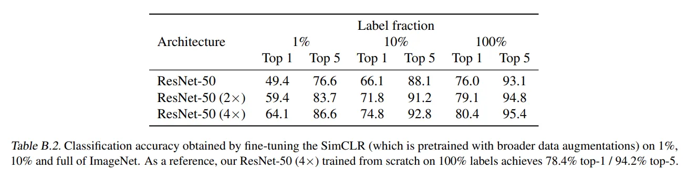
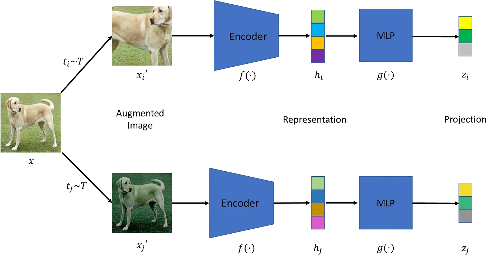
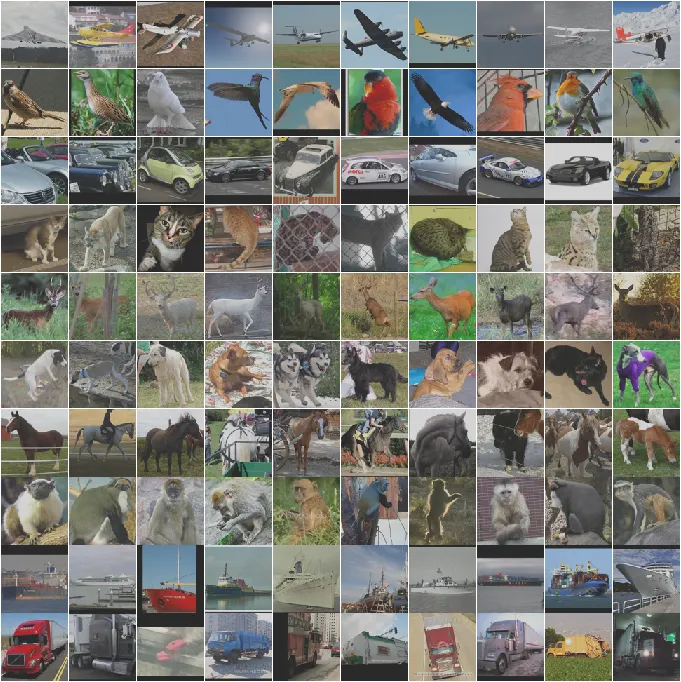
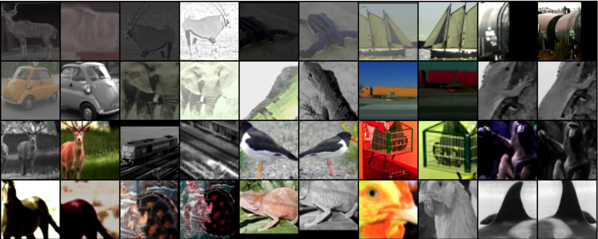

Deep learning is a great tool that outperforms many tasks such as image recognition, detection, and segmentation. However, one of the main challenges we encounter when we want to use deep learning is collecting enough data for the task. Most of the time, the data itself is insufficient, and we also need to label it to supervise the learning process.

The need for labels makes a lot of data unusable for learning tasks and prevents us from improving our models. Moreover, if you think about it, we humans don’t need so much labeled data. By seeing just a few labeled images, we can very quickly understand the *representation* of the object and can classify non-previously seen images just by understanding this representation. For example, you don’t need to see all types of dogs to classify an image of an unseen dog, because you understand what represents a dog in an image (four legs, tail, face structure, etc.).

To solve the problem of unlabeled data we can use self-supervised learning instead of regular supervised learning. Self-supervised learning enables models to learn meaningful features from vast amounts of unlabeled data. Self-supervised methods leverage the inherent structure of data and allow models to learn rich and transferable representations. In this post, we will understand the basic ideas behind self-supervised learning and use the [SimCLR](https://arxiv.org/pdf/2002.05709) architecture to see how to train a self-supervised model. Finally, we will implement and train an image recognition model based on SimCLR using PyTorch and PyTorch Lightning.

## Contrastive Learning

Contrastive learning is a self-supervised learning technique where a model learns to distinguish between similar and dissimilar data points. The core idea is to map similar samples (positives) closer together in the feature space while pushing dissimilar samples (negatives) farther apart.

But how can we know which images are similar and which are dissimilar if we don't have labels? One way to do that is when given an image, generate different “views” of it (such as different crops, rotations, or any other augmentations). The model then tries to make the representations of these views closer to each other and farther from representations of different images. This makes sense since essentially an image of a dog represents the same thing even if we flip it or rotate it, for example, and we expect the model to represent the augmented image in a similar way to the original image.

This process helps the model learn meaningful features and representations that can be used for various downstream tasks, like classification or object detection.

Next, we will talk about the SimCLR architecture which is based on contrastive learning.

## SimCLR

SimCLR, or a Simple Framework for Contrastive Learning of Visual Representations, is a contrastive learning architecture for self-supervised learning proposed in the paper “[A Simple Framework for Contrastive Learning of Visual Representations](https://arxiv.org/pdf/2002.05709)”. In the paper, they show that using SimCLR to learn representations and then fine-tune on ImageNet with just 10% of the labels achieves great results compared to learning without self-supervised and on 100% of the labels.

<figure>
  
  <figcaption>
    Source: “<a href="https://arxiv.org/pdf/2002.05709">A Simple Framework for Contrastive Learning of Visual Representations</a>”
  </figcaption>
</figure>

### The Architecture

As we already mentioned, in contrastive learning we want similar images to have a close representation, while different images should be farther away from each other.

<figure>
  
  <figcaption>
    A simple framework for contrastive learning of visual representations. Two separate data augmentation operators are sampled from the same family of augmentations ($t_i \sim T$ and $t_j \sim T$) and applied to each data example to obtain two correlated views. A base encoder network $f(\cdot)$ and a projection head $g(\cdot)$ are trained to maximize agreement using a contrastive loss. After training is completed, we throw away the projection head $g(\cdot)$ and use encoder $f(\cdot)$ and representation $h$ for downstream tasks.
  </figcaption>
</figure>

As you can see in the figure above, we take an image and sample two augmentations to apply to it. Then, we use an encoder network to get a representation of the image. Finally, we use an MLP to project the representation and try to maximize the similarity between the two projections. Pay attention that after the training, we will remove the MLP and use only the representation for training downstream tasks like recognition. For different images, we will do a similar process, but we want to minimize the similarity between them.

As always, the best way to understand the whole process is to write it by ourselves, so let’s code it.

## Let’s Code It

The full code can be found [here](https://github.com/dorzv/ComputerVision/blob/master/self_supervised_learning/SimCLR.ipynb).

In this section, we are going to implement SimCLR architecture using PyTorch. We will also use PyTorch Lightning to save some work and boilerplates. [PyTorch Lightning](https://lightning.ai/docs/pytorch/stable/) is a lightweight wrapper for PyTorch, designed to simplify the research process while maintaining the flexibility and power of native PyTorch. It abstracts away much of the boilerplate code and provides a high-level interface for model training, validation, and testing. We will also install [TorchMetrics](../introduction-to-torch-metrics/index.qmd) to track performance metrics later. To install it we use

```python
!pip install lightning torchmetrics -q
```

We also want to import all the modules we want to use.

```python
import os
import matplotlib.pyplot as plt

import torch
import torch.nn as nn
import torch.nn.functional as F
import torch.optim as optim
from torch.utils.data import DataLoader, Subset
from torch.optim.lr_scheduler import OneCycleLR

import lightning as L
from lightning.pytorch.callbacks import ModelCheckpoint

import torchvision
import torchvision.transforms.v2 as transforms
import torchvision.models as models
from torchvision.datasets import STL10

from torchmetrics import Accuracy

from sklearn.model_selection import train_test_split

import numpy as np
```

Let’s also set a seed for reproducibility.

```python
L.seed_everything(0)
```

Finally, we set a device (GPU or CPU) and the number of workers we will use for the dataloader.

```python
device = 'cuda' if torch.cuda.is_available() else 'cpu'
num_worker = os.cpu_count()
print(f'{device=}')
print(f'{num_worker=}')
```

### The Dataset

We will use the [STL-10](https://cs.stanford.edu/%7Eacoates/stl10/) dataset. This dataset is an image recognition dataset for self-supervised training. It consists of a small amount of labeled images, and a lot of unlabeled images (which are not necessarily of the same classes as the labeled images, but from a similar distribution, for example, other animals). The dataset is described as follows according to the STL-10 website:

* 10 classes: airplane, bird, car, cat, deer, dog, horse, monkey, ship, truck.
* Images are 96x96 pixels, in color.
* 500 training images (10 pre-defined folds), 800 test images per class.
* 100,000 unlabeled images for unsupervised learning. These examples are extracted from a similar but broader distribution of images. For instance, it contains other types of animals (bears, rabbits, etc.) and vehicles (trains, buses, etc.) in addition to the ones in the labeled set.
* Images were acquired from labeled examples on [ImageNet](http://www.image-net.org/).

<figure>
  
  <figcaption>
    Source: <a href="https://cs.stanford.edu/%7Eacoates/stl10/">https://cs.stanford.edu/~acoates/stl10/</a>
  </figcaption>
</figure>

First, we define the folder where we will save the data

```python
DATASET_PATH = 'STL10'
```

Then, we define a class that creates multiple augmentation views of an image (as we want to give the network the same image with different augmentations as a positive sample).

```python
class AugmentationViews:
  """
  Create multiple augmentations for an image
  """
  def __init__(self, transform, num_views):
    self.transform = transform
    self.num_views = num_views

  def __call__(self, image):
    return [self.transform(image) for _ in range(self.num_views)]
```

And finally, we define a basic transformation using torchvision, to apply to our images (randomly).

```python
base_transform = transforms.Compose([
    transforms.RandomHorizontalFlip(),
    transforms.RandomResizedCrop(size=96),
    transforms.RandomApply([transforms.ColorJitter(brightness=0.8, contrast=0.8, saturation=0.8, hue=0.1)], p=0.8),
    transforms.RandomGrayscale(p=0.2),
    transforms.ToTensor(),
    transforms.Normalize((0.5,), (0.5,))
])
```

Now it’s time to get the data itself. We will do it using torchvision dataset module that supports STL10.

```python
unlabeled_data = STL10(
    root=DATASET_PATH,
    split="unlabeled",
    download=True,
    transform=AugmentationViews(base_transform, num_views=2))

train_data = STL10(
    root=DATASET_PATH,
    split="train",
    download=True,
    transform=AugmentationViews(base_transform, num_views=2)
)
```

The module will download the files of the STL10 dataset to *DATASET_PATH*, create Dataset objects for the unlabeled and the labeled training data, and also apply the augmentation we set earlier to the data.

It’s always a good idea to look at the images in the dataset, so we will write code to show us a sample of images including the augmentation views.

```python
NUM_IMAGES = 20
images = torch.stack([image for ii in range(NUM_IMAGES)
                    for image in unlabeled_data[ii][0]],
                   dim=0)
images_grid = torchvision.utils.make_grid(images, nrow=10, normalize=True)
images_grid = images_grid.permute(1, 2, 0)

plt.figure(figsize=(20, 10))
plt.imshow(images_grid)
plt.axis("off")
plt.show()
```

<figure>
  
  <figcaption>
    A sample and images with augmentations. Pay attention that for each image there are two versions with different augmentation.
  </figcaption>
</figure>

### Loss

In the paper, the authors present a loss function they call NT-Xent loss which is a normalized temperature-scaled cross-entropy loss. For calculating this loss, we start by sampling a mini-batch of $N$ images, and for each image, we apply two randomly sampled augmentations (as we saw earlier). We consider each pair of augmented images (which came from the same original image) as a positive pair, while all other $2(N-1)$ images are considered negative examples relative to the two pictures in the positive pair.

Using cosine similarity (which is a dot product between L2 normalized $\mathbf{u}$ and $\mathbf{v}$) we define

$$
\text{sim}(\mathbf{u}, \mathbf{v}) = \frac{\mathbf{u}^T \mathbf{v}}{\|\mathbf{u}\| \|\mathbf{v}\|}
$$

Given a positive pair ($i, j$) we define a loss as:

$$
\ell_{i,j} = -\log \frac{\exp(\text{sim}(\boldsymbol{z}_i, \boldsymbol{z}_j)/\tau)}{\sum_{k=1}^{2N} \mathbb{1}_{[k \neq i]} \exp(\text{sim}(\boldsymbol{z}_i, \boldsymbol{z}_k)/\tau)}
$$

where

$$
\mathbb{1}_{[k \neq i]} \in \{0, 1\}
$$

is an indicator function that gets one only if $k \neq i$, $\tau$ is a temperature parameter and $z$ is the projection result of the network (see the architecture scheme in the architecture section above).

For the final loss, we compute the above loss for all positive pairs in the mini-batch, for both ($i, j$) and ($j, i$).

$$
\mathcal{L} = \frac{1}{2N} \sum_{k=1}^{N} [\ell(2k-1, 2k) + \ell(2k, 2k-1)]
$$

Let’s write it in code.

```python
class NTXentLoss(nn.Module):

    def __init__(self, batch_size, temperature, device='cuda'):
      super().__init__()
      self.batch_size = batch_size
      self.device = device
      self.temperature = temperature
      self.similarity_function = nn.CosineSimilarity(dim=-1)
      self.negative_pairs_mask = self.get_negative_mask()
      self.criterion = nn.CrossEntropyLoss(reduction="sum").to(device)

    def calculate_similarity_matrix(self, x, y):
      """
      Calculate the similarity between each vector in the first
      argument with each vector in the second one, to get a matrix
      of similarity scores between all the vectors in the two arguments
      """
      return self.similarity_function(x.unsqueeze(1), y.unsqueeze(0))

    def get_negative_mask(self):
      """
      Create a mask with True for negative elements, i.e.
      pairs from views that don't come from the same
      original image
      """
      mat_1 = np.eye(2 * self.batch_size)
      mat_2 = np.eye(2 * self.batch_size, k=-self.batch_size)
      mat_3 = np.eye(2 * self.batch_size, k=self.batch_size)
      mask = torch.from_numpy((mat_1 + mat_2 + mat_3))
      mask = (1 - mask).type(torch.bool)
      return mask

    def forward(self, zis, zjs):
      """
      Args:
      zis (torch.Tensor): projections of the first view of the images
      zjs (torch.Tensor): projections of the second view of the images
      """
      projections = torch.cat([zjs, zis], dim=0)

      similarity_matrix = self.calculate_similarity_matrix(projections, projections)  #[2N, 2N]
      # The positive pairs are on the batch_size-th diagonals of the similarity matrix
      positive_pairs_1 = torch.diag(similarity_matrix, self.batch_size)  # [N]
      positive_pairs_2 = torch.diag(similarity_matrix, -self.batch_size)  # [N]
      positives_pairs = torch.cat([positive_pairs_1, positive_pairs_2]).view(2 * self.batch_size, 1)  # [2N, 1]

      negatives_pairs = similarity_matrix[self.negative_pairs_mask].view(2 * self.batch_size, -1)  # [2N, 2N-2]

      logits = torch.cat((positives_pairs, negatives_pairs), dim=1).to(self.device)  # [2N, 2N-1]
      logits /= self.temperature

      labels = torch.zeros(2 * self.batch_size).long().to(self.device)
      loss = self.criterion(logits, labels)

      return loss / (2 * self.batch_size)
```

### Self-Supervised Training

In this section, we will build the SimCLR network for our self-supervised training. We will use the ResNet-50 as the backbone for the representation and add an MLP for the projection.

For the training itself, we will use [PyTorch Lightning](https://lightning.ai/docs/pytorch/stable/) which by implementing only three simple methods, `training_step`, `validation_step`, and `configure_optimizers`, in our model, lets us train the model without writing the training (and validation) loop by ourselves.

```python
class ResNetSimCLR(L.LightningModule):
  def __init__(self, backbone, output_dim, batch_size, freeze=True, device='cuda'):
    super().__init__()
    self.save_hyperparameters()  # save the parameters of model into check points
    self.represntation_num_of_features = backbone.fc.in_features
    self.features_extractor = nn.Sequential(*list(backbone.children())[:-1])  #  ResNet without the classifier

    if freeze:
      # freeze all parameters of the features extractor except to the 2 last blocks
      num_blocks = len(list(self.features_extractor.children()))
      for index_block, block in enumerate(list(self.features_extractor.children()), 1):
        if index_block <= num_blocks-2:
          for param in block.parameters():
            param.requires_grad = False

    self.mlp = nn.Sequential(
        nn.Linear(self.represntation_num_of_features, 2 * self.represntation_num_of_features),
        nn.BatchNorm1d(2 * self.represntation_num_of_features),
        nn.SELU(inplace=True),
        nn.Linear(2*self.represntation_num_of_features, self.represntation_num_of_features),
        nn.BatchNorm1d(self.represntation_num_of_features),
        nn.SELU(inplace=True),
        nn.Linear(self.represntation_num_of_features, output_dim)
    )

    self.loss = NTXentLoss(batch_size, 0.05, device)

  def forward(self, x):
    h = self.features_extractor(x)
    h = h.squeeze()
    z = self.mlp(h)
    return h, z

  def training_step(self, batch, batch_idx):
    x, _ = batch
    xis, xjs = x  # two augmented views for each image
    _, zis = self(xis)
    _, zjs = self(xjs)

    loss = self.loss(zis, zjs)
    return loss

  def validation_step(self, batch, batch_idx):
    x, _ = batch
    xis, xjs = x  # two augmented views for each image
    _, zis = self(xis)
    _, zjs = self(xjs)

    loss = self.loss(zis, zjs)
    self.log('val_loss', loss)  # log to tensorboard
    return loss

  def configure_optimizers(self):
    optimizer = optim.Adam(self.parameters(), lr=1e-4)
    scheduler = OneCycleLR(optimizer, anneal_strategy='cos', max_lr=0.1, total_steps=1500)
    return [optimizer], [scheduler]
```

In the code above we create a ResNet-based SimCLR model. We take a ResNet network as a backbone (without the last block which is a classifier), and use it as the feature extractor (the part that generates the representation vectors). The dimension of the representation is the output of the feature extractor, and it equals the number of features in the input of the original classifier of the ResNet.

To make the training simpler, we added an option to freeze most of the ResNet (we can do it since the ImageNet dataset the ResNet already trained on is similar to the STL-10). If one wants to use it, one must get a pre-trained ResNet to use the SimCLR class. Here, we will train all from scratch.

Finally, we create an MLP for the projection head and create an `NTXentLoss` object as the loss.

We define the forward method of the network, and the training step and the validation step for PyTorch Lightning. PyTorch Lightning will create the training loop for us and use these two methods for the training step and validation step for each mini-batch. We also ask PyTorch Lightning to track the validation loss. We also need to create the `configure_optimizers` method with the optimizer we want to use, and we also use a learning scheduler. Again, PyTorch Lightning uses this method to handle the updates of the weights by itself.

We are ready now to train the network, but first, we need to create dataloaders.

```python
batch_size = 128
train_dataloader = DataLoader(unlabeled_data, batch_size=batch_size, shuffle=True, drop_last=True, pin_memory=True, num_workers=num_worker)
val_dataloader = DataLoader(train_data, batch_size=batch_size, shuffle=False, drop_last=True, pin_memory=True, num_workers=num_worker)
```

In the paper, you can see that the SimCLR network should be trained with a large batch size, but as most of us don’t have powerful GPUs, we will use a smaller batch size.

And now the training itself.

```python
resnet50 = models.resnet50(weights=None)
simclr = ResNetSimCLR(resnet50, 128, batch_size, device=device, freeze=False)

# Pytorch Lightning Trainer
checkpoint_callback = ModelCheckpoint(monitor='val_loss', mode='min', save_last=True)
trainer = L.Trainer(accelerator="auto", max_epochs=100, callbacks=checkpoint_callback)
trainer.fit(model=simclr, train_dataloaders=train_dataloader, val_dataloaders=val_dataloader)
```

First, we set the device to use. Next, we download ResNet-50 with torchvision without pre-trained weights (but you can use `weights='DEFAULT'` to get the pre-trained weights), and create the SimCLR network. We create a checkpoint callback that says to PyTorch Lightning to monitor the validation loss and save a checkpoint anytime the validation loss gets its minimum value, and also save the last step for a case we want to continue the training. Then, we define a Trainer object that will use a GPU if there is one (else use the CPU) for 100 epochs, and use the fit method to start the training.

### Classification

With the SimCLR network ready, we can move to train a classifier based on it. We start by creating supervised datasets and dataloaders.

```python
train_data = STL10(
    root=DATASET_PATH,
    split="train",
    download=True,
    transform=transforms.ToTensor())

test_data = STL10(
    root=DATASET_PATH,
    split="test",
    download=True,
    transform=transforms.ToTensor()
)

batch_size = 128
train_dataloader = DataLoader(train_data, batch_size=batch_size, shuffle=True, drop_last=False, pin_memory=True, num_workers=num_worker)
test_dataloader = DataLoader(test_data, batch_size=batch_size, shuffle=False, drop_last=False, pin_memory=True, num_workers=num_worker)
```

And then create a simple classifier network with PyTorch Lightning.

```python
class Classifier(L.LightningModule):
    def __init__(self, features_extractor, representation_dim, num_classes):
        super().__init__()
        self.save_hyperparameters()
        self.features_extractor = features_extractor
        self.classifier = nn.Sequential(
            nn.Linear(representation_dim, 2 * representation_dim),
            nn.BatchNorm1d(2 * representation_dim),
            nn.SELU(inplace=True),
            nn.Linear(2 * representation_dim, num_classes)
          )
        self.accuracy_metric = Accuracy(task='multiclass', num_classes=num_classes)
    
    def forward(self, x):
        x = self.features_extractor(x)
        x = x.squeeze()
        x = self.classifier(x)
        return x
    
    def training_step(self, batch, batch_idx):
        x, y = batch
        y_predicted = self(x)
        loss = F.cross_entropy(y_predicted, y)
        return loss
    
    def validation_step(self, batch, batch_idx):
        x, y = batch
        y_predicted = self(x)
        loss = F.cross_entropy(y_predicted, y)
        self.accuracy_metric.update(y_predicted, y)
        self.log('accuracy', self.accuracy_metric, on_step=False, on_epoch=True, prog_bar=True)
        return loss
    
    def configure_optimizers(self):
        optimizer = optim.Adam(self.parameters(), lr=3e-4)
        return optimizer
```

We also use [TorchMetrics](../introduction-to-torch-metrics/index.qmd) to track the accuracy of the classification.

And now we can train the classifier based on the SimCLR network.

```python
simclr = ResNetSimCLR.load_from_checkpoint(checkpoint_callback.best_model_path)
features_extractor = simclr.features_extractor
representation_dim = simclr.represntation_num_of_features
classifier = Classifier(features_extractor=features_extractor, representation_dim=representation_dim, num_classes=10)

# Pytorch Lightning Trainer
checkpoint_callback_classifier = ModelCheckpoint(dirpath='Classifier', monitor='accuracy', mode='max', save_last=True)
trainer = L.Trainer(accelerator="auto", max_epochs=200, callbacks=checkpoint_callback_classifier)
trainer.fit(model=classifier, train_dataloaders=train_dataloader, val_dataloaders=test_dataloader)
```

We load the best model to the SimCLR network (the weights that have the minimum validation loss) and take only the features extractor part of the SimCLR network for the classifier. Finally, we train it in a similar way to the SimCLR training, but this time we track the accuracy for saving checkpoints.

After the train finished, we can check the best accuracy we got using the checkpoint callback that tracks the accuracy.

```python
print(f'Best accuracy is {checkpoint_callback_classifier.best_model_score}')
# Best accuracy is 0.7772499918937683
```

We succeeded in getting 77.7% accuracy with our self-supervised model using only 5000 labeled images for 10 labels.

Let’s do it again, but this time we will use only 500 labeled images (10% of the total labeled images). First, we need to create a subset dataset of the training data.

```python
labels = [x for _, x in train_data]
indexes = list(range(len(labels)))

indexes_subset, *_ = train_test_split(indexes, labels, train_size=0.1, shuffle=True, stratify=labels)
train_data_subset = Subset(train_data, indexes_subset)
train_dataloader_subset = DataLoader(train_data_subset, batch_size=batch_size, shuffle=True, drop_last=False, pin_memory=True, num_workers=num_worker)
```

We create a list of all the labels in the dataset, and a list of indexes with the same length as the dataset. Then, we use the `train_test_split` from scikit-learn to take 10% of the data by choosing 10% of the indexes. We use the `stratify` argument with the labels list, so in the result, we get the same distribution of labels as in the original dataset. Using the `Subset` class we create a subset of the original train dataset with the indexes we have chosen and create a dataloader from this subset dataset.

Now we can retrain the classification network with the new dataset.

```python
simclr = ResNetSimCLR.load_from_checkpoint(checkpoint_callback.best_model_path)
features_extractor = simclr.features_extractor
representation_dim = simclr.represntation_num_of_features
classifier_subset = Classifier(features_extractor=features_extractor, representation_dim=representation_dim, num_classes=10)

# Pytorch Lightning Trainer
checkpoint_callback_classifier_subset = ModelCheckpoint(dirpath='ClassifierSubset',monitor='accuracy', mode='max', save_last=True)
trainer = L.Trainer(accelerator="auto", max_epochs=200, callbacks=checkpoint_callback_classifier_subset)
trainer.fit(model=classifier_subset, train_dataloaders=train_dataloader_subset, val_dataloaders=test_dataloader)
```

And check the accuracy

```python
print(f'Best accuracy is {checkpoint_callback_classifier_subset.best_model_score}')
# Best accuracy is 0.6567500233650208
```

We got 65.6% accuracy with our self-supervised model using only 500 labeled images for 10 labels.

However, the interesting question is what accuracy we will get if we use supervised training only. Let’s check it.

### Supervised Learning

In this section, we will build a similar network based on ResNet as a features extractor and a classification head similar to the previous network.

```python
class SupervisedClassifier(L.LightningModule):
    def __init__(self, resnet, num_classes, freeze=True):
        super().__init__()
        self.features_extractor = nn.Sequential(*list(resnet.children())[:-1])  #  ResNet without the classifier
        self.num_classes = num_classes
        self.classifier_head_input_dim = resnet.fc.in_features
        
        if freeze:
            # freeze all parameters of the features extractor except to the 2 last blocks
            num_blocks = len(list(self.features_extractor.children()))
            for index_block, block in enumerate(list(self.features_extractor.children()), 1):
                if index_block <= num_blocks-2:
                  for param in block.parameters():
                    param.requires_grad = False
        
        self.classifier_head = nn.Sequential(
            nn.Linear(self.classifier_head_input_dim, 2 * self.classifier_head_input_dim),
            nn.BatchNorm1d(2 * self.classifier_head_input_dim),
            nn.SELU(inplace=True),
            nn.Linear(2 * self.classifier_head_input_dim, num_classes)
          )
        self.accuracy_metric = Accuracy(task='multiclass', num_classes=num_classes)
    
    def forward(self, x):
        x = self.features_extractor(x)
        x = x.squeeze()
        x = self.classifier_head(x)
        return x
    
    def training_step(self, batch, batch_idx):
        x, y = batch
        y_predicted = self(x)
        loss = F.cross_entropy(y_predicted, y)
        return loss
    
    def validation_step(self, batch, batch_idx):
        x, y = batch
        y_predicted = self(x)
        loss = F.cross_entropy(y_predicted, y)
        self.accuracy_metric.update(y_predicted, y)
        self.log('accuracy', self.accuracy_metric, on_step=False, on_epoch=True, prog_bar=True)
        return loss
    
    def configure_optimizers(self):
        optimizer = optim.Adam(self.parameters(), lr=3e-4)
        return optimizer
```

And again use ResNet-50, and train the network with the full labeled dataset.

```python
resnet50 = models.resnet50(weights=None)
supervised_classifier = SupervisedClassifier(resnet50, 10, freeze=False)

# Pytorch Lightning Trainer
checkpoint_callback_supervised_classifier = ModelCheckpoint(dirpath='SupervisedClassifier',monitor='accuracy', mode='max', save_last=True)
trainer = L.Trainer(accelerator="auto", max_epochs=200, callbacks=checkpoint_callback_supervised_classifier)
trainer.fit(model=supervised_classifier, train_dataloaders=train_dataloader, val_dataloaders=test_dataloader)
```

And look at the accuracy.

```python
print(f'Best accuracy is {checkpoint_callback_supervised_classifier.best_model_score}')
# Best accuracy is 0.5256249904632568
```

We got only 52.5% this time.

Let’s repeat the training with 10% of the labeled data.

```python
resnet50 = models.resnet50(weights=None)
supervised_classifier_subset = SupervisedClassifier(resnet50, 10, freeze=False)

# Pytorch Lightning Trainer
checkpoint_callback_supervised_classifier_subset = ModelCheckpoint(dirpath='SupervisedClassifierSubset',monitor='accuracy', mode='max', save_last=True)
trainer = L.Trainer(accelerator="auto", max_epochs=200, callbacks=checkpoint_callback_supervised_classifier_subset)
trainer.fit(model=supervised_classifier_subset, train_dataloaders=train_dataloader_subset, val_dataloaders=test_dataloader)
```

```python
print(f'Best accuracy is {checkpoint_callback_supervised_classifier_subset.best_model_score}')
# Best accuracy is 0.30937498807907104
```

We got a poor result of 30.9% accuracy.

## Conclusion

Let’s repeat the results we got for accuracy.

| | Self-Supervised | Supervised |
| :--- | :---: | :---: |
| **5000 labeled images** | 77.7% | 52.5% |
| **500 labeled images** | 65.6% | 30.9% |

: Accuracy scores for self-supervised and full supervised training

\
Using self-supervision we got much higher accuracy than by using supervised learning. Even with just 500 labeled images (only 50 images per class), we got a higher score than fully supervised learning using 5000 images.

This experiment shows us the potential of self-supervised learning, and that we can leverage unlabeled data (which is easier to collect than labeled data) to improve the performance of our models.