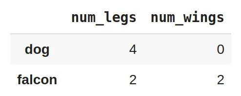
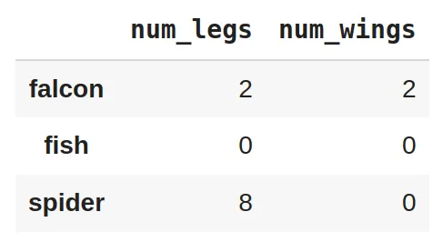
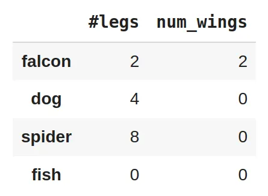
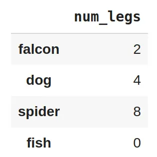
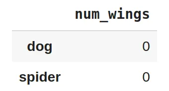
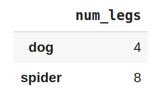
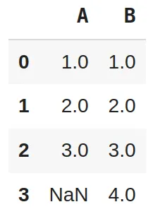
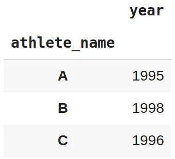
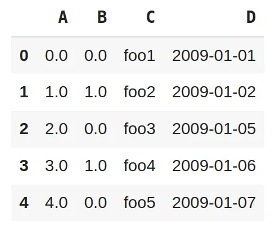
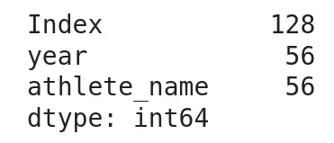

<figure>
  
</figure>

## Sample

The sample method lets you get a random sample of the original data frame. You can specify the number of elements (usually rows, but they can also be columns) you want in the sample or the fraction of the total elements in the data frame. The returned sample will be shuffled.

```python
import pandas as pd

df = pd.DataFrame({'num_legs': [2, 4, 8, 0],
                   'num_wings': [2, 0, 0, 0]},
                  index=['falcon', 'dog', 'spider', 'fish'])

df.sample(n=2)
```

<figure>
  
</figure>

```python
df.sample(frac=0.75)
```

<figure>
  
</figure>

## Rename

You can change column names directly using the `columns` property of the DataFrame object. However, if you only want to replace specific column names you can simply use the `rename` method.

```python
df.rename({'num_legs': '#legs'}, axis='columns')
```

<figure>
  
</figure>

## **Pop**

The pop method removes a column from the data frame and returns it as a Series.

```python
df.pop('num_wings')
```

<figure>
  
  <figcaption>The original DataFrame after removing the num_wings columns</figcaption>
</figure>

## Use column name together with iloc

If you need to use `iloc` but also want to use the column name instead of its index, you can do it by using

```python
df = pd.DataFrame({'num_legs': [2, 4, 8, 0],
                   'num_wings': [2, 0, 0, 0]},
                  index=['falcon', 'dog', 'spider', 'fish'])

df.iloc[[1, 2], df.columns.get_indexer(['num_wings'])]
```

<figure>
  
</figure>

Pay attention, if the name passed to the `get_indexer` is not in the data frame it will return -1 and will give you the wrong column. Suppose we use the `pop` method as before so the num_wings column no longer exists, then we get

<figure>
  
</figure>

You can see we got the column num_legs instead of num_wings. If you want to get one specific column you can use instead the `get_loc` method which raises an error if the column does not exist.

## Check if two series are similar

The function `pandas.testing.assert_series_equal` can help you test if the two series are similar. It is similar to the `equals` method but it is more flexible. For example, the `equals` method requires the two series to be of the same type, but with the other function, we can check just for the values.

```python
df = pd.DataFrame({"A":[1, 2, 3, 4], 
                  "B":[1.0, 2.0, 3.0, 4.0], 
                  })

pd.testing.assert_series_equal(df["A"], df["B"], check_names=False, check_dtype=False)
df['A'].equals(df['B'])  # return False
```

The `assert_series_equal` can also get a tolerance value to check if the two series are “close enough”. You should remember that this is an assertion function which means it raises an error if there is no similarity.

## Convert string to numeric data

There are several ways to convert numeric data that is stored as a string to numeric data in pandas. The popular way, probably, is the `to_numeric` function. One advantage this function has is that it can also convert stings which are not present numerical data. In such a case, it converts the string to NaN.

```python
df = pd.DataFrame({"A":['1', '2', '3', 'banana'], 
                  "B":[1.0, 2.0, 3.0, 4.0], 
                  })
df.apply(pd.to_numeric, errors = "coerce")
```

<figure>
  
</figure>

## Find the last occurrence

We can check the last time an athlete won a competition in the following way.

```python
df = pd.DataFrame({'year': [1992, 1993, 1994, 1995, 1996, 1997, 1998],
                   'athlete_name': ['A', 'B', 'A', 'A', 'C', 'B', 'B']})
df.groupby('athlete_name')['year'].last().to_frame()
```

<figure>
  
</figure>

## Control the display options

Pandas lets you control the display option (along with other parameters) using the `set_option` function. For example, you can control the number of rows that will be shown when a data frame is printed to the display.

```python
pd.set_option("display.max_rows",5)
```

You can also reset the options you changed by the `reset_option` function. You can see a lot of examples of such options [here](https://pandas.pydata.org/docs/user_guide/options.html).

## Data frames for testing

You can use the `pandas.util.testing` module to create data frames for testing. For example, to create a data frame with several different data types you can use

```python
pd.util.testing.makeMixedDataFrame()
```

<figure>
  
</figure>

## Check the memory usage for each column

You can use `memory_usage` function to see the amount of memory each column uses.

```python
df.memory_usage(deep = True)
```

<figure>
  
</figure>