<figure>
  
  <figcaption>
    Photo by
    <a href="https://www.pexels.com/photo/panda-sitting-on-top-of-a-wood-8162930/">
      Ddou Dou
    </a>
    on Pexels
  </figcaption>
</figure>

### Explode

The explode method transforms each element in a list-like into a new row. While doing so, it also replicates the indexes.

```python
import pandas as pd

df = pd.DataFrame(
    {"Continent": ["Europe", "America"],
      "Countries": [["Britain", "France", "Spain", "Italy"], ["US", "Canada", "Mexico"]]}
)
```

<figure>
  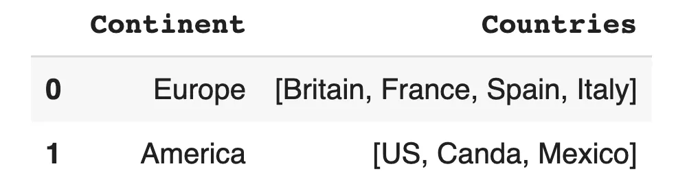
</figure>

In the "Countries" column, the elements are lists with names of countries. We can use the *explode* method to make a new row for each country.

```python
df_explode = df.explode('Countries')
```

<figure>
  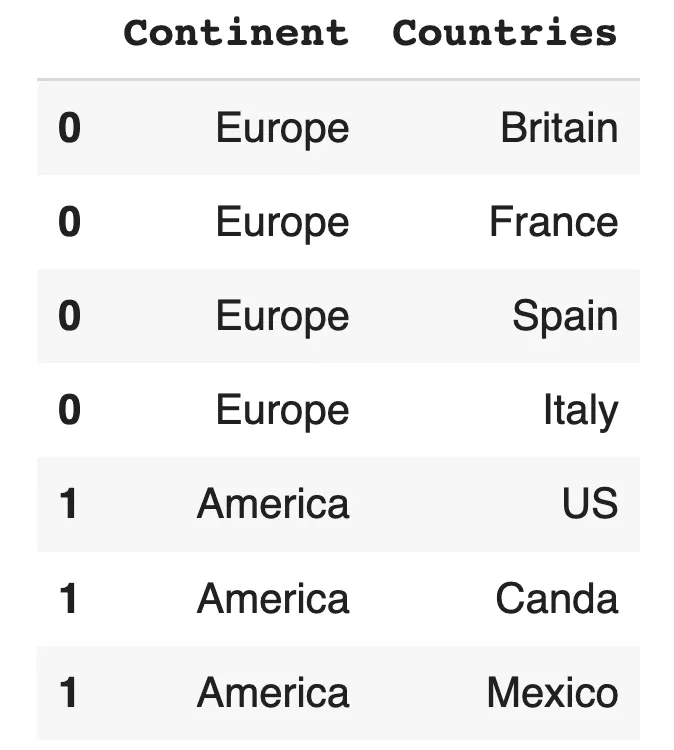
</figure>

We can go back to the original data frame by using:

```python
df_reversed = df_explode.reset_index().groupby(['index', 'Continent']).agg(list).reset_index(level=1)
```

<figure>
  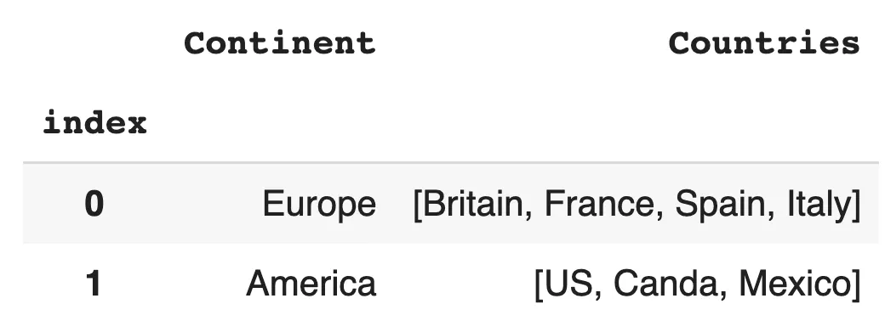
</figure>

### Clean Data Using Regular Expression

Suppose we have a column of values of purchases, but some of them are integers, others are float, and also there are some strings with non-numeric characters like "$" or ",".

```python
df = pd.DataFrame(
    {"Name": ["Alice", "Bob", "Charlie", "Dona"],
      "Purchase": [7543.23, 8000, '$9500.0', '€10,000']}
)  
```

<figure>
  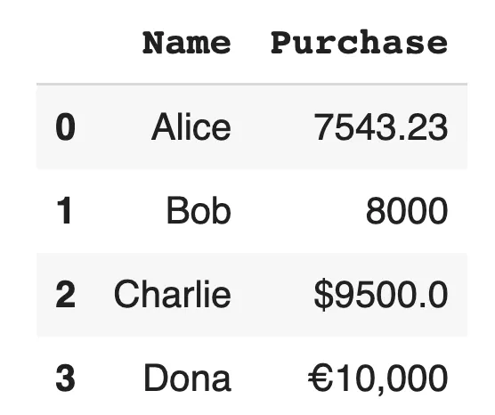
</figure>

We want a clean column of float numbers. We can do that using

```python
df['Purchase_clean'] = df['Purchase'].replace('[^0-9\.]', '', regex=True).astype(float)
```

The code searches for non-numeric characters (that means not digits and not ".") and remove them by replacing them with an empty string. Finally, it converts the whole series into float.

<figure>
  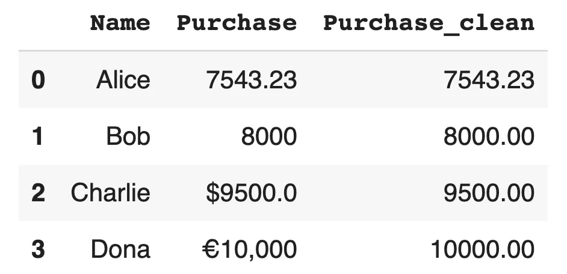
</figure>

### Use Numpy r_ for Multiple Slices

Suppose you want to get columns [1,2,3,4,7,8,9,10]. There is no one range that returns exactly these numbers. Instead of asking for each of the numbers individually, we can use Numpy r_.

```python
df.iloc[:, np.r_[1:5, 7:11]] # return data frame with columns 1,2,3,4,7,8,9,10
```

### Making Plots Direct from the Data Frame

You can use the *plot* method directly from a data frame object:

```python
df = pd.DataFrame({'x': [1,2,3,4,5], 'y': [2, 4 , 6, 8, 10]})
df.plot(x='x', y='y', kind='line')
```

<figure>
  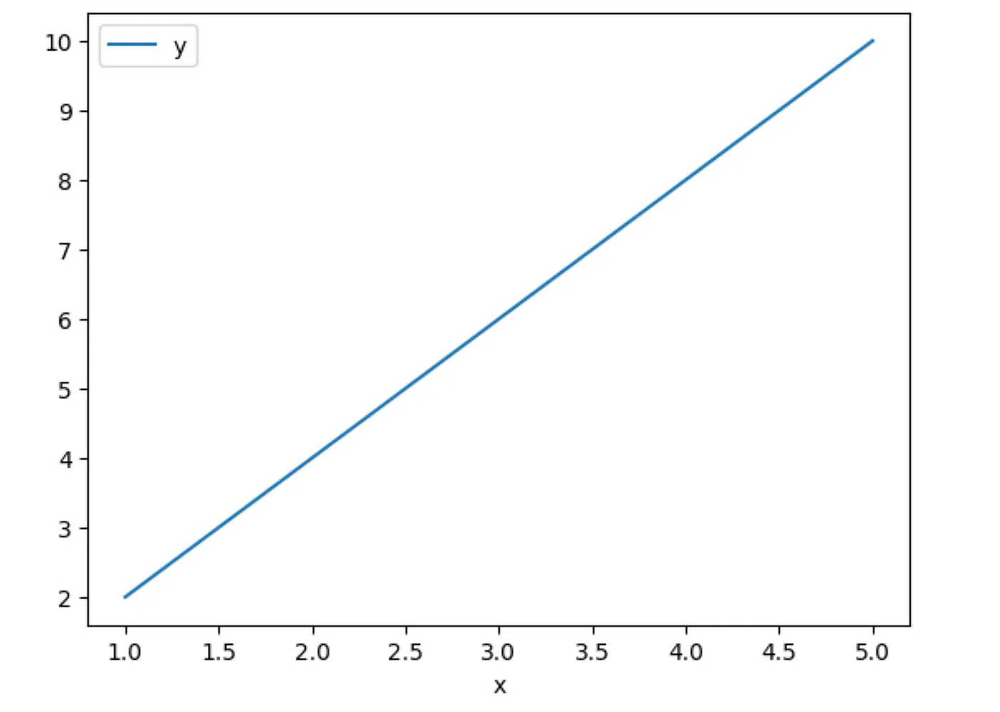
</figure>

### Add Prefix and Suffix to Column names

You can use the methods *add_prefix* and *add_suffix* to add prefix or suffix to the names of the columns (or rows).

```python
df = pd.DataFrame({'x': [1,2,3,4,5], 'y': [2, 4 , 6, 8, 10]})
df.add_prefix('position_')
```

<figure>
  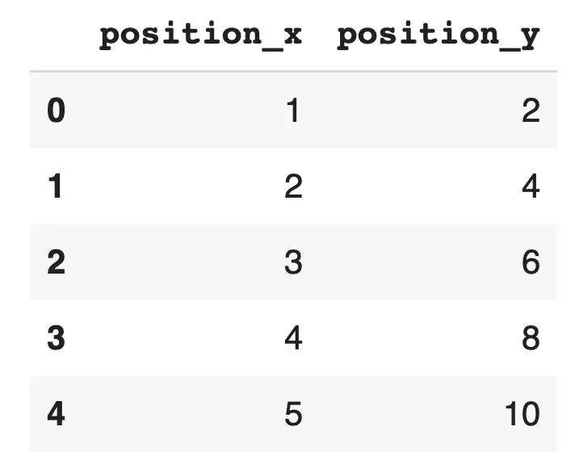
</figure>

### Select Columns Based on Type

Pandas let you select columns by type. For example, you can ask for all the numeric columns.

```python
df = pd.DataFrame({'A': [1, 2, 3, 4, 5, 6],
                   'B': [True, False] * 3,
                   'C': ['a', 'b', 'c', 'd', 'e', 'f']})

df.select_dtypes(include='number')  # return column A
df.select_dtypes(include='bool')    # return column B
df.select_dtypes(exclude='object')  # return columns A and B
```

### Map Values into New Values

The *map* method can replace values with new predefined values.

```python
df = pd.DataFrame({'Color': ['red', 'green', 'blue'], 
                   'Type': [1, 2, 3]})
df['Color'] = df['Color'].map({'red': 'R', 'green': 'G', 'blue': 'B'})
```

<figure>
  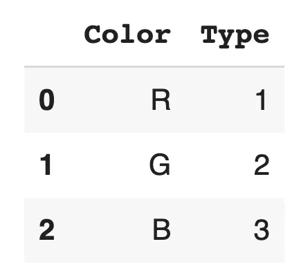
</figure>

### Encode Objects as an Enumerated Type

The method *factorize* can obtain a numeric representation for objects.

```python
df = pd.DataFrame({'Name': ["Santa's Little Helper", "Snow Ball I", "Snow Ball II", "Stampy"], 
                   'Animal': ['Dog', 'Cat', 'Cat', 'Elephant']})
df['Animal_code'] = df['Animal'].factorize()[0]
```

<figure>
  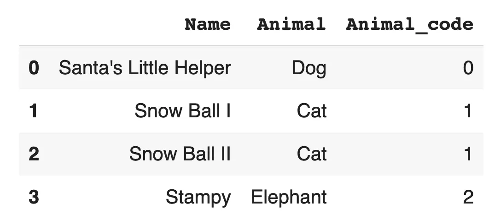
</figure>

### Read Table from the Web

We can use *read_html* to get a table from the web. This method returns a list of data frames with tables it has found. We can direct it using a regular expression with the keyword *match*.

```python
df_list = pd.read_html('https://en.wikipedia.org/wiki/Harry_Potter_and_the_Chamber_of_Secrets', 
                       match='Harry Potter and the Chamber of Secrets')
```

<figure>
  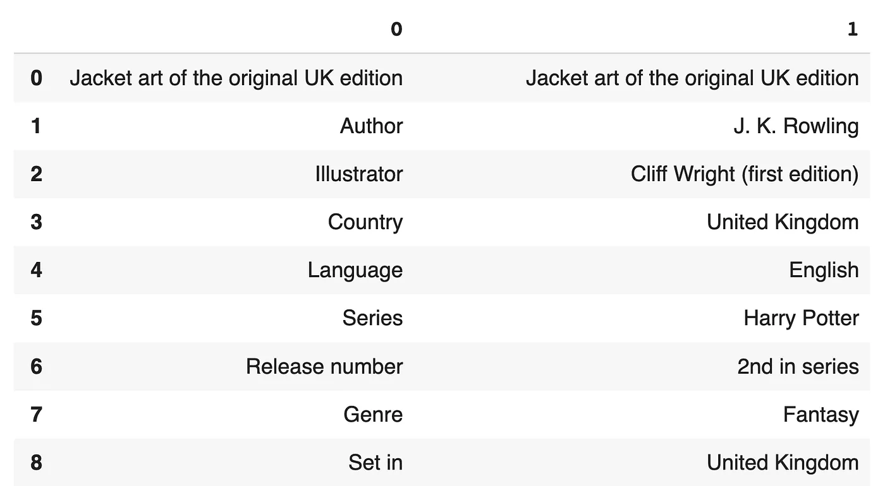
</figure>

### Filter Data Frame According to Values

We can filter a data frame by checking if a certain entry is contained in a list of values.

```python
df = pd.DataFrame({'Animal': ['Lion', 'Tuna', 'Dolphin', 'Frog', 'Dove'],
                   'Type': ['Mammal', 'Fish', 'Mammal', 'Amphibian', 'Bird']})
df[df['Type'].isin(['Mammal'])]
```

<figure>
  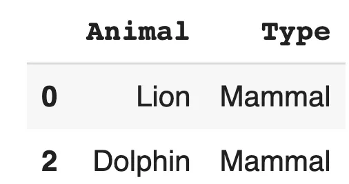
</figure>