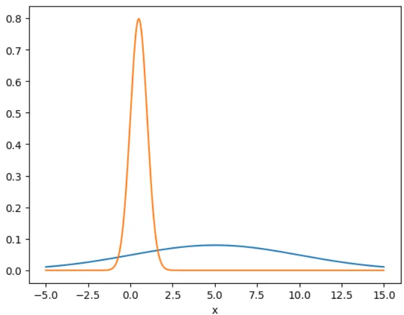
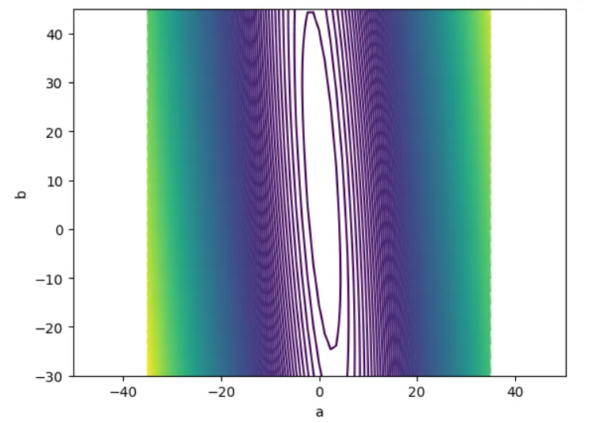
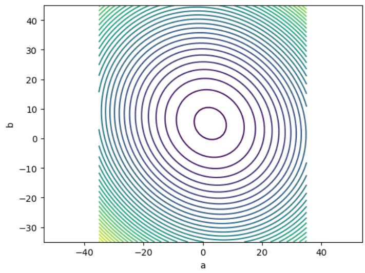
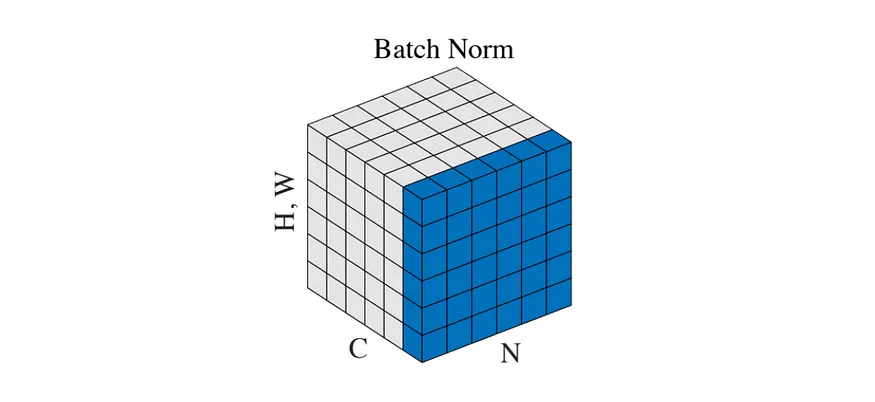
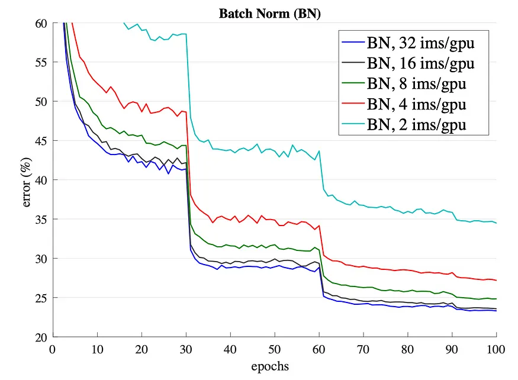
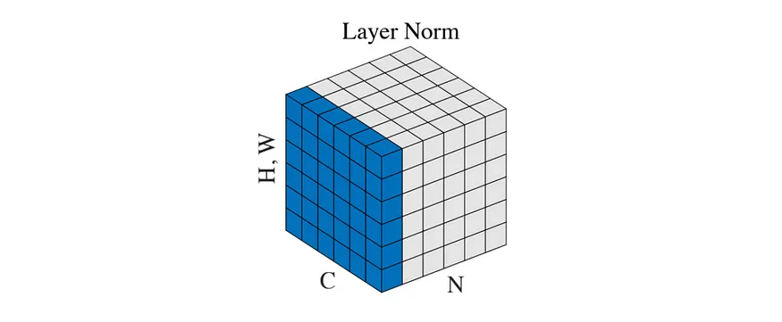
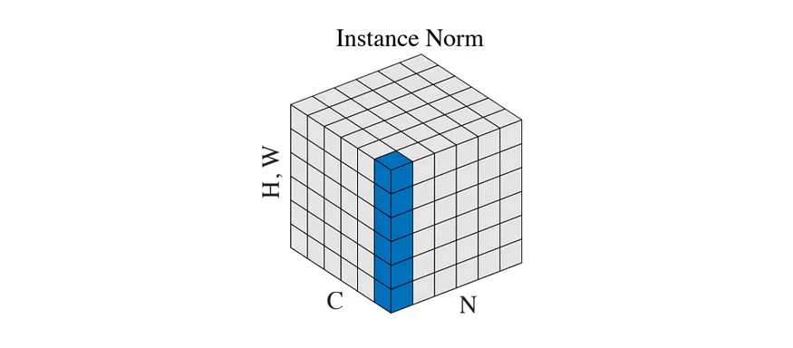
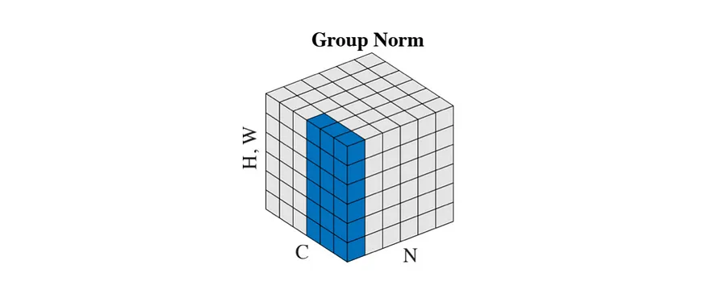

Normalization is a key part of deep learning that helps models train more effectively and perform better. It works by keeping data or calculations in a consistent range, making it easier for the model to learn patterns. There are several types of normalization, like batch normalization and layer normalization, each with its own purpose. In this blog, we’ll look at these methods, how they work, and why they are useful in deep learning.

## Why Use Normalization

Normalization helps improve the efficiency, stability, and accuracy of training models. It is much easier for the model to find a good solution when its feature space is in scale. It’s best to understand this concept with visualization.

Let’s assume we have a simple linear regression task with two features. One feature, $x_1$, comes from a normal distribution with a mean of 5 and a standard deviation of 5, while the other one, $x_2$, comes from another normal distribution with parameters 0.5 and 0.5.

<figure>
  
  <figcaption>
    Normal distribution with mean and std of 5 (blue) and 0.5 (orange)
  </figcaption>
</figure>

You can see the two features have very different scales. Now we assume these features relate to some target $y$, according to the formula:

$$
y = Ax_1 + Bx_2
$$

with $A$ and $B$ some coefficients.

We want to find the parameters $a$ and $b$ that give us the best estimation for $y$. We can use linear regression to do it by training a model to predict $y$, and update $a$ and $b$ parameters to minimize a loss function.

$$
J = \frac{1}{m} \sum_{i=0}^{m} (y - \hat{y}(a, b))^2
$$

Now we can look at the loss function $J$ as a function of $a$ and $b$.

<figure>
  
  <figcaption>
    A contour plot of the loss as function of a and b.
  </figcaption>
</figure>

We can see the loss function is very skewed. The gradients in the direction of $a$ are much steeper than those in the direction of $b$.

This can make the training slower and unstable. Let’s see what will happen if we normalize (or more precisely, standardize) the features before using them.

$$
\begin{aligned}
\bar{x}_1 &= \frac{x_1 - \mu_{x_1}}{\sigma_{x_1}} \\
\bar{x}_2 &= \frac{x_2 - \mu_{x_2}}{\sigma_{x_2}}
\end{aligned}
$$

where $\mu$ is the mean and $\sigma$ is the standard deviation. This transformation changes the distribution of the features to have a zero mean and standard deviation of one.

Now the loss is much more uniform in both directions.

<figure>
  
</figure>

which means the gradient directions are more uniform and the training will be faster and more stable.

## Normalization in Deep Learning

The previous example was a classical machine-learning problem where we have input, one formula with parameters, and output. It was sufficient to normalize the input features. In deep learning, however, we have many layers, where each layer's output is the input to the next layer. In such a case we would like to normalize the features after (almost) each layer.

In the machine learning case, we have all the input features in advance, and we can normalize them before the training. In the deep learning case, we don’t know the feature distribution of each layer before the training due to the weights update. This means the next layer may see a different distribution in each step. So we need some new methods to handle the normalization.

In the following sections, we explore popular normalization techniques and see code implementation for them.

## Batch Normalization

<figure>
  
  <figcaption>
    Feature map tensor, with N as the batch axis, C as the channel axis, and (H, W) as the spatial axes. The pixels in blue are normalized by the same mean and variance, computed by aggregating the values of these pixels.
    <a href="https://arxiv.org/pdf/1803.08494">
      Source
    </a>
  </figcaption>
</figure>

Batch Normalization is a normalization that normalizes the inputs to each layer within a mini-batch. For each mini-batch of data, Batch Normalization computes the mean ($\mu$) and variance ($\sigma^2$) of the inputs. These values are used to normalize the inputs by subtracting the mean and dividing by the standard deviation in a similar way to what we saw previously:

$$
\hat{x} = \frac{x - \mu}{\sqrt{\sigma^2 + \epsilon}}
$$

where $\epsilon$ is a small constant added for numerical stability. After normalization, the inputs are scaled and shifted using learnable parameters $\gamma$ (scale) and $\beta$ (shift):

$$
y = \gamma \hat{x} + \beta
$$

We can code it as:

```python
def BatchNorm(x, gamma, beta, eps=1e-5):
    # x shape [N, C, H, W]

    mean = torch.mean(x, dim=[0,2,3], keepdim=True)  # [1, C, 1, 1]
    var = torch.var(x, dim=[0,2,3], keepdim=True)    # [1, C, 1, 1]

    x_hat = (x - mean) / torch.sqrt(var + eps)
    
    return gamma * x_hat + beta
```

In addition to stabilizing the training and accelerating the convergence, Batch Normalization is also used as regularization. Since its statistics depend on the specific samples in the mini-batch, they introduce slight randomness (noise) into the normalized output. This noise acts similarly to dropout or other regularization methods by preventing the model from relying too heavily on specific patterns in the training data.

Because Batch normalization relies on computing mean and variance within each mini-batch, if the mini-batch size is too small the estimates of mean and variance become noisy, reducing its effectiveness. This may make the training unstable or lead to poor performance.

<figure>
  
  <figcaption>
    <a href="https://arxiv.org/pdf/1803.08494">
      Source
    </a>
  </figcaption>
</figure>

## Layer Normalization

<figure>
  
  <figcaption>
    Feature map tensor, with N as the batch axis, C as the channel axis, and (H, W) as the spatial axes. The pixels in blue are normalized by the same mean and variance, computed by aggregating the values of these pixels.
    <a href="https://arxiv.org/pdf/1803.08494">
      Source
    </a>
  </figcaption>
</figure>

Layer normalization (LN) is a normalization technique designed to address some of the limitations of batch normalization, particularly in scenarios with small batch sizes or sequential data. Instead of normalizing across the batch dimension, it normalizes across the features of each individual sample in a layer.

Unlike batch normalization, LN does not depend on the mini-batch size. It works effectively for small batch sizes and for single-sample training (e.g., in online learning). Moreover, because it normalizes each sample independently it is particularly effective in sequential processing models (like RNN) where the sequence length and structure may vary.

```python
def LayerNorm(x, gamma, beta, eps=1e-5):
    # x shape [N, C, H, W]
    
    mean = torch.mean(input=x, dim=[1,2,3], keepdim=True) # [N, 1, 1, 1]
    var = torch.var(input=x, dim=[1,2,3], keepdim=True)   # [N, 1, 1, 1]
    
    x_hat = (x - mean) / torch.sqrt(var + eps)
    
    return gamma * x_hat + beta
```

## Instance Normalization

<figure>
  
  <figcaption>
    Feature map tensor, with N as the batch axis, C as the channel axis, and (H, W) as the spatial axes. The pixels in blue are normalized by the same mean and variance, computed by aggregating the values of these pixels.
    <a href="https://arxiv.org/pdf/1803.08494">
      Source
    </a>
  </figcaption>
</figure>

Instance Normalization (IN) is a normalization technique primarily used in tasks where preserving style or content is important, such as style transfer or generative models. It operates at the level of individual samples, normalizing each feature map independently for each instance (or image) in a batch. By normalizing within each feature map, Instance Normalization preserves spatial structure, which is critical in image generation tasks.

Similar to Layer Normalization, Instance Normalization does not depend on batch size and works well even for a batch size of one.

```python
def InstanceNorm(x, gamma, beta, eps=1e-5):
    # x shape [N, C, H, W]

    mean = torch.mean(input=x, dim=[2,3], keepdim=True)  # [N, C, 1, 1]
    var = torch.var(input=x, dim=[2,3], keepdim=True)    # [N, C, 1, 1]

    x_hat = (x - mean) / torch.sqrt(var + eps)
    
    return gamma * x_hat + beta
```

## Group Normalization

<figure>
  
  <figcaption>
    Feature map tensor, with N as the batch axis, C as the channel axis, and (H, W) as the spatial axes. The pixels in blue are normalized by the same mean and variance, computed by aggregating the values of these pixels.
    <a href="https://arxiv.org/pdf/1803.08494">
      Source
    </a>
  </figcaption>
</figure>

Group Normalization (GN) is a normalization technique designed to address the limitations of Batch Normalization, particularly for tasks where the batch size is small or variable. It is a combination of Layer and Instance Normalization, divides the features in each layer into groups, and normalizes them within each group independently.

As in Layer Normalization and Instance Normalization, it is independent of the batch size. GN often outperforms Layer Normalization and Instance Normalization for convolutional networks, especially in tasks with limited data or memory.

```python
def GroupNorm(x, gamma, beta, group_num, eps=1e-5):
    # x shape [N, C, H, W]
    N, C, H, W = x.shape

    x = torch.reshape(x, shape=[N, group_num, C // group_num, H, W])
    mean = torch.mean(x, dim=[2,3,4], keepdim=True)  # [N, G, 1, 1, 1]
    var = torch.var(x, dim=[2,3,4], keepdim=True)    # [N, G, 1, 1, 1]

    x_hat = (x - mean) / torch.sqrt(var + eps)

    x_hat = torch.reshape(x_hat, shape=[N, C, H, W])
    
    return gamma * x_hat + beta
```

## Conclusion

In this post, we saw the main ideas behind normalization and explored four of the most popular normalization techniques in deep learning. We can summarize their properties in a table.

| Feature | Batch Normalization | Layer Normalization | Instance Normalization | Group Normalization |
| :--- | :--- | :--- | :--- | :--- |
| Normalization Axis | Across batch dimension | Across feature dimension | Across spatial dimensions per feature map | Across groups of channels |
| Dependency on Batch Size | Yes | No | No | No |
| Use Case | CNNs, image tasks | NLP, sequential data | Style transfer, generative models | Small batch sizes, vision tasks |
| Spatial Structure | Not preserved | Preserved | Preserved | Preserved |

Normalization techniques are important components for stabilizing and accelerating the training of deep learning models. From the widely-used Batch Normalization, which shines in large-batch scenarios, to the more specialized approaches like Layer Normalization, Instance Normalization, and Group Normalization, each method has its strengths and use cases. While Batch Normalization is the default choice for many tasks, alternative techniques address its limitations in scenarios such as small batch sizes, sequential data, or style-transfer applications. Understanding these differences allows you to select the most suitable normalization method, improving both model performance and training efficiency.