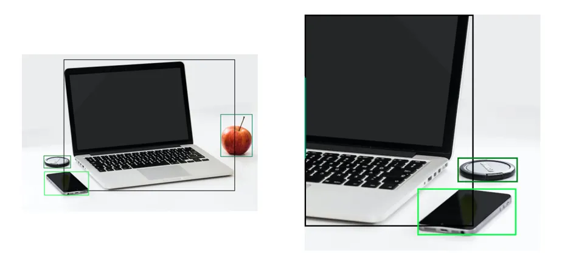
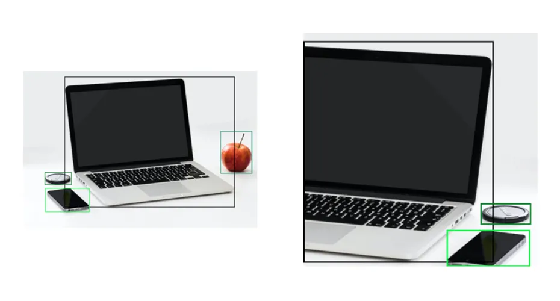

With the PyTorch 2.0 version, torchvision 0.15 also released and brought an updated and extended API for the Transforms module.

The [Transforms](https://pytorch.org/vision/0.10/auto_examples/plot_transforms.html#sphx-glr-auto-examples-plot-transforms-py) module lets you apply a wide range of transformations to an image (such as flipping the image, scaling, rotation, cropping, changing colors, and many more), and by so augmenting the dataset we train on and improve the model’s performance.

Up to version 0.15, the Transforms module could handle image transformations and augmentation for image classification (because it only worked on images). For tasks like object detection or segmentation (where you also have bounding boxes and masks), you needed to extend the Transforms module by yourself or use some other augmentation libraries like Albumentations.

Version 0.15 of torchvision introduced Transforms V2 with several advantages [1]:

* The transformations can also work now on bounding boxes, masks, and even videos. You aren’t restricted to image classification tasks but can use the new transformation for object detection, image segmentation, and video classification as well.
* New transforms are added, and additional improvements will be added only to version 2
* The new module is faster
* The transforms now support arbitrary input structures like dicts, lists, tuples, etc. That means the input can be with any structure, and you get the same structure as an output

And the best part is that the new version is fully backward compatible with the old one. If you already use the Transforms API, you can move to the new one by just changing the import line.

Transforms V2 is still considered as BETA, but it’s not expected to be changed too much and is planned to be fully stable in torchvision 0.17.

## **Let’s Code It**

We can make a simple example for the task of object detection. We can start with an image with some objects in it.

<figure>
  
  <figcaption>
    Photo by karsten madsen from 
    <a href="https://www.pexels.com/photo/macbook-pro-near-iphone-and-apple-fruit-18105/">
      Pexels
    </a>
  </figcaption>
</figure>

In the first step, we import the necessary libraries and read the image.

```python
from pathlib import Path
import torch
import torchvision.transforms.v2 as tr  # importing the new transforms module
from torchvision.io import read_image
import matplotlib.pyplot as plt

image_path = Path.home() / 'Downloads' / 'image.jpg'
image = read_image(str(image_path))
```

We want to create a function to display the image and the transformation.

```python
def display_tensor_augmentation(tensor_image_original, tensor_image_transformed, bboxes_original=None, bboxes_transformed=None):
    if bboxes_original is not None:
        tensor_image_original = draw_bounding_boxes(tensor_image_original, bboxes_original, width=3)

    if bboxes_transformed is not None:
        tensor_image_transformed = draw_bounding_boxes(tensor_image_transformed, bboxes_transformed, width=3)


    pil_image_original = tr.ToPILImage()(tensor_image_original.cpu())
    pil_image_transformed = tr.ToPILImage()(tensor_image_transformed.cpu())

    plt.figure()
    plt.subplot(121)
    plt.imshow(pil_image_original)
    plt.axis('off')
    plt.subplot(122)
    plt.imshow(pil_image_transformed)
    plt.axis('off')
    plt.show()
```

For making a transformation we need to define a set of transforms. We do it exactly as in the first version.

```ini
transform = tr.Compose([
    tr.RandomResizedCrop(size=512),
    tr.RandomHorizontalFlip(1),
])
```

This transformation makes a random crop of the image and resizes it to $512 \times 512$ pixels and then flips it horizontally.

<figure>
  
  <figcaption>
    The original image and the transformed one
  </figcaption>
</figure>

The previous case is the simple case used for image classification where we don’t need to deal with additional information except for the image itself.

Now let’s repeat the example but this time for an object detection task where we have a list of bounding boxes in addition to the image. For the bounding boxes information, we are going to use a special type of tensor called TVTensors. The TVTensors are regular tensors (they are actually subclasses of `torch.Tensor`), but hold additional information. There are four types of TVTensors: `Image`, `BoundingBoxes`, `Masks`, and `Video`.

In our case, we want to use the `BoundingBoxes` type to define a tensor that represents bounding boxes. For that, we need to create a standard tensor of size $(N, 4)$ for the bounding boxes information, and include additional information about the format of the bounding boxes (for example top left and bottom right) and the size of the canvas (image) where the measures of the bounding boxes were taken from.

Now, when we make a transformation on the image with the bounding box, the transform sees we ask to transform bounding box data (because we use `tv_tensors.BoundingBoxes` type) and can handle it as needed.

```python
boxes = tv_tensors.BoundingBoxes(
    [
        [227, 30, 1156, 742],
        [118, 551, 265, 619],
        [121, 637, 363, 766],
        [1078, 327, 1251, 557]
    ],
    format='XYXY', canvas_size=image.shape[-2:])

transformed_image, transformed_boxes = transform(image, boxes)
```

Notice we didn’t have to change anything. The transform function saw we wanted to apply the transformation also on the bounding boxes, and it performed it and then returned it as another output.

<figure>
  
  <figcaption>
    The original image with bounding boxes and the transformed one. Pay attention to the apple’s bounding box at the middle of the left edge of the transformed image
  </figcaption>
</figure>

It looks like it worked! But, if you look carefully at the middle of the left edge of the transformed image you will notice the bounding box of the apple, even though the apple is cropped out from the image. This is a case of a degenerate bounding box, it doesn’t capture anything but still exists in our image. To remove degenerate bounding boxes we need to add to our transformation the `SanitizeBoundingBoxes` transformation [2].

```python
transform = tr.Compose([
    tr.RandomResizedCrop(size=512, antialias=True),
    tr.RandomHorizontalFlip(1),
    tr.SanitizeBoundingBoxes()  # need to add this if we use crops as part of our transformation
])

transformed_data = transform({'image': image, 'boxes': boxes, 'labels': torch.arange(boxes.shape[0])})
display_tensor_augmentation(image, transformed_data['image'], boxes, transformed_data['boxes'])
```

<figure>
  
  <figcaption>
    The original image with bounding boxes and the transformed one
  </figcaption>
</figure>

Now there is no bounding box for the apple which is cropped out from the image. Because of the default way `SanitizeBoundingBoxes` works, we have passed the data as a dictionary (recall that the new transforms support arbitrary input structures) and added label information.

## Conclusion

Version 2 of the Transforms API is already available, and even though it is still in BETA, it’s pretty mature, keeps compatibility with the first version, and lets us use it for more tasks like object detection and segmentation.

[1] <https://pytorch.org/vision/stable/transforms.html>

[2] <https://pytorch.org/vision/stable/auto_examples/transforms/plot_transforms_e2e.html#sphx-glr-auto-examples-transforms-plot-transforms-e2e-py>
