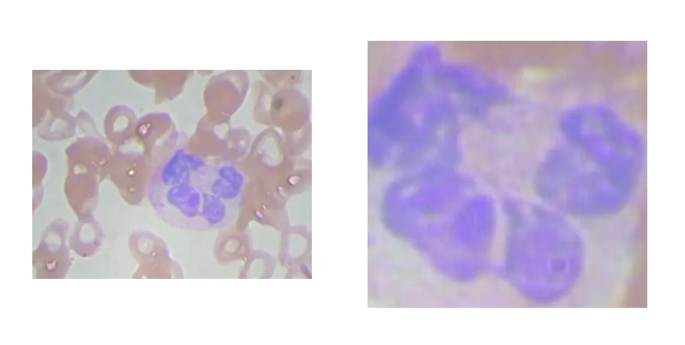

YOLO (You Only Look Once) is one of the greatest networks for object detection. As such, it can be a very good candidate for various object detection tasks, including for objects the original network hasn’t been trained for.

We are going to leverage the YOLOv8 model by [Ultralytics](https://docs.ultralytics.com/) for the detection of white blood cells in images, based on the [Blood Cell Images dataset from Kaggle](https://www.kaggle.com/datasets/paultimothymooney/blood-cells?rvi=1). I made a few modifications to the dataset as follows. First, I reduced the number of images to only 40 images and took only images with one white blood cell. Second, instead of using the original labels of the dataset, I made another dataset with cropped images containing only the white blood cells. We will use these crops to create the labels by ourselves.

The project contains three steps:

1. Process the original dataset of images and crops to create a dataset suited for the YOLOv8.
2. Train the YOLOv8 model using transfer learning
3. Predict and save results

Most of the code will be part of a class which will be a wrapper for the original YOLOv8 implementation.

```python
import warnings
from shutil import copy, rmtree
from pathlib import Path
import numpy as np
import cv2
from ultralytics import YOLO
from sklearn.model_selection import train_test_split
import pandas as pd
import torch
import matplotlib.pyplot as plt

class YoloWrapper:
    def __init__(self, model_weights: str) -> None:
        """
        Initialize YOLOv8 model with weights.
        Args:
            model_weights (str): model weight can be one of the follows:
                - 'nano' for YOLOv8 nano model
                - 'small' for YOLOv8 small model
                - a path to a .pt file contains the weights from a previous training.
        """
        if model_weights == 'nano':
            model_weights = 'yolov8n.pt'
        elif model_weights == 'small':
            model_weights = 'yolov8s.pt'
        elif model_weights == 'medium':
            model_weights = 'yolov8m.pt'
        elif (not Path(model_weights).exists()) or (Path(model_weights).suffix != '.pt'):
            raise ValueError('The parameter model_weight should be "nano", "small" or a'
                             'path to a .pt file with saved weights')

        # initialize YOLO model
        self.model = YOLO(model_weights)
```

In the `__init__` function of the class we initialize YOLOv8 model with weights. We can create pre-trained models of type “nano”, “small” or “medium” or initialize a model with our own saved weights by using a path to the weights.

## Processing the Dataset

We start with a dataset that contains two folders: `full_images` and `crops`. The `full_images` folder contains 40 images of blood cells with one white blood cell. In the `crops` folder, there are 40 images, each one contains the crop of the white cell from the original image in the `full_images` folder. The original image and the cropped image have the same name. You can get the dataset from [here](https://www.dropbox.com/scl/fo/4ceeusflhmgskugf89mco/h?rlkey=ek9hvzbkczm0mfkulowkkn84l&dl=0), or create it on your own using the original dataset from Kaggle and make the crops by yourself.

<figure>
  
  <figcaption>
    On the left is the original image and on the right is the cropped image of the white blood cell
  </figcaption>
</figure>

The first step is to create labels for our dataset. The labels should represent bounding boxes for the white blood cell in the YOLO format. This format is as follows: `<class: int> <x center: float> <y center: float> <width: float> <height: float>`. The numbers are normalized to the image size (that is equal to the case where the image coordinates are $(0,0)$ for the top left and $(1,1)$ for the bottom right). For each image, a text file with the same name as the image should be created, and contains a row with the above format. In our case, in each image, there is one object to detect and this object belongs to one type (white blood cell), so we only have one class and we give it the number $0$.

Our first task is to find the coordinates of the bounding box for the labels using the cropped images. We can do that by using a technique called *template matching*. This is a relatively simple method where the cropped image slides along the original image and outputs the position with the best (normalized) correlation with the cropped image. You can learn more about template matching from [this video](https://www.youtube.com/watch?v=yDDhcJuSQw0&list=PLAwxTw4SYaPnbDacyrK_kB_RUkuxQBlCm&index=68).

Luckily, OpenCV has an [implementation](https://docs.opencv.org/3.4/df/dfb/group__imgproc__object.html#ga586ebfb0a7fb604b35a23d85391329be) for template matching and we can use it for our case. We create a static method in our class for implementing the label creations. The method gets as input a path to the original images, a path to the cropped images, and a path to where to save the labels. Before we continue with the method, it’s worth saying that through the code I will use the Path class extensively, so if you are not familiar with it, you can read more about it [here](../pathlib-a-Better-Way-to-Work-with-Paths-in-Python/index.qmd). In the beginning, we read the file names for both the original images and the cropped images and sort them so they will be aligned. Then, for each pair of images, we use template matching with the OpenCV functions `matchTemplate` and `minMaxLoc` to find the position of the cropped image in the original image, which is, in fact, the bounding box. Finally, we save it in a text file with the YOLO format and the same name as the images.

```python
    @staticmethod
    def create_yolo_labels_from_crop(images_path: str | Path, crops_path: str | Path,
                                     labels_path: str | Path | None = None) -> None:
        """
        Create labels in YOLO format from images cropped from larger images.
        The YOLO format is a txt file where there is a row for each object
        at the format: <class: int> <x center: float> <y center: float> <width: float> <height: float>
        where all measure in a relative coordinate in the range [0,  1].
        The function assume the folder of the original and cropped images have the same data and the images
        have the same name.
        Args:
            images_path (str|Path): path to the folder containing the full images
            crops_path (str|Path): path to the folder containing the cropped images
            labels_path (str|Path|None): optional (default None). Path to the folder
                where the train will be saved. If None the labels will be saved in a
                labels folder in the parent directory of the images.

        Returns:

        """
        images_path = Path(images_path)
        crops_path = Path(crops_path)

        if labels_path is None:
            parent_dir = images_path.parent
            labels_path = parent_dir / 'labels'
        else:
            labels_path = Path(labels_path)

        labels_path.mkdir(parents=True, exist_ok=True)

        images_list = sorted(list(images_path.glob('*')))
        crops_list = sorted(list(crops_path.glob('*')))

        for image_path, crop_path in zip(images_list, crops_list):
            image = cv2.imread(str(image_path), cv2.IMREAD_GRAYSCALE)
            crop = cv2.imread(str(crop_path), cv2.IMREAD_GRAYSCALE)

            # Apply template Matching
            template_match_results = cv2.matchTemplate(image, crop, cv2.TM_CCORR_NORMED)
            min_val, max_val, min_loc, max_loc = cv2.minMaxLoc(template_match_results)
            x_left = max_loc[0]
            y_top = max_loc[1]
            h, w = crop.shape
            x_right = x_left + w
            y_bottom = y_top + h

            with open((labels_path / image_path.stem).with_suffix('.txt'), 'w') as file:
                text = (f'0 '
                        f'{((x_left + x_right) / 2) / image.shape[1]} '
                        f'{((y_top + y_bottom) / 2) / image.shape[0]} '
                        f'{w / image.shape[1]} '
                        f'{h / image.shape[0]}')
                file.write(text)
```

At the end of this function, we get a folder with text files with the coordinates of the bounding boxes. The labels themselves are not sufficient since we also need to arrange all the data in YOLO dataset format as follows.

```text
- dataset
  - images
    - train
    - val
  - labels
    - train
    - val
```

The data is organized in a root folder (dataset for example), where there are two folders for the images and the labels, and inside each of them, the data is split into training and validation data. In addition to that, we also need a configuration file that will tell YOLO where the data is and what classes there are.

```python
    @staticmethod
    def create_dataset(images_path: str | Path, labels_path: str | Path = None, result_path: str | Path = None,
                       train_size: float = 0.9) -> None:
        """
        Create A YOLO dataset from a folder of images and a folder of labels. The function
        assumes all the images have a labels with the same name. The output structure is
        - result_path
            - images
                - train
                - val (optional)
            - labels
                - train
                - val (optional)
        Args:
            images_path (str|Path): path to the folder contains the images
            labels_path (str|Path): path to the folder contains the labels
            result_path (optional, str|Path): path to the folder where the result will be saved.
                If it's None, a folder named 'data' will be created in parent directory of the images.
            train_size (float): a number between 0 and 1 represent the proportion of the dataset to
                include in the train split

        Returns:

        """
        if train_size <= 0 or 1 < train_size:
            raise ValueError(f'Train size should be between 0 to 1, but got {train_size}')

        images_path = Path(images_path)
        labels_path = Path(labels_path)

        if result_path is None:
            parent_dir = images_path.parent
            result_path = parent_dir / 'data'
        else:
            result_path = Path(result_path)

        if result_path.exists():
            rmtree(result_path)

        all_images = sorted(list(images_path.glob('*')))
        all_labels = sorted(list(labels_path.glob('*')))

        training_dataset, val_dataset, train_labels, val_labels = train_test_split(
            all_images, all_labels, train_size=train_size)

        result_path_image_training = result_path / 'images' / 'train'
        result_path_image_training.mkdir(parents=True, exist_ok=False)
        result_path_label_training = result_path / 'labels' / 'train'
        result_path_label_training.mkdir(parents=True, exist_ok=False)

        for image, label in zip(training_dataset, train_labels):
            copy(image, result_path_image_training / image.name)
            copy(label, result_path_label_training / label.name)

        if val_dataset:
            result_path_image_validation = result_path / 'images' / 'val'
            result_path_image_validation.mkdir(parents=True, exist_ok=False)
            result_path_label_validation = result_path / 'labels' / 'val'
            result_path_label_validation.mkdir(parents=True, exist_ok=False)

            for image, label in zip(val_dataset, val_labels):
                copy(image, result_path_image_validation / image.name)
                copy(label, result_path_label_validation / label.name)
```

```python
    @staticmethod
    def create_config_file(parent_data_path: str | Path, class_names: list[str], path_to_save: str = None) -> None:
        """
        Create YOLOv8 configuration yaml file. The configuration file contains:
        path -  absolute path to the folder contains the images and labels folders with the data
        train - relative path to 'path' of the train images folder (images/train)
        val -  relative path to 'path' of the validation images folder (images/val), if exists
        nc - the number of classes
        names - a list of the classes names
        Args:
            parent_data_path (str|Path): path to the folder contains the images and labels folder with the data.
                The structure of this folder should be:
                - parent_data_path
                    - images
                        - train
                        - val (optional)
                    - labels
                        - train
                        - val (optional)
            class_names (list[str]): a list contains the names of the classes. The first name is for label 0, and so on
            path_to_save (Optional, str): A path to where to save the result. By default it save it in the working
                directory as 'config.yaml'. If a folder is given a file 'config.yaml' will be saved inside. If a path
                including file name is given, the file must be with a .yaml suffix.

        Returns:

        """
        parent_data_path = Path(parent_data_path)
        if not parent_data_path.exists():
            raise FileNotFoundError(f'Folder {parent_data_path} is not found')
        if not (parent_data_path / 'images' / 'train').exists():
            raise FileNotFoundError(f'There is not folder {parent_data_path / "images" / "train"}')
        if not (parent_data_path / 'labels' / 'train').exists():
            raise FileNotFoundError(f'There is not folder {parent_data_path / "labels" / "train"}')

        config = {
            'path': str(parent_data_path.absolute()),
            'train': 'images/train',
            'val': 'images/val',
            'nc': len(class_names),
            'names': class_names
        }

        if not (parent_data_path / 'images' / 'val').exists():
            config.pop('val')

        if path_to_save is None:
            path_to_save = 'config.yaml'
        path_to_save = Path(path_to_save)

        if not path_to_save.suffix:  # is a folder
            path_to_save.mkdir(parents=True, exist_ok=True)
            path_to_save = path_to_save / 'config.yaml'

        if path_to_save.suffix != '.yaml':
            raise ValueError(f'The path to save the configuration file should be a folder, a yaml file or None.'
                             f'Got a {path_to_save.suffix} file instead')

        with open(path_to_save, 'w') as file:
            for key, value in config.items():
                file.write(f'{key}: {value}\n')
```

The first method takes the whole data and arranges it in the above folder structure and also splits the data into training and validation sets. The second method creates the configuration file. The configuration file holds the following information: the path to the root of the dataset, the relative path to the training and validation sets, the number of classes in the dataset (one in our case), and a list with the names of the different classes there are (in our case only “white blood cell”). Here is an example of such a configuration file.

```yaml
path: /home/User/Projects/YOLO_study_case/data  # path of the root of the data
train: images/train  # relative path to the data root for the training data
val: images/val  # relative path to the data root for the validation data
nc: 1  # number of classes
names: ['white_blood_cell']  # list of classes names
```

With the dataset and the configuration file ready, we can move on to training.

## Training the Model

The YOLO class from ultralytics already has a method for training. This method takes care of everything including data augmentation and validation metrics, so we have very little to do. Because we don’t want our users to learn the API for the full YOLO class, we make a wrapper method for training which is much simpler than the full capability of the original one. Our method only gets as inputs the configuration file, number of epochs, and the name of the results folder. In addition, we set the argument *freeze* to $10$, meaning we freeze the first $10$ layers of the model, which are the backbone of the YOLO networks we use (nano, small, and medium). This means we use the backbone as is and don’t update its weights (thus, it is a transfer learning).

```python
    def train(self, config: str, epochs: int = 100, name: str = None) -> None:
        """
        Train the model. After running a 'runs/detect/<name>' folder will be created and stores information
        about the training and the saved weights.
        Args:
            config (str): a path to a configuration yaml file for training.
                Such a file contains:
                    path -  absolute path to the folder contains the images and labels folders with the data
                    train - relative path to 'path' of the train images folder (images/train)
                    val -  relative path to 'path' of the validation images folder (images/val), if exists
                    nc - the number of classes
                    names - a list of the classes names
                Can be created with the create_config_file method.
            epochs (int): number of epochs for training
            name (str): the name of the results' folder. If None (default) a default name 'train #' will
                be created.

        Returns:

        """
        if Path(config).suffix != '.yaml':
            raise ValueError('Config file should be a yaml file')
        self.model.train(data=config, epochs=epochs, name=name, freeze=10)
```

The weights and validation results will be saved in our project folder in the path `runs/detect/<name>`.

## Make Predictions and Save Results

Now, we have a trained model and we can make predictions. Again, the original YOLO class can handle the prediction for new data, but we can wrap it up with our functions. First, we can create a method that predicts a bounding box for an image and then plots the image with the bounding box on it.

```python
    def predict_and_show(self, image: str | np.ndarray, threshold: float = 0.25) -> None:
        """
        Predict bounding box for a single image and show the bounding box with its confidence.
        Args:
            image (str | np.ndarray): a path to an image or a BGR np.ndarray image to predict
                bounding box for
            threshold (float): a number between 0 and 1 for the confidence a bounding box should have to
                consider as a detection. Default is 0.25.
        Returns:

        """
        yolo_results = self.model(image, threshold=threshold)
        labeled_image = yolo_results[0].plot()
        plt.figure()
        plt.imshow(labeled_image[..., ::-1])  # change channels order since the YOLO work on BGR images
        plt.show()
```

The original YOLO class can return the prediction results in several ways: top left corner and bottom right corner (both normalized or in original coordinates), or center point and width and height (again normalized or unnormalized). But what if we want the bounding boxes in another format? We can create a new wrapper function to return the prediction with our favorite format, for example, the top left corner and width and height. An example of such a function can be seen below.

```python
    def predict(self, image: str | Path | np.ndarray | list[str] | list[Path] | list[np.ndarray], threshold: float = 0.25,
                ) -> list[np.ndarray]:
        """
        Predict bounding box for images.
        Args:
            image (str|Path|np.ndarray|list[str]|list[Path]|list[np.ndarray]): image data. Can be a string path
                to an image, a BGR image as numpy ndarray, a list with string paths to images or a list
                with BGR images as numpy ndarray.
            threshold (float): a number between 0 and 1 for the confidence a bounding box should have to
                consider as a detection. Default is 0.25.

        Returns:
            (list[np.ndarray]): a list with numpy ndarrays for each detection
        """
        yolo_results = self.model(image, conf=threshold)
        bounding_boxes = [torch.concatenate([x.boxes.xyxy[:, :2], x.boxes.xyxy[:, 2:] - x.boxes.xyxy[:, :2]], dim=1).cpu().numpy()
                          for x in yolo_results]
        return bounding_boxes
```

Here we use the predictions in the top left corner and bottom right corner format and convert them into the top left corner and width and height format.

Another thing we can do is to save the prediction into a CSV file.

```python
    def predict_and_save_to_csv(self, images: list[str] | list[Path] | list[np.ndarray], image_ids: list[str] = None,
                                path_to_save_csv: str | Path = '', threshold: float = 0.25, minimum_size: int = 100,
                                only_most_conf=True) -> None:
        """
        Predict a batch of images and return the bounding boxes prediction in a csv file with the columns:
        image_id, x_top_left, y_top_left, width, height. If there is no any prediction, a csv will not be created.
        Args:
            images (list[str] | list[Path] | list[np.ndarray]): a list with string paths to images or a list
                with BGR images as numpy ndarray.
            image_ids (list[str]): the ids of the images
            path_to_save_csv (Optional, str|Path): a path where to save the csv file. If the path is not for
                a specific csv file, the file name will be bounding_box.csv by default.
            threshold (float):  a number between 0 and 1 for the confidence a bounding box should have to
                consider as a detection. Default is 0.25.
            minimum_size (int): the minimum width and height in pixels for a bounding box to saved in the csv file.
                If the bounding box founded is smaller than the minimum size, the width and the height will update
                 to the minimum size, and the top left point will be updated accordingly to keep the object in
                 the center
            only_most_conf (bool): True to keep only the bounding box with the highest confidence for each image.
                The bounding boxes are sorted so the first one is the one with the highest confidence

        Returns:

        """
        if image_ids is None:
            if isinstance(images[0], np.ndarray):
                raise ValueError('image_ids can not be None if images is a list of numpy arrays')
            else:
                # get the name of the images as image id
                image_ids = [Path(image_path).stem for image_path in images]

        if isinstance(images[0], (str, Path)):
            h, w, _ = cv2.imread(str(images[0])).shape
        else:  # numpy array
            h, w, _ = images[0].shape

        bbox_list = self.predict(images, threshold)
        if only_most_conf:  # keep only the bounding box with the highest confidence
            bbox_list = [bboxes[[0], :] if bboxes.shape[0] > 0 else bboxes for bboxes in bbox_list]

        # if there are more than one bounding box for an image, we need to duplicate the image id
        image_ids_with_duplicates = [image_id
                                     for bbox, image_id in zip(bbox_list, image_ids)
                                     for _ in range(bbox.shape[0])]
        bbox_matrix = np.vstack(bbox_list)

        if bbox_matrix.shape[0] == 0:
            warnings.warn('A bounding boxes were not found for any of the images.'
                          'A csv file will not be created')
            return

        # set the width to minimum value
        less_than_min = bbox_matrix[:, 2] < minimum_size
        missing_width = minimum_size - bbox_matrix[less_than_min, 2]
        bbox_matrix[less_than_min, 2] = minimum_size
        bbox_matrix[less_than_min, 0] = np.minimum(
            np.maximum(bbox_matrix[less_than_min, 0] - missing_width / 2, 0),
            w - 1 - minimum_size
        )

        # set the height to minimum value
        less_than_min = bbox_matrix[:, 3] < minimum_size
        missing_height = minimum_size - bbox_matrix[less_than_min, 3]
        bbox_matrix[less_than_min, 3] = minimum_size
        bbox_matrix[less_than_min, 1] = np.minimum(
            np.maximum(bbox_matrix[less_than_min, 1] - missing_height / 2, 0),
            h - 1 - minimum_size
        )

        dict_for_csv = {
            'image_id': image_ids_with_duplicates,
            'x_top_left': bbox_matrix[:, 0],
            'y_top_left': bbox_matrix[:, 1],
            'width': bbox_matrix[:, 2],
            'height': bbox_matrix[:, 3]
        }

        bbox_dataframe = pd.DataFrame(dict_for_csv)

        path_to_save_csv = Path(path_to_save_csv)
        if path_to_save_csv.suffix == '':
            path_to_save_csv = path_to_save_csv / 'bounding_boxes.csv'
        if path_to_save_csv.suffix != '.csv':
            raise ValueError('A non-csv file is given')
        path_to_save_csv.parent.mkdir(parents=True, exist_ok=True)
        bbox_dataframe.to_csv(str(path_to_save_csv), index=False)
```

In the function above we get a list of images to make prediction for, then we use the network to predict bounding boxes and save the result in a CSV file with the columns: image id, x top left, y top left, width, and height. We also add the ability to save only the bounding box with the highest confidence and to keep the bounding boxes in the result file to be with a minimum size. Pay attention that if an image has more than one prediction, we need to duplicate the image id for each prediction.

Finally, we can add a function to draw bounding boxes on images according to the CSV file.

```python
    @staticmethod
    def draw_bbox_from_csv(image: str | Path | np.ndarray, csv_path: str, image_id: str = None) -> None:
        """
        Draw bounding boxes according to a csv for one image
        Args:
            image (str | Path | np.ndarray): a path to a single image or a BGR np.ndarray image to predict
                bounding box for
            csv_path (str): a path to a csv file with bounding boxes
            image_id (str): the image id as in the csv. If None (default), all the bounding boxes
                in the csv will be drawn.
        Returns:

        """
        if not isinstance(image, np.ndarray):
            image = cv2.imread(str(image))

        bbox_dataframe = pd.read_csv(csv_path)

        if image_id is not None:
            bbox_dataframe = bbox_dataframe.loc[bbox_dataframe['image_id'] == image_id, :]

        for _, row in bbox_dataframe.iterrows():
            cv2.rectangle(
                image,
                (int(row['x_top_left']), int(row['y_top_left'])), (int(row['x_top_left'] + row['width']), int(row['y_top_left'] + row['height'])),
                (0, 0, 255),
                4
            )

        plt.figure()
        plt.imshow(image[..., ::-1])
        if image_id is not None:
            plt.title(image_id)
        plt.show()
```

We can use all of this with a script as follows, for example.

```python
from pathlib import Path
import cv2
from yolo_wrapper import YoloWrapper


# paths to the data
dataset_path = Path('data/yolo_dataset')  # where the YOLO dataset will be
large_field_images_path = Path('data/raw_data/full_image')  # where the original images
cropped_images_path = Path('data/raw_data/crops')
labels_path = Path('data/labels')  # where the labels are

YoloWrapper.create_yolo_labels_from_crop(large_field_images_path, cropped_images_path, labels_path)

# create the dataset in the format of YOLO
YoloWrapper.create_dataset(large_field_images_path, labels_path, dataset_path)
# create YOLO configuration file
config_path = 'blood_cell_config.yaml'
YoloWrapper.create_config_file(dataset_path, ['white_cell'], config_path)

# create pretrained YOLO model and train it using transfer learning
model = YoloWrapper('nano')
model.train(config_path, epochs=200, name='blood_cell')

# make predictions on the validation set
data_to_predict_path = dataset_path/'images'/'val'
val_image_list = list(data_to_predict_path.glob('*.jpg'))

# save the prediction in a csv file where the bounding boxes should have minimum size
model.predict_and_save_to_csv(val_image_list, path_to_save_csv='nano_blood_cell.csv', minimum_size=100, threshold=0.25,
                              only_most_conf=True)
# draw bounding boxes from csv
for image in val_image_list:
    model.draw_bbox_from_csv(image, 'nano_blood_cell.csv', image.stem)
```

## Conclusion

In this post, we saw how we can take a pre-trained model that already has a full implementation to work with and wrap it with our own class so we can simplify the original implementation and make it custom-made to our needs.

You can find the full code [here](https://github.com/dorzv/ComputerVision/tree/master/custom_yolo).