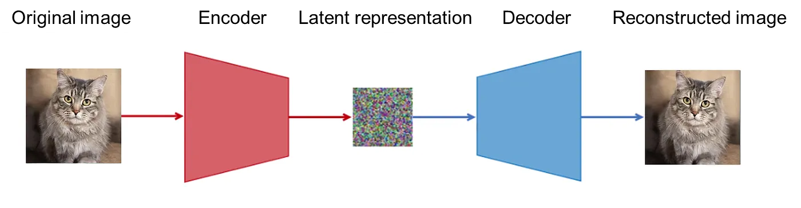
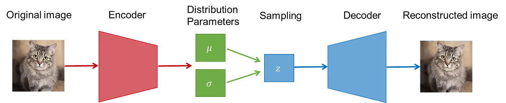
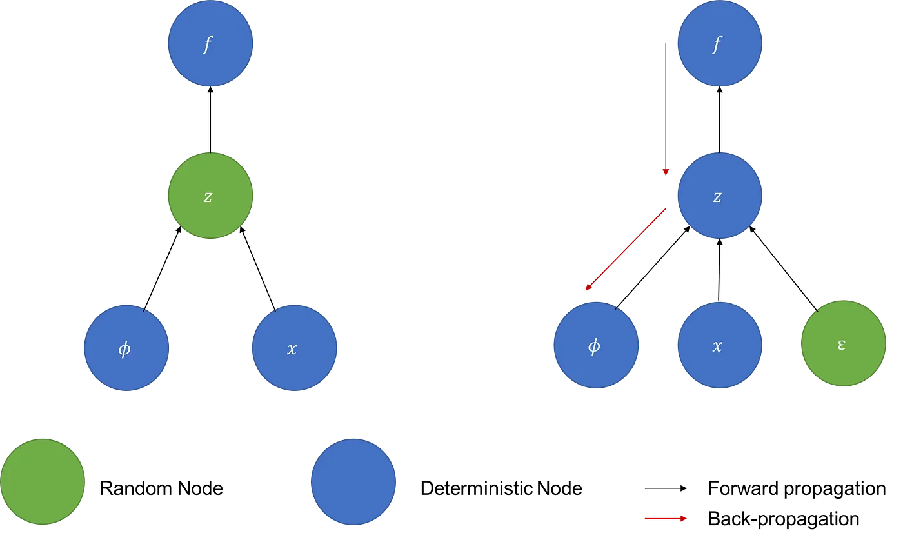
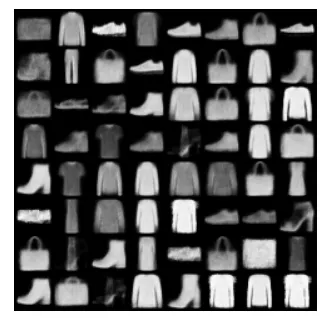
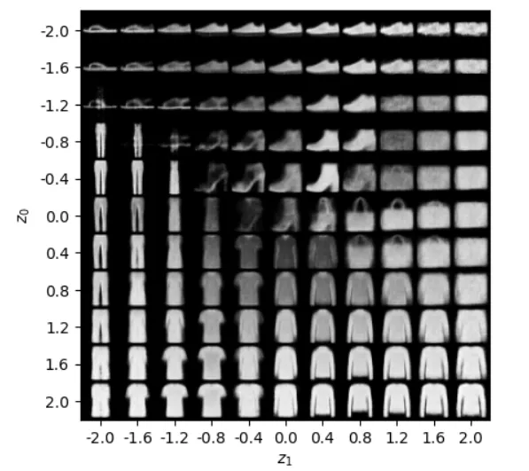
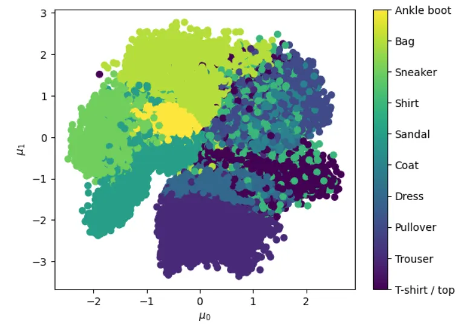

Generative artificial intelligence is one of the most exciting fields in deep learning. Such networks can generate new data, like image text or sound, by learning the distribution the data comes from. Various generative deep learning models exist, like Generative Adversarial Networks (GANs), Diffusion-based networks, and Variational Autoencoders.

In this post, we are going to focus on the Variational Autoencoder model. We start by understanding why it’s useful, derivate it mathematically, and finally implement a simple network.

## AutoEncoder vs Variational AutoEncoder

An AutoEncoder is a network that can take an input (image in our case), $x$, compress it to some latent representation $z$ using an encoder, and decode it back from $z$ to the original data $x$ using a decoder.

<figure>
  
  <figcaption>The architecture of an autoencoder. An image is compressed into some latent representation and decoded back.</figcaption>
</figure>

The aim of this model is to get the best reconstruction possible. The network has no regularization on the latent space and can do whatever is needed to get the original image back. This means we don’t really know how the latent space is constructed, and that’s why it can be very difficult for us to use the latent space to sample a new image to generate (we can only reconstruct images we already have their latent representation).

Here comes the Variational Autoencoder. Instead of using any latent space, we use some constraints to get a latent space from which we know how to sample. For example, we can ask for a latent space, which is a normal distribution similar to the standard normal distribution, and then we can sample from this distribution to decode images.

<figure>
  
</figure>

In the above figure, the encoder returns the mean and the standard deviation of a normal distribution, then we sample a latent vector $z$, and finally, the decoder reconstructs the image from $z$. The main difference between the autoencoder and the variational autoencoder is that the encoder in the first one returns an encoded representation of the image as a latent vector, while the second returns a distribution as the encoded version of the image, from which we can sample a latent representation.

## The Mathematics Behind the Variational AutoEncoder

As explained, the variational autoencoder has a probabilistic approach. The decoder represents the probability distribution to get the data $x$ given the latent representation $z$, $p(x|z)$. On the other hand, the encoder represents the probability distribution of the latent $z$ given the data $x$, $p(z|x)$. The relation between these two distributions is given by Bayes theorem.

$$
p(z|x) = \frac{p(x|z)p(z)}{p(x)} = \frac{p(x|z)p(z)}{\int p(x|z)p(z)dz}
$$

Where $p(z)$ is a prior distribution of $z$ we assume, and $p(x)$ is the distribution of the data we generally don’t know and can’t even solve the integral that defines it. That means we also can’t compute the posterior $p(z|x)$. Instead of computing it, we can try to approximate it using a recognition model $q_\phi(z|x)$, such as

$$q_\phi(z|x) \approx p_\theta(z|x)$$

where $\phi$ and $\theta$ are the parameters of a model, and $q_\phi(z|x)$ and $p_\theta(z|x)$ are families of distributions parameterized by $\phi$ and $\theta$ (at the end, we will want to find those parameters to define the best models).

To find the parameters, we need to define an optimization problem. Because we want $q_\phi(z|x)$ to describe best the real distribution $p_\theta(z|x)$, we can minimize the KL divergence between them.

$$
\begin{aligned}
KL(q_\phi(z|x)||p_\theta(z|x)) &= \mathbb{E}_{q_\phi} \left[ \log \frac{q_\phi(z|x)}{p_\theta(z|x)} \right] \\
&= \mathbb{E}_{q_\phi} \left[ \log \frac{q_\phi(z|x)p_\theta(x)}{p_\theta(z, x)} \right] \\
&= \mathbb{E}_{q_\phi} \left[ \log \frac{q_\phi(z|x)}{p_\theta(z, x)} + \log(p_\theta(x)) \right] \\
&= \mathbb{E}_{q_\phi} \left[ \log \frac{q_\phi(z|x)}{p_\theta(z, x)} \right] + \log(p_\theta(x)) \\
&= -\mathbb{E}_{q_\phi} \left[ \log \frac{p_\theta(z, x)}{q_\phi(z|x)} \right] + \log(p_\theta(x)) \\
&= -\mathcal{L}_{\theta,\phi}(x) + \log(p_\theta(x))
\end{aligned}
$$

We can rearrange the equation so

$$\mathcal{L}_{\theta,\phi}(x) = \log(p_\theta(x)) - KL(q_\phi(z|x)||p_\theta(z|x))$$
$$\Rightarrow \mathcal{L}_{\theta,\phi}(x) \le \log(p_\theta(x))$$

The inequality is true because KL divergence is a non-negative value. That means $\mathcal{L}_{\theta,\phi}(x)$ is a lower bound of the log-likelihood of the data (also called evidence) — and this is the reason it’s called the Evidence Lower Bound (ELBO). Notice that we get an equality if and only if the KL divergence part is zero, meaning the recognition model is equal to the true posterior distribution.

From what we saw, we can understand that instead of minimizing the KL divergence, we can equivalently maximize the ELBO, $\mathcal{L}_{\theta,\phi}(x)$. We can develop the expression for the ELBO as follows:

$$
\begin{aligned}
\mathcal{L}_{\theta,\phi}(x) &= \mathbb{E}_{q_\phi} \left[ \log \frac{p_\theta(z, x)}{q_\phi(z|x)} \right] \\
&= \mathbb{E}_{q_\phi} \left[ \log \frac{p_\theta(x|z)p_\theta(z)}{q_\phi(z|x)} \right] \\
&= \mathbb{E}_{q_\phi} \left[ \log \frac{p_\theta(z)}{q_\phi(z|x)} + \log(p_\theta(x|z)) \right] \\
&= \mathbb{E}_{q_\phi} [\log(p_\theta(x|z))] - KL(q_\phi(z|x)||p_\theta(z))
\end{aligned}
$$

We see that the ELBO constructs from two terms. The first term is the expectation over the likelihood of the real model. As we want to maximize it, it can be seen as a “reconstruction error” (we want to get the data that has the most likelihood given the latent representation $z$, which should be the original data $x$ the $z$ came from). The second term can be seen as a regularization. As we want to maximize the ELBO, we need to keep the KL divergence small (since it is non-negative), which means we are penalized if our recognition model $q_\phi(z|x)$ is far from the prior. This shows the trade-off between choosing a model that is more similar to the prior or a model followed by the observed data and maximizing the likelihood.

## Reparametrizing Trick

As explained before, the latent representation $z$ is sampled for $q_\phi(z|x)$, which means it is a random variable. We need to back-propagate through $z$ to $\phi$ to optimize our loss function, but it’s problematic since $z$ is a random variable sampled from some distribution. Instead, we can express $z$ using some differentiable transformation with another random variable $\varepsilon$, $z = g(\varepsilon, \phi, x)$. This change lets us back-propagate through $z$ to optimize $\phi$, as illustrated in the following figure.

<figure>
  
</figure>

## Let’s Code it

We are going to implement a Variational Autoencoder for the FashionMNIST dataset. The FashionMNIST dataset contains low-resolution gray-scale images of 10 fashion items such as shirts, dresses, and shoes. We want our model to generate new images similar to those in the FashionMNIST dataset.

We start by importing the relevant libraries we are going to use.

```python
import numpy as np
import torch
from torch import nn, optim
from torch.nn import functional as F
from torchvision import datasets
from torchvision.utils import make_grid
from torchvision.transforms.transforms import ToPILImage, ToTensor
import matplotlib.pyplot as plt
```

And defining some constant values to use.

```python
BATCH_SIZE = 128
EPOCHS = 100
Z_DIM = 2
LEARNING_RATE = 1e-3

device = torch.device('cuda' if torch.cuda.is_available() else 'cpu')
```

The next step is to get the dataset and create a data loader. We can use torchvision to load the dataset directly.

```python
train_data = datasets.FashionMNIST('./data', train=True, download=True,
                            transform=ToTensor())
test_data = datasets.FashionMNIST('./data', train=False,
                           transform=ToTensor())

train_loader = torch.utils.data.DataLoader(train_data,
                                           batch_size=BATCH_SIZE, shuffle=True)
test_loader = torch.utils.data.DataLoader(test_data,
                                          batch_size=BATCH_SIZE, shuffle=True)
```

Now, we want to build the model. As we explained, the Variational Autoencoder is composed of an encoder, sampling step, and decoder. We want to implement each of them and compose them to a full model.

```python
class Sampling(nn.Module):
  def __init__(self):
    super().__init__()

  def forward(self, z_means, z_log_vars):
      epsilon = torch.randn_like(z_means, dtype=torch.float32)
      return z_means + torch.exp(0.5 * z_log_vars) * epsilon


class Encoder(nn.Module):
  def __init__(self, latent_dim):
    super().__init__()
    self.latent_dim = latent_dim
    self.encoder = nn.Sequential(
        nn.Conv2d(1, 32, 3, stride=2, padding=1),
        nn.ReLU(True),
        nn.Conv2d(32, 64, 3, stride=2, padding=1),
        nn.ReLU(True),
        nn.Flatten(),
        nn.Linear(7 * 7 * 64, 16),
        nn.ReLU(True)
    )
    self.lin_mean = nn.Linear(16, latent_dim)
    self.lin_log_var = nn.Linear(16, latent_dim)
    self.sampling = Sampling()

  def forward(self, x):
    x = self.encoder(x)
    z_means = self.lin_mean(x)
    z_log_vars = self.lin_log_var(x)
    z = self.sampling(z_means, z_log_vars)
    return z, z_means, z_log_vars


class Decoder(nn.Module):
  def __init__(self, latent_dim):
    super().__init__()
    self.decoder = nn.Sequential(
        nn.Linear(latent_dim, 7 * 7 * 64),
        nn.ReLU(True),
        nn.Unflatten(1, (64, 7, 7)),
        nn.ConvTranspose2d(64, 64, 3, stride=2, padding=1, output_padding=1),
        nn.ReLU(True),
        nn.ConvTranspose2d(64, 32, 3, stride=2, padding=1, output_padding=1),
        nn.ReLU(True),
        nn.ConvTranspose2d(32, 1, 3, padding=1),
        nn.Sigmoid()
    )

  def forward(self, x):
    return self.decoder(x)


class VAE(nn.Module):
  def __init__(self, latent_dim):
    super().__init__()
    self.encoder = Encoder(latent_dim)
    self.decoder = Decoder(latent_dim)

  def forward(self, x):
    z, z_means, z_log_vars = self.encoder(x)
    x = self.decoder(z)
    return x.view(-1, 1, 28, 28), z_means, z_log_vars
```

In the sampling step, we use $\varepsilon$ sampled from a standard normal distribution and compute $z$ by using the parameterize trick by multiplying it with the standard division and adding the mean to get a new value sampled from another normal distribution.

For the optimization part, we developed the expression

$$\mathcal{L}_{\theta,\phi}(x) = \mathbb{E}_{q_\phi} [\log(p_\theta(x|z))] - KL(q_\phi(z|x)||p_\theta(z))$$

We can make it a loss by looking at $-\mathcal{L}_{\theta,\phi}(x)$. For the KL divergence, we are going to assume the prior $p_\theta(z)$ is a standard normal distribution (mean of 0 and variance of 1), and we also assume $q_\phi(z|x)$ is a normal distribution. In general, these distributions are for vectors (multivariate normal distributions), but we are going to assume the covariance matrix is diagonal, meaning each value in the vector is independent of the other.

It can be shown that for such a case, the KL divergence is given by:

$$KL(\mathcal{N}(\boldsymbol{\mu}, diag(\sigma_1^2, ..., \sigma_n^2))||\mathcal{N}(\mathbf{0}, \mathbf{I})) = \frac{1}{2} \sum_{i=1}^{n} (\sigma_i^2 + \mu_i^2 - 1 - \ln(\sigma_i^2))$$

For the second term, we have said that it represents a reconstruction error. Instead of using it directly, we can select another reconstruction term, such as L1, L2, or binary cross-entropy. Here, we are going to use binary cross entropy between the reconstructed image at the end of the decoder and the original image we use as input to the encoder.

```python
def loss_func(x_reconstruct, x, z_means, z_log_vars):
  bce = F.binary_cross_entropy(x_reconstruct, x, reduction='sum')
  kld = 0.5 * torch.sum(z_means ** 2 + torch.exp(z_log_vars) - z_log_vars - 1)

  return bce + kld
```

We define the training step and the test step.

```python
def train_step(model, dataloader, loss_tracking):
  model.train()
  for batch in dataloader:
    optimizer.zero_grad()
    batch = batch[0].to(device)
    reconstructed_batch, mu, log_var = model(batch)
    loss = loss_func(reconstructed_batch, batch, mu, log_var)
    current_loss = loss.item()
    loss_tracking.append(current_loss) 
    loss.backward()
    optimizer.step()

def test_step(model, dataloader, loss_tracking):
  model.eval()
  with torch.no_grad():
    for batch in dataloader:
      batch = batch[0].to(device)
      reconstructed_batch, mu, log_var = model(batch)
      loss = loss_func(reconstructed_batch, batch, mu, log_var)
      current_loss = loss.item()
      loss_tracking.append(current_loss) 
```

Finally, we create the model and the optimizer and train the model.

```python
model = VAE(Z_DIM).to(device)
optimizer = optim.Adam(model.parameters(), lr=LEARNING_RATE)

train_loss = []
test_loss = []

for epoch in range(EPOCHS):
  train_step(model, train_loader, train_loss)
  test_step(model, test_loader, test_loss)
  print(f'Epoch {epoch}; Train loss epoch mean {np.mean(train_loss[-len(train_loader):])}, Test loss epoch mean {np.mean(test_loss[-len(test_loader):])}')
```

After the training, we can sample new data using the decoder.

```python
def sample(model, image_to_sample=64, nrow=8):
  with torch.no_grad():
    z = torch.randn((image_to_sample, Z_DIM)).to(device)
    samples = model.decoder(z).cpu().view(image_to_sample, 1, 28, 28)
    grid = make_grid(samples, nrow=nrow)
    return ToPILImage()(grid)

sample(model)
```

<figure>
  
</figure>

We can look at how different values in the latent vector $z$ influence the results.

```python
z0_range = np.linspace(-2, 2, 11)
z1_range = np.linspace(-2, 2, 11)
results = []

with torch.no_grad():
  for z0 in z0_range:
    for z1 in z1_range:
      results.append(model.decoder(torch.tensor([[z0, z1]], device=device, dtype=torch.float32)).view(-1, 1, 28, 28))

image = ToPILImage()(make_grid(torch.cat(results, dim=0), 11))

plt.imshow(image)
plt.xticks([2 + (28/2) + (28+2) * ii for ii in range(len(z1_range))], [f'{x:.1f}' for x in z1_range])
plt.yticks([2 + (28/2) + (28+2) * ii for ii in range(len(z0_range))], [f'{x:.1f}' for x in z0_range])
plt.xlabel(r'$z_1$')
plt.ylabel(r'$z_0$')
```

<figure>
  
</figure>

We can also look at the distribution of the means as the encoder sets them.

```python
labels_map = {
0:    "T-shirt / top",
1:    "Trouser",
2:    "Pullover",
3:    "Dress",
4:    "Coat",
5:    "Sandal",
6:    "Shirt",
7:    "Sneaker",
8:    "Bag",
9:    "Ankle boot"
}

all_data = train_data.data.unsqueeze(1) / 255.
with torch.no_grad():
  _, mu, _ = model.encoder(all_data.to(device))
mu = mu.cpu().numpy()
labels = train_data.targets.numpy()

plt.scatter(mu[:,0], mu[:, 1], c=labels)
cbar = plt.colorbar(ticks = range(10))
cbar.ax.set_yticklabels([labels_map[i] for i in range(10)])
plt.xlabel(r'$\mu_0$')
plt.ylabel(r'$\mu_1$')
```

<figure>
  
</figure>
