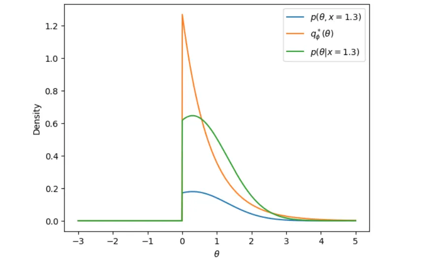

In a [previous post](../markov-chain-monte-carlo-or-how-to-estimate-unknown-probability-function/index.qmd), we discussed the problem of estimating a probability function that cannot be calculated directly, and we saw a method called Markov Chain Monte Carlo to address this problem. In this post, we are going to repeat the problem (so you don't have to read the previous post) and then see another method called variational inference to try and find an approximation to the problem.

· · ·

In the field of probability and statistics, it is not uncommon to encounter situations where the probability distribution function cannot be calculated directly. One example of such a situation is Bayesian inference.

A popular example of Bayesian inference is the estimation of model parameters. The parameters are the elements that define the model structure. For example, for a normal distribution, the parameters are the mean and the variance. For an exponential distribution, the parameter is $\lambda$.

In this case, we usually have some samples $x$ that come from a distribution with unknown parameters $\theta$, but we assume we have some prior knowledge about $\theta$ we can express using a probability function $p(\theta)$. Using Bayes theorem, we can find the probability for $\theta$ according to observed data $x$ (called the posterior).

$$
p(\theta\vert{}x) = \frac{p(x\vert{}\theta)p(\theta)}{p(x)}
$$

In most cases, the calculation of the numerator is not too difficult. However, the normalization factor can be a challenge. To find $p(x)$, we usually need to calculate the integral

$$
p(x) = \int_{\theta} p(x\vert{}\theta)p(\theta)d\theta
$$

In some simple cases (especially in low dimensions), we can compute that integral, but in higher dimensions, it may become intractable. So, instead of computing $p(\theta\vert{}x)$ directly, we need to use some approximation.

There are two main approaches to tackling this problem. The first one is the Markov Chain Monte Carlo (MCMC), which is based on sampling from the unknown distribution, and you can read about it [here](../markov-chain-monte-carlo-or-how-to-estimate-unknown-probability-function/index.qmd). The second one is Variational Inference, which is an approximation-based approach, and we are going to deal with it in this post.

## Variational Inference

Suppose we have some probability distribution function that we know up to a scaling factor, as in the case of Bayesian inference. We can write

$$
p(\theta\vert{}x) \propto p(x\vert{}\theta)p(\theta)
$$

In variational inference, we want to find some (simple and easy to compute) distribution $q(\theta)$ from a set of parametric distribution probability functions (for example, a normal distribution is a family of distributions parametrized by the mean and the variance) such that $q(\theta)$ minimizes some error function (or maximizes similarity function) relative to the unnormalized distribution that we can compute (for example, $p(x\vert{}z)p(z)$). In other words, we search for parameters set $\theta$ that represent the best approximation $q(\theta)$ from some family of distributions to the known unnormalized function. Sometimes, $q$ is called a surrogate function.

Mathematically, we can write it as

$$
q^*(\theta) = \arg \min_{q(\theta)\in Q} Err(q(\theta), p(\theta\vert{}x))
$$

where $Q$ is a distribution family, $Err$ is some error function that we want to minimize, and $q^*$ is the probability distribution function that gives us the best approximation by minimizing the error function.

To define the error function, we want some metric that measures how much two distributions are different from each other and also a metric that the fact that we don't know the normalization factor won't influence. To achieve this, we can use the KL divergence, which has high values for different distributions and zero for perfectly matched distributions.

We can write it as

$$
q^*(\theta) = \arg \min_{q(\theta)\in Q} KL(q(\theta) \vert{}\vert{} p(\theta\vert{}x))
$$

where the KL divergence is

$$
KL(q(\theta) \vert{}\vert{} p(\theta\vert{}x)) = \mathbb{E}_{\theta\sim q(\theta)}\left[\log \frac{q(\theta)}{p(\theta\vert{}x)}\right] = \int_{\theta} q(\theta)\log \frac{q(\theta)}{p(\theta\vert{}x)}d\theta
$$

It's important to note that, in general, $\theta$ can be a vector, so the integration is multi-dimensional. The problem with the expression above is that we still don't know $p(\theta\vert{}x)$, but we do know $p(x\vert{}\theta)p(\theta) = p(\theta, x)$, where the right-hand side is the joint distribution of $x$ and $\theta$. Using Bayes theorem, we can write

$$
\begin{aligned}
KL(q(\theta) \vert{}\vert{} p(\theta\vert{}x)) &= \int_{\theta} q(\theta) \log \left(\frac{q(\theta)}{p(\theta\vert{}x)}\right) d\theta \\
&= \int_{\theta} q(\theta) \log \left(\frac{q(\theta)p(x)}{p(\theta, x)}\right) d\theta \\
&= \int_{\theta} q(\theta) \log \left(\frac{q(\theta)}{p(\theta, x)}\right) d\theta + \int_{\theta} q(\theta) \log(p(x))d\theta \\
&= -\int_{\theta} q(\theta) \log \left(\frac{p(\theta, x)}{q(\theta)}\right) d\theta + \log(p(x)) \underbrace{\int_{\theta} q(\theta)d\theta}_{=1} \\
&= -\underbrace{\mathbb{E}_{\theta\sim q(\theta)}\left[\log \left(\frac{p(\theta, x)}{q(\theta)}\right)\right]}_{\mathcal{L}(q)} + \log(p(x))
\end{aligned}
$$

So finally, we can write

$$
KL(q(\theta) \vert{}\vert{} p(\theta\vert{}x)) = -\mathcal{L}(q) + \log(p(x))
$$

$\mathcal{L}(q)$ is also called the Evidence Lower Bound (ELBO) since the log-likelihood of the evidence (the data $x$ we know), $\log(p(x))$, cannot be smaller than it. We can see that by rearranging the equation.

$$
\mathcal{L}(q) = \log(p(x)) - KL(q(\theta) \vert{}\vert{} p(\theta\vert{}x))
$$

Since the KL divergence is a non-negative value, the value of $\mathcal{L}(q)$ is smaller than or equal to the log-likelihood of the evidence, and hence, $\mathcal{L}(q)$ is a lower bound of it.

Recall now that we originally wanted to find a probability distribution $q(\theta)$ for which the KL divergence gets minimized. But, from what we saw, we can define an equivalent optimization problem using $\mathcal{L}(q)$ such as

$$
q^*(\theta) = \arg \max_{q(\theta)\in Q} \mathcal{L}(q)
$$

That's true because $\log(p(x))$ is a constant in the optimization problem, and as such, it does not influence the optimization.

Let's take another look at the optimization over $\mathcal{L}(q)$.

$$
\begin{aligned}
\arg \max_{q(\theta)\in Q} \mathcal{L}(q) &= \arg \max_{q(\theta)\in Q} \mathbb{E}_{\theta\sim q(\theta)}\left[\log \left(\frac{p(\theta, x)}{q(\theta)}\right)\right] \\
&= \arg \max_{q(\theta)\in Q} \mathbb{E}_{\theta\sim q(\theta)}\left[\log \left(\frac{p(x\vert{}\theta)p(\theta)}{q(\theta)}\right)\right] \\
&= \arg \max_{q(\theta)\in Q} \left\{\mathbb{E}_{\theta\sim q(\theta)}[\log (p(x\vert{}\theta))] - KL(q(\theta)\vert{}\vert{}p(\theta))\right\}
\end{aligned}
$$

The first term is the expectation of the log-likelihood. This term wants to maximize the problem according to the observed data $x$ by selecting a model that best explains the observed data. The second term is the negative KL divergence between the approximation and the prior. This term maximizes by choosing an approximation that is very similar to the prior. In summary, we can see in this optimization problem the prior-likelihood trade-off.

## Simple Example

Let's see an example to understand variational inference better. This example follows the example in this [video](https://www.youtube.com/watch?v=u4BJdBCDR9w&list=PLISXH-iEM4JloWnKysIEPPysGVg4v3PaP&index=3). As we explained earlier, we usually know the prior $p(\theta)$ and the likelihood $p(x\vert{}\theta)$, and our goal is to approximate $p(\theta\vert{}x)$ using a simpler distribution $q(\theta)$ that belongs to some distribution family.

We assume the following:

$$
\begin{aligned}
p(\theta) &\sim Exp(\lambda = 1) \\
p(x\vert{}\theta) &\sim \mathcal{N}(\mu = \theta, \sigma^2 = 1)
\end{aligned}
$$

meaning $p(\theta)$ is an exponential distribution with parameter $\lambda=1$, and $p(\theta\vert{}x)$ is a normal distribution with mean equal to $\theta$ and variance of 1. We can write it directly as:

$$
\begin{aligned}
p(\theta) &= e^{-\theta}I(\theta \ge 0) \\
p(x\vert{}\theta) &= \frac{1}{\sqrt{2\pi}}e^{-\frac{1}{2}(x-\theta)^2}
\end{aligned}
$$

where $I$ is the indicator function, which gives 1 when the condition in the argument is met and 0 otherwise. The value of $p(x)$ is expressed by

$$
p(x) = \int_{\theta} p(x\vert{}\theta)p(\theta)d\theta = \int_0^\infty e^{-\theta} \frac{1}{\sqrt{2\pi}}e^{-\frac{1}{2}(x-\theta)^2} d\theta
$$

but this integral has no closed form, and we don't have it (although, in this simple case, we can try to evaluate it numerically). So, instead, we want to use the variational inference method to find an approximation to $p(\theta\vert{}x)$.

First we want to get $p(\theta, x)$ (the joint distribution)

$$
\begin{aligned}
p(\theta, x) &= p(x\vert{}\theta)p(\theta) \\
&= \frac{1}{\sqrt{2\pi}}e^{-\frac{1}{2}(x-\theta)^2} e^{-\theta} I(\theta \ge 0) \\
&= \frac{1}{\sqrt{2\pi}} e^{-\frac{1}{2}x^2 + x\theta - \frac{1}{2}\theta^2 - \theta} I(\theta \ge 0)
\end{aligned}
$$

Now, let's define $q(\theta)$ as an exponential distribution parameterized by $\phi$, so

$$
q_\phi(\theta) = Exp(\theta; \lambda = \phi) = \phi e^{-\phi \theta} I(\theta \ge 0)
$$

Pay attention that $q_\phi(\theta)$ represents the family of exponential distributions using the parameter $\phi$. Our goal is to find the $\phi$ for which $q_\phi(\theta)$ is the best approximation over all the possibilities of $\phi$, or mathematically

$$
\phi^* = \arg \max_{\phi \in \mathbb{R}_+} \mathcal{L}(q) = \arg \max_{\phi \in \mathbb{R}_+} \mathbb{E}_{\theta\sim q_\phi(\theta)}\left[\log \left(\frac{p(\theta, x)}{q_\phi(\theta)}\right)\right]
$$

We have an expression for each of the elements so we can develop the expression we want to maximize.

$$
\begin{aligned}
\mathcal{L}(q_\phi(\theta)) &= \mathbb{E}_{\theta\sim q_\phi(\theta)}\left[\log \left(\frac{p(\theta, x)}{q_\phi(\theta)}\right)\right] \\
&= \mathbb{E}_{\theta\sim q_\phi(\theta)}[\log(p(\theta, x)) - \log(q_\phi(\theta))] \\
&= \mathbb{E}_{\theta\sim q_\phi(\theta)}\left[-\frac{1}{2}\log(2\pi) - \frac{1}{2}x^2 + x\theta - \frac{1}{2}\theta^2 - \theta + 0 - \log(\phi) + \phi\theta - 0\right] \\
&= -\frac{1}{2}\log(2\pi) - \frac{1}{2}x^2 + \frac{x}{\phi} - \frac{1}{2}\frac{2}{\phi^2} - \frac{1}{\phi} - \log(\phi) + \frac{\phi}{\phi} \\
&= -\frac{1}{\phi^2} + \frac{x-1}{\phi} - \log(\phi) + 1 - \frac{1}{2}\log(2\pi) - \frac{1}{2}x^2
\end{aligned}
$$

where we used the fact that

$$
\log(I(\theta)) = \begin{cases} 
0, & \text{if } \theta \ge 0 \\ 
-\infty, & \text{otherwise} 
\end{cases}
$$

and the expectation property for exponential distribution

$$
\mathbb{E}_{X\sim Exp(\lambda)}[X] = \frac{1}{\lambda}, \\
\mathbb{E}_{X\sim Exp(\lambda)}[X^2] = \frac{2}{\lambda^2}
$$

We can now differentiate $\mathcal{L}(q)$ according to $\phi$ to find the value that maximizes it.

$$
\begin{aligned}
&\frac{\partial \mathcal{L}(q_\phi(\theta))}{\partial \phi} = \frac{2}{\phi^3} + \frac{1-x}{\phi^2} - \frac{1}{\phi} = 0 \\
&2 + (1-x)\phi - \phi^2 = 0 \\
&\phi + (x-1)\phi^2 - 2 = 0 \\
&\phi_{1,2} = -\frac{(x-1)}{2} \pm \frac{\sqrt{(x-1)^2 - 4 \cdot (-2)}}{2} = -\frac{(x-1)}{2} \pm \sqrt{\frac{(x-1)^2}{4} + 2}
\end{aligned}
$$

Recall that $x$ is known to us. Let's assume $x$ is $1.3$, for example. Then, since we have a constraint on $\phi$ that it must be positive, the solution is the one with the plus sign.

$$
\phi^* = -\frac{(x-1)}{2} + \sqrt{\frac{(x-1)^2}{4} + 2}
$$

<figure>
  
  <figcaption>
    In blue, the joint distribution $p(\theta, x)$ while we know $x=1.3$ (this is not a probability density function since integration over $\theta$ won't sum to 1). In orange, the best approximation $q$ assuming $x=1.3$. In green, the real probability density function of the posterior (computed numerically).
  </figcaption>
</figure>

You can see that $q^*_\phi(\theta)$ captures the general properties of the real posterior as we expect from an approximation. Remember that the result is directly influenced by the distribution type we choose.