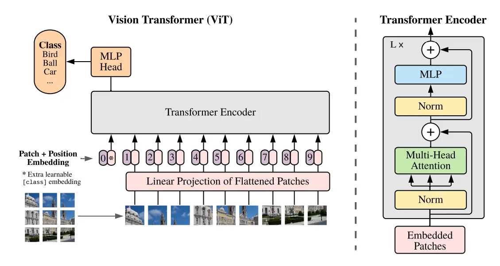
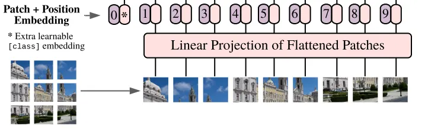
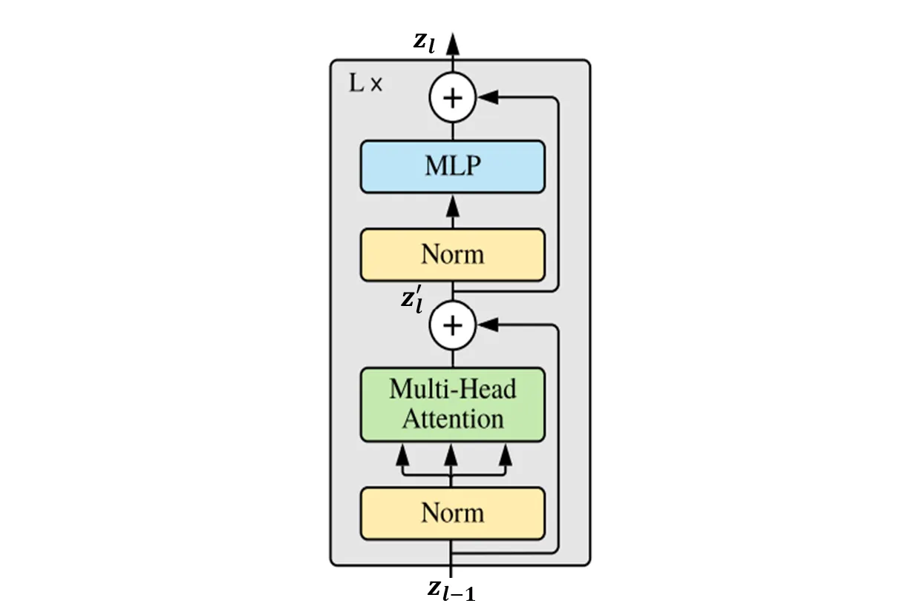
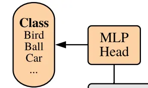
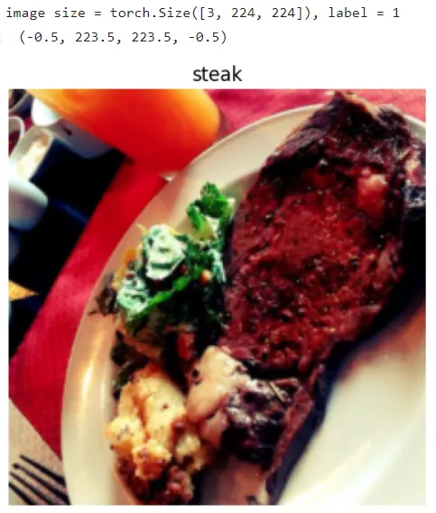
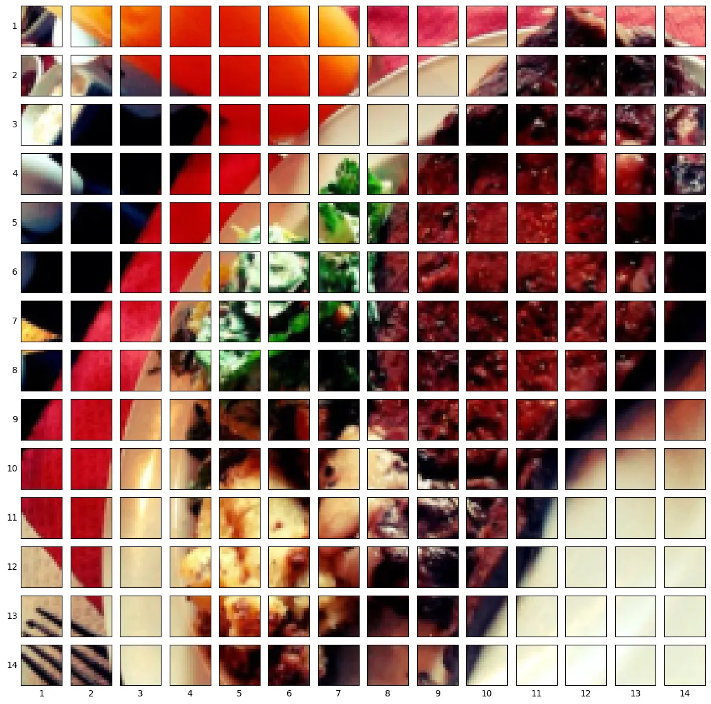

The Visual Transformer (ViT) architecture is a groundbreaking advancement in computer vision, offering a new way for machines to understand images. Unlike traditional methods that use convolutional neural networks (CNNs), Visual Transformers use self-attention mechanisms to process entire images at once. This approach captures global context and details more effectively, leading to improved performance in tasks like image classification and object detection.

In previous posts, we talked about the [attention](../attention-what-is-it-and-how-it-works/index.qmd) and the [self-attention](../from-attention-to-self-attention-and-transformers-a-mathematical-introduction/index.qmd) mechanisms. In this article, we explore the basics of the Visual Transformer architecture, which is based on the self-attention idea, by following the paper “[An image is worth 16X16 words](https://arxiv.org/pdf/2010.11929)”.

## The Visual Transformer Architecture

Let’s start by reviewing the architecture.

<figure>
  
  <figcaption>
    Model overview of ViT. Source:
    <a href="https://arxiv.org/pdf/2010.11929">
      An image is worth 16X16 words
    </a>
  </figcaption>
</figure>

In the first step, we take an image and split it into patches of $16\times 16$ pixels. More formally, we start with an image, which is a tensor of size $[H\times W\times C]$, where $H$ is the height of the image, $W$ is the width and $C$ is the number of channels ($3$ in the case of an RGB image), divide it into patches, and flatten each of them so we get $N$ vectors from the original image, each of them of size $[P^2\cdot C]$, where $[P\times P]$ is the size of the patch (for example, $16\times 16$). The number of patches, $N$, is given by $N = HW/P^2$.

Now we have $N$ vectors of size $[P^2\cdot C]$ that contain the same content as the original image (we just divided the image into patches and flattened each one of them). In the next step, we change the representation of the new vector by learning a new embedding representation. We set a dimension for the new patch embedding, $D$, and use a learnable linear transformation to map the flattened image patches into the new embedding representation. That means we map each of the $N$ vectors from the original flattened image patch of dimension $[P^2\cdot C]$ into a new vector of dimension $D$ (which can be the same dimension, $[P^2\cdot C]$).

Mathematically, we mark the flattened patch as vector $\mathbf{x}_p^i$ and the linear transformation as $\mathbf{E}$, so the embedding is given by

$$
x_p^i E; \quad x_p^i \in \mathbb{R}^{1 \times (P^2 C)}, \quad E \in \mathbb{R}^{(P^2 C) \times D}
$$

In addition to the image patch embedding, an additional embedding is added as class embedding. This embedding should represent at the output the content of the image (e.g., an image of a dog or a cat). In the final step, we use its output as input to the classification head to determine the image class, as seen in the figure above. Like the other embedding, we will learn it during training.

If you recall from the previous [post](../from-attention-to-self-attention-and-transformers-a-mathematical-introduction/index.qmd), the self-attention mechanism, upon which the transformer is built, is permutation equivariant, meaning it isn't aware of the order of the inputs. But in an image the order matters. So, we want to add **positional embedding** to the patches, so the transformers will be aware of the order of the sequence of patches.

For the positional embedding we can start with some random matrix $\mathbf{E}_{pos}$ with size $[(N+1)\times D]$ ($N$ patches + $1$ class embedding) and learn the representation for the position of the patches.

All we described so far is formulated in the paper in equation (1) as:

$$
\mathbf{z}_0 = [\mathbf{x}_{\text{class}}; \, \mathbf{x}_p^1\mathbf{E}; \, \mathbf{x}_p^2\mathbf{E}; \cdots; \, \mathbf{x}_p^N\mathbf{E}] + \mathbf{E}_{pos}, \quad \mathbf{E} \in \mathbb{R}^{(P^2 \cdot C) \times D}, \, \mathbf{E}_{pos} \in \mathbb{R}^{(N+1) \times D}
$$

The matrix $\mathbf{z}_0$ (which is the concatenation of all the image patches embedding and the class embedding with the addition of the positional embedding) is the input we will use for the transformer encoder as in the figure.

<figure>
  
</figure>

### The Transformer Encoder

The main processing of the data is performed inside the transformer encoder. This block is composed of transformer blocks with the following structure:

<figure>
  
</figure>

The inputs start with a layer norm that normalizes each of the inputs independently and is then processed by a multi-head self-attention block (MSA). We add the input of the transformer block to the output of the multi-head self-attention using skip connection and again apply layer norm. The output of the layer norm goes through an MLP and we use a skip connection once again to get the output of the whole transformer block. This process repeats itself for $L$ such blocks. If we mark the number of the transformer block as $l$, where $l$ goes from $1$ to $L$ we can write the following formulas to describe the transformer block.

$$
\begin{aligned} \mathbf{z}'_\ell &= \text{MSA}(\text{LN}(\mathbf{z}_{\ell-1})) + \mathbf{z}_{\ell-1}, \quad &\ell = 1 \dots L \\ \mathbf{z}_\ell &= \text{MLP}(\text{LN}(\mathbf{z}'_\ell)) + \mathbf{z}'_\ell, \quad &\ell = 1 \dots L \end{aligned}
$$

After all $L$ transformer blocks, we will take the output of the $0$-th index and apply once more layer normalization to get the final output of the transformer encoder.

$$
\mathbf{y} = \text{LN}(\mathbf{z}_L^0)
$$

Finally, we insert the output $\mathbf{y}$ into the classification MLP head to determine the class of the image.

<figure>
  
</figure>

And that’s it! Now it is time to code it by ourselves.

## Let’s Code It

In this section, we will implement and train a visual transformer. We will be based on the original paper “[An image is worth 16X16 words](https://arxiv.org/pdf/2010.11929)” together with this [blog](https://www.learnpytorch.io/08_pytorch_paper_replicating/#1-get-data).

A full notebook can be found [here](https://github.com/dorzv/ComputerVision/blob/master/vision_transformer/ViT.ipynb).

Let’s start with some basic imports.

```python
import torch
from torch import nn
from torch.utils.data import DataLoader
from torchvision import transforms
from torchvision.datasets import ImageFolder
import matplotlib.pyplot as plt
```

and we also install torchinfo which is a tool that let us see the structure of the network easily.

```python
! pip install -q torchinfo
import torchinfo
```

Also, we set the device to use (either a GPU or a CPU in a case where a GPU isn’t available).

```python
device = 'cuda' if torch.cuda.is_available() else 'cpu'
```

### The Data

Next, we want to get images to work with and arrange them so we can use them to train the network. The first step will be to get the data, and for that, we will write a function that downloads the data and unzips it.

```python
import os
import zipfile
import requests 

def download_data(source_link, destination_folder, remove_zip=True):
  """
  A function to get a zip of data from a web, download it and unzip it into a
  folder. Can remove the zip after extraction.

  Args:
    source_link (str): a link to the zip file.
    destination_folder (str): the name of the folder where the zip will be 
      extracted.
    remove_zip (bool): whether to remove the zip after extraction or not. 
      Default is True.
  
  Return:
    (str): path to the destination folder
  """

  image_path = os.path.join('data', destination_folder)
  target_path = os.path.join('data', os.path.basename(source_link))
  if os.path.isdir(image_path):
    print('Folder already exists. Skipping download')
    return image_path
  
  # Download zip
  os.makedirs(image_path)
  with open(target_path, 'wb') as file:
    request = requests.get(source_link)
    print('Downloading zip file...')
    file.write(request.content)
  
  with zipfile.ZipFile(target_path, 'r') as zip_file:
    print('Unzipping...')
    zip_file.extractall(image_path)

  if remove_zip:
    os.remove(target_path)
  
  return image_path
```

As in the original post, we are going to use a dataset that contains images of pizzas, steaks, and sushi, and can be found [here](https://github.com/mrdbourke/pytorch-deep-learning/tree/main/data). Using the previous function we can download it and set variables for the train and test data folders.

```python
image_folder = download_data("https://github.com/mrdbourke/pytorch-deep-learning/raw/main/data/pizza_steak_sushi.zip", "pizza_steak_sushi")
train_data_path = os.path.join(image_folder, 'train')
test_data_path = os.path.join(image_folder, 'test')
```

As we work with PyTorch, we want to use a Dataset to handle our data. Because we use a very simple dataset we are not required to implement a Dataset class by ourselves, but can use instead the ImageFolder class from torchvision. This class is a generic dataset for images organized in a directory structure, where images are stored in subdirectories representing different classes.

```text
root/
├── class1/
│   ├── img1.png
│   ├── img2.png
│   └── ...
├── class2/
│   ├── img1.png
│   ├── img2.png
│   └── ...
```

The ImageFolder class will return us an image together with its label (class) according to the folder's structure, without the need for us to define anything.

We want to apply some transformations to the images, so we define transforms and pass them too as input to the ImageFolder class.

```python
transformation = transforms.Compose([
    transforms.Resize((224, 224)),
    transforms.ToTensor()
])

# create Datasets
train_dataset = ImageFolder(train_data_path, transformation)
test_dataset = ImageFolder(test_data_path, transformation)
```

The labels will be sorted alphabetically and can be seen using

```python
classes_name = train_dataset.classes
```

In our case label 0 is pizza, 1 is steak, and 2 is sushi.

After creating datasets for the train and the test data, we can create a DataLoader based on them.

```python
train_dataloader = DataLoader(train_dataset, batch_size=32, shuffle=True, 
                              num_workers=os.cpu_count(), pin_memory=True)
test_dataloader = DataLoader(test_dataset, batch_size=32, shuffle=False,
                             num_workers=os.cpu_count(), pin_memory=True)
```

We can check ourselves and visualize a sample from the dataset.

```python
# see an example of image
image_batch, label_batch = next(iter(train_dataloader))
image = image_batch[0]
label = label_batch[0]
print(f'image size = {image.shape}, label = {label}')
image_permute = image.permute(1, 2, 0)
plt.imshow(image_permute)
plt.title(classes_name[label])
plt.axis(False)
```

<figure>
  
</figure>

To better understand the patching we previously discussed, we can visualize the image as patches of 16 by 16 pixels.

```python
# visualize image as patches
image_size = image_permute.shape[0]
patch_size = 16
num_of_patches = image_size // patch_size
if image_size % patch_size != 0:
  raise ValueError("Image size must be divisible by patch size")

fig, axes = plt.subplots(nrows=num_of_patches, ncols=num_of_patches, 
                       figsize=(num_of_patches, num_of_patches), sharex=True,
                       sharey=True)

# plot each patch in a subplot
for ii, patch_height in enumerate(range(0, image_size, patch_size)):
  for jj, patch_width in enumerate(range(0, image_size, patch_size)):
    axes[ii, jj].imshow(image_permute[patch_height:patch_height+patch_size,
                                          patch_width:patch_width+patch_size,
                                          :])
    
    # set labels
    axes[ii, jj].set_ylabel(ii+1, rotation="horizontal",
                            horizontalalignment="right", 
                            verticalalignment="center") 
    axes[ii, jj].set_xlabel(jj+1)
    axes[ii, jj].set_xticks([])
    axes[ii, jj].set_yticks([])
    axes[ii, jj].label_outer()
```

<figure>
  
</figure>

### The Network

Now, it’s the time to build the network. We will build building blocks first, and then use them to build the visual transformer. Let’s start with the block that takes an image, divides it into patches, and transforms them into embedded representation.

```python
class PatchEmbedding(nn.Module):
  """
  Convert a 2D image into a sequence of 1D vector of embedding representation
  of patches on the image.
  
  Args:
    in_channel (int): the number of channels of the input image (default 3)
    patch_size (int): the size of each patch of the image (default 16)
    embedding_size (int): the size of the embedding vector (default 768)
  """
  def __init__(self, in_channels=3, patch_size=16, embedding_size=768):
    super().__init__()

    self.patch_size = patch_size

    self.patcher = nn.Conv2d(in_channels, embedding_size, patch_size, stride=patch_size)
    self.flatten = nn.Flatten(start_dim=2, end_dim=3)

  def forward(self, x):
    image_size = x.shape[-1]
    if image_size % self.patch_size != 0:
      raise ValueError(f'Patch size {self.patch_size} is not compatible with the image size {image_size}')
    
    x_patched = self.patcher(x)
    x_flatten = self.flatten(x_patched)

    return x_flatten.permute((0, 2, 1))
```

We use 2D convolution with a kernel of the size of the patch (with the same stride size) to divide the image into patches, and set the output number of channels to be the embedding size. Then, we flatten the spatial shape of the result to get 1D vectors of the embedding size. Before we return the result, we permute the result so the embedding dimension will be the last one.

We can check our block with the following code.

```python
patch_size = 16
print(f'Image tensor shape is {image.shape}')
height, width = image.shape[1:3]

# Add batch dimension
x = image.unsqueeze(0)

patch_embedding_layer = PatchEmbedding(in_channels=3, patch_size=patch_size, embedding_size=768)
patch_embedding = patch_embedding_layer(x)
print(f'Patch embedding shape is {patch_embedding.shape}')


###########  Print ###########
"""
Image tensor shape is torch.Size([3, 224, 224])
Patch embedding shape is torch.Size([1, 196, 768])
"""
```

In addition to the patch embedding, we want to add the class embedding. We initialize this embedding randomly and set it as PyTorch parameters so our network can learn it by itself. Finally, we concatenate the class embedding and the patch embedding.

```python
class_token = nn.Parameter(torch.randn(patch_embedding.shape[0], 1, patch_embedding.shape[-1]),
                          requires_grad=True)
print(f'Class token embedding shape is {class_token.shape}')

# Append the class token embedding to the patches embedding
patch_embedding_with_class_embedding = torch.cat((class_token, patch_embedding), dim=1)
print(f'Class token embedding with patch embedding shape is {patch_embedding_with_class_embedding.shape}')

###########  Print ###########
"""
Class token embedding shape is torch.Size([1, 1, 768])
Class token embedding with patch embedding shape is torch.Size([1, 197, 768])
"""
```

Similarly, we initialize the position embedding, but this time we add it to the other embeddings.

```python
# Position embedding
position_embedding = nn.Parameter(torch.randn_like(patch_embedding_with_class_embedding),
                                  requires_grad=True)

# Add the position embedding to the patches embedding
patch_and_position_embedding = patch_embedding_with_class_embedding + position_embedding
print(f"Patch and position embedding shape is {patch_and_position_embedding.shape}")

###########  Print ###########
"""
Patch and position embedding shape is torch.Size([1, 197, 768])
"""
```

Next, we write the multihead self-attention block. PyTorch already implements this kind of block, so we don’t need to write it by ourselves. Instead, we just wrap the PyTorch block with our class so it also includes layer norm block.

```python
class MultiheadSelfAttentionBlock(nn.Module):
  """
  Create a multihead self attention block with layer normalization
  Args:
    embedding_dim (int): the hidden size - D
    num_heads (int): number of heads for the multihead self attention
    dropout (float): dropout probability 
  """

  def __init__(self, embedding_dim=768, num_heads=12, dropout=0):
      super().__init__()
      self.layer_norm = nn.LayerNorm(normalized_shape=embedding_dim)
      self.multihead_attention = nn.MultiheadAttention(embed_dim=embedding_dim,
                                                       num_heads=num_heads,
                                                       dropout=dropout,
                                                       batch_first=True)
  
  def forward(self, x):
    x = self.layer_norm(x)
    attention_output, _ = self.multihead_attention(query=x, key=x, value=x, need_weights=False)

    return attention_output
```

We also need to write the MLP block that will be used in the transformer encoder. Pay attention it also contains the second layer norm of the encoder.

```python
class MLPBlock(nn.Module):
  """
  Create a multilayer perceptron block with layer normalization

  Args:
    embedding_dim (int): the hidden size - D, used as input and output size
    mlp_size (int): the dimension of the hidden layer
    dropout (float): dropout probability 
  """

  def __init__(self, embedding_dim=768, mlp_size=3072, dropout=0.1):
    super().__init__()
    self.layer_norm = nn.LayerNorm(normalized_shape=embedding_dim)
    self.mlp = nn.Sequential(
        nn.Linear(embedding_dim, mlp_size),
        nn.GELU(),
        nn.Dropout(dropout),
        nn.Linear(mlp_size, embedding_dim),
        nn.Dropout(dropout)
    )

  def forward(self, x):
    x = self.layer_norm(x)
    x = self.mlp(x)
    return x
```

With the self-attention block and the MLP, we can write the transformer encoder block.

```python
class TransformerEncoderBlock(nn.Module):
  """
  Create the transformer encoder block

  Args:
    embedding_dim (int): the hidden size - D
    num_heads (int): number of heads for the multihead self attention
    mlp_size (int): the dimension of the hidden layer
    attention_dropout (float): dropout probability for the MSA 
    mlp_dropout (float): dropout probability for the MLP
  """

  def __init__(self, embedding_dim=768, num_heads=12, mlp_size=3072,
               attention_dropout=0, mlp_dropout=0.1):
    super().__init__()
    self.msa_block = MultiheadSelfAttentionBlock(embedding_dim=embedding_dim,
                                                 num_heads=num_heads,
                                                 dropout=attention_dropout)
    self.mlp_block = MLPBlock(embedding_dim=embedding_dim,
                              mlp_size=mlp_size,
                              dropout=mlp_dropout)
    
  def forward(self, x):
    x = self.msa_block(x) + x 
    x = self.mlp_block(x) + x
    return x
```

And now we are finally ready to write the visual transformer.

```python
class ViT(nn.Module):
  """
  Create a Visual Transformer. The default values of the hyperparameters are
  as of ViT-Base

  Args:
    img_size (int): image resolution. Default is 224 as in Table 3 in ViT paper
    in_channel (int): the number of channels of the input image. Default 3
    patch_size (int): the size (height and width) of the patch. Default 16
    num_transformer_layers (int): The number of transformers layers. Default is
      12 as in Table 1 in ViT paper for ViT base
    embedding_dim (int): hidden size D. Default is 768 as in Table 1 in ViT
      paper for ViT-Base
    mlp_size (int): MLP size. Default is 3072 as in Table 1 in ViT paper for ViT
      -Base
    num_heads (int): number of heads for the multihead self attention blocks.
      Default is 12 as in Table 1 in ViT paper for ViT-Base
    attention_dropout (float): dropout probability for the MSA block
    mlp_dropout (float): dropout probability for the MLP block
    embedding_dropout (float): dropout probability for patch and position
      embeddings
    num_classes (int): number of classes in the output. Default is 1000 as in 
      ImageNet
  """

  def __init__(self, 
               img_size=224,
               in_channels=3,
               patch_size=16,
               num_transformer_layers=12,
               embedding_dim=768, 
               mlp_size=3072,
               num_heads=12, 
               attention_dropout=0,
               mlp_dropout=0.1, 
               embedding_dropout=0.1,
               num_classes=1000):
    super().__init__()

    if img_size % patch_size != 0:
      raise ValueError(f"Image size must be divisible by patch size, image size: {img_size}, patch size: {patch_size}.")

    self.num_patches = img_size ** 2 // patch_size ** 2
    
    # Create learnable class embedding (needs to go at front of sequence of patch embeddings)
    self.class_embedding = nn.Parameter(data=torch.randn(1, 1, embedding_dim),
                                        requires_grad=True)
    
    # Create learnable position embedding
    self.position_embedding = nn.Parameter(
        data=torch.randn(1, self.num_patches+1, embedding_dim),
        requires_grad=True)
    
    self.embedding_dropout = nn.Dropout(embedding_dropout)

    self.patch_embedding = PatchEmbedding(in_channels=in_channels,
                                          patch_size=patch_size,
                                          embedding_size=embedding_dim)
    
    self.transformer_encoder = nn.Sequential(
        *[TransformerEncoderBlock(embedding_dim=embedding_dim,
                                  num_heads=num_heads,
                                  mlp_size=mlp_size,
                                  attention_dropout=attention_dropout,
                                  mlp_dropout=mlp_dropout) 
         for _ in range(num_transformer_layers)]
         )
    
    self.classifier = nn.Sequential(
            nn.LayerNorm(normalized_shape=embedding_dim),
            nn.Linear(in_features=embedding_dim, 
                      out_features=num_classes)
        )
    
  def forward(self, x):
    batch_size = x.shape[0]
    class_token = self.class_embedding.expand(batch_size, -1, -1)
    
    x = self.patch_embedding(x)
    x = torch.cat((class_token, x), dim=1)
    x = self.position_embedding + x
    x = self.embedding_dropout(x)
    x = self.transformer_encoder(x)
    x = self.classifier(x[:, 0])

    return x
```

The visual transformer is built as we describe in the first section, but you can see we also added dropout to the embedding to improve the generalization of the network.

If you want to better understand the structure of the visual transformer we wrote, you can use `torchinfo` to output the structure

```python
from torchinfo import summary
vit = ViT(num_classes=len(classes_name))

summary(model=vit, 
        input_size=(32, 3, 224, 224), # (batch_size, color_channels, height, width)
        col_names=["input_size", "output_size", "num_params", "trainable"],
        col_width=20,
        row_settings=["var_names"]
 )
```

```text
=================================================================================================================================================
Layer (type (var_name))                                           Input Shape          Output Shape         Param #              Trainable
=================================================================================================================================================
ViT (ViT)                                                         [32, 3, 224, 224]    [32, 3]              152,064              True
├─PatchEmbedding (patch_embedding)                                [32, 3, 224, 224]    [32, 196, 768]       --                   True
│    └─Conv2d (patcher)                                           [32, 3, 224, 224]    [32, 768, 14, 14]    590,592              True
│    └─Flatten (flatten)                                          [32, 768, 14, 14]    [32, 768, 196]       --                   --
├─Dropout (embedding_dropout)                                     [32, 197, 768]       [32, 197, 768]       --                   --
├─Sequential (transformer_encoder)                                [32, 197, 768]       [32, 197, 768]       --                   True
│    └─TransformerEncoderBlock (0)                                [32, 197, 768]       [32, 197, 768]       --                   True
│    │    └─MultiheadSelfAttentionBlock (msa_block)               [32, 197, 768]       [32, 197, 768]       2,363,904            True
│    │    └─MLPBlock (mlp_block)                                  [32, 197, 768]       [32, 197, 768]       4,723,968            True
│    └─TransformerEncoderBlock (1)                                [32, 197, 768]       [32, 197, 768]       --                   True
│    │    └─MultiheadSelfAttentionBlock (msa_block)               [32, 197, 768]       [32, 197, 768]       2,363,904            True
│    │    └─MLPBlock (mlp_block)                                  [32, 197, 768]       [32, 197, 768]       4,723,968            True
│    └─TransformerEncoderBlock (2)                                [32, 197, 768]       [32, 197, 768]       --                   True
│    │    └─MultiheadSelfAttentionBlock (msa_block)               [32, 197, 768]       [32, 197, 768]       2,363,904            True
│    │    └─MLPBlock (mlp_block)                                  [32, 197, 768]       [32, 197, 768]       4,723,968            True
│    └─TransformerEncoderBlock (3)                                [32, 197, 768]       [32, 197, 768]       --                   True
│    │    └─MultiheadSelfAttentionBlock (msa_block)               [32, 197, 768]       [32, 197, 768]       2,363,904            True
│    │    └─MLPBlock (mlp_block)                                  [32, 197, 768]       [32, 197, 768]       4,723,968            True
│    └─TransformerEncoderBlock (4)                                [32, 197, 768]       [32, 197, 768]       --                   True
│    │    └─MultiheadSelfAttentionBlock (msa_block)               [32, 197, 768]       [32, 197, 768]       2,363,904            True
│    │    └─MLPBlock (mlp_block)                                  [32, 197, 768]       [32, 197, 768]       4,723,968            True
│    └─TransformerEncoderBlock (5)                                [32, 197, 768]       [32, 197, 768]       --                   True
│    │    └─MultiheadSelfAttentionBlock (msa_block)               [32, 197, 768]       [32, 197, 768]       2,363,904            True
│    │    └─MLPBlock (mlp_block)                                  [32, 197, 768]       [32, 197, 768]       4,723,968            True
│    └─TransformerEncoderBlock (6)                                [32, 197, 768]       [32, 197, 768]       --                   True
│    │    └─MultiheadSelfAttentionBlock (msa_block)               [32, 197, 768]       [32, 197, 768]       2,363,904            True
│    │    └─MLPBlock (mlp_block)                                  [32, 197, 768]       [32, 197, 768]       4,723,968            True
│    └─TransformerEncoderBlock (7)                                [32, 197, 768]       [32, 197, 768]       --                   True
│    │    └─MultiheadSelfAttentionBlock (msa_block)               [32, 197, 768]       [32, 197, 768]       2,363,904            True
│    │    └─MLPBlock (mlp_block)                                  [32, 197, 768]       [32, 197, 768]       4,723,968            True
│    └─TransformerEncoderBlock (8)                                [32, 197, 768]       [32, 197, 768]       --                   True
│    │    └─MultiheadSelfAttentionBlock (msa_block)               [32, 197, 768]       [32, 197, 768]       2,363,904            True
│    │    └─MLPBlock (mlp_block)                                  [32, 197, 768]       [32, 197, 768]       4,723,968            True
│    └─TransformerEncoderBlock (9)                                [32, 197, 768]       [32, 197, 768]       --                   True
│    │    └─MultiheadSelfAttentionBlock (msa_block)               [32, 197, 768]       [32, 197, 768]       2,363,904            True
│    │    └─MLPBlock (mlp_block)                                  [32, 197, 768]       [32, 197, 768]       4,723,968            True
│    └─TransformerEncoderBlock (10)                               [32, 197, 768]       [32, 197, 768]       --                   True
│    │    └─MultiheadSelfAttentionBlock (msa_block)               [32, 197, 768]       [32, 197, 768]       2,363,904            True
│    │    └─MLPBlock (mlp_block)                                  [32, 197, 768]       [32, 197, 768]       4,723,968            True
│    └─TransformerEncoderBlock (11)                               [32, 197, 768]       [32, 197, 768]       --                   True
│    │    └─MultiheadSelfAttentionBlock (msa_block)               [32, 197, 768]       [32, 197, 768]       2,363,904            True
│    │    └─MLPBlock (mlp_block)                                  [32, 197, 768]       [32, 197, 768]       4,723,968            True
├─Sequential (classifier)                                         [32, 768]            [32, 3]              --                   True
│    └─LayerNorm (0)                                              [32, 768]            [32, 768]            1,536                True
│    └─Linear (1)                                                 [32, 768]            [32, 3]              2,307                True
=================================================================================================================================================
Total params: 85,800,963
Trainable params: 85,800,963
Non-trainable params: 0
Total mult-adds (G): 5.52
=================================================================================================================================================
Input size (MB): 19.27
Forward/backward pass size (MB): 3292.20
Params size (MB): 229.20
Estimated Total Size (MB): 3540.67
=============================================================================================================================================
```

All we have to do now is to train the model. For that, we will build a training loop.

```python
# train the model
optimizer = torch.optim.Adam(vit.parameters(), lr=3e-3, betas=(0.9, 0.999),
                             weight_decay=0.3)
loss_fn = torch.nn.CrossEntropyLoss()

epochs = 10

vit.to(device)

train_loss = []
train_acc = []
test_loss = []
test_acc = []

for epoch in range(epochs):
  vit.train()
  train_step_loss = 0
  train_step_acc = 0

  for batch_ii, (images_batch, labels_batch) in enumerate(train_dataloader):
    images_batch = images_batch.to(device)
    labels_batch = labels_batch.to(device)

    labels_predictions = vit(images_batch)
    loss = loss_fn(labels_predictions, labels_batch)
    train_step_loss += loss.item()
    train_step_acc += torch.sum(
        torch.argmax(labels_predictions, dim=1) == labels_batch
        ) / len(labels_batch)

    optimizer.zero_grad()
    loss.backward()
    optimizer.step()

  train_step_loss = train_step_loss / len(train_dataloader)
  train_step_acc = train_step_acc / len(train_dataloader)

  test_step_loss = 0
  test_step_acc = 0

  vit.eval()
  with torch.inference_mode():
    for batch_ii, (images_batch, labels_batch) in enumerate(test_dataloader):
      images_batch = images_batch.to(device)
      labels_batch = labels_batch.to(device)

      labels_predictions = vit(images_batch)
      loss = loss_fn(labels_predictions, labels_batch)
      test_step_loss += loss.item()
      test_step_acc += torch.sum(
        torch.argmax(labels_predictions, dim=1) == labels_batch
        ) / len(labels_batch)
    
  test_step_loss = test_step_loss / len(test_dataloader)
  test_step_acc = test_step_acc / len(test_dataloader)

  print(
  f"Epoch: {epoch+1} | "
  f"train_loss: {train_step_loss:.4f} | "
  f"train_accuracy: {train_step_acc:.4f} | "
  f"test_loss: {test_step_loss:.4f} | "
  f"test_accuracy: {test_step_acc:.4f}"
  )

  train_loss.append(train_step_loss)
  train_acc.append(train_step_acc)
  test_loss.append(test_step_loss)
  test_acc.append(test_step_acc)
```

## Conclusion

The Visual Transformer architecture introduces a powerful new approach to computer vision by using self-attention mechanisms instead of traditional CNNs. This allows for a better understanding of global context and details in images. By treating images as sequences of patches, ViT enhances performance in tasks like image classification. We saw the architecture of the visual transformer, understood its basic ideas and components, and finally implemented and trained the basic version of it.